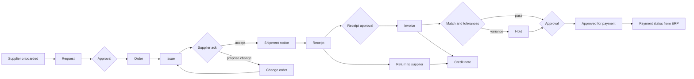
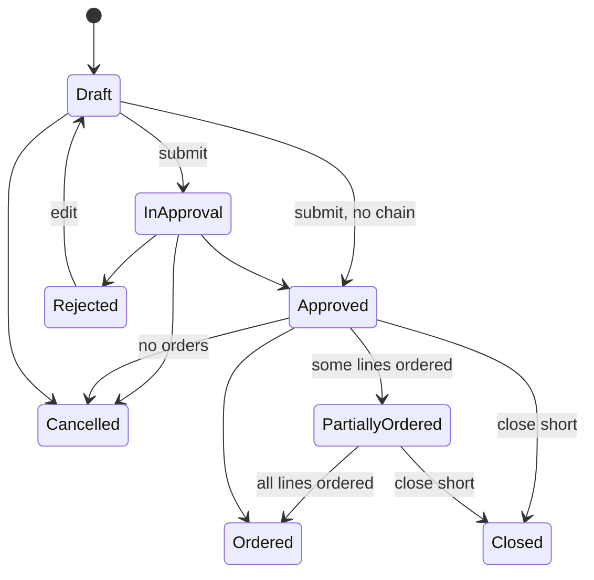
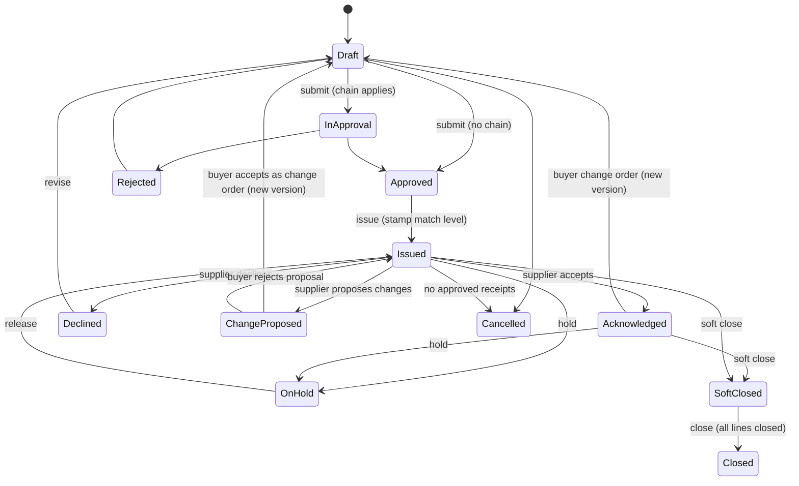
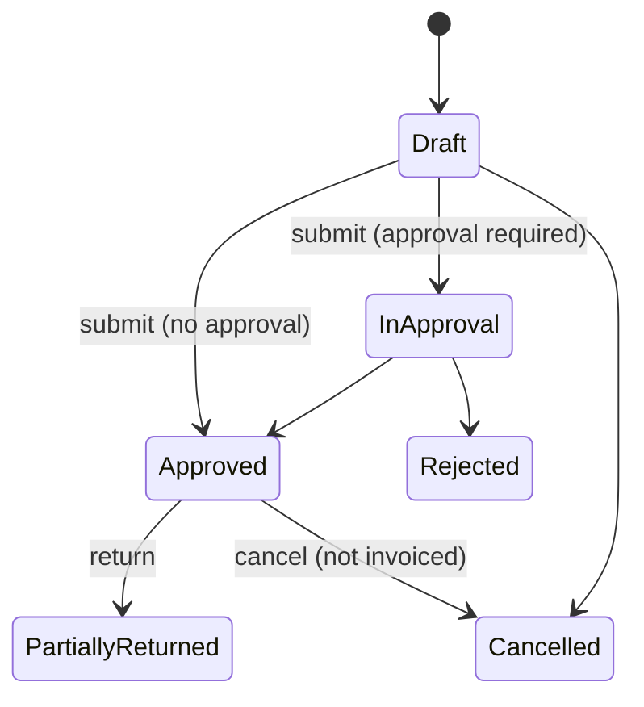
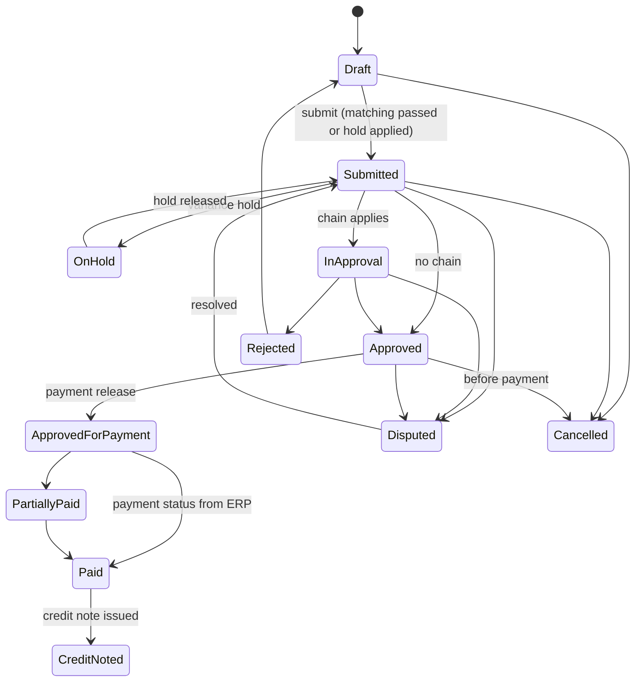
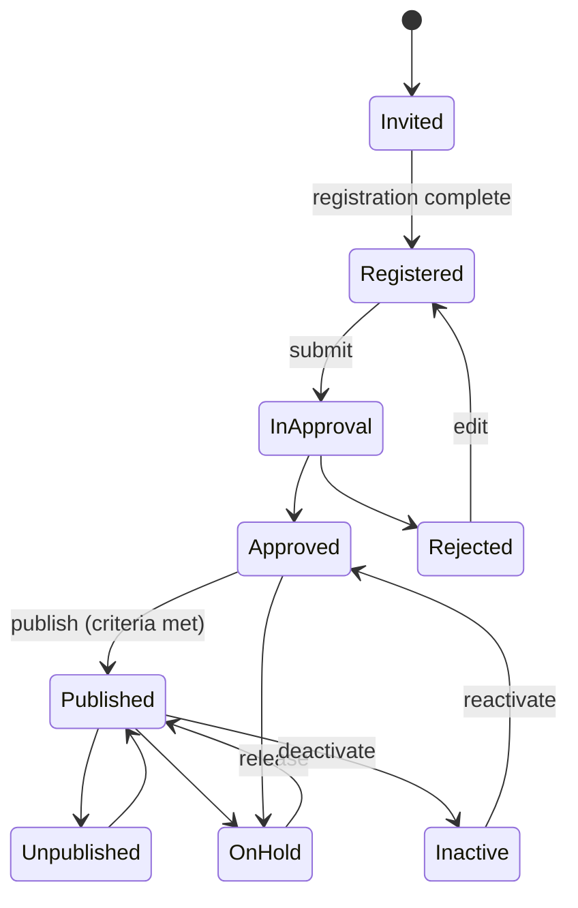

# Foundation: Functional Foundation PRD for Procure-to-Pay

## 0. Document control

| Item | Value |
|---|---|
| Document title | Procure-to-Pay on Foundation: Functional Product Requirements Document |
| Product code namespaces | `Procurement.Finance`, `Procurement.Suppliers`, `Procurement.Catalogue`, `Procurement.Requests`, `Procurement.Orders`, `Procurement.Receiving`, `Procurement.Payables`, `Procurement.Contracts` with database schemas `finance`, `suppliers`, `catalogue`, `requests`, `orders`, `receiving`, `payables`, `contracts` |
| Version | 1.2 DRAFT for review (decisions of 2026-10-17, second round, applied) |
| Date | 2026-10-17 |
| Status | Draft. Written for joint development. Decisions confirmed on 2026-10-17 are listed in section 10.1; remaining open points in section 10.2. |
| Inputs | The anonymised reverse-engineered PRD of the current procurement platform (242 functional requirements, 67 rules, state machines, defects and open questions), the Technical Foundation PRD (companion), the product owner's decisions of 2026-10-17, and the industry research basis in section 2.4 (process frameworks, standards, benchmarks and leading products). The team's current knowledge is a starting point; the research basis sets the bar. |
| Dependency | Every cross-cutting need (identity, roles, approvals, audit, files, notifications, numbering, custom fields, imports, telemetry, organisation ownership and sharing) is a Foundation capability referenced by its TF-ID. This document never re-specifies them. |
| Tags | `[Carried]` behaviour from the current product that stays. `[Improved]` carried but changed to close a defect or gap. `[New]` not in the current product; standard practice. `[Decision]` needs your confirmation. `[Later]` recorded, not in version 1. |

Change log: 1.0 DRAFT, 2026-10-17, first full draft. 1.2 DRAFT, 2026-10-17, second round: Supplier Network experience (one portal for all suppliers of all customers) replaces the per-tenant supplier portal; process reference and research basis made a binding area with the industry frameworks and standards to use; intercompany design hooks; scale notes for very large buyers. 1.1 DRAFT, 2026-10-17, decisions applied: all twelve functional decisions confirmed; new area "Organisation separation" (business units) with ten requirements built into the first slice; non-order invoice policy at tenant and supplier level; receipt approval designed for later per-unit, per-supplier and per-category control; Indian GST as an accelerator pack; country accelerator pack mechanism.

## 1. Vision and goals

### 1.1 Vision

A procure-to-pay product that an enterprise can run end to end with its suppliers: controlled demand (requests with budget), compliant ordering (approved orders to approved suppliers), reliable receiving, and invoice matching that pays the right amount once. Suppliers work in their own portal on the same records. Everything is configurable per tenant and traceable per record. Sourcing events, auctions and expenses are separate products that will reuse this product's masters later.

### 1.2 Goals (outcomes)

1. Every purchase goes through a request, an approval and an order; no spend outside the system for in-scope categories.
2. Invoices are matched to orders and receipts automatically; a first-pass match rate of at least 85% for order-based invoices.
3. Suppliers self-serve: onboarding, order acknowledgement, shipment notices, invoices and catalogues, with a target of 70% of orders acknowledged in the portal within 3 days.
4. Finance has real-time budget consumption and accruals (received not invoiced) without spreadsheets.
5. Every control (approval limits, tolerances, duplicate checks, segregation of duties) is configuration, audited and provable to an auditor.
6. A new tenant with masters loaded can raise its first request within one day of provisioning.
7. A group of companies runs all its business units (organisations) in one tenant with separated master data, operations and visibility where they want separation, and shared where they want sharing, without any module needing rework later.
8. A supplier registers once, works with every customer from one portal, and finds every order, notice, invoice and query across customers in one inbox.
9. The product works for the largest global buyers: tens of thousands of users, tens of thousands of suppliers, hundreds of millions of documents over its life, on a dedicated deployment when required.

### 1.3 Lessons from the current product that shape this document

Keep (carried): the end-to-end flow and its documents; account-string splits with budget periods; budget blocking or warning per document type; configurable match levels per supplier and chart of account stamped on order lines; tolerances by value or percentage; multi-channel order issue; supplier acknowledgement; GRN pending quantity counting in-progress receipts; invoice types (order-based, receipt-based, non-order, proforma, credit); supplier portal for orders, shipment notices, invoices and catalogues; catalogue revisions accepted by the buyer.

Improve (defects and gaps found): atomic quantity and budget checks; duplicate supplier invoice number check; closure flags per order line and close-short; credit notes that reverse consumption; price-variance hold instead of hard block when configured; return-to-supplier documents; order change versions with re-acknowledgement; supplier ownership on every portal operation; one rule implementation for both surfaces; warehouse maintenance screen; explicit behaviour for every state transition; approval reminders and escalation; accrual report built on consumption buckets.

## 2. Scope

### 2.1 Modules in version 1

| Module | Schema | Content |
|---|---|---|
| Finance masters | `finance` | Chart of accounts and segments, account strings, budgets (periods, lines, consumption, adjustments), fiscal calendar, currencies and exchange rates with revisions, tax codes and classifications, units of measure, categories and commodities, payment and shipping terms, legal entities (as Foundation organisation units with finance attributes) |
| Suppliers | `suppliers` | Invitation, registration, master data, approval and publishing, status control, addresses, contacts, sites, bank accounts, documents and compliance with expiry, questionnaires, duplicate detection, performance indicators, portal ownership |
| Catalogue | `catalogue` | Items, supplier items, supplier catalogues and revisions, publishing, browse and cart, contract pricing |
| Requests | `requests` | Purchase requests with lines and lots, account splits, exchange rates, submission validations, approvals, budget check, conversion to orders, cancellation, copy, templates |
| Orders | `orders` | Purchase orders, templates and rendering, change approval, match-level stamping, issue by channel, supplier acknowledgement, change orders with versions, hold, soft close, close, cancel, line closure flags |
| Receiving | `receiving` | Advance shipment notices, goods receipt notes with inspection, pending quantity and tolerance checks, approvals, returns to supplier, received and invoiced buckets, warehouses |
| Payables | `payables` | Invoices of all types, lines, taxes, charges, splits, matching and tolerances, duplicate check, holds, approvals, disputes, cancellation, credit notes, payment status from the ERP, accruals, supplier portal invoicing, invoice capture suggestions |
| Contracts | `contracts` | Contract repository, items and pricing, publishing, consumption against orders, expiry and renewal alerts |
| Supplier portal | (uses the modules above) | Supplier-facing screens built on the Foundation shell with record policies for ownership |
| Reporting | (views) | Operational reports and exports; analytics feeds |

### 2.2 Organisation (business unit) separation

Indian and Asian customers very often run several business units (they call them organisations) in one company and require separation of master data, operations and data visibility by unit, with sharing where it helps. This is built into the functional foundation so that no module suffers later:

- Every master record and document carries an owning organisation and a sharing mode (private, shared with listed organisations, global) through the Foundation pattern (TF-220). The organisation tree, role scopes and the organisation switcher are Foundation capabilities (TF-034, TF-222).
- Finance masters: chart of accounts, account strings, budgets and fiscal calendars belong to a legal entity; a legal entity is an organisation with legal attributes; a business unit may sit under a legal entity and use its chart of accounts.
- Suppliers: one supplier master per tenant (so a supplier registers once), enabled per organisation with organisation-specific terms, status and approval; a private supplier is visible only to its owner.
- Items and categories: global by default; organisation-specific items, supplier items and prices allowed; catalogues and contracts published per organisation or shared.
- Documents (requests, orders, receipts, invoices, contracts) belong to the organisation of the requester or buyer; cross-organisation documents are not allowed in version 1 (intercompany is a later feature); visibility follows organisation access.
- Configuration per organisation: numbering, templates, approval configurations, tolerances and settings can override the tenant values (TF-221).
- Reporting: per organisation, and consolidated for group roles with children included.

Requirements FF-180 to FF-189 define this area; they are in the first product slice.

### 2.3 Supplier Network: one portal for all suppliers

The supplier side is not a screen set inside each customer's tenant. It is the Supplier Network, one portal for all suppliers of all customers (Technical Foundation section 3.6, TF-230 to TF-239). What this means for this product:

- A supplier registers once in the network. A customer invites the supplier; the network matches or creates the supplier organisation; the supplier accepts the connection. Inside the customer's tenant the supplier record is linked to the network organisation and enabled per organisation (FF-182).
- The supplier maintains one profile (company data, addresses, contacts, bank accounts, documents). Each customer accepts proposed changes through its own approval and verification rules. Customer-specific values (terms, status, preferred flag) stay with the customer.
- Orders, shipment notices, receipts, invoices, credit notes, contracts, questionnaires and tasks live only in the customer's tenant. The network keeps a minimal action index so the supplier sees one inbox across customers and opens any item in the customer's context with a delegated token.
- Supplier screens in this product are portal views served through the network: order and acknowledgement, shipment notice, receipt view, invoice entry with validations, catalogue upload, questionnaires, tasks, company data. They look the same for every customer, show the customer's name, organisation and terms, and apply the customer's rules.
- Buyers invite, enable, hold and end relationships from the tenant; they see only their own relationship with the supplier.

Requirements FF-190 to FF-197 define the supplier experience; FF-150 to FF-159 describe the portal screens that the network serves.

### 2.4 Process reference and research basis (binding)

The functional foundation and every module are grounded in industry research and process documentation before design (Technical Foundation P17, TF-240). The references for procure-to-pay:

| Reference | Use in this product |
|---|---|
| APQC Process Classification Framework, category 4 "Procure materials and services" (4.1 to 4.4) and category 9 "Manage financial resources" for payables | Process map backbone; every requirement maps to a PCF activity |
| CIPS (Chartered Institute of Procurement and Supply) and ISM (Institute for Supply Management) practice guides; The Hackett Group procurement benchmarks | Control points, segregation of duties, performance indicators and target values (first-pass match, cycle times, cost per order) |
| Peppol BIS Billing 3.0, UBL 2.1 (order, order response, despatch advice, receipt advice, invoice, credit note), UN/CEFACT cross-industry invoice | Document field models and e-invoicing readiness; mandatory fields present or excluded with reason |
| UNSPSC for categories and commodities; GS1 (GTIN, GLN) for item and location identifiers; ISO 4217 currencies; ISO 8601 dates; UN/LOCODE locations; ISO 20022 for payment status messages; Incoterms 2020 for shipping terms | Reference data and identifier formats |
| GSTN rules for Indian GST and e-invoicing (accelerator pack); EU VAT directive principles for later packs | Country accelerator packs |
| Leading products studied for capability parity and gaps (enterprise source-to-pay suites and supplier networks) | Competitive feature review in the process reference pack |
| SOX-style financial controls, COSO | Approval limits, segregation of duties, evidence |

Each module carries a process reference pack (process maps with variants and exceptions, standards mapping, benchmark indicators, competitive review, research log) reviewed by an external practitioner before its first slice. Requirements FF-200 to FF-205 define this.

### 2.5 Out of scope in version 1 (`[Later]`)

Sourcing events and auctions (separate product); travel and expenses (separate product; a lightweight mobile entry comes with the companion app); payment execution and bank integration (ERP); inventory and stock ledger; e-invoicing network connections (fields are prepared; Indian GST comes as an accelerator pack); punch-out catalogues; supplier risk scoring from external data; multi-tier supplier collaboration; blanket orders with releases (recorded as a later feature); 4-way match with inspection quantities beyond the inspection result flag; intercompany documents between organisations of one tenant (the record model keeps hooks: counterpart organisation, intercompany flag, mirrored document reference, so that a request in organisation A fulfilled by organisation B can be added later without rework); translation of business data (Unicode in any language from day one).

## 3. Personas

| Persona | Goals in this product | Surface |
|---|---|---|
| Requester | Raise a request from catalogue or free text, see budget, follow approval, confirm receipt when asked | Enterprise app |
| Buyer | Qualify suppliers, convert requests to orders, manage order changes, resolve supplier queries, maintain catalogues and contracts | Enterprise app |
| Approver (manager, budget owner, finance, legal) | Approve requests, suppliers, orders, receipts and invoices with context, within SLA, or delegate | Enterprise app, email links |
| Receiver (stores, site) | Record receipts against orders, note inspection, return goods | Enterprise app (tablet) |
| Accounts payable clerk | Create and match invoices, resolve variances and holds, get invoices approved for payment, handle credit notes | Enterprise app |
| Controller / finance administrator | Chart of accounts, budgets, fiscal calendar, rates, taxes, tolerances, accruals | Enterprise app |
| Procurement administrator | Suppliers configuration, document templates, numbering, categories, approval configurations | Tenant console (Foundation) and enterprise app |
| Supplier primary contact | Register once in the Supplier Network, accept customer connections, maintain one company profile, manage users and bank accounts, upload catalogues per customer | Supplier Network portal |
| Supplier contact | Work one inbox across customers: acknowledge orders, send shipment notices, submit invoices, answer queries and questionnaires | Supplier Network portal |
| ERP integration (service account) | Pull approved orders and invoices, push payment status, sync masters | Partner API (Foundation) |

Foundation provides the identity, roles and permissions for all of them. This product declares its permission catalogue (section 8.3) and record policies.

## 4. Domain model

```mermaid
erDiagram
  ORGANISATION ||--o{ ORGANISATION : "parent of"
  ORGANISATION ||--o| LEGAL_ENTITY : "is a (legal attributes)"
  ORGANISATION ||--o{ PURCHASE_REQUEST : owns
  ORGANISATION ||--o{ PURCHASE_ORDER : owns
  ORGANISATION ||--o{ INVOICE : owns
  ORGANISATION ||--o{ SUPPLIER_ENABLEMENT : "enables supplier for"
  SUPPLIER ||--o{ SUPPLIER_ENABLEMENT : "enabled in"
  LEGAL_ENTITY ||--o{ CHART_OF_ACCOUNT : owns
  CHART_OF_ACCOUNT ||--o{ SEGMENT : defines
  CHART_OF_ACCOUNT ||--o{ ACCOUNT_STRING : validates
  BUDGET_PERIOD ||--o{ BUDGET_LINE : contains
  BUDGET_LINE }o--|| ACCOUNT_STRING : "for"
  BUDGET_LINE ||--o{ BUDGET_CONSUMPTION : records
  SUPPLIER ||--o{ SUPPLIER_SITE : has
  SUPPLIER ||--o{ SUPPLIER_CONTACT : has
  SUPPLIER ||--o{ SUPPLIER_BANK : has
  SUPPLIER ||--o{ SUPPLIER_DOCUMENT : holds
  SUPPLIER ||--o{ CATALOGUE : publishes
  CATALOGUE ||--o{ CATALOGUE_REVISION : "revised by"
  CATALOGUE ||--o{ CATALOGUE_ITEM : lists
  ITEM ||--o{ SUPPLIER_ITEM : "offered as"
  CONTRACT }o--|| SUPPLIER : with
  CONTRACT ||--o{ CONTRACT_ITEM : prices
  PURCHASE_REQUEST ||--|{ REQUEST_LINE : has
  REQUEST_LINE ||--o{ ACCOUNT_SPLIT : "split across"
  ACCOUNT_SPLIT }o--|| ACCOUNT_STRING : codes
  REQUEST_LINE }o--o| ITEM : references
  REQUEST_LINE }o--o| SUPPLIER : "suggested"
  PURCHASE_REQUEST ||--o{ PURCHASE_ORDER : "converted to"
  PURCHASE_ORDER }o--|| SUPPLIER : "issued to"
  PURCHASE_ORDER ||--|{ ORDER_LINE : has
  PURCHASE_ORDER ||--o{ ORDER_VERSION : "changed as"
  ORDER_LINE }o--o| CONTRACT_ITEM : "consumes"
  ORDER_LINE ||--o{ ASN_LINE : "announced by"
  ORDER_LINE ||--o{ RECEIPT_LINE : "received by"
  RECEIPT ||--|{ RECEIPT_LINE : has
  RECEIPT_LINE ||--o{ RETURN_LINE : "returned by"
  ORDER_LINE ||--o{ INVOICE_LINE : "invoiced by (2-way)"
  RECEIPT_LINE ||--o{ INVOICE_LINE_SOURCE : "feeds (3-way)"
  INVOICE ||--|{ INVOICE_LINE : has
  INVOICE_LINE ||--o{ INVOICE_LINE_SOURCE : "sourced from"
  INVOICE ||--o{ CREDIT_NOTE : "reversed by"
  INVOICE ||--o{ PAYMENT_STATUS : "paid as"
```

Approval chains, attachments, comments, change history, audit, tasks, custom fields and numbering attach to every document through Foundation and are not drawn. Every master record (supplier, item, category, tax code, payment term, template) also carries an owning organisation and a sharing mode (not drawn).

## 5. End-to-end processes

### 5.1 Supplier onboarding

Invite (buyer, by email or network identifier) → network matches or creates the supplier organisation → supplier registers once or accepts the connection → customer-specific sections completed (per customer configuration) → duplicate check in the tenant → approval chain (supplier new) → enabled per organisation → published when mandatory documents and sections are complete → supplier available for requests and orders → profile changes offered by the network and accepted per customer rules; customer-side changes run the supplier change chain → documents expire and trigger actions → hold, end relationship or deactivate when needed (warned when open documents exist).

### 5.2 Request to order

Create request (header, lines, lots, splits) → submit (validations, budget check, hook) → approval chain → approved → buyer reviews and converts to one order per supplier (lines without supplier are sourced or assigned first) → order approval (when configured) → match level and tolerances stamped → issue by channel → supplier acknowledges (accept, decline, or propose changes) → buyer accepts proposal as a change order (new version) or rejects.

### 5.3 Receive to invoice (3-way)

Supplier sends shipment notice → buyer approves → receiver records receipt against order lines (pending quantity and tolerance checks under row locks) → receipt approval when required (else approved directly) → receipt lines become invoiceable → invoice created from receipt lines (supplier portal or AP) → submit (capacity, variances, duplicate number, budget for non-order lines) → price variance beyond tolerance blocks or holds per configuration → approval chain → approved → approved for payment → payment status from the ERP → credit note for returns or disputes reverses consumption.

### 5.4 Two-way and non-order invoices

Order-based invoice for lines stamped 2-way uses order quantities as capacity; non-order invoices require coding and budget check; proforma invoices reference an order and consume nothing.

### 5.5 Contract consumption

Buyer publishes a contract with items and prices → requesters pick contract items → order lines carry the contract reference → released quantity and value accumulate on the contract → alerts at thresholds and before expiry.

## 6. Functional requirements
Each requirement has an identifier, a priority (Must, Should, Could), a tag, the requirement statement in business terms, the reason, acceptance criteria that a tester can run (including at least one error case), dependencies and notes.

### 6.1 Finance masters (FF-001 to FF-015, 15 requirements)

#### FF-001 Legal entity finance attributes  
*Priority:* **Must** · *Tag:* `[Carried]` · *Area:* Finance masters

**Requirement:** Each legal entity (a Foundation organisation unit of type legal entity) shall carry finance attributes: entity code, tax registrations, default currency, default chart of account, billing and shipping addresses, numbering initials, logo for documents.

**Why:** Documents belong to a legal entity; numbering and templates depend on it.

**Acceptance criteria:**

- AC1 Given a legal entity without default chart of account, When a request is created for it, Then the user must choose a chart of account and is told why.
- AC2 Given a duplicate entity code, When saved, Then it is refused. (error case)
- AC3 Given numbering initials set, When a document is numbered with the dynamic prefix on, Then the initials appear in the number.

*Depends on:* TF-034, TF-166

#### FF-002 Chart of accounts and segments  
*Priority:* **Must** · *Tag:* `[Carried]` · *Area:* Finance masters

**Requirement:** Finance administrators shall define charts of account per legal entity with ordered segments (name, length, data type, allowed values or value ranges, mandatory), buying group, billing address, and default match levels for products and services.

**Why:** Account strings are built from segments.

**Acceptance criteria:**

- AC1 Given a chart with three segments, When an account string is entered, Then each part is validated against its segment values.
- AC2 Given a chart of another legal entity, When selected on a document, Then it is refused. (error case)
- AC3 Given segment values changed, When existing documents are viewed, Then their strings are unchanged.

*Depends on:* FF-001

#### FF-003 Account strings  
*Priority:* **Must** · *Tag:* `[Improved]` · *Area:* Finance masters

**Requirement:** Valid account strings shall be stored as master records (string, segment values, owner, active) so that budgets, lists and reports reference them; invalid combinations shall be refused and inactive strings shall not be selectable on new lines.

**Why:** Avoid free-text coding mistakes.

**Acceptance criteria:**

- AC1 Given an inactive string, When a line is coded with it, Then it is refused with the status shown. (error case)
- AC2 Given a new combination allowed by segment rules, When first used, Then it is created as a master record (if the setting allows) or refused (if the setting requires pre-defined strings).
- AC3 Given a string owner, When a budget line owner is not set, Then the string owner is used as the dynamic approver.

*Depends on:* FF-002

#### FF-004 Budget periods  
*Priority:* **Must** · *Tag:* `[Carried]` · *Area:* Finance masters

**Requirement:** Finance administrators shall create budget periods (name, start, end, owner, status Open or Closed) per legal entity; closed periods accept no new reservations.

**Why:** Budget control by period.

**Acceptance criteria:**

- AC1 Given an Open period, When a line is split to it, Then it is accepted.
- AC2 Given a Closed period, When a new request uses it, Then it is refused. (error case)
- AC3 Given overlapping periods for one legal entity, When saved, Then a warning is shown (overlaps allowed for quarters inside years).

*Depends on:* FF-001

#### FF-005 Budget lines  
*Priority:* **Must** · *Tag:* `[Carried]` · *Area:* Finance masters

**Requirement:** Budget lines shall be unique per budget period and account string, with owner, amount, reserved, consumed and available, and a consumption history with document references.

**Why:** Where the money is.

**Acceptance criteria:**

- AC1 Given a duplicate period and string, When saved, Then it is refused. (error case)
- AC2 Given amount 100,000 with reserved 20,000 and consumed 30,000, When viewed, Then available shows 50,000.
- AC3 Given history requested, When viewed, Then each row shows document type, number, amount and event (reserved, confirmed, released).

*Depends on:* FF-004, FF-003

#### FF-006 Budget availability check with reservation  
*Priority:* **Must** · *Tag:* `[Improved]` · *Area:* Finance masters

**Requirement:** When a request, non-order invoice or other budget-relevant document is submitted and budget validation is on for its type, the system shall lock the budget lines in a fixed order, compute required per split, compare with available, block or warn per configuration, and reserve the required amounts in the same transaction.

**Why:** Gap: race conditions in the current product.

**Acceptance criteria:**

- AC1 Given two requests submitted at once against the last 1,000 available, When processed, Then one succeeds and the other is refused (blocking) or warned (warning mode).
- AC2 Given no budget line for a string with validation on, When submitted, Then "No budget line exists for account string X" is shown. (error case)
- AC3 Given warning mode, When exceeded, Then submission proceeds, the shortfall is stored on the document and shown to approvers.

*Depends on:* FF-005, TF-084

#### FF-007 Budget consumption and release  
*Priority:* **Must** · *Tag:* `[Improved]` · *Area:* Finance masters

**Requirement:** Reservations shall become consumption at approval (or at submission when configured), be released on rejection, cancellation or close-short, be transferred from request to order to invoice without double counting, and be reversed by credit notes.

**Why:** Correct available budget at all times.

**Acceptance criteria:**

- AC1 Given an approved request later converted to an order and invoiced, When viewed, Then the budget line shows one consumption, not three.
- AC2 Given a request cancelled, When processed, Then its reservation is released.
- AC3 Given a credit note approved, When processed, Then consumption decreases by its amount. (edge)
- AC4 Given a release attempted for a reservation that no longer exists, When processed, Then it is refused and reported as an integrity error. (error case)

*Depends on:* FF-006

#### FF-008 Budget adjustments and transfers  
*Priority:* **Should** · *Tag:* `[Improved]` · *Area:* Finance masters

**Requirement:** Permitted users shall adjust a budget line (positive or negative, reason mandatory) or transfer between lines in one action, never below consumed plus reserved, with approval when configured.

**Why:** Budgets change during the year.

**Acceptance criteria:**

- AC1 Given an adjustment that would make available negative, When saved, Then it is refused. (error case)
- AC2 Given a transfer of 10,000 from A to B, When approved, Then A decreases and B increases by 10,000 with one audit trail.
- AC3 Given adjustments, When listed, Then actor, reason and time are shown.

*Depends on:* FF-005, TF-090

#### FF-009 Fiscal calendar  
*Priority:* **Should** · *Tag:* `[Carried]` · *Area:* Finance masters

**Requirement:** Fiscal years with periods (no overlaps, no gaps) per legal entity, with open and closed states; documents carry the fiscal period of their date; closed periods refuse new documents dated inside them unless the user has the permission to post into closed periods.

**Why:** Period reporting.

**Acceptance criteria:**

- AC1 Given periods with a gap, When saved, Then it is refused. (error case)
- AC2 Given a document dated in a closed period, When created by a user without the permission, Then it is refused.
- AC3 Given a document, When viewed, Then its fiscal period is shown.

*Depends on:* FF-001

#### FF-010 Categories and commodities  
*Priority:* **Should** · *Tag:* `[Carried]` · *Area:* Finance masters

**Requirement:** A category tree with management groups and a commodity hierarchy mapped to categories shall classify items, request lines, suppliers and contracts and shall be usable in approval conditions and reports.

**Why:** Classification for routing and analytics.

**Acceptance criteria:**

- AC1 Given a category with a management group, When a request line of that category is submitted, Then the group can be resolved as approvers.
- AC2 Given a duplicate category name under the same parent, When saved, Then it is refused. (error case)
- AC3 Given a commodity moved, When viewed, Then its items keep the mapping.

#### FF-011 Currencies and exchange rates with revisions  
*Priority:* **Must** · *Tag:* `[Carried]` · *Area:* Finance masters

**Requirement:** Currencies (code, decimals, symbol) and exchange rates (from, to, chart of account or legal entity, validity range, rate) shall be maintained through a revision workflow (draft, submitted, approved, applied), with a rate feed connector as a later option; conversions use the rate valid on the document date.

**Why:** Correct conversion with control.

**Acceptance criteria:**

- AC1 Given a revision approved, When applied, Then rates are valid from the start date.
- AC2 Given overlapping validity for the same pair and scope, When saved, Then it is refused. (error case)
- AC3 Given no valid rate, When a line is converted, Then the save is refused with the pair and date named.

*Depends on:* TF-090

#### FF-012 Tax codes and classifications  
*Priority:* **Must** · *Tag:* `[Improved]` · *Area:* Finance masters

**Requirement:** Tax codes with components and rates, validity and country, tax classifications for items and services (such as harmonised codes), and a place-of-supply rule setting shall drive tax lines on orders and invoices; totals round per currency decimals using half away from zero; country-specific rule sets (Indian GST with CGST, SGST and IGST by place of supply) are delivered as accelerator packs (FF-176).

**Why:** Correct invoice totals; Indian GST readiness.

**Acceptance criteria:**

- AC1 Given a line of 1,000 with an 18 percent code of two components, When computed, Then two tax lines of 90 each are created.
- AC2 Given an expired tax code, When used on a new line, Then it is refused. (error case)
- AC3 Given rounding, When totals are computed, Then line taxes round to two decimals and the header equals the sum of lines.

**Notes:** Decision F-08 confirmed.

#### FF-013 Units of measure  
*Priority:* **Must** · *Tag:* `[Carried]` · *Area:* Finance masters

**Requirement:** Units with code, name, type and conversions (for example 1 box = 12 each) shall be maintained; conversions apply when receipts or invoices use a different unit than the order line.

**Why:** Real deliveries use other units.

**Acceptance criteria:**

- AC1 Given an order in boxes and a receipt in each, When received, Then quantity is converted and compared in the order unit.
- AC2 Given a unit without conversion to the order unit, When used on a receipt, Then it is refused. (error case)
- AC3 Given a duplicate unit code, When saved, Then it is refused.

#### FF-014 Payment and shipping terms  
*Priority:* **Should** · *Tag:* `[Carried]` · *Area:* Finance masters

**Requirement:** Payment terms (net days, discount percent and days) and shipping terms shall be maintained and defaulted from supplier to order to invoice; invoice due dates and discount dates shall be computed from terms.

**Why:** Standard commercial terms.

**Acceptance criteria:**

- AC1 Given terms net 30 and an invoice date, When saved, Then the due date is 30 days later.
- AC2 Given a discount of 2 percent within 10 days, When viewed, Then the discount date and amount are shown.
- AC3 Given a term deleted while in use, When attempted, Then it is refused. (error case)

#### FF-015 Masters import, export and ERP sync  
*Priority:* **Must** · *Tag:* `[New]` · *Area:* Finance masters

**Requirement:** All finance masters shall be importable and exportable through the Foundation import framework and API, with ERP as the optional system of record (inbound sync by schedule) and conflict reporting when a record changed in both systems.

**Why:** Every tenant loads masters from an ERP.

**Acceptance criteria:**

- AC1 Given a chart of accounts file, When imported, Then segments and strings are created and errors reported per row.
- AC2 Given a record changed in both systems, When synced, Then it is reported as a conflict and not overwritten. (error case)
- AC3 Given an export, When run, Then files per master are produced.

*Depends on:* TF-205, TF-206

### 6.2 Suppliers (FF-020 to FF-039, 20 requirements)

#### FF-020 Supplier invitation  
*Priority:* **Must** · *Tag:* `[Carried]` · *Area:* Suppliers

**Requirement:** A buyer with the invite permission shall invite a supplier (company name, country, primary contact email or network identifier, optional category and documents to sign), creating a supplier in Invited status in the tenant and a relationship invitation in the Supplier Network, which matches an existing network organisation by tax identifier or email domain or sends a time-limited registration link (72 hours, resendable); duplicates in the tenant shall be flagged before sending.

**Why:** Start of onboarding.

**Acceptance criteria:**

- AC1 Given a new company and contact, When invited, Then the supplier exists as Invited and the email is sent.
- AC2 Given a company that matches an existing supplier by tax identifier or name similarity, When invited, Then a duplicate warning lists the matches and requires confirmation. (error case)
- AC3 Given an expired link, When resent, Then a new link is sent and the old one stops working.
- AC4 Given the supplier already exists in the network, When invited, Then the existing organisation receives a connection request instead of a registration link. (edge)

*Depends on:* TF-018, TF-232

#### FF-021 Supplier self-registration  
*Priority:* **Must** · *Tag:* `[Carried]` · *Area:* Suppliers

**Requirement:** A new supplier shall register once in the Supplier Network (credentials, MFA, terms, network profile: legal name, country, tax identifiers, one contact); an existing supplier shall accept the connection; then the customer-specific wizard with sections enabled per tenant (addresses, contacts, sites, bank accounts, tax and compliance, documents, questionnaires) pre-fills from the network profile, saves progress and submits when mandatory sections are complete.

**Why:** Supplier self-service.

**Acceptance criteria:**

- AC1 Given mandatory sections complete, When submitted, Then the supplier moves to Registered and the buyer is notified.
- AC2 Given a mandatory document missing, When submitted, Then the section and document are named and submission is refused. (error case)
- AC3 Given progress saved, When the contact returns, Then the wizard resumes where they left.

*Depends on:* FF-020, TF-028, TF-164

#### FF-022 Supplier master  
*Priority:* **Must** · *Tag:* `[Carried]` · *Area:* Suppliers

**Requirement:** The supplier master shall hold identity (number auto or manual, legal name, trade name, type, registration type, country), tax identifiers (validated per country rules), classification (categories, commodities, preferred flag, diversity attributes), commercial defaults (currency, payment terms, shipping terms, match levels), portal settings (allowed channels), status fields and custom fields.

**Why:** Central master of the product.

**Acceptance criteria:**

- AC1 Given a supplier with unique identifiers, When saved, Then it is visible to buyers with status.
- AC2 Given a tax identifier already registered, When saved, Then it is refused naming the field. (error case)
- AC3 Given India validation on, When a GST or PAN with a wrong format is entered, Then it is refused.

*Depends on:* FF-010, FF-014

#### FF-023 Duplicate supplier detection  
*Priority:* **Should** · *Tag:* `[New]` · *Area:* Suppliers

**Requirement:** On create and on registration the system shall check exact matches (tax identifiers, registration numbers, email, phone, bank account) and fuzzy matches (name and address similarity above a configurable threshold) and show candidates; a buyer may mark a candidate as "not a duplicate" with a reason.

**Why:** Duplicate suppliers break spend analysis and payments.

**Acceptance criteria:**

- AC1 Given a name similar above the threshold, When saved, Then candidates are shown and confirmation required.
- AC2 Given an exact tax identifier match, When saved, Then it is refused. (error case)
- AC3 Given a candidate marked not duplicate, When saved again, Then it is not shown again for that pair.

*Depends on:* FF-022

#### FF-024 Supplier approval and publishing  
*Priority:* **Must** · *Tag:* `[Carried]` · *Area:* Suppliers

**Requirement:** New suppliers shall run the supplier-new approval configuration; approved suppliers shall be published only when publishing criteria are met (mandatory documents valid, required sections complete, at least one active contact, bank account verified when required); unpublishing shall remove the supplier from selection on new documents.

**Why:** Only vetted suppliers receive orders.

**Acceptance criteria:**

- AC1 Given criteria met, When published, Then the supplier can be selected on requests and orders.
- AC2 Given an expired mandatory document, When publishing, Then it is refused naming the document. (error case)
- AC3 Given unpublished, When a new request line is edited, Then the supplier is not offered and existing documents keep it.

*Depends on:* FF-022, TF-090

#### FF-025 Supplier status control  
*Priority:* **Must** · *Tag:* `[Improved]` · *Area:* Suppliers

**Requirement:** Permitted users shall put a supplier on hold, release, deactivate and reactivate with a mandatory reason; hold and deactivation shall warn when open orders, receipts in approval or submitted invoices exist and shall require a second confirmation; on hold or inactive suppliers shall not be selectable and their portal users shall see a status notice.

**Why:** Carried; adds guards and reasons.

**Acceptance criteria:**

- AC1 Given open orders, When deactivation is requested, Then the list of open documents is shown and confirmation is required.
- AC2 Given a supplier on hold, When a buyer creates an order for it, Then it is refused. (error case)
- AC3 Given reactivation, When done, Then the previous published status is restored.

*Depends on:* FF-024

#### FF-026 Supplier addresses  
*Priority:* **Should** · *Tag:* `[Carried]` · *Area:* Suppliers

**Requirement:** Addresses (type, lines, city, state, country, postal code, one primary, one remit-to) maintained by supplier or buyer, used on orders and invoices.

**Why:** Shipping and remittance.

**Acceptance criteria:**

- AC1 Given a second address marked primary, When saved, Then the first loses the primary flag.
- AC2 Given an address used on an open order, When deleted, Then it is refused; it can be deactivated. (error case)
- AC3 Given a remit-to address, When an invoice is created, Then it defaults to it.

*Depends on:* FF-022

#### FF-027 Supplier contacts and portal users  
*Priority:* **Must** · *Tag:* `[Carried]` · *Area:* Suppliers

**Requirement:** Contacts (name, email unique, phone, role) shall be maintained; a contact with portal access is a Supplier Network user of the supplier organisation (created by the primary contact in the network) and is visible to the tenant as a linked contact; buyers may block a network user for their tenant only; the tenant never holds supplier credentials.

**Why:** Portal access control.

**Acceptance criteria:**

- AC1 Given a new network user added by the primary contact, When saved, Then the user can act for every customer per role and appears as a contact in each connected tenant.
- AC2 Given an email already used in the network, When saved, Then it is refused. (error case)
- AC3 Given a tenant blocks a network user, When that user opens the tenant's items, Then they are refused for that tenant only and other customers are unaffected.

*Depends on:* FF-022, TF-230, TF-239

#### FF-028 Supplier sites  
*Priority:* **Should** · *Tag:* `[Carried]` · *Area:* Suppliers

**Requirement:** Sites (name, address, tax registration, contacts, bank link, status) with site-level approval when configured; orders may target a site; invoices carry the site's tax registration.

**Why:** Multi-site suppliers.

**Acceptance criteria:**

- AC1 Given a site with a tax registration, When an invoice for that site is created, Then the registration is used.
- AC2 Given a site without mandatory documents when required, When published, Then it is refused. (error case)
- AC3 Given a site deactivated, When a new order is created, Then it is not offered.

*Depends on:* FF-022

#### FF-029 Supplier bank accounts with verification  
*Priority:* **Must** · *Tag:* `[Improved]` · *Area:* Suppliers

**Requirement:** Bank accounts (bank, branch, account number encrypted, codes, currency, primary, attachments) shall be maintained; any addition or change shall run an approval with a mandatory out-of-band verification checklist (call-back to a known number, document check) recorded by the approver; unverified accounts shall not be used for payment instructions; changes shall notify the supplier's primary contact and the buyer owner.

**Why:** Bank account change fraud is the main payables risk.

**Acceptance criteria:**

- AC1 Given a bank change by a supplier user, When submitted, Then the approver sees the checklist and cannot approve until it is completed.
- AC2 Given a change approved without the checklist, When attempted, Then it is refused. (error case)
- AC3 Given a change, When saved, Then the primary contact and the buyer owner are notified.

*Depends on:* FF-022, TF-074, TF-090

**Notes:** Decision F-05 confirmed.

#### FF-030 Supplier documents and compliance expiry  
*Priority:* **Must** · *Tag:* `[Improved]` · *Area:* Suppliers

**Requirement:** Document types (name, issuer type, mandatory for publishing, expiry rule, expiry action: warn, block new orders, unpublish) shall be configured; supplier documents carry issue and expiry dates and attachments; a daily job shall apply expiry actions and notify the supplier and buyer 30, 14 and 1 days before expiry.

**Why:** Compliance at all times.

**Acceptance criteria:**

- AC1 Given a document expiring in 14 days, When the job runs, Then supplier and buyer are notified.
- AC2 Given an expired document with action "block new orders", When an order is created, Then it is refused naming the document. (error case)
- AC3 Given a renewed document uploaded, When saved, Then the block is lifted.

*Depends on:* FF-022, TF-120, TF-150

#### FF-031 Supplier questionnaires  
*Priority:* **Should** · *Tag:* `[Carried]` · *Area:* Suppliers

**Requirement:** Buyers shall send questionnaires (Foundation forms) to suppliers for qualification and periodic review; responses shall be scored by evaluators and stored on the supplier with dates; questionnaires may be required for publishing.

**Why:** Structured qualification.

**Acceptance criteria:**

- AC1 Given a required questionnaire unanswered, When publishing, Then it is refused.
- AC2 Given a response scored, When viewed on the supplier, Then score and date are shown.
- AC3 Given a questionnaire sent, When the supplier logs in, Then it appears in their portal with status. (edge)

*Depends on:* FF-022

**Notes:** Foundation forms are a Foundation capability to be added (TF reference: Workflow and Extensibility); listed as a dependency in open questions.

#### FF-032 Supplier performance indicators  
*Priority:* **Should** · *Tag:* `[New]` · *Area:* Suppliers

**Requirement:** The system shall compute per supplier and period: on-time acknowledgement rate, on-time delivery rate (receipt date versus need-by), receipt rejection rate, invoice accuracy (invoices held or rejected), and show them on the supplier and in reports.

**Why:** Supplier management needs facts.

**Acceptance criteria:**

- AC1 Given orders and receipts in a quarter, When indicators compute, Then the rates match the underlying documents.
- AC2 Given no activity, When viewed, Then indicators show "no data" not zero. (edge)
- AC3 Given an indicator below a threshold, When evaluated, Then the supplier is flagged for review.
- AC4 Given a user without the supplier performance permission, When indicators are requested, Then it is refused. (error case)

*Depends on:* FF-076, FF-095, FF-118

**Notes:** Decision F-09 confirmed.

#### FF-033 Supplier change approval  
*Priority:* **Must** · *Tag:* `[Carried]` · *Area:* Suppliers

**Requirement:** Changes to approved suppliers (by supplier or buyer) in controlled fields (legal name, tax identifiers, bank, addresses, contacts) shall run the supplier-change approval configuration; uncontrolled fields apply immediately; pending changes shall be visible side by side with current values.

**Why:** Control over master changes.

**Acceptance criteria:**

- AC1 Given a controlled field changed, When saved, Then the record keeps current values until approval and shows the pending change.
- AC2 Given rejection, When done, Then the change is discarded and the proposer notified.
- AC3 Given an uncontrolled field changed, When saved, Then it applies at once with history. (edge)
- AC4 Given a change to a controlled field by a user without permission, When saved, Then it is refused. (error case)

*Depends on:* FF-022, TF-090

#### FF-034 Supplier 360 view and lists  
*Priority:* **Must** · *Tag:* `[Carried]` · *Area:* Suppliers

**Requirement:** Buyers shall see a supplier page with tabs (profile, addresses, contacts, sites, banks, documents, questionnaires, performance, orders, receipts, invoices, contracts, catalogue, approvals, history) and lists with filters by status, category, country and document expiry.

**Why:** One place for the relationship.

**Acceptance criteria:**

- AC1 Given a supplier, When opened, Then all tabs load with counts.
- AC2 Given a filter by documents expiring within 30 days, When applied, Then only matching suppliers appear.
- AC3 Given a user without read permission, When opened, Then it is refused. (error case)

*Depends on:* FF-022

#### FF-035 Supplier configuration defaults  
*Priority:* **Should** · *Tag:* `[Carried]` · *Area:* Suppliers

**Requirement:** Tenant administrators shall set defaults for new suppliers (payment terms, currency, match levels, required sections, required documents, portal channels) applied at creation and editable per supplier.

**Why:** Consistency and speed.

**Acceptance criteria:**

- AC1 Given defaults set, When a supplier is created, Then fields are pre-filled.
- AC2 Given a default changed, When existing suppliers are viewed, Then their values are unchanged.
- AC3 Given a user without the configuration permission, When saving, Then it is refused. (error case)

*Depends on:* FF-022, TF-057

#### FF-036 Supplier portal ownership  
*Priority:* **Must** · *Tag:* `[Improved]` · *Area:* Suppliers

**Requirement:** Every supplier-facing operation shall arrive from the Supplier Network with a delegated token bound to one supplier relationship and shall be bound to that supplier by a Foundation record policy; lists filter to the supplier; access by identifier to another supplier's record is refused and audited with the supplier user identity.

**Why:** Gap: missing ownership checks in the current product.

**Acceptance criteria:**

- AC1 Given supplier A's user requests supplier B's order, When evaluated, Then it is refused and audited. (error case)
- AC2 Given a list of invoices, When loaded by a supplier user, Then only their invoices appear with correct paging.
- AC3 Given a buyer impersonating a supplier user, When acting, Then the supplier scope applies and the audit shows both identities.

*Depends on:* TF-035, TF-025

#### FF-037 Supplier merge  
*Priority:* **Could** · *Tag:* `[New]` · *Area:* Suppliers

**Requirement:** A permitted user shall merge a duplicate supplier into a surviving supplier, moving documents, contacts and portal users, with a preview and an audit of the merge; the merged supplier becomes inactive with a pointer to the survivor.

**Why:** Clean master data.

**Acceptance criteria:**

- AC1 Given a merge preview, When confirmed, Then all documents reference the survivor and the duplicate is inactive.
- AC2 Given a merge of suppliers with different tax identifiers, When attempted, Then a warning requires confirmation. (edge)
- AC3 Given a merge, When audited, Then the full list of moved records is recorded.
- AC4 Given a merge requested by a user without the merge permission, When attempted, Then it is refused. (error case)

*Depends on:* FF-023

#### FF-038 Supplier categories and preferred status  
*Priority:* **Should** · *Tag:* `[New]` · *Area:* Suppliers

**Requirement:** Suppliers shall be classified by categories and commodities they serve, with preferred or approved status per category; request and order supplier suggestions shall use these classifications.

**Why:** Guide buyers to the right suppliers.

**Acceptance criteria:**

- AC1 Given a line of category X, When suppliers are suggested, Then preferred suppliers for X appear first.
- AC2 Given a supplier removed from a category, When suggested, Then it no longer appears for that category.
- AC3 Given a supplier on hold, When suggested, Then it is excluded. (edge)
- AC4 Given a category that does not exist, When assigned, Then it is refused. (error case)

*Depends on:* FF-022, FF-010

#### FF-039 Supplier risk flags  
*Priority:* **Could** · *Tag:* `[New]` · *Area:* Suppliers

**Requirement:** Buyers shall record risk flags on suppliers (type, severity, source, date, note) that show on supplier selection and may block new orders when severity is critical.

**Why:** Manual risk management before any external data source.

**Acceptance criteria:**

- AC1 Given a critical flag, When an order is created, Then it is refused with the flag shown. (error case)
- AC2 Given a medium flag, When a supplier is selected, Then a warning is shown.
- AC3 Given a flag cleared, When saved, Then the history keeps it with the clearing reason.

*Depends on:* FF-022

### 6.3 Catalogue (FF-040 to FF-049, 10 requirements)

#### FF-040 Items  
*Priority:* **Must** · *Tag:* `[Carried]` · *Area:* Catalogue

**Requirement:** Items (code auto or manual, name, description, type product or service, unit, category, commodity, tax classification, default price and currency, attributes, images, status) shall be maintained with translations for name and description.

**Why:** Standard items for requests and catalogues.

**Acceptance criteria:**

- AC1 Given a new item with auto code, When saved, Then it receives the next code.
- AC2 Given an inactive item, When a requester searches, Then it is not offered.
- AC3 Given a duplicate manual code, When saved, Then it is refused. (error case)

*Depends on:* FF-010, FF-013, TF-143

#### FF-041 Supplier items  
*Priority:* **Should** · *Tag:* `[Carried]` · *Area:* Catalogue

**Requirement:** Supplier items link an item to a supplier with supplier part number, price, currency, unit, lead time, minimum order quantity, availability and validity dates.

**Why:** Supplier-specific prices.

**Acceptance criteria:**

- AC1 Given a supplier item in validity, When a request line picks item and supplier, Then the price is pre-filled.
- AC2 Given a duplicate item and supplier pair, When saved, Then it is refused. (error case)
- AC3 Given validity ended, When picked, Then the price is not pre-filled and a notice is shown.

*Depends on:* FF-040, FF-022

#### FF-042 Catalogue upload and revisions  
*Priority:* **Should** · *Tag:* `[Carried]` · *Area:* Catalogue

**Requirement:** Suppliers shall upload catalogues (template download; CSV, spreadsheet or archive with images) creating a revision with lines; validation and duplicate checks run before the revision is submitted; buyers see a diff against the current catalogue (new, changed price, removed).

**Why:** Price list maintenance by suppliers.

**Acceptance criteria:**

- AC1 Given a valid file, When uploaded, Then a revision in Submitted status with a diff exists and the buyer is notified.
- AC2 Given duplicate part numbers in the file, When uploaded, Then it is refused listing them. (error case)
- AC3 Given a changed price, When the diff is viewed, Then old and new prices and percent change are shown.

*Depends on:* FF-022, TF-205

#### FF-043 Catalogue revision acceptance  
*Priority:* **Should** · *Tag:* `[Carried]` · *Area:* Catalogue

**Requirement:** Buyers shall accept or reject a revision (whole or per line, with comments); accepted lines become current catalogue items with validity; rejected lines are reported to the supplier.

**Why:** Buyer control of prices.

**Acceptance criteria:**

- AC1 Given a revision accepted, When the catalogue is viewed, Then lines reflect it and the supplier is notified.
- AC2 Given lines rejected with comments, When the supplier views the revision, Then the comments are shown per line.
- AC3 Given a revision accepted twice, When attempted, Then it is refused. (error case)

*Depends on:* FF-042

#### FF-044 Catalogue publishing  
*Priority:* **Should** · *Tag:* `[Carried]` · *Area:* Catalogue

**Requirement:** Buyers shall publish catalogues with accepted lines to requesters (optionally per organisation unit) and unpublish them; only published lines in validity are orderable.

**Why:** Only approved content is bought from.

**Acceptance criteria:**

- AC1 Given a published catalogue, When a requester browses, Then its lines appear.
- AC2 Given a catalogue without accepted lines, When published, Then it is refused. (error case)
- AC3 Given a line past validity, When browsed, Then it is hidden.

*Depends on:* FF-043

#### FF-045 Browse and cart  
*Priority:* **Should** · *Tag:* `[Carried]` · *Area:* Catalogue

**Requirement:** Requesters shall browse published catalogue and contract items across suppliers with search, filters (category, supplier, price) and favourites, add to a cart with quantities, and convert the cart into a request with one line per item and supplier pre-filled.

**Why:** Shopping experience.

**Acceptance criteria:**

- AC1 Given items in the cart, When converted, Then a draft request exists with the lines, prices and suppliers.
- AC2 Given an empty cart, When converted, Then a message says the cart is empty. (error case)
- AC3 Given a favourite, When the requester returns, Then it is listed first.

*Depends on:* FF-044, FF-050

#### FF-046 Contract items in the catalogue  
*Priority:* **Should** · *Tag:* `[New]` · *Area:* Catalogue

**Requirement:** Published contract items shall appear in browsing with contract price and remaining quantity or value, and lines created from them shall carry the contract reference.

**Why:** Contract compliance by default.

**Acceptance criteria:**

- AC1 Given a contract item picked, When the request line is created, Then it references the contract and uses its price.
- AC2 Given a contract expired, When browsed, Then its items are hidden.
- AC3 Given remaining quantity zero, When picked, Then a notice is shown and the line is created without contract reference. (edge)
- AC4 Given a contract item of an unpublished contract, When requested by identifier, Then it is refused. (error case)

*Depends on:* FF-141

#### FF-047 Price validity and currency rules  
*Priority:* **Should** · *Tag:* `[New]` · *Area:* Catalogue

**Requirement:** Catalogue and supplier item prices shall have validity dates and currencies; price changes shall never apply to issued orders; expiring prices shall be reported to buyers 30 days before.

**Why:** Stable orders, timely renewals.

**Acceptance criteria:**

- AC1 Given a price changed after an order is issued, When the order is viewed, Then its price is unchanged.
- AC2 Given a price expiring in 30 days, When the job runs, Then the buyer is notified.
- AC3 Given a price in a currency not allowed for the tenant, When uploaded, Then it is refused. (error case)

*Depends on:* FF-041, FF-043

#### FF-048 Catalogue search and favourites  
*Priority:* **Could** · *Tag:* `[New]` · *Area:* Catalogue

**Requirement:** Search shall cover item names, descriptions, part numbers and attributes with synonyms configurable by the tenant; users may keep favourites and recent items.

**Why:** Findability.

**Acceptance criteria:**

- AC1 Given a synonym configured, When searched, Then matching items appear.
- AC2 Given no results, When searched, Then suggestions by category are shown.
- AC3 Given recent items, When the catalogue opens, Then they are listed. (edge)
- AC4 Given a synonym list upload with invalid rows, When imported, Then the rows are reported and skipped. (error case)

*Depends on:* FF-045, TF-204

#### FF-049 Catalogue and item imports  
*Priority:* **Should** · *Tag:* `[Carried]` · *Area:* Catalogue

**Requirement:** Items and supplier items shall be importable through the Foundation import framework with templates and validation.

**Why:** Bulk loading at go-live.

**Acceptance criteria:**

- AC1 Given a valid item file, When imported, Then items are created and codes allocated.
- AC2 Given rows with unknown units, When imported, Then they are reported and skipped. (error case)
- AC3 Given a dry run, When finished, Then nothing is created and the report shows counts.

*Depends on:* FF-040, TF-205

### 6.4 Requests (FF-050 to FF-063, 14 requirements)

#### FF-050 Create and edit a request  
*Priority:* **Must** · *Tag:* `[Carried]` · *Area:* Requests

**Requirement:** Requesters shall create requests (title, legal entity, currency, chart of account, requested for, organisation unit, project, need-by date, fiscal period, ship-to location, notes, custom fields, attachments) as Draft and edit them in Draft or Rejected; editing in other states is refused.

**Why:** Entry document.

**Acceptance criteria:**

- AC1 Given mandatory header fields, When saved, Then a Draft exists without a number.
- AC2 Given a request in approval, When edited, Then it is refused with the state named. (error case)
- AC3 Given a rejected request edited and resubmitted, When processed, Then a new approval chain is built.

*Depends on:* FF-001, FF-002, FF-011

#### FF-051 Request lines and lots  
*Priority:* **Must** · *Tag:* `[Carried]` · *Area:* Requests

**Requirement:** Lines (item or free text, type product or service, quantity or amount basis, quantity, unit, unit price, currency, supplier suggestion, category, need-by, ship-to, custom fields) and lots with child lines, numbered per request, with a duplicate rule on item plus supplier plus account coding plus ship-to.

**Why:** Line detail for ordering.

**Acceptance criteria:**

- AC1 Given a complete line, When saved, Then it gets the next line number and the request total updates.
- AC2 Given a duplicate line, When saved, Then it is refused with the duplicate named. (error case)
- AC3 Given a lot, When child lines are added, Then the lot total equals the sum of children.

*Depends on:* FF-050, FF-040, FF-013

#### FF-052 Account splits on lines  
*Priority:* **Must** · *Tag:* `[Carried]` · *Area:* Requests

**Requirement:** Each line shall be split across account strings with budget period and percent per the account split rule; a default split from the requester's organisation unit shall be proposed.

**Why:** Accounting on every line.

**Acceptance criteria:**

- AC1 Given splits of 60 and 40 percent, When submitted, Then validation passes.
- AC2 Given splits totalling 90 percent, When submitted, Then "Allocations for line N total 90 percent; they must total 100" is shown. (error case)
- AC3 Given a default split configured, When a line is created, Then it is pre-filled and editable.

*Depends on:* FF-051, FF-003, FF-004

#### FF-053 Line currencies and conversion  
*Priority:* **Should** · *Tag:* `[Carried]` · *Area:* Requests

**Requirement:** When multi-currency lines are allowed, lines may be in allowed currencies and are converted to the header currency with the rate valid on the request date; the request shows both amounts.

**Why:** Imports and foreign suppliers.

**Acceptance criteria:**

- AC1 Given a line in USD and header in INR, When saved, Then the converted amount uses the valid rate.
- AC2 Given no rate, When saved, Then it is refused naming the pair and date. (error case)
- AC3 Given multi-currency off, When editing, Then only the header currency is offered.

*Depends on:* FF-011, FF-051

#### FF-054 Submission validations  
*Priority:* **Must** · *Tag:* `[Improved]` · *Area:* Requests

**Requirement:** On submit the system shall validate header mandatory fields, at least one line, mandatory line fields, splits totalling 100 percent, supplier status (published, not on hold, no critical flag, no blocking expired document), item status, budget period open, and run hook points; it shall then allocate the number and start the approval chain (or approve directly when no configuration applies).

**Why:** Clean documents reach approvers.

**Acceptance criteria:**

- AC1 Given a complete request, When submitted, Then it is numbered and In Approval (or Approved).
- AC2 Given a supplier on hold on a line, When submitted, Then it is refused naming the line and supplier. (error case)
- AC3 Given a hook that blocks, When submitted, Then the message is shown and the request stays Draft.

*Depends on:* FF-050, FF-052, FF-024, TF-090, TF-202

#### FF-055 Budget check at submission  
*Priority:* **Must** · *Tag:* `[Improved]` · *Area:* Requests

**Requirement:** Submission shall apply the budget availability check with reservation (FF-006) when request budget validation is on, blocking or warning as configured, and show approvers the budget status per split.

**Why:** Spend control at the source.

**Acceptance criteria:**

- AC1 Given blocking on and budget short, When submitted, Then it is refused with the shortfall per account string.
- AC2 Given warning on, When submitted, Then it proceeds and the approval screen shows the shortfall.
- AC3 Given validation off, When submitted, Then no budget check runs and no reservation is made. (edge)

*Depends on:* FF-054, FF-006

#### FF-056 Approval of requests  
*Priority:* **Must** · *Tag:* `[Carried]` · *Area:* Requests

**Requirement:** Requests shall use the Foundation workflow with the request document type, conditions on header, line and split fields (amount, category, legal entity, supplier, account string, custom fields), dynamic approvers (manager chain, budget owner, account string owner, category group) and the standard actions; approvers shall see lines, splits, budget status and attachments in the approval view.

**Why:** Core governance.

**Acceptance criteria:**

- AC1 Given a configuration on amount above 10,000 with manager chain, When submitted, Then the requester's manager is an approver.
- AC2 Given a rejection, When done, Then the requester is notified and may edit.
- AC3 Given an approver who is also the requester and self-approval is disallowed, When they try, Then it is refused. (error case)

*Depends on:* FF-054, TF-090, TF-091

#### FF-057 Cancel a request  
*Priority:* **Must** · *Tag:* `[Carried]` · *Area:* Requests

**Requirement:** The requester or a permitted user shall cancel a request in Draft, In Approval or Approved without orders, with a reason, releasing budget reservations and notifying pending approvers.

**Why:** Needs change.

**Acceptance criteria:**

- AC1 Given an Approved request without orders, When cancelled, Then it is Cancelled and reservations released.
- AC2 Given a request with an order, When cancelled, Then it is refused; close-short is offered instead. (error case)
- AC3 Given cancellation, When audited, Then the reason is recorded.

*Depends on:* FF-050, FF-007

#### FF-058 Convert a request to orders  
*Priority:* **Must** · *Tag:* `[Improved]` · *Area:* Requests

**Requirement:** A buyer shall convert an Approved request into one draft order per supplier (default) with the option to split or merge lines across orders before submission; lines without supplier must be assigned a supplier first; converted lines are linked and the request becomes Partially Ordered or Ordered.

**Why:** No re-keying.

**Acceptance criteria:**

- AC1 Given approved lines for two suppliers, When converted, Then two draft orders exist and the request is Ordered.
- AC2 Given a line without supplier, When converted, Then it is refused naming the line. (error case)
- AC3 Given only some lines converted, When saved, Then the request is Partially Ordered with remaining quantities visible.

*Depends on:* FF-056, FF-070

**Notes:** Decision F-01 confirmed.

#### FF-059 Partial ordering and close-short  
*Priority:* **Should** · *Tag:* `[New]` · *Area:* Requests

**Requirement:** Remaining quantities on request lines shall be orderable later; a buyer or requester shall close a request or line short with a reason, releasing remaining budget reservation.

**Why:** Demand changes.

**Acceptance criteria:**

- AC1 Given a line of 10 with 6 ordered, When viewed, Then 4 remains orderable.
- AC2 Given close-short, When applied, Then the remaining 4 is released and the line is Closed.
- AC3 Given a closed line, When conversion is attempted, Then it is refused. (error case)

*Depends on:* FF-058, FF-007

#### FF-060 Copy and templates  
*Priority:* **Could** · *Tag:* `[Carried]` · *Area:* Requests

**Requirement:** Users shall copy a request into a new draft and save requests as personal or shared templates; templates pre-fill header and lines without numbers.

**Why:** Repeat buying.

**Acceptance criteria:**

- AC1 Given a copy, When created, Then lines and splits are copied as a new Draft.
- AC2 Given a template used, When created, Then the request is Draft with template lines.
- AC3 Given a template with an inactive item, When used, Then the line is flagged for review. (edge)
- AC4 Given a template shared by a user without the share permission, When saved, Then it is refused. (error case)

*Depends on:* FF-050

**Notes:** Decision F-12 confirmed.

#### FF-061 Request lists and visibility  
*Priority:* **Must** · *Tag:* `[Carried]` · *Area:* Requests

**Requirement:** Lists of requests with filters (status, requester, unit, period, supplier, amount) shall respect visibility: requesters see their own and those requested for them, buyers see their units, approvers see those they act on, administrators see all.

**Why:** Need to know.

**Acceptance criteria:**

- AC1 Given a requester, When listing, Then only their requests appear.
- AC2 Given a buyer scoped to unit A, When listing, Then requests of unit A and children appear.
- AC3 Given a user without any request permission, When opening, Then it is refused. (error case)

*Depends on:* FF-050, TF-033, TF-035

#### FF-062 Ship-to locations  
*Priority:* **Should** · *Tag:* `[Carried]` · *Area:* Requests

**Requirement:** Ship-to locations per legal entity or unit with addresses shall be offered on lines and carried to orders.

**Why:** Correct delivery.

**Acceptance criteria:**

- AC1 Given locations for the unit, When a line is edited, Then they are offered.
- AC2 Given a location of another legal entity, When saved on the line, Then it is refused. (error case)
- AC3 Given a location on the line, When the order is created, Then the order line carries it.

*Depends on:* FF-001

#### FF-063 Request totals and summary  
*Priority:* **Should** · *Tag:* `[Carried]` · *Area:* Requests

**Requirement:** Requests shall show line totals, converted totals in header currency, tax estimate when codes are set, budget status per split, linked orders and a summary panel for approvers.

**Why:** Context for decisions.

**Acceptance criteria:**

- AC1 Given lines in two currencies, When viewed, Then the total is in header currency with the rates used.
- AC2 Given linked orders, When viewed, Then order numbers and statuses are listed.
- AC3 Given no rate for a line, When totals compute, Then the total shows as unavailable with the reason instead of a wrong number. (error case)

*Depends on:* FF-053

### 6.5 Orders (FF-070 to FF-086, 17 requirements)

#### FF-070 Create orders  
*Priority:* **Must** · *Tag:* `[Carried]` · *Area:* Orders

**Requirement:** Orders shall be created from requests (FF-058) or directly by buyers with the permission (header: supplier and site, legal entity, chart of account, currency, delivery and billing addresses, payment and shipping terms, delivery channel, template, contact; lines: item, quantity, unit, price, tax code, ship-to, need-by, contract reference, splits), as Draft with the number allocated at submission.

**Why:** The commitment document.

**Acceptance criteria:**

- AC1 Given an order created from a request, When viewed, Then each line links to its request line and splits are copied.
- AC2 Given a supplier not published, When an order is created, Then it is refused. (error case)
- AC3 Given a direct order, When created, Then the buyer must have the direct-order permission.

*Depends on:* FF-022, FF-001, FF-014

#### FF-071 Order lines and totals  
*Priority:* **Must** · *Tag:* `[Carried]` · *Area:* Orders

**Requirement:** Order lines carry quantity or amount basis, unit price, discounts, tax lines from tax codes, charges (freight, handling) at header or line, and compute totals in order currency with converted amounts in legal entity currency.

**Why:** Correct commitments.

**Acceptance criteria:**

- AC1 Given lines, taxes and charges, When totals compute, Then the total equals lines plus taxes plus charges minus discounts.
- AC2 Given a tax code expired, When used, Then it is refused. (error case)
- AC3 Given a change in a line, When saved, Then totals recompute.

*Depends on:* FF-070, FF-012

#### FF-072 Order splits and budget  
*Priority:* **Must** · *Tag:* `[Carried]` · *Area:* Orders

**Requirement:** Order lines inherit splits from request lines or require splits for direct orders with the same rules; budget reservation moves from request to order without double counting; direct orders reserve budget at submission when configured.

**Why:** Accounting continuity.

**Acceptance criteria:**

- AC1 Given a converted line, When viewed, Then splits equal the request line's splits.
- AC2 Given a direct order with splits short of 100 percent, When submitted, Then it is refused. (error case)
- AC3 Given a direct order submitted with validation on, When processed, Then budget is reserved.

*Depends on:* FF-070, FF-052, FF-006

#### FF-073 Order submission and approval  
*Priority:* **Must** · *Tag:* `[Carried]` · *Area:* Orders

**Requirement:** Submission shall validate header and lines, supplier status and documents, contract limits, and run the order approval configuration (new and change types) when configured; otherwise the order is Approved.

**Why:** Control before commitment.

**Acceptance criteria:**

- AC1 Given an order above a threshold with a configuration, When submitted, Then it is In Approval with the configured approvers.
- AC2 Given a supplier with a blocking expired document, When submitted, Then it is refused naming the document. (error case)
- AC3 Given no configuration, When submitted, Then it is Approved.

*Depends on:* FF-070, TF-090, FF-030

#### FF-074 Match level and tolerance stamping  
*Priority:* **Must** · *Tag:* `[Carried]` · *Area:* Orders

**Requirement:** On approval each line shall be stamped with the resolved match level (supplier value for the line type, else chart of account, else system default) and the over-receipt and invoice tolerances in force; stamps never change; later configuration changes affect new orders only.

**Why:** Predictable matching.

**Acceptance criteria:**

- AC1 Given supplier 2-way and chart 3-way for products, When approved, Then product lines are stamped 2-way.
- AC2 Given a stamped line, When the supplier's match level changes, Then the line keeps its stamp.
- AC3 Given a line with match level None, When stamped, Then no quantity tracking applies to it. (edge)
- AC4 Given a stamping attempt on a line that is not approved, When attempted, Then it is refused. (error case)

*Depends on:* FF-073, FF-022, FF-002

#### FF-075 Issue orders by channel  
*Priority:* **Must** · *Tag:* `[Carried]` · *Area:* Orders

**Requirement:** Approved orders shall be issued through the chosen channel: email with the rendered PDF, supplier portal notification, or internal only; the rendered document uses the legal entity's template; issue sets Issued, records time and channel, and stores the PDF.

**Why:** Formal commitment to the supplier.

**Acceptance criteria:**

- AC1 Given channel email, When issued, Then the supplier contact receives the PDF and the order is Issued.
- AC2 Given no template, When issued, Then it is refused naming the missing template. (error case)
- AC3 Given channel portal, When issued, Then the supplier sees it with an acknowledge action.

*Depends on:* FF-073, TF-162, TF-150

#### FF-076 Supplier acknowledgement  
*Priority:* **Must** · *Tag:* `[Improved]` · *Area:* Orders

**Requirement:** Supplier users shall acknowledge an issued order by accepting, declining with reason, or proposing changes (dates, quantities, prices per line) within a configurable period; the buyer is notified; proposals are accepted as a change order or rejected; on-time acknowledgement is measured.

**Why:** Carried; adds change proposals.

**Acceptance criteria:**

- AC1 Given acceptance, When saved, Then status is Acknowledged and the buyer notified.
- AC2 Given a proposal, When the buyer accepts it, Then a change order version is created with the proposed values and re-issued.
- AC3 Given a declined order, When the supplier later tries to accept, Then it is refused. (error case)

*Depends on:* FF-075, FF-079

#### FF-077 Acknowledgement reminders  
*Priority:* **Should** · *Tag:* `[New]` · *Area:* Orders

**Requirement:** Unacknowledged orders shall trigger reminders to the supplier after configurable days and escalation to the buyer; the order list shall flag overdue acknowledgements.

**Why:** Delivery risk is visible early.

**Acceptance criteria:**

- AC1 Given 3 days without acknowledgement, When the job runs, Then the supplier is reminded and the order flagged.
- AC2 Given acknowledgement received, When evaluated, Then no further reminder is sent.
- AC3 Given 7 days, When the job runs, Then the buyer is notified. (edge)
- AC4 Given reminder days set to zero or negative, When saved, Then it is refused. (error case)

*Depends on:* FF-076, TF-120

#### FF-078 Order lists and views  
*Priority:* **Must** · *Tag:* `[Carried]` · *Area:* Orders

**Requirement:** Order lists with filters and saved views; order line view across orders with ordered, received, invoiced and open quantities; service orders view; supplier-specific list in the portal.

**Why:** Tracking fulfilment.

**Acceptance criteria:**

- AC1 Given the line view, When loaded, Then each line shows the four quantities.
- AC2 Given a supplier user, When listing, Then only their orders appear.
- AC3 Given a user without read permission, When opening, Then it is refused. (error case)

*Depends on:* FF-070, FF-098

#### FF-079 Change orders with versions  
*Priority:* **Must** · *Tag:* `[New]` · *Area:* Orders

**Requirement:** Buyers shall change issued orders by creating a new version (lines added, changed or cancelled; header changes), with a change summary, re-approval per configuration, and re-issue; quantities cannot be reduced below received or invoiced; prices cannot change for fully invoiced lines; previous versions remain viewable and the supplier sees the diff.

**Why:** Gap: current product sets the order back to draft without versions.

**Acceptance criteria:**

- AC1 Given a quantity reduced below received, When saved, Then it is refused naming the line. (error case)
- AC2 Given a change approved and issued, When the supplier opens it, Then version 2 with the diff and a new acknowledgement request is shown.
- AC3 Given version history, When viewed, Then each version shows who, when and what changed.

*Depends on:* FF-075, FF-076, TF-090

#### FF-080 Hold and release  
*Priority:* **Should** · *Tag:* `[Carried]` · *Area:* Orders

**Requirement:** Buyers shall put an order on hold with reason (no receipts or invoices accepted) and release it; suppliers see the hold notice.

**Why:** Pause without cancel.

**Acceptance criteria:**

- AC1 Given an order on hold, When a receipt is created, Then it is refused with the hold reason. (error case)
- AC2 Given release, When done, Then receipts and invoices are accepted again.
- AC3 Given hold, When the supplier views the order, Then the notice is shown.

*Depends on:* FF-075

#### FF-081 Soft close, close and cancel  
*Priority:* **Must** · *Tag:* `[Improved]` · *Area:* Orders

**Requirement:** Soft close stops receipts and allows invoices; close requires all lines closed for receiving and invoicing (or close-short); cancel is allowed only without approved receipts or submitted invoices; each with reason, budget release of remaining reservation, and supplier notification.

**Why:** Clean open-order reporting.

**Acceptance criteria:**

- AC1 Given approved receipts, When cancel is attempted, Then it is refused; soft close is offered. (error case)
- AC2 Given soft close, When an invoice is created, Then it is allowed and a receipt is refused.
- AC3 Given close, When done, Then remaining reservations are released.

*Depends on:* FF-075, FF-007

#### FF-082 Line closure flags and close-short  
*Priority:* **Must** · *Tag:* `[New]` · *Area:* Orders

**Requirement:** Each order line shall have closed-for-receiving and closed-for-invoicing flags set automatically when quantities are met within tolerance, or manually by close-short with reason; closed lines refuse the related documents and release remaining budget.

**Why:** Standard practice (final delivery and final invoice indicators).

**Acceptance criteria:**

- AC1 Given a line fully received within tolerance, When the receipt is approved, Then closed-for-receiving is set automatically.
- AC2 Given a line closed for invoicing, When an invoice line references it, Then it is refused. (error case)
- AC3 Given close-short, When applied, Then both flags are set and the budget remainder released.

*Depends on:* FF-074, FF-098

#### FF-083 Contract reference on order lines  
*Priority:* **Should** · *Tag:* `[New]` · *Area:* Orders

**Requirement:** Order lines may reference a contract item; price is taken from the contract; released quantity and value accumulate on the contract at issue and are released on cancellation; exceeding the contract limit is blocked or warned per setting.

**Why:** Contract compliance.

**Acceptance criteria:**

- AC1 Given a contract line with 100 remaining, When an order line of 60 is issued, Then remaining shows 40.
- AC2 Given an order line of 150 against 100 remaining with blocking on, When submitted, Then it is refused. (error case)
- AC3 Given the order cancelled, When processed, Then remaining returns to 100.

*Depends on:* FF-070, FF-143

#### FF-084 Order totals, taxes and documents  
*Priority:* **Must** · *Tag:* `[Carried]` · *Area:* Orders

**Requirement:** Orders shall show totals by currency, tax breakdown by code and component, charges, and the rendered PDF per version; printing uses the template with tenant branding.

**Why:** Shared commercial document.

**Acceptance criteria:**

- AC1 Given taxes with two components, When viewed, Then the breakdown shows both.
- AC2 Given version 2 issued, When the PDF list is viewed, Then both versions' PDFs exist.
- AC3 Given a missing tax code on a taxable line, When submitted, Then a warning asks for confirmation. (edge)
- AC4 Given a tax component total that does not equal the header tax, When computed, Then the document is refused as inconsistent. (error case)

*Depends on:* FF-071, TF-162

#### FF-085 Requester confirmation and notifications  
*Priority:* **Should** · *Tag:* `[New]` · *Area:* Orders

**Requirement:** Requesters shall be notified when their lines are ordered, issued, acknowledged, received and invoiced; they may confirm receipt for desk deliveries when configured (creating a receipt in their name).

**Why:** Close the loop with the requester.

**Acceptance criteria:**

- AC1 Given an order issued for the requester's line, When processed, Then the requester is notified with the order number.
- AC2 Given desk-delivery confirmation enabled, When the requester confirms, Then a receipt is created and routed per configuration.
- AC3 Given confirmation disabled, When the requester views the order, Then no confirm action appears. (edge)
- AC4 Given a requester confirming receipt for a line not theirs, When attempted, Then it is refused. (error case)

*Depends on:* FF-075, FF-092

#### FF-086 Blanket and standing orders  
*Priority:* **Could** · *Tag:* `[New]` · *Area:* Orders

**Requirement:** Blanket orders with a value or quantity ceiling and validity, against which release orders are created without approval up to the ceiling. Recorded for a later slice.

**Why:** Common for services and recurring supplies.

**Acceptance criteria:**

- AC1 Given a blanket order, When a release is created within the ceiling, Then it is issued without approval when configured.
- AC2 Given a release above the ceiling, When submitted, Then it is refused. (error case)
- AC3 Given validity ended, When a release is created, Then it is refused.

*Depends on:* FF-070

**Notes:** Later.

### 6.6 Receiving (FF-090 to FF-104, 15 requirements)

#### FF-090 Shipment notices (ASN)  
*Priority:* **Must** · *Tag:* `[Carried]` · *Area:* Receiving

**Requirement:** Supplier users shall create shipment notices against issued or acknowledged order lines (quantities not above open quantity, ship date, expected date, carrier, tracking, packages, attachments), save and submit; buyers shall approve or reject when approval is configured; approved notices are shown when creating receipts.

**Why:** Receiving preparation.

**Acceptance criteria:**

- AC1 Given open lines, When a notice is submitted, Then the buyer is notified and the notice is In Approval or Approved per configuration.
- AC2 Given a quantity above open quantity, When submitted, Then it is refused naming the line. (error case)
- AC3 Given an approved notice, When a receipt is created, Then its lines are offered with announced quantities.

*Depends on:* FF-075, FF-036

#### FF-091 Shipment notice visibility and tracking  
*Priority:* **Should** · *Tag:* `[New]` · *Area:* Receiving

**Requirement:** Buyers and receivers shall see notices per order and per expected date, with status; a notice may be marked received in full or partially by the receipts created from it.

**Why:** Plan the dock.

**Acceptance criteria:**

- AC1 Given notices expected this week, When filtered, Then they are listed by date.
- AC2 Given receipts created from a notice, When viewed, Then the notice shows received versus announced per line.
- AC3 Given a notice cancelled by the supplier before receipt, When viewed, Then it is marked cancelled. (edge)
- AC4 Given a notice marked received by a user without the receiving permission, When attempted, Then it is refused. (error case)

*Depends on:* FF-090

#### FF-092 Create a receipt  
*Priority:* **Must** · *Tag:* `[Improved]` · *Area:* Receiving

**Requirement:** Receivers shall create receipts against order lines (optionally from a notice) with received quantity and unit, warehouse, inspection result (accepted, rejected, damaged with quantities), received date, delivery note number, notes and attachments; the pending quantity shall be computed under row locks as ordered × (1 + tolerance) − receipts submitted − receipts approved, and a receipt above it shall be refused.

**Why:** Gap: non-atomic check in the current product.

**Acceptance criteria:**

- AC1 Given two receipts created at once for the last 5 units, When processed, Then exactly one succeeds.
- AC2 Given quantity above pending, When saved, Then "Quantity exceeds the open quantity of N" is shown. (error case)
- AC3 Given a receipt in boxes for an order in each, When saved, Then the quantity is converted.

*Depends on:* FF-074, FF-013, TF-084

#### FF-093 Receipt tolerance  
*Priority:* **Must** · *Tag:* `[Carried]` · *Area:* Receiving

**Requirement:** Receipts shall respect the over-receipt tolerance stamped on the order line (else the legal entity or system tolerance) by percentage or value; receipts beyond tolerance are refused; receipts below quantity are allowed (partial deliveries).

**Why:** Controlled over-delivery.

**Acceptance criteria:**

- AC1 Given tolerance 5 percent and ordered 100, When 105 is received cumulatively, Then it is accepted; 106 is refused.
- AC2 Given tolerance zero, When 101 is received, Then it is refused. (error case)
- AC3 Given a partial receipt, When saved, Then the remaining quantity is shown.

*Depends on:* FF-092

#### FF-094 Inspection and warehouse  
*Priority:* **Should** · *Tag:* `[Carried]` · *Area:* Receiving

**Requirement:** Inspection results per line (accepted, rejected, damaged quantities with reasons and photos) and warehouse or location shall be recorded; only accepted quantity counts as received for invoicing when the inspection setting is on; rejected quantities create a return proposal.

**Why:** Quality at receipt.

**Acceptance criteria:**

- AC1 Given 10 received with 2 rejected and the setting on, When approved, Then 8 counts for invoicing and a return proposal for 2 exists.
- AC2 Given rejected quantity without reason, When saved, Then it is refused. (error case)
- AC3 Given the setting off, When approved, Then the full received quantity counts.

*Depends on:* FF-092

#### FF-095 Receipt submission and approval  
*Priority:* **Must** · *Tag:* `[Carried]` · *Area:* Receiving

**Requirement:** Submission shall re-run the pending and tolerance checks, then route through the receipt approval configuration when receipt approval is required (a tenant-wide switch in version 1, with the setting model prepared for per-organisation, per-supplier and per-category control later), else approve directly; approved receipt lines become invoiceable for 3-way lines and update buckets.

**Why:** Verified goods are payable.

**Acceptance criteria:**

- AC1 Given approval required, When submitted, Then approvers see it with lines and inspection.
- AC2 Given approval not required, When submitted, Then it is Approved at once and buckets update.
- AC3 Given approval, When done, Then the receipt date and approver are recorded. (edge)
- AC4 Given a submitted receipt approved by the receiver who created it when self-approval is disallowed, When attempted, Then it is refused. (error case)

*Depends on:* FF-092, TF-090

**Notes:** Decision F-02 confirmed.

#### FF-096 Receipt rejection and cancellation  
*Priority:* **Must** · *Tag:* `[Improved]` · *Area:* Receiving

**Requirement:** Rejection by an approver releases the receipt quantity; cancellation of an approved receipt requires the permission, a reason, and is refused when any quantity has been invoiced (credit note path instead); both notify the receiver.

**Why:** Integrity of buckets.

**Acceptance criteria:**

- AC1 Given an approved receipt partly invoiced, When cancel is attempted, Then it is refused naming the invoice. (error case)
- AC2 Given rejection, When done, Then the pending quantity increases accordingly.
- AC3 Given cancellation, When done, Then received approved decreases and the audit shows the reason.

*Depends on:* FF-095

#### FF-097 Returns to supplier  
*Priority:* **Should** · *Tag:* `[New]` · *Area:* Receiving

**Requirement:** A return document shall reference approved receipt lines with return quantity and reason, run approval when configured, reduce received approved quantity on approval, be refused for quantities already invoiced (credit note required first), and notify the supplier with a return note PDF.

**Why:** Standard practice; absent in the current product.

**Acceptance criteria:**

- AC1 Given 10 received approved and 0 invoiced, When a return of 3 is approved, Then received approved is 7 and open to receive increases by 3.
- AC2 Given 10 received with 10 invoiced, When a return is attempted, Then it is refused with the credit note path explained. (error case)
- AC3 Given approval, When done, Then the supplier receives the return note.

*Depends on:* FF-095, FF-127

#### FF-098 Received and invoiced buckets  
*Priority:* **Must** · *Tag:* `[Improved]` · *Area:* Receiving

**Requirement:** Order lines shall carry received submitted, received approved, invoiced submitted and invoiced approved; receipt lines shall carry invoiced submitted and invoiced approved; every transition shall update buckets in the same transaction under row locks (submit adds to submitted, approve moves to approved, reject releases submitted, cancel and return release approved, credit note reverses approved).

**Why:** The system of record for matching.

**Acceptance criteria:**

- AC1 Given a receipt approved for 6 of 10, When viewed, Then received approved is 6 and open to receive is 4 (tolerance zero).
- AC2 Given an invoice submitted for 6 against a 2-way line, When viewed, Then invoiced submitted is 6 and open to invoice is 4.
- AC3 Given a transition that would make a bucket negative, When attempted, Then it is refused as an integrity error. (error case)

*Depends on:* FF-074, TF-084

#### FF-099 Open quantities view  
*Priority:* **Should** · *Tag:* `[New]` · *Area:* Receiving

**Requirement:** Buyers, receivers and payables shall see per order line the open-to-receive and open-to-invoice quantities and amounts, computed from buckets, with drill-down to the documents.

**Why:** One truth for everyone.

**Acceptance criteria:**

- AC1 Given buckets, When the view loads, Then open quantities match the formulas in section 7.1.
- AC2 Given a drill-down, When clicked, Then the receipts and invoices of the line are listed.
- AC3 Given a line with match level None, When viewed, Then quantities show as not tracked. (edge)
- AC4 Given a user without read permission on orders, When the view is requested, Then it is refused. (error case)

*Depends on:* FF-098

#### FF-100 Warehouses and locations  
*Priority:* **Should** · *Tag:* `[Improved]` · *Area:* Receiving

**Requirement:** Warehouses and locations per legal entity (code, name, address, active) shall be maintained in a screen and offered on receipts.

**Why:** Gap: no screen in the current product.

**Acceptance criteria:**

- AC1 Given a warehouse created, When a receipt is made, Then it is offered.
- AC2 Given a duplicate code, When saved, Then it is refused. (error case)
- AC3 Given a warehouse deactivated, When used on a new receipt, Then it is not offered.

*Depends on:* FF-001

#### FF-101 Receipt documents and print  
*Priority:* **Should** · *Tag:* `[Carried]` · *Area:* Receiving

**Requirement:** Receipts shall render as PDF with the legal entity template (goods receipt note) and be downloadable by buyers and the supplier.

**Why:** Dock paperwork and supplier evidence.

**Acceptance criteria:**

- AC1 Given a template, When rendered, Then the PDF shows lines, quantities and inspection.
- AC2 Given no template, When rendered, Then it is refused naming the template. (error case)
- AC3 Given the supplier user, When they open their receipt, Then the same PDF is available.

*Depends on:* FF-095, TF-162

#### FF-102 Service receipts  
*Priority:* **Should** · *Tag:* `[New]` · *Area:* Receiving

**Requirement:** For service lines on amount basis, receipts shall record amount received (service entry) instead of quantity, with the same pending and tolerance logic on amounts.

**Why:** Services are bought by amount.

**Acceptance criteria:**

- AC1 Given a service line of 10,000 and a service receipt of 6,000, When saved, Then open to receive is 4,000.
- AC2 Given a service receipt above open amount plus tolerance, When saved, Then it is refused. (error case)
- AC3 Given invoicing of the service line, When submitted, Then capacity uses received amounts for 3-way.

*Depends on:* FF-092, FF-098

#### FF-103 Receiving delegation and requester receipts  
*Priority:* **Should** · *Tag:* `[New]` · *Area:* Receiving

**Requirement:** Receiving duties shall be delegable (Foundation delegation type receiving); requesters may be allowed to confirm receipt for their own lines per configuration, creating receipts routed per the receipt approval setting.

**Why:** Desk deliveries and absences.

**Acceptance criteria:**

- AC1 Given a delegation to user B, When B records a receipt for A's unit, Then it is allowed and attributed to both.
- AC2 Given requester confirmation enabled, When the requester confirms, Then a receipt exists in their name.
- AC3 Given requester confirmation disabled, When attempted, Then it is refused. (error case)

*Depends on:* FF-092, TF-037

#### FF-104 Receipt lists and supplier view  
*Priority:* **Must** · *Tag:* `[Carried]` · *Area:* Receiving

**Requirement:** Receipt lists (all, per order, per supplier, pending approval) for buyers and receivers; suppliers see their receipts in the portal with quantities and inspection results.

**Why:** Visibility for both parties.

**Acceptance criteria:**

- AC1 Given a supplier user, When listing, Then only their receipts appear.
- AC2 Given filters by pending approval, When applied, Then only those appear.
- AC3 Given a user without read permission, When opening, Then it is refused. (error case)

*Depends on:* FF-095, FF-036

### 6.7 Payables (FF-110 to FF-134, 25 requirements)

#### FF-110 Invoice types  
*Priority:* **Must** · *Tag:* `[Carried]` · *Area:* Payables

**Requirement:** The system shall support order-based invoices (lines from order lines stamped 2-way or from approved receipt lines for 3-way), non-order invoices (coded lines), proforma invoices (referencing an order, consuming nothing) and credit notes (referencing an approved invoice); type decides creation path, validations and effects.

**Why:** Different documents, one engine.

**Acceptance criteria:**

- AC1 Given an order with 2-way and 3-way lines, When an invoice is created from it, Then 2-way lines take order quantities and 3-way lines offer approved receipt lines.
- AC2 Given a credit note without reference, When saved, Then it is refused. (error case)
- AC3 Given a proforma, When approved, Then no bucket or budget changes.

*Depends on:* FF-074, FF-095

#### FF-111 Create invoice from orders  
*Priority:* **Must** · *Tag:* `[Carried]` · *Area:* Payables

**Requirement:** AP users and supplier users shall create an invoice from one or more orders of the same supplier with open 2-way lines (eligibility check), copying lines with open quantities and prices, allowing partial quantities, and appending further orders to a draft invoice of the same supplier.

**Why:** Fast and accurate entry.

**Acceptance criteria:**

- AC1 Given an order with open lines, When an invoice is created, Then a draft with those lines exists and the order is linked.
- AC2 Given all lines invoiced, When created, Then "All lines of this order are already invoiced" is shown. (error case)
- AC3 Given a draft of another supplier, When appending, Then it is refused.

*Depends on:* FF-110, FF-098

#### FF-112 Create invoice from receipts  
*Priority:* **Must** · *Tag:* `[Carried]` · *Area:* Payables

**Requirement:** For 3-way lines, invoices shall be built from approved receipt lines with open quantity, one invoice line per order line fed by one or more receipt lines (allocations summing to the line quantity), with the source picker showing pending-approval receipts as not yet billable.

**Why:** Goods-receipt-based invoice verification.

**Acceptance criteria:**

- AC1 Given two approved receipts of 5 for one order line, When an invoice line of 10 is created, Then two source rows of 5 exist.
- AC2 Given a receipt line in approval, When selected, Then it is shown as pending and cannot be used. (error case)
- AC3 Given an allocation sum different from the line quantity, When saved, Then it is refused.

*Depends on:* FF-110, FF-095, FF-098

#### FF-113 Non-order invoices  
*Priority:* **Must** · *Tag:* `[Carried]` · *Area:* Payables

**Requirement:** Non-order invoices shall require supplier, legal entity, chart of account, currency, supplier invoice number and date, and lines with description, amount, tax code and account splits totalling 100 percent; routing uses the invoice approval configuration; budget check applies when configured.

**Why:** Capture all spend.

**Acceptance criteria:**

- AC1 Given complete coding, When submitted, Then it is Submitted and routed.
- AC2 Given a line without splits, When submitted, Then it is refused naming the line. (error case)
- AC3 Given the tenant policy "orders required" or a supplier flagged "orders required", When a non-order invoice is created, Then it is refused or warned per the tenant or supplier setting (the supplier setting overrides the tenant setting).

*Depends on:* FF-110, FF-052, FF-006

**Notes:** Decision F-06 confirmed: policy at tenant and supplier level.

#### FF-114 Proforma invoices  
*Priority:* **Should** · *Tag:* `[Carried]` · *Area:* Payables

**Requirement:** Proforma invoices reference an order, carry amounts for advance payment, follow approval, and never consume order quantities or budget; later final invoices may reference the proforma for netting (advance applied).

**Why:** Advance payments.

**Acceptance criteria:**

- AC1 Given a proforma approved, When the final invoice is created, Then the advance can be applied and the payable amount reduced.
- AC2 Given a proforma without order, When saved, Then it is refused. (error case)
- AC3 Given a proforma, When buckets are viewed, Then nothing changed.

*Depends on:* FF-110

#### FF-115 Invoice lines, taxes, charges, discounts and withholding  
*Priority:* **Must** · *Tag:* `[Carried]` · *Area:* Payables

**Requirement:** Lines (item or description, quantity, unit, unit price, tax code, account splits where needed), taxes at header or line level (one or the other), charges (freight, handling, other) at header or line, discounts and withholding at header or line, with totals computed and rounded per currency; the supplier's totals as printed shall be entered and compared to computed totals with a tolerance.

**Why:** Invoices rarely match perfectly.

**Acceptance criteria:**

- AC1 Given header taxes switched to line level, When saved, Then header tax lines are removed and line taxes required.
- AC2 Given the entered total differs from the computed total beyond tolerance, When submitted, Then a warning or block applies per setting. (error case)
- AC3 Given rounding, When totals compute, Then header equals the sum of rounded lines.

*Depends on:* FF-110, FF-012

#### FF-116 Account coding for invoice lines  
*Priority:* **Must** · *Tag:* `[Carried]` · *Area:* Payables

**Requirement:** Order-based lines inherit splits from order lines (editable only with permission); non-order lines require splits; a single chart of account per invoice is enforced when the setting is on.

**Why:** Correct accounting.

**Acceptance criteria:**

- AC1 Given an order-based line, When viewed, Then splits equal the order line's splits.
- AC2 Given the single-chart setting on and lines of two charts, When submitted, Then it is refused. (error case)
- AC3 Given a user with the override permission, When splits are changed on an order-based line, Then the change is audited.

*Depends on:* FF-115, FF-052

#### FF-117 Capacity checks at submission  
*Priority:* **Must** · *Tag:* `[Improved]` · *Area:* Payables

**Requirement:** On submission, for each order-based line the system shall lock the order line and source receipt lines in a fixed order and check: 2-way quantity ≤ open to invoice on the order line; 3-way allocations ≤ open on each receipt line and receipt lines approved; strict-invoice-once setting blocks any prior consumption; closed-for-invoicing lines refused; then update invoiced submitted buckets.

**Why:** No over-billing; atomic.

**Acceptance criteria:**

- AC1 Given open 4 and an invoice of 4, When submitted, Then it passes and open becomes 0; an invoice of 5 is refused naming the line.
- AC2 Given two invoices for the same last units submitted at once, When processed, Then exactly one succeeds.
- AC3 Given strict mode and a line with any prior invoice, When submitted, Then it is refused. (error case)

*Depends on:* FF-098, TF-084

**Notes:** Decision F-04 confirmed.

#### FF-118 Variance tolerances and holds  
*Priority:* **Must** · *Tag:* `[Improved]` · *Area:* Payables

**Requirement:** Submission shall check unit price, quantity, line amount and total amount variances against the stamped or configured tolerances (percentage or value); per tolerance type the action is block (refuse) or hold (submit with a hold reason that must be released by a permitted user before approval completes); holds are listed in a holds console.

**Why:** Carried tolerances; adds hold.

**Acceptance criteria:**

- AC1 Given price variance 3 percent with tolerance 2 percent and action hold, When submitted, Then the invoice is Submitted with a price hold and approval cannot complete until release.
- AC2 Given action block, When submitted, Then it is refused naming the line and variance. (error case)
- AC3 Given a hold released with reason, When approval completes, Then the release is in the audit.

*Depends on:* FF-117, FF-074

**Notes:** Decision F-03 confirmed.

#### FF-119 Duplicate invoice check  
*Priority:* **Must** · *Tag:* `[New]` · *Area:* Payables

**Requirement:** No two live invoices (not cancelled or rejected) of the same supplier may share the supplier invoice number; a fuzzy check (same supplier, same amount, date within 7 days) shall warn.

**Why:** Gap in the current product; standard control.

**Acceptance criteria:**

- AC1 Given an existing live invoice with number X for supplier S, When another with X is submitted, Then it is refused. (error case)
- AC2 Given the earlier invoice is Cancelled, When submitted, Then it is allowed.
- AC3 Given same amount within 7 days, When submitted, Then a warning asks for confirmation.

*Depends on:* FF-110

#### FF-120 Stale match level and refresh  
*Priority:* **Must** · *Tag:* `[Carried]` · *Area:* Payables

**Requirement:** A draft invoice shall snapshot the match level of each order line; at submission a mismatch with the current stamp (possible only for lines approved later) refuses submission and the draft can be refreshed.

**Why:** Consistency.

**Acceptance criteria:**

- AC1 Given a stale snapshot, When submitted, Then it is refused with "Order line N changed; refresh the draft". (error case)
- AC2 Given refresh, When done, Then the snapshot updates and lines are re-validated.
- AC3 Given no change, When submitted, Then no refresh is needed.

*Depends on:* FF-074

#### FF-121 Budget check for non-order invoices  
*Priority:* **Must** · *Tag:* `[Carried]` · *Area:* Payables

**Requirement:** Non-order invoices shall apply the budget check with reservation when invoice budget validation is on; order-based invoices do not consume again.

**Why:** Avoid double counting.

**Acceptance criteria:**

- AC1 Given validation on and short budget with blocking, When submitted, Then it is refused with the shortfall.
- AC2 Given an order-based invoice, When submitted, Then no new reservation is made. (edge)
- AC3 Given validation off, When submitted, Then no check runs.

*Depends on:* FF-113, FF-006

#### FF-122 Invoice approval and disputes  
*Priority:* **Must** · *Tag:* `[Carried]` · *Area:* Payables

**Requirement:** Invoices shall run the invoice approval configuration with conditions (amount, supplier, variance flags, non-order flag, hold flags); approvers see lines, matched documents, variances and holds; a permitted user may mark an invoice Disputed with reason and resolve it back to Submitted.

**Why:** Control before payment.

**Acceptance criteria:**

- AC1 Given an invoice with a hold, When all approvers approve, Then status remains pending until the hold is released. (edge)
- AC2 Given a dispute, When marked, Then the supplier is notified with the reason.
- AC3 Given rejection, When done, Then the invoice returns to Draft with the reason and buckets release submitted quantities.
- AC4 Given a dispute marked by a user without the permission, When attempted, Then it is refused. (error case)

*Depends on:* FF-117, FF-118, TF-090

#### FF-123 Cancel an invoice  
*Priority:* **Must** · *Tag:* `[Carried]` · *Area:* Payables

**Requirement:** Cancellation with reason shall be allowed in Draft, Submitted and Approved before payment release, releasing invoiced buckets and budget; after payment release only credit notes apply.

**Why:** Clean reversal before payment.

**Acceptance criteria:**

- AC1 Given an Approved invoice not released, When cancelled, Then buckets and budget are released.
- AC2 Given an invoice released for payment, When cancel is attempted, Then it is refused with the credit note path. (error case)
- AC3 Given cancellation, When audited, Then the reason is recorded.

*Depends on:* FF-122, FF-098

#### FF-124 Payment release and payment status  
*Priority:* **Must** · *Tag:* `[Improved]` · *Area:* Payables

**Requirement:** Approved invoices shall be released for payment by a permitted user (manual or automatic per setting) moving to Approved For Payment with a payment run reference; payment status (paid, partially paid, date, reference, amount) shall be received from the ERP through the API and shown on the invoice; fully paid invoices become Paid.

**Why:** Close the loop with finance.

**Acceptance criteria:**

- AC1 Given release, When done, Then status is Approved For Payment and the event is published for the ERP.
- AC2 Given a payment status for an unknown invoice, When received, Then it is rejected with an error. (error case)
- AC3 Given partial payment, When received, Then status is Partially Paid with the paid amount.

*Depends on:* FF-122, TF-105

#### FF-125 Payment terms, due dates and discounts  
*Priority:* **Should** · *Tag:* `[Carried]` · *Area:* Payables

**Requirement:** Invoices shall carry payment terms (from supplier or order), compute due date and early-payment discount date and amount, and lists shall flag invoices due within 7 days or overdue.

**Why:** Working capital.

**Acceptance criteria:**

- AC1 Given net 30, When the invoice date is set, Then the due date is 30 days later.
- AC2 Given a discount term, When viewed, Then the discount date and amount are shown.
- AC3 Given an overdue unpaid invoice, When listed, Then it is flagged. (edge)
- AC4 Given payment terms missing on the supplier and the order, When an invoice is submitted, Then it is refused until terms are set. (error case)

*Depends on:* FF-014, FF-110

#### FF-126 Invoice lists, queue and summaries  
*Priority:* **Must** · *Tag:* `[Carried]` · *Area:* Payables

**Requirement:** Lists (all, per order, per supplier, drafts, held, disputed, due) with saved views; an AP work queue of invoices needing action by age; summaries per invoice (totals, taxes, matched documents) and global (counts and amounts by status).

**Why:** Daily operations.

**Acceptance criteria:**

- AC1 Given invoices in several states, When the queue loads, Then items needing action appear with age and reason.
- AC2 Given a supplier user, When listing, Then only their invoices appear.
- AC3 Given global summary, When viewed, Then counts match the lists. (edge)
- AC4 Given a user without invoice read permission, When the queue is opened, Then it is refused. (error case)

*Depends on:* FF-110, FF-036

#### FF-127 Credit notes  
*Priority:* **Must** · *Tag:* `[New]` · *Area:* Payables

**Requirement:** Credit notes shall reference an approved or paid invoice (whole or lines), carry the supplier's credit note number (unique per supplier), run approval, and on approval reverse invoiced approved buckets and budget consumption as negative movement and publish an event for the ERP; source rows are never deleted.

**Why:** Gap in the current product; required for returns and disputes.

**Acceptance criteria:**

- AC1 Given a credit note for 3 units of an invoiced line, When approved, Then invoiced approved decreases by 3 and the receipt line shows 3 open again.
- AC2 Given a credit note above the invoiced quantity, When saved, Then it is refused. (error case)
- AC3 Given approval, When done, Then an event is published with the reference to the original invoice.

*Depends on:* FF-110, FF-098, FF-007

#### FF-128 Invoice attachments and capture suggestions  
*Priority:* **Should** · *Tag:* `[New]` · *Area:* Payables

**Requirement:** Invoices shall store the supplier's PDF or image; when the AI capture feature is enabled, the AI service shall propose header and line values from the document as suggestions with confidence; the user confirms before any value is saved; suggestions and confirmations are audited.

**Why:** Faster entry with human control.

**Acceptance criteria:**

- AC1 Given a PDF uploaded and capture enabled, When processed, Then suggestions appear marked as suggested with confidence.
- AC2 Given the user confirms, When saved, Then the confirmed values are stored and the audit shows suggestion and confirmation.
- AC3 Given the AI service unavailable, When processed, Then the user is told and enters values manually. (error case)

*Depends on:* FF-110, TF-208

**Notes:** Decision F-10 confirmed.

#### FF-129 E-invoicing readiness  
*Priority:* **Should** · *Tag:* `[New]` · *Area:* Payables

**Requirement:** Invoice headers shall hold the fields needed for statutory e-invoices (for example registration numbers, place of supply, invoice reference number, QR code text, document type codes) as configurable fields per country, validated when the country rule is on.

**Why:** Indian GST e-invoice and similar regimes; the Indian rules themselves arrive as an accelerator pack (FF-176).

**Acceptance criteria:**

- AC1 Given the India rule on and a missing invoice reference number on a B2B invoice above the threshold, When submitted, Then a warning or block applies per setting.
- AC2 Given the rule off, When submitted, Then no e-invoice validation runs.
- AC3 Given the fields present, When exported to the ERP, Then they are included. (edge)
- AC4 Given an e-invoice field with an invalid format, When submitted with the rule on, Then it is refused naming the field. (error case)

*Depends on:* FF-110, FF-012

**Notes:** Decision F-08 confirmed.

#### FF-130 Accrual report  
*Priority:* **Must** · *Tag:* `[Improved]` · *Area:* Payables

**Requirement:** A received-not-invoiced report per legal entity, period and account string shall compute (received approved − invoiced approved) × order price per line, excluding receipts pending approval, exportable and reconcilable to buckets.

**Why:** Period-end liabilities.

**Acceptance criteria:**

- AC1 Given received approved 10 and invoiced approved 6 at price 100, When the report runs, Then the line shows 400.
- AC2 Given a receipt in approval, When the report runs, Then it is excluded.
- AC3 Given export, When run, Then the file totals match the screen. (edge)
- AC4 Given a user without the accrual report permission, When run, Then it is refused. (error case)

*Depends on:* FF-098

#### FF-131 Uninvoiced and open-order views  
*Priority:* **Should** · *Tag:* `[Carried]` · *Area:* Payables

**Requirement:** Views of orders and lines not fully invoiced and not fully received, with ages and supplier, to drive follow-up.

**Why:** Follow-up work.

**Acceptance criteria:**

- AC1 Given lines open to invoice, When the view loads, Then they are listed with open quantity and value.
- AC2 Given a line closed for invoicing, When the view loads, Then it is excluded.
- AC3 Given a filter by supplier, When applied, Then only that supplier's lines appear. (edge)
- AC4 Given a user without order read permission, When the view is requested, Then it is refused. (error case)

*Depends on:* FF-098

#### FF-132 Matching configuration  
*Priority:* **Must** · *Tag:* `[Carried]` · *Area:* Payables

**Requirement:** Tenant settings shall define default match levels, receipt approval required, strict invoice-once, single chart per invoice, tolerance values and actions per type, duplicate fuzzy window, non-order invoice policy (tenant level, overridable per supplier), payment release mode and e-invoice rules; each setting shall be overridable per organisation where section 2.2 allows.

**Why:** Different customers, different controls.

**Acceptance criteria:**

- AC1 Given strict invoice-once switched on, When the next invoice is submitted, Then the strict rule applies.
- AC2 Given a tolerance set to a negative value, When saved, Then it is refused. (error case)
- AC3 Given a setting changed, When 60 seconds pass, Then it applies without restart.

*Depends on:* TF-057

#### FF-133 Nightly reconciliation of buckets and budgets  
*Priority:* **Must** · *Tag:* `[New]` · *Area:* Payables

**Requirement:** A nightly job shall recompute received and invoiced buckets from receipts and invoices and budget reserved and consumed from documents, compare with stored values, write differences to a drift report and alert operators; drift is an incident, not auto-healed.

**Why:** Counters are a cache; documents are the truth.

**Acceptance criteria:**

- AC1 Given consistent data, When the job runs, Then zero drift rows exist and a success record is stored.
- AC2 Given a manual database change that breaks a counter, When the job runs, Then the drift row names the line and values and an alert fires. (error case)
- AC3 Given the job fails, When detected, Then an alert fires.

*Depends on:* FF-098, FF-007, TF-120

#### FF-134 Holds console  
*Priority:* **Should** · *Tag:* `[New]` · *Area:* Payables

**Requirement:** A console lists invoices on hold with reason, age, owner and release action requiring a reason; releasing is permission-controlled and audited.

**Why:** Variances need owners.

**Acceptance criteria:**

- AC1 Given held invoices, When the console loads, Then they are listed by age.
- AC2 Given release by a user without the permission, When attempted, Then it is refused. (error case)
- AC3 Given release, When done, Then approval can complete and the audit shows the reason.

*Depends on:* FF-118

### 6.8 Contracts (FF-140 to FF-147, 8 requirements)

#### FF-140 Contract repository  
*Priority:* **Should** · *Tag:* `[Carried]` · *Area:* Contracts

**Requirement:** Contracts (number, name, type, supplier, legal entities covered, currency, start, end, value ceiling, owner, renewal terms, documents and clauses as attachments, custom fields) shall be maintained with approval (new and change) and publishing.

**Why:** Agreed terms in one place.

**Acceptance criteria:**

- AC1 Given mandatory fields, When saved, Then the contract is Draft with a number at submission.
- AC2 Given an end date before start, When saved, Then it is refused. (error case)
- AC3 Given publishing, When done, Then items become orderable.

*Depends on:* FF-022, TF-090

#### FF-141 Contract items and pricing  
*Priority:* **Should** · *Tag:* `[Carried]` · *Area:* Contracts

**Requirement:** Contract items (item or description, unit, price, currency, validity, quantity or value ceiling per item) with price tiers by quantity and validity.

**Why:** Pricing basis for orders.

**Acceptance criteria:**

- AC1 Given tiers 1 to 99 at 10 and 100 plus at 9, When a line of 150 is created, Then price 9 applies.
- AC2 Given a duplicate item in a contract, When saved, Then it is refused. (error case)
- AC3 Given validity ended, When picked, Then the item is not offered.

*Depends on:* FF-140, FF-040

#### FF-142 Contract approval and publishing  
*Priority:* **Should** · *Tag:* `[Carried]` · *Area:* Contracts

**Requirement:** New contracts and changes run the contract approval configurations; only published contracts are offered; unpublishing hides items but keeps references on existing orders.

**Why:** Control.

**Acceptance criteria:**

- AC1 Given approval, When published, Then items appear in browsing.
- AC2 Given a contract unpublished, When an existing order is viewed, Then its reference remains.
- AC3 Given a change to a published contract, When saved, Then it runs the change approval and the published version stays until approval. (edge)
- AC4 Given publishing attempted before approval, When requested, Then it is refused. (error case)

*Depends on:* FF-140, TF-090

#### FF-143 Contract consumption  
*Priority:* **Should** · *Tag:* `[New]` · *Area:* Contracts

**Requirement:** Released quantity and value accumulate from issued order lines referencing the contract and release on cancellation or close-short; thresholds (for example 80 percent) alert the owner; exceeding the ceiling blocks or warns per setting.

**Why:** Know when a contract runs out.

**Acceptance criteria:**

- AC1 Given 80 percent reached, When the next order is issued, Then the owner is alerted.
- AC2 Given 100 percent reached with blocking, When an order is submitted, Then it is refused. (error case)
- AC3 Given an order cancelled, When processed, Then the consumption is released.

*Depends on:* FF-083, FF-140

**Notes:** Decision F-07 confirmed.

#### FF-144 Expiry and renewal alerts  
*Priority:* **Should** · *Tag:* `[New]` · *Area:* Contracts

**Requirement:** Contracts expiring within 90, 60 and 30 days shall alert owners; a renewal creates a new version with new dates and optional price changes while keeping history.

**Why:** Avoid lapses.

**Acceptance criteria:**

- AC1 Given 60 days to expiry, When the job runs, Then the owner is notified.
- AC2 Given a renewal, When saved, Then a new version exists and the old one is read-only.
- AC3 Given an expired contract, When items are browsed, Then they are hidden. (edge)
- AC4 Given a renewal with an end date before the new start date, When saved, Then it is refused. (error case)

*Depends on:* FF-140, TF-120

#### FF-145 Contract documents and clauses  
*Priority:* **Could** · *Tag:* `[New]` · *Area:* Contracts

**Requirement:** Contracts hold documents (signed copies, amendments) and key clause fields (liability cap, payment terms, termination notice) as structured attributes for reporting.

**Why:** Findability of terms.

**Acceptance criteria:**

- AC1 Given clause fields, When filtered in the list, Then matching contracts appear.
- AC2 Given a signed copy uploaded, When viewed, Then it is listed with version.
- AC3 Given a document deleted, When attempted on a published contract, Then it is refused. (error case)

*Depends on:* FF-140, TF-160

#### FF-146 Contract reports  
*Priority:* **Could** · *Tag:* `[New]` · *Area:* Contracts

**Requirement:** Reports on contract coverage (spend on contract versus off contract per category), consumption, expiry calendar and supplier contract list.

**Why:** Compliance evidence.

**Acceptance criteria:**

- AC1 Given orders with and without contract references, When the coverage report runs, Then on-contract percent is shown per category.
- AC2 Given export, When run, Then a file is produced.
- AC3 Given no contracts, When run, Then an empty state is shown. (edge)
- AC4 Given a user without the contract report permission, When run, Then it is refused. (error case)

*Depends on:* FF-143

#### FF-147 Contract import  
*Priority:* **Could** · *Tag:* `[New]` · *Area:* Contracts

**Requirement:** Contracts and items importable through the import framework.

**Why:** Migration from spreadsheets.

**Acceptance criteria:**

- AC1 Given a valid file, When imported, Then contracts and items exist as Draft.
- AC2 Given an unknown supplier, When imported, Then the row is reported. (error case)
- AC3 Given a dry run, When finished, Then nothing is created.

*Depends on:* FF-140, TF-205

### 6.9 Supplier portal (FF-150 to FF-159, 10 requirements)

#### FF-150 Supplier portal access through the network  
*Priority:* **Must** · *Tag:* `[Improved]` · *Area:* Supplier portal

**Requirement:** Supplier users log in once to the Supplier Network (password, MFA; SSO later), see a customer switcher and a unified inbox, and open each customer's screens served with that customer's name, branding context, organisation and rules; inside a customer they see only their supplier's records (FF-036) and only modules the customer enabled for suppliers.

**Why:** Secure self-service.

**Acceptance criteria:**

- AC1 Given a supplier user connected to two customers, When logged in, Then the inbox shows both customers' items and the switcher lists both.
- AC2 Given an enterprise user, When they open the network portal, Then it is refused. (error case)
- AC3 Given customer A disables supplier invoicing, When the supplier works in A, Then invoices are hidden for A only.

*Depends on:* TF-230, TF-233, TF-234, TF-040, FF-036

#### FF-151 Orders and acknowledgement in the portal  
*Priority:* **Must** · *Tag:* `[Carried]` · *Area:* Supplier portal

**Requirement:** Suppliers see issued orders and versions with PDFs, acknowledge (FF-076), and see holds, soft closes and cancellations.

**Why:** Core supplier task.

**Acceptance criteria:**

- AC1 Given an issued order, When opened, Then the PDF and the acknowledge actions are shown.
- AC2 Given version 2, When opened, Then the diff and a new acknowledgement request are shown.
- AC3 Given an order of another supplier by identifier, When requested, Then it is refused. (error case)

*Depends on:* FF-075, FF-076, FF-036

#### FF-152 Shipment notices in the portal  
*Priority:* **Must** · *Tag:* `[Carried]` · *Area:* Supplier portal

**Requirement:** Suppliers create and submit shipment notices (FF-090) from their orders and see their status.

**Why:** Delivery coordination.

**Acceptance criteria:**

- AC1 Given open lines, When a notice is submitted, Then it appears in the buyer's list.
- AC2 Given a notice rejected, When viewed, Then the reason is shown.
- AC3 Given a cancelled order, When a notice is attempted, Then it is refused. (error case)

*Depends on:* FF-090

#### FF-153 Company data in the portal  
*Priority:* **Must** · *Tag:* `[Improved]` · *Area:* Supplier portal

**Requirement:** The primary contact maintains one company profile in the network (company data, addresses, contacts, bank accounts, documents) and customer-specific data (sites, questionnaires, customer-required documents) per customer; profile changes are offered to every connected customer and each applies its approval and verification rules; a per-customer pending indicator shows what awaits approval and what was declined.

**Why:** Current data without buyer effort.

**Acceptance criteria:**

- AC1 Given a bank change in the network profile, When submitted, Then every connected customer shows a pending change with its own verification checklist.
- AC2 Given a non-primary contact, When they try to change bank data, Then it is refused. (error case)
- AC3 Given a document expiring for customer A, When the supplier logs in, Then a reminder names customer A.

*Depends on:* FF-029, FF-030, FF-033, TF-235

#### FF-154 Receipts and returns in the portal  
*Priority:* **Should** · *Tag:* `[Carried]` · *Area:* Supplier portal

**Requirement:** Suppliers see receipts and returns for their orders with quantities, inspection results and PDFs.

**Why:** Transparency before invoicing.

**Acceptance criteria:**

- AC1 Given a receipt approved, When viewed, Then quantities and inspection are shown.
- AC2 Given a return approved, When viewed, Then the return note is available.
- AC3 Given a receipt of another supplier, When requested, Then it is refused. (error case)

*Depends on:* FF-101, FF-097

#### FF-155 Invoices in the portal  
*Priority:* **Must** · *Tag:* `[Carried]` · *Area:* Supplier portal

**Requirement:** Suppliers create order-based, receipt-based, proforma invoices and credit notes for their orders, upload their invoice document, see validations before submission, and track status, holds, disputes and payment status.

**Why:** Faster, cleaner invoices.

**Acceptance criteria:**

- AC1 Given an order with open lines, When the supplier creates an invoice, Then eligible lines are offered with open quantities.
- AC2 Given a variance block, When submitted, Then the supplier sees the reason per line. (error case)
- AC3 Given payment status received, When viewed, Then it is shown with date and reference.

*Depends on:* FF-111, FF-112, FF-124, FF-036

#### FF-156 Catalogue in the portal  
*Priority:* **Should** · *Tag:* `[Carried]` · *Area:* Supplier portal

**Requirement:** Suppliers download templates, upload catalogues, see revisions with diffs and buyer comments, and current published items.

**Why:** Supplier-maintained content.

**Acceptance criteria:**

- AC1 Given an upload, When valid, Then a revision with diff appears.
- AC2 Given a rejected line, When viewed, Then the buyer comment is shown.
- AC3 Given no accepted revision, When items are viewed, Then an empty state explains. (edge)
- AC4 Given a file over the size limit, When uploaded, Then it is refused with the limit shown. (error case)

*Depends on:* FF-042, FF-043

#### FF-157 Questionnaires and documents in the portal  
*Priority:* **Should** · *Tag:* `[Carried]` · *Area:* Supplier portal

**Requirement:** Suppliers answer questionnaires and upload required documents with expiry dates; the portal shows what is missing for publishing.

**Why:** Onboarding completeness.

**Acceptance criteria:**

- AC1 Given a missing mandatory document, When the home page loads, Then it is listed as a to-do.
- AC2 Given a questionnaire submitted, When viewed, Then it is read-only with status.
- AC3 Given an expired document, When replaced, Then the block lifts. (edge)
- AC4 Given a document uploaded with an expiry date in the past, When saved, Then it is refused. (error case)

*Depends on:* FF-030, FF-031

#### FF-158 Tasks and queries in the portal  
*Priority:* **Should** · *Tag:* `[Carried]` · *Area:* Supplier portal

**Requirement:** Suppliers see tasks assigned to them (Foundation tasks), respond, attach files and resolve; buyers reopen or close.

**Why:** Tracked communication.

**Acceptance criteria:**

- AC1 Given a task assigned, When the supplier resolves it, Then the buyer is notified.
- AC2 Given a closed task, When the supplier tries to respond, Then it is refused. (error case)
- AC3 Given a task with an attachment, When opened, Then the file is downloadable.

*Depends on:* TF-097

#### FF-159 Portal home  
*Priority:* **Should** · *Tag:* `[Carried]` · *Area:* Supplier portal

**Requirement:** A home page with counts of orders awaiting acknowledgement, notices due, invoices by status, held or disputed invoices, documents expiring, open tasks and announcements.

**Why:** Guide the supplier.

**Acceptance criteria:**

- AC1 Given data, When loaded, Then counts are correct and link to lists.
- AC2 Given no data, When loaded, Then zeros are shown. (edge)
- AC3 Given an announcement for suppliers, When published, Then it appears.
- AC4 Given a supplier user whose supplier is inactive, When the home page loads, Then a status notice is shown and actions are disabled. (error case)

*Depends on:* FF-150

### 6.10 Reporting (FF-160 to FF-166, 7 requirements)

#### FF-160 Operational reports  
*Priority:* **Must** · *Tag:* `[Carried]` · *Area:* Reporting

**Requirement:** The reports in section 8.4 shall be available as grids with filters, saved views and export, respecting permissions and visibility.

**Why:** Run the operation.

**Acceptance criteria:**

- AC1 Given the open orders report, When filtered by supplier, Then only that supplier's lines appear.
- AC2 Given a user without the reports permission, When opening, Then it is refused. (error case)
- AC3 Given export, When run, Then the file matches the grid.

*Depends on:* TF-171, TF-203

#### FF-161 Cycle time and first-pass match measures  
*Priority:* **Should** · *Tag:* `[New]` · *Area:* Reporting

**Requirement:** The system shall compute cycle times (request to approval, approval to order, order to acknowledgement, order to receipt, invoice to approval) and the first-pass match rate (invoices approved without hold or rejection), by period, legal entity and supplier.

**Why:** Goals 2 and 3 are measured here.

**Acceptance criteria:**

- AC1 Given documents in a period, When computed, Then medians and percentiles are shown.
- AC2 Given an invoice with a hold later released, When counted, Then it is not first-pass.
- AC3 Given no data, When viewed, Then "no data" is shown. (edge)
- AC4 Given a period with inconsistent data (an approval before submission), When computed, Then the record is excluded and listed in a data quality note. (error case)

*Depends on:* FF-160

#### FF-162 Budget reports  
*Priority:* **Should** · *Tag:* `[Carried]` · *Area:* Reporting

**Requirement:** Budget consumption by line, period and document type with reserved, consumed and available, and drill-down to documents.

**Why:** Finance visibility.

**Acceptance criteria:**

- AC1 Given consumption, When the report runs, Then totals match budget lines.
- AC2 Given drill-down, When clicked, Then documents are listed.
- AC3 Given export, When run, Then a file is produced. (edge)
- AC4 Given a user without the budget report permission, When run, Then it is refused. (error case)

*Depends on:* FF-005

#### FF-163 Supplier reports  
*Priority:* **Should** · *Tag:* `[Carried]` · *Area:* Reporting

**Requirement:** Supplier master reports (status, categories, documents expiring, pending changes, bank verifications) and performance indicators per period.

**Why:** Supplier management.

**Acceptance criteria:**

- AC1 Given documents expiring within 30 days, When the report runs, Then suppliers and documents are listed.
- AC2 Given performance indicators, When run for a quarter, Then rates per supplier are shown.
- AC3 Given export, When run, Then a file is produced. (edge)
- AC4 Given a user without the supplier report permission, When run, Then it is refused. (error case)

*Depends on:* FF-032, FF-034

#### FF-164 Analytics data feed  
*Priority:* **Could** · *Tag:* `[New]` · *Area:* Reporting

**Requirement:** Daily snapshots of documents, buckets and budgets shall be exported to a defined analytics schema or file set for the analytics product.

**Why:** Separation of analytics.

**Acceptance criteria:**

- AC1 Given a day, When the feed runs, Then files or tables per entity are produced with a manifest.
- AC2 Given a failed run, When detected, Then an alert fires. (error case)
- AC3 Given a re-run, When executed, Then outputs are idempotent.

*Depends on:* TF-120

#### FF-165 Document search  
*Priority:* **Should** · *Tag:* `[New]` · *Area:* Reporting

**Requirement:** Users shall find requests, orders, receipts, invoices, suppliers and contracts by number, supplier, item or free text through Foundation unified search with visibility rules.

**Why:** Findability.

**Acceptance criteria:**

- AC1 Given an order number, When searched, Then the order appears with a link.
- AC2 Given a record outside visibility, When searched, Then it is not returned.
- AC3 Given no match, When searched, Then an empty state is shown. (edge)
- AC4 Given a query over the allowed length, When searched, Then it is refused. (error case)

*Depends on:* TF-204

#### FF-166 Exports for audit and ERP  
*Priority:* **Should** · *Tag:* `[New]` · *Area:* Reporting

**Requirement:** Period exports of approved documents and their approvals for auditors, and ERP-shaped exports (orders, receipts, invoices, credit notes) through export definitions.

**Why:** Evidence and integration.

**Acceptance criteria:**

- AC1 Given a period, When the audit export runs, Then documents with approval decisions and signatures are included.
- AC2 Given an ERP export definition, When scheduled, Then files land at the destination.
- AC3 Given a failed delivery, When retried, Then it alerts after the policy. (error case)

*Depends on:* TF-203, TF-064

### 6.11 Configuration (FF-170 to FF-176, 7 requirements)

#### FF-170 Document type settings  
*Priority:* **Must** · *Tag:* `[Carried]` · *Area:* Configuration

**Requirement:** Settings per document type for budget validation and blocking, consumption trigger, multi-currency lines, approval configurations, numbering, templates, mandatory custom fields and acknowledgement reminder days.

**Why:** Configurable control.

**Acceptance criteria:**

- AC1 Given a setting changed, When the next document is created, Then it applies.
- AC2 Given an invalid value, When saved, Then it is refused. (error case)
- AC3 Given a change, When audited, Then before and after are recorded.

*Depends on:* TF-057

#### FF-171 Supplier onboarding configuration  
*Priority:* **Must** · *Tag:* `[Carried]` · *Area:* Configuration

**Requirement:** Settings for enabled registration sections, required documents and questionnaires, bank verification rules, duplicate thresholds, portal channels and supplier defaults.

**Why:** Different onboarding per tenant.

**Acceptance criteria:**

- AC1 Given a section disabled, When a supplier registers, Then it is not shown.
- AC2 Given bank verification required, When a bank change is approved without checklist, Then it is refused. (error case)
- AC3 Given a threshold changed, When duplicate detection runs, Then the new threshold applies.

*Depends on:* TF-057, FF-021

#### FF-172 Matching and tolerance configuration screen  
*Priority:* **Must** · *Tag:* `[Carried]` · *Area:* Configuration

**Requirement:** One screen for the matching configuration (FF-132) with explanations and a simulation that shows how a sample invoice would be treated.

**Why:** Administrators must understand the controls.

**Acceptance criteria:**

- AC1 Given a sample invoice entered in the simulation, When run, Then the outcome per check (pass, hold, block) is shown.
- AC2 Given a change saved, When audited, Then it is recorded.
- AC3 Given a user without the permission, When opening, Then it is refused. (error case)

*Depends on:* FF-132

#### FF-173 Document templates for the product  
*Priority:* **Must** · *Tag:* `[Carried]` · *Area:* Configuration

**Requirement:** Templates for order, change order, return note, receipt note and invoice acknowledgement per legal entity and language through Foundation templates, with product placeholders documented.

**Why:** Branded documents.

**Acceptance criteria:**

- AC1 Given a template per legal entity, When rendered, Then it is used.
- AC2 Given a missing placeholder, When saved, Then it is refused. (error case)
- AC3 Given a preview, When requested, Then sample data renders.

*Depends on:* TF-162, TF-163

#### FF-174 Approval configuration starter set  
*Priority:* **Should** · *Tag:* `[New]` · *Area:* Configuration

**Requirement:** A starter set of approval configurations per document type (manager chain by amount bands, budget owner for requests, finance for invoices above a threshold, procurement head for suppliers) shall be seeded as inactive examples that administrators can activate and edit.

**Why:** Faster go-live.

**Acceptance criteria:**

- AC1 Given a new tenant, When the console opens, Then the starter configurations exist inactive.
- AC2 Given activation, When a document is submitted, Then the configuration applies.
- AC3 Given an edit, When saved, Then it is versioned by Foundation workflow. (edge)
- AC4 Given a starter configuration edited to reference an unknown field, When saved, Then it is refused. (error case)

*Depends on:* TF-090, TF-095

#### FF-175 Go-live checklist and data readiness  
*Priority:* **Should** · *Tag:* `[New]` · *Area:* Configuration

**Requirement:** A tenant readiness view shall show what is missing before go-live: legal entities, chart of accounts, account strings, budgets, currencies, units, taxes, templates, numbering, approval configurations, suppliers, items, users and roles, with links to fix each.

**Why:** Goal 6 (first request within one day).

**Acceptance criteria:**

- AC1 Given missing templates, When the view loads, Then it is listed with a link.
- AC2 Given all items complete, When the view loads, Then it shows ready.
- AC3 Given a user without administration permission, When opening, Then it is refused. (error case)

*Depends on:* FF-170, FF-171

#### FF-176 Country accelerator packs  
*Priority:* **Should** · *Tag:* `[New]` · *Area:* Configuration

**Requirement:** Country-specific rules shall be delivered as accelerator packs installed per tenant by operators and configured by tenant administrators: reference data (tax codes and components, classifications, document types), validation rules (identifier formats, e-invoice fields), computation rules (for example Indian GST: CGST and SGST for intra-state, IGST for inter-state by place of supply, reverse charge flags) and report formats; packs are versioned and upgradable without code changes to the product.

**Why:** Decision F-08: Indian GST as an accelerator pack; other countries later.

**Acceptance criteria:**

- AC1 Given the Indian GST pack installed, When an intra-state invoice line is taxed, Then CGST and SGST components are computed; inter-state produces IGST.
- AC2 Given no pack installed, When a line is taxed, Then plain tax codes apply without country rules.
- AC3 Given a pack upgraded, When installed, Then existing documents keep their computed values and new documents use the new rules.
- AC4 Given a pack installation by a tenant administrator without operator rights, When attempted, Then it is refused. (error case)

*Depends on:* FF-012, FF-129, TF-088

**Notes:** Decision G-05 default: operators install, tenant administrators configure.

### 6.12 Organisation separation (FF-180 to FF-189, 10 requirements)

#### FF-180 Owning organisation on every record  
*Priority:* **Must** · *Tag:* `[New]` · *Area:* Organisation separation

**Requirement:** Every master record (supplier, item, supplier item, catalogue, contract, category, tax code, payment term, ship-to location, template) and every document (request, order, shipment notice, receipt, return, invoice, credit note) shall carry an owning organisation and a sharing mode through the Foundation pattern (TF-220); documents take the organisation of the requester or buyer and never mix organisations; the organisation is shown on lists and records.

**Why:** Decision F-13: separation by business unit from day one.

**Acceptance criteria:**

- AC1 Given a user of organisation A creating a request, When saved, Then the request's organisation is A.
- AC2 Given a request of organisation A, When a line references an item private to organisation B, Then it is refused. (error case)
- AC3 Given a list, When loaded, Then the organisation column is shown and filterable.

*Depends on:* TF-220

#### FF-181 Sharing modes for master data  
*Priority:* **Must** · *Tag:* `[New]` · *Area:* Organisation separation

**Requirement:** Master data shall support the three sharing modes: global (default for categories, units, currencies, tax codes and payment terms), shared with listed organisations (for example a supplier or item used by two units), and private (visible to the owner only); administrators set the default mode per master type and may change a record's mode with audit.

**Why:** Shared where it helps, separated where required.

**Acceptance criteria:**

- AC1 Given an item shared with organisations A and B, When a user of C searches, Then it is not shown.
- AC2 Given a record changed from global to private, When saved, Then documents of other organisations that already reference it keep working and a warning lists them.
- AC3 Given a change by a user without the master's configuration permission, When attempted, Then it is refused. (error case)

*Depends on:* FF-180

#### FF-182 Supplier enablement per organisation  
*Priority:* **Must** · *Tag:* `[New]` · *Area:* Organisation separation

**Requirement:** A supplier shall register once per tenant and be enabled per organisation with organisation-specific terms (payment and shipping terms, currency, match levels, preferred flag, status On or On Hold) and an optional organisation approval; documents of an organisation may use only suppliers enabled in it; supplier users see documents of all organisations they are enabled in, labelled by organisation.

**Why:** One registration for the supplier, separate control for each unit.

**Acceptance criteria:**

- AC1 Given a supplier enabled in A but not B, When a buyer of B creates an order for it, Then it is refused with an enablement action offered. (error case)
- AC2 Given organisation terms set, When an order in that organisation is created, Then the organisation's terms default.
- AC3 Given a supplier user, When listing orders, Then orders of all enabling organisations appear with the organisation name.

*Depends on:* FF-022, FF-024, FF-180

**Notes:** Decision G-01 default.

#### FF-183 Organisation-specific configuration  
*Priority:* **Must** · *Tag:* `[New]` · *Area:* Organisation separation

**Requirement:** Numbering sequences, document templates, approval configurations, tolerances, budget validation switches, receipt approval requirement and default match levels shall be settable per organisation, overriding tenant values for records owned by that organisation (TF-221); the tenant console shows effective values per organisation.

**Why:** Units run differently.

**Acceptance criteria:**

- AC1 Given a numbering sequence for organisation A with prefix A-PO, When an order of A is issued, Then its number starts with A-PO.
- AC2 Given no override for B, When an order of B is issued, Then the tenant sequence is used.
- AC3 Given a template missing for both A and the tenant, When rendering, Then it is refused naming the template. (error case)

*Depends on:* TF-221, FF-170

#### FF-184 Document visibility by organisation  
*Priority:* **Must** · *Tag:* `[New]` · *Area:* Organisation separation

**Requirement:** Lists and reads of documents shall be filtered by the user's organisation access (home organisation, additional organisations, parent with children for group roles); approvals, tasks and notifications shall respect the same access; cross-organisation reads of private records shall be audited.

**Why:** Need to know per unit.

**Acceptance criteria:**

- AC1 Given a buyer with access to A only, When listing orders, Then only A's orders appear.
- AC2 Given a group role at the parent, When listing, Then orders of all children appear with the organisation shown.
- AC3 Given a direct link to a document of another organisation, When opened without access, Then it is refused and audited. (error case)

*Depends on:* TF-222, FF-180

#### FF-185 Finance masters per legal entity and organisation  
*Priority:* **Must** · *Tag:* `[New]` · *Area:* Organisation separation

**Requirement:** Chart of accounts, account strings, budgets and fiscal calendars belong to a legal entity; an organisation under a legal entity uses that entity's chart of accounts and may have its own budget lines; coding a document to an account string of another legal entity is refused; budgets and consumption are reported per organisation and consolidated.

**Why:** Accounting integrity per legal entity.

**Acceptance criteria:**

- AC1 Given organisation A under legal entity L1, When a request in A is coded, Then only L1 account strings are offered.
- AC2 Given a string of L2, When used on A's document, Then it is refused. (error case)
- AC3 Given budget lines per organisation, When the consolidated report runs, Then totals per organisation and the group total are shown.

*Depends on:* FF-002, FF-005, FF-180

**Notes:** Decision G-02 default.

#### FF-186 Catalogue and contract applicability per organisation  
*Priority:* **Should** · *Tag:* `[New]` · *Area:* Organisation separation

**Requirement:** Catalogues shall be published per organisation or to all; contracts shall list the organisations they cover; browsing shows only items published to the user's organisation; contract consumption is tracked per organisation and in total.

**Why:** Different units buy from different agreements.

**Acceptance criteria:**

- AC1 Given a catalogue published to A, When a user of B browses, Then its items are hidden.
- AC2 Given a contract covering A and B, When an order of C references it, Then it is refused. (error case)
- AC3 Given consumption by A and B, When the contract is viewed, Then per-organisation and total consumption are shown.

*Depends on:* FF-044, FF-140, FF-180

#### FF-187 Consolidated reporting and organisation switcher  
*Priority:* **Should** · *Tag:* `[New]` · *Area:* Organisation separation

**Requirement:** Reports and dashboards shall run per organisation and consolidated for users with group roles, with the organisation as a filter and a column; the UI organisation switcher sets the default organisation for new documents and lists.

**Why:** Group functions need the whole picture.

**Acceptance criteria:**

- AC1 Given a group finance user, When the accrual report runs consolidated, Then rows show the organisation and totals per organisation and overall.
- AC2 Given the switcher set to B, When a new request is created, Then its organisation is B.
- AC3 Given a user without access to B, When they try to switch to B, Then it is refused. (error case)

*Depends on:* TF-222, FF-160

#### FF-188 Organisation onboarding and lifecycle  
*Priority:* **Should** · *Tag:* `[New]` · *Area:* Organisation separation

**Requirement:** Adding an organisation shall open a readiness checklist (legal entity link, chart of accounts, account strings, budgets, numbering, templates, approval configurations, enabled suppliers, users and roles); deactivating an organisation shall stop new documents and keep existing ones readable; merging reassigns records with audit (TF-223).

**Why:** Companies reorganise.

**Acceptance criteria:**

- AC1 Given a new organisation, When created, Then the checklist lists missing items with links.
- AC2 Given a deactivated organisation, When a new order is attempted, Then it is refused. (error case)
- AC3 Given a merge, When confirmed, Then the merged organisation's documents reference the survivor and history keeps the original organisation.

*Depends on:* TF-223, FF-175

#### FF-189 Supplier portal across organisations  
*Priority:* **Must** · *Tag:* `[New]` · *Area:* Organisation separation

**Requirement:** A supplier user shall see documents, tasks and questionnaires from every organisation of the tenant that enabled the supplier, grouped or filterable by organisation, with the organisation's name, terms and contacts shown on each document; data of organisations that did not enable the supplier is never shown.

**Why:** One portal for the supplier, clear separation for the buyer group.

**Acceptance criteria:**

- AC1 Given enablement in A and B, When the supplier opens orders, Then orders of A and B appear with the organisation shown.
- AC2 Given no enablement in C, When the supplier opens a C document by identifier, Then it is refused. (error case)
- AC3 Given an invoice created by the supplier, When saved, Then its organisation equals the order's organisation and the organisation's bill-to details apply.

*Depends on:* FF-182, FF-036, FF-150

### 6.13 Supplier Network experience (FF-190 to FF-197, 8 requirements)

#### FF-190 Supplier connection and onboarding through the network  
*Priority:* **Must** · *Tag:* `[New]` · *Area:* Supplier Network experience

**Requirement:** A customer's invitation shall create a connection request in the Supplier Network; a new supplier registers once (network profile and credentials) and an existing supplier accepts the request; the connection becomes a relationship linked to the customer's supplier record; the customer-specific onboarding wizard (FF-021) then runs with the network profile pre-filled.

**Why:** Decision F-16: one registration for all customers.

**Acceptance criteria:**

- AC1 Given an existing network supplier invited by a second customer, When they accept, Then no new registration is needed and the second customer's wizard opens with the profile pre-filled.
- AC2 Given a new supplier, When they complete network registration, Then the first customer's wizard opens next.
- AC3 Given an invitation to a tax identifier that belongs to a different registered organisation, When sent, Then the network flags the conflict to the buyer before the invitation goes out. (error case)

*Depends on:* FF-020, FF-021, TF-231, TF-232

#### FF-191 Unified inbox across customers  
*Priority:* **Must** · *Tag:* `[New]` · *Area:* Supplier Network experience

**Requirement:** The supplier portal shall show one inbox of items needing action across all customers (orders awaiting acknowledgement, shipment notices due, receipts to review, invoices held or disputed, questionnaires, tasks, documents expiring) with the customer name and organisation on each item, filters by customer, type, status and due date, sorting by due date, and a count per customer.

**Why:** Suppliers work for many customers; one list saves time.

**Acceptance criteria:**

- AC1 Given items from three customers, When the inbox loads, Then all appear with customer and organisation names and due dates.
- AC2 Given a filter by customer B, When applied, Then only B's items appear.
- AC3 Given an item whose customer unit is unreachable, When the inbox loads, Then it is marked unreachable and can be retried. (error case)

*Depends on:* TF-233

#### FF-192 Customer switcher and customer context  
*Priority:* **Must** · *Tag:* `[New]` · *Area:* Supplier Network experience

**Requirement:** A customer switcher shall set the active customer for all screens (orders, notices, receipts, invoices, catalogue, questionnaires, tasks, company data per customer); screens show the customer's name, organisation, terms and rules; actions run in the customer's tenant with the customer's validations.

**Why:** Clear context prevents mistakes across customers.

**Acceptance criteria:**

- AC1 Given the switcher set to customer A, When orders are listed, Then only A's orders appear with A's branding context.
- AC2 Given an invoice created under customer A, When submitted, Then A's matching rules and tolerances apply.
- AC3 Given a user without a relationship to customer C, When they try to switch to C, Then it is refused. (error case)

*Depends on:* TF-234, FF-150

#### FF-193 Acting on documents of several customers  
*Priority:* **Must** · *Tag:* `[New]` · *Area:* Supplier Network experience

**Requirement:** Supplier users shall acknowledge orders, submit shipment notices and invoices, answer questionnaires and resolve tasks for any connected customer from the portal; bulk acknowledgement across customers shall run each item in its customer's tenant and report per item.

**Why:** The purpose of one portal.

**Acceptance criteria:**

- AC1 Given orders from two customers selected, When bulk acknowledged, Then each is acknowledged in its tenant and the results list shows both.
- AC2 Given one customer rejects an acknowledgement (order cancelled meanwhile), When the bulk action runs, Then the others succeed and the failure shows the customer's reason. (error case)
- AC3 Given an invoice submitted for customer A, When saved, Then it exists only in A's tenant and the inbox item closes.

*Depends on:* TF-236, FF-076, FF-090, FF-111

#### FF-194 One profile, per-customer acceptance  
*Priority:* **Must** · *Tag:* `[New]` · *Area:* Supplier Network experience

**Requirement:** The supplier shall maintain one network profile; each change shall be offered to every connected customer; the supplier shall see per customer whether a change is pending, accepted or declined with the customer's reason; customer-specific data (terms, status, preferred flag, questionnaires, customer-required documents) stays per customer.

**Why:** Less duplicate maintenance for suppliers, full control for customers.

**Acceptance criteria:**

- AC1 Given an address change, When saved, Then each customer shows pending until its approval completes.
- AC2 Given customer B declines with a reason, When viewed, Then the reason is shown for B only.
- AC3 Given a change rejected by a customer's validation (for example an unsupported bank code format), When received, Then the supplier sees the validation message for that customer. (error case)

*Depends on:* TF-235, FF-029, FF-033

#### FF-195 Supplier users and roles in the network  
*Priority:* **Must** · *Tag:* `[New]` · *Area:* Supplier Network experience

**Requirement:** The supplier's primary contact shall manage the supplier organisation's users (invite, roles, remove) in the network; roles decide which customers and which document types a user may work (all customers by default, or a customer subset); customers may block a user for their tenant only.

**Why:** Supplier organisations need their own user administration.

**Acceptance criteria:**

- AC1 Given a user limited to customers A and C, When they log in, Then B's items are not shown.
- AC2 Given a user removed by the primary contact, When they try to log in, Then it is refused and sessions end. (error case)
- AC3 Given customer B blocks a user, When that user opens B's items, Then they are refused for B only.

*Depends on:* TF-230, TF-239, FF-027

#### FF-196 Supplier notifications across customers  
*Priority:* **Should** · *Tag:* `[New]` · *Area:* Supplier Network experience

**Requirement:** Supplier users shall receive notifications from all customers through the network with the customer named, choose channels and digests once for all customers, and never receive a customer's internal notifications; customers keep their templates and branding in the content.

**Why:** One mailbox, clear sender context.

**Acceptance criteria:**

- AC1 Given orders issued by customers A and B, When the daily digest is chosen, Then one email lists both grouped by customer.
- AC2 Given a customer's internal notification key, When evaluated, Then it is never routed to supplier users. (error case)
- AC3 Given an immediate channel chosen for holds, When a hold occurs, Then the notification is sent at once with the customer named.

*Depends on:* TF-236, TF-151

#### FF-197 Relationship status and history  
*Priority:* **Should** · *Tag:* `[New]` · *Area:* Supplier Network experience

**Requirement:** Suppliers shall see each customer relationship with status (connected, on hold, ended), the customer's enabled organisations, terms and performance indicators the customer chooses to share; ended relationships keep read-only history of documents for the retention period.

**Why:** Transparency for suppliers.

**Acceptance criteria:**

- AC1 Given a relationship on hold, When viewed, Then the status and the customer's message are shown and actions are disabled.
- AC2 Given a customer sharing on-time delivery, When viewed, Then the indicator is shown for that customer only.
- AC3 Given an ended relationship, When the supplier opens a document, Then it is read-only and no action is offered. (error case)

*Depends on:* TF-232, FF-032

### 6.14 Process reference and research basis (FF-200 to FF-205, 6 requirements)

#### FF-200 Process reference pack per module  
*Priority:* **Must** · *Tag:* `[New]` · *Area:* Process reference and research basis

**Requirement:** Before the first slice of each module (finance masters, suppliers, catalogue, requests, orders, receiving, payables, contracts, supplier network experience), a process reference pack shall exist and be approved: APQC PCF activity mapping, process maps (BPMN) for the main flow and each variant and exception, standards mapping (section 2.4), benchmark indicators with targets, competitive feature review of leading suites and networks, open gaps, and a research log with sources and dates.

**Why:** Decision F-17: not limited by what we know today.

**Acceptance criteria:**

- AC1 Given a module slice is scheduled, When the design review runs, Then the pack is present and approved, or the slice is blocked.
- AC2 Given a pack, When reviewed, Then every requirement of the module maps to a PCF activity and a process map step, or an exclusion is recorded.
- AC3 Given a pack without the competitive review, When submitted for approval, Then it is refused. (error case)

*Depends on:* TF-240

#### FF-201 Standards alignment of document models  
*Priority:* **Must** · *Tag:* `[New]` · *Area:* Process reference and research basis

**Requirement:** The data models of orders, order responses, shipment notices, receipts, invoices and credit notes shall be mapped field by field to UBL 2.1 and Peppol BIS Billing 3.0 (and UN/CEFACT where relevant); mandatory fields of the standards shall exist in the model or be recorded as exclusions with reasons; exports in UBL shall be possible for invoices and orders in a later slice.

**Why:** Interoperability and e-invoicing readiness.

**Acceptance criteria:**

- AC1 Given the invoice model, When compared with Peppol BIS Billing 3.0, Then every mandatory element has a field or a recorded exclusion.
- AC2 Given an order, When exported as UBL (later slice), Then it validates against the schema.
- AC3 Given a new field added to the invoice model, When the standards mapping is not updated, Then the review is blocked. (error case)

*Depends on:* FF-200, FF-110

#### FF-202 Reference data from standards  
*Priority:* **Must** · *Tag:* `[New]` · *Area:* Process reference and research basis

**Requirement:** Categories shall support UNSPSC codes (with tenant-specific trees mapped to UNSPSC), items and locations shall support GS1 identifiers (GTIN, GLN), currencies ISO 4217, dates ISO 8601, locations UN/LOCODE, shipping terms Incoterms 2020, and payment status messages ISO 20022 codes, each as optional reference attributes that packs and integrations can rely on.

**Why:** Common language with ERPs, suppliers and networks.

**Acceptance criteria:**

- AC1 Given a category mapped to a UNSPSC code, When exported, Then the code is included.
- AC2 Given an item with a GTIN of wrong length or check digit, When saved, Then it is refused. (error case)
- AC3 Given a payment status message with an ISO 20022 code, When received, Then it maps to the invoice payment state.

*Depends on:* FF-010, FF-040, FF-124

#### FF-203 Benchmark indicators built in  
*Priority:* **Should** · *Tag:* `[New]` · *Area:* Process reference and research basis

**Requirement:** The product shall compute the benchmark indicators from the research basis (first-pass match rate, invoice cycle time, order cycle time, acknowledgement time, catalogue and contract compliance, cost per order inputs, supplier on-time delivery, electronic invoice share) with the same definitions as the reference sources so that customers can compare with industry benchmarks.

**Why:** Customers judge the product by these numbers.

**Acceptance criteria:**

- AC1 Given a quarter of data, When indicators compute, Then each shows value, definition and the reference it follows.
- AC2 Given a definition changed in a later version, When computed, Then both the old and new values are available for the transition period. (edge)
- AC3 Given insufficient data, When computed, Then the indicator shows "insufficient data" with the minimum needed. (error case)

*Depends on:* FF-161, FF-200

#### FF-204 External practitioner review  
*Priority:* **Must** · *Tag:* `[New]` · *Area:* Process reference and research basis

**Requirement:** Each process reference pack and each module design shall be reviewed by at least one external practitioner with recent experience of a leading suite or network; review findings shall be recorded with disposition (accepted, deferred, rejected with reason) before the first slice of the module starts.

**Why:** Independent challenge of the team's assumptions.

**Acceptance criteria:**

- AC1 Given a review completed, When the module slice starts, Then the findings and dispositions are recorded.
- AC2 Given a module without a review record, When the slice is scheduled, Then it is blocked. (error case)
- AC3 Given a deferred finding, When the next version is planned, Then it appears in the backlog with its source.

*Depends on:* FF-200

#### FF-205 Research log and living process documentation  
*Priority:* **Should** · *Tag:* `[New]` · *Area:* Process reference and research basis

**Requirement:** The research log (sources, dates, findings, decisions) and the process maps shall be kept with the product documentation, updated with each release that changes a process, and published to customers as process documentation per module.

**Why:** Documentation that stays true.

**Acceptance criteria:**

- AC1 Given a release that changes a process, When published, Then the process map version matches the release.
- AC2 Given a customer administrator, When they open process documentation, Then the current maps and variants are shown.
- AC3 Given a process change merged without a documentation update, When the release checklist runs, Then it is blocked. (error case)

*Depends on:* FF-200, TF-209

## 7. Business rules and state machines

### 7.1 Key rules (summary; each is also a requirement above)

| Rule | Statement |
|---|---|
| Account splits | Each split has an account string, a budget period when budget validation is on, and 1 to 100 percent; splits of a line total exactly 100 percent at submission; no duplicate account string and period on a line. |
| Budget availability | Available = amount + adjustments − consumed − reserved. Required per split = line amount × percent. Blocking or warning per document type. Reserve at submission, confirm at approval, release on rejection or cancellation. |
| Match level stamp | Resolved once at order approval: supplier value for the line type, else chart of account value, else system default; never changed afterwards. |
| Pending receipt quantity | Ordered × (1 + over-receipt tolerance) − receipts submitted − receipts approved, computed under row locks. |
| Open to invoice | 2-way: ordered − invoiced submitted − invoiced approved. 3-way: sum over approved receipt lines of received − invoiced submitted − invoiced approved. Strict mode option: any prior consumption blocks. |
| Tolerances | Percentage or value ranges around the reference for quantity, unit price, line amount and total; stamped over-receipt tolerance wins over system settings; action per tolerance type: block or hold. |
| Duplicate invoice | No two live invoices (not cancelled or rejected) of a supplier share the supplier invoice number. |
| Closure | A line closed for receiving accepts no receipts; closed for invoicing accepts no invoices; close-short sets both and releases remaining budget reservation. |
| Credit notes | Reference an approved invoice; reverse consumption and budget as negative movement; never delete source rows. |
| Returns | A return references an approved receipt line; reduces received approved quantity; refused when the quantity is already invoiced (credit note path). |
| Supplier uniqueness | Supplier number, tax identifiers, registration numbers and primary contact email unique; fuzzy duplicate warning on name and address. |
| Ownership | Supplier users see and act only on records of their supplier; enforced by Foundation record policies on every operation. |
| Organisation visibility | Every record has an owning organisation and a sharing mode; users see records of organisations they have access to plus records shared with them or global; documents never mix organisations; a supplier must be enabled in the document's organisation. |
| Network boundary | Supplier credentials and the supplier's master profile live in the Supplier Network; documents live only in the customer tenant; every supplier action arrives with a delegated token for one customer and one relationship and is audited with the supplier user identity. |

### 7.2 State machines

#### Purchase request

#### Purchase order

#### Receipt (GRN) and shipment notice

#### Invoice

#### Supplier

Contract: Draft → In approval → Approved → Published → Expiring (alert) → Expired or Renewed; Unpublished from Published. Catalogue: Draft → Accepted → Published ↔ Unpublished; Revision: Submitted → Accepted or Rejected. Credit note: Draft → Submitted → Approved → Applied. Return: Draft → Submitted → Approved.

## 8. Data, integration and reporting

### 8.1 Data notes

Schemas per module as in section 2.1. The largest tables (request lines, order lines, receipt lines, invoice lines, budget consumption, buckets) follow the Foundation partitioning conventions (TF-226) from the first migration so that a very large buyer can be served on a dedicated deployment without redesign. Every document has a public number from Foundation numbering (TF-166), standard columns, version, soft delete only before submission, custom fields (TF-200), attachments (TF-160), tracked change history (TF-062). Consumption buckets live on order lines and receipt lines and are recomputed by the nightly reconciliation job (FF-133). Sensitive supplier fields (bank account, tax identifiers) use field-level encryption (TF-074).

### 8.2 Integrations (through Foundation events, webhooks and connectors)

| Direction | Data | Trigger | Foundation capability |
|---|---|---|---|
| Inbound | Legal entities, chart of accounts, account strings, budgets, currencies and rates, tax codes, units, categories, suppliers (optional master in ERP), payment terms | Schedule or push | Import framework, API, connectors (TF-205, TF-206) |
| Outbound | Approved suppliers and bank changes, issued orders and change orders, approved receipts, approved invoices and credit notes | Events | Webhooks, outbound connectors (TF-105, TF-114) |
| Inbound | Payment status per invoice (paid, partially paid, date, reference) | Push | API, connector |
| Outbound | Order PDF to supplier by email, portal notification | Issue | Notifications, document rendering (TF-150, TF-162) |
| Inbound | Invoice capture suggestions from the AI service (fields and lines from a PDF or image) | Upload | AI service contract (TF-208) |
| Outbound | Action index events for suppliers (orders issued, holds, disputes, tasks, questionnaires) with the tenant's configured fields | Document events | Supplier Network (TF-233) |
| Inbound | Supplier actions and profile change proposals from the network with delegated tokens | Supplier action | Supplier Network (TF-234, TF-235) |

### 8.3 Permission catalogue (declared by this product)

`finance.coa.*`, `finance.budget.*`, `finance.rate.*`, `finance.tax.*`; `suppliers.supplier.{read,create,update,approve,publish,hold,deactivate,invite,impersonate}`, `suppliers.bank.{read,update,verify}`, `suppliers.document.*`; `catalogue.item.*`, `catalogue.catalogue.{read,accept,reject,publish}`; `requests.request.{read,create,update,submit,cancel,convert,close}`; `orders.order.{read,create,update,submit,issue,change,hold,close,cancel}`; `receiving.asn.*`, `receiving.receipt.{read,create,submit,approve,cancel,return}`; `payables.invoice.{read,create,update,submit,approve,hold_release,dispute,cancel,release_payment}`, `payables.credit_note.*`; `contracts.contract.{read,create,update,publish}`; `reports.*`. Each with `read_all` versus `read_own` variants where ownership applies. Supplier portal roles get only the `*_own` and supplier-scoped permissions.

### 8.4 Reports (version 1)

Open requests, open orders and lines with received and invoiced quantities, receipts pending approval, invoices by status and age, invoice holds and disputes, received not invoiced (accrual) by period and legal entity, budget consumption by line and document, supplier master with status and documents expiring, catalogue status, contract consumption and expiry, cycle times (request to order, order to receipt, invoice to approval), first-pass match rate. All as grids with saved views and exports (TF-171, TF-203); analytics dashboards are a later product on the same data.

### 8.5 Configuration (tenant console, Foundation settings)

Match levels by default (product 3-way, service 2-way); tolerances per type with block or hold; strict invoice-once (default off); single chart of account per invoice; receipt approval required (tenant-wide in version 1, designed for per-organisation, per-supplier and per-category later); non-order invoice policy at tenant and supplier level; budget validation and blocking per document type; consumption triggers; multi-currency on lines; numbering per document and per organisation; document templates per organisation; supplier onboarding sections and required documents; duplicate detection thresholds; acknowledgement reminder days; auto-close rules; approval configurations per document type and organisation (Foundation workflow); country accelerator packs (Indian GST first).

## 9. Build plan in slices

Each slice is demonstrable end to end on Foundation (after Foundation slices S1 and S2; supplier-facing parts need S8). Before each slice starts, the process reference pack for its modules must be approved (FF-200). A slice P0 runs first: the process reference packs for all modules.

| Slice | Demonstrable outcome | Requirements |
|---|---|---|
| P0 Process reference packs | Process maps, standards mapping, benchmark indicators, competitive review and research log for every module, reviewed by an external practitioner | FF-200 to FF-205 |
| P1 Masters, organisations and first request | Organisation separation pattern applied (owning organisation, sharing modes, per-organisation configuration), chart of accounts with segments, account strings, budget periods and lines, currencies, units, categories; a request with lines and splits submitted, approved by Foundation workflow with budget check, numbered per organisation | FF-001 to FF-015, FF-050 to FF-057, FF-061 to FF-063, FF-170, FF-175, FF-180 to FF-185 |
| P2 Suppliers and orders | Supplier invite through the network, registration or connection, approval, per-organisation enablement, publish; convert approved request to orders per supplier; order approval, stamping, issue by email and network; supplier acknowledges from the network inbox (needs Foundation S8) | FF-020 to FF-031, FF-033 to FF-036, FF-070 to FF-078, FF-150 to FF-153, FF-159, FF-171, FF-173, FF-174, FF-186 to FF-189, FF-190 to FF-193 |
| P3 Receiving | Shipment notices and receipts with atomic pending quantity and tolerance checks, approval, returns, buckets, warehouses, receipt print | FF-090 to FF-104, FF-154 |
| P4 Invoicing and matching | Order-based, receipt-based, non-order and proforma invoices; matching with tolerances, holds, duplicate check; approval; approved for payment; payment status from ERP; accrual report | FF-110 to FF-126, FF-130 to FF-134, FF-155, FF-160 to FF-162, FF-172 |
| P5 Catalogue, contracts, change orders | Items and supplier items, catalogue revisions, browse and cart, contracts with consumption, change orders with versions and re-acknowledgement, close-short and closure flags | FF-040 to FF-049, FF-058 to FF-060, FF-079 to FF-086, FF-140 to FF-147 |
| P6 Completeness | Credit notes, supplier documents and compliance expiry, questionnaires, performance indicators, duplicate detection, invoice capture suggestions, remaining reports and configuration | FF-032, FF-037 to FF-039, FF-127 to FF-129, FF-156 to FF-158, FF-163 to FF-166, FF-176, FF-194 to FF-197 |

## 10. Decisions and open points

### 10.1 Decisions confirmed on 2026-10-17

| ID | Decision | Where applied |
|---|---|---|
| F-01 | One order per supplier on conversion; buyer can split or merge before submit | FF-058 |
| F-02 | Receipt approval tenant-wide in version 1; design allows per organisation, per supplier and per category later | FF-095, FF-132 |
| F-03 | Price variance: hold by default; block configurable | FF-118 |
| F-04 | Strict invoice-once as a tenant setting, default off | FF-117, FF-132 |
| F-05 | Supplier bank changes need a second approver and an out-of-band verification checklist | FF-029 |
| F-06 | Non-order invoices allowed; approval configuration routes them; policy configurable at tenant and supplier level | FF-113, FF-132 |
| F-07 | Contract consumption in version 1 (slice P5) | FF-083, FF-143 |
| F-08 | Tax codes with components; place-of-supply rule as a setting; e-invoice fields prepared; Indian GST as an accelerator pack | FF-012, FF-129, FF-176 |
| F-09 | Supplier performance indicators: on-time acknowledgement, on-time delivery, receipt rejections, invoice accuracy | FF-032 |
| F-10 | AI invoice capture in version 1 (slice P6) as suggestions only | FF-128 |
| F-11 | Manual exchange rates with revision workflow; rate feed connector later | FF-011 |
| F-12 | Request templates yes; recurring requests later | FF-060 |
| F-13 | Organisation (business unit) separation of master data, operations and visibility built into the functional foundation | Section 2.2, FF-180 to FF-189, first slice |
| F-14 | One supplier registration per tenant with per-organisation enablement | FF-182 |
| F-15 | Intercompany documents not in version 1; design hooks kept | Section 2.5 |
| F-16 | One Supplier Portal for all suppliers of all customers, with easy work across customers | Section 2.3, FF-190 to FF-197, FF-150 to FF-159 served through the network |
| F-17 | Functional foundation and modules backed by industry research and strong process documentation | Section 2.4, FF-200 to FF-205, slice P0 |

### 10.2 Open points

| ID | Question | Default used |
|---|---|---|
| G-02 | Can a business unit without legal status raise documents, or only legal entities? | Any organisation can own documents; the legal entity above it supplies chart of accounts and tax registration |
| G-03 | Which organisation-level overrides are needed on day one beyond numbering, templates, approvals and tolerances? | Those four plus budget validation switches |
| G-04 | Intercompany documents in a later version: which flows (one organisation buying for another, internal recharge)? | Not in version 1; hooks kept on records |
| G-05 | Accelerator pack delivery: installed by operators per tenant, or chosen by tenant administrators from a catalogue? | Operators install; tenant administrators configure |
| G-06 | Mobile companion scope for this product: approval centre only, or also receipt confirmation? | Approval centre first; receipt confirmation second |
| G-07 | Which supplier profile sections are mandatory at network registration versus per customer? | Network: legal name, country, one contact; customer: everything else per its configuration |
| G-08 | Catalogues: one catalogue per customer (default) or one network catalogue offered to many customers? | Per customer in version 1; network catalogue later |
| G-09 | External practitioners for process reference reviews: who, and how many per module? | At least one practitioner per module with recent experience in a leading suite |

## 11. Glossary

| Term | Meaning |
|---|---|
| Organisation (business unit) | A sub-structure of the tenant that owns master data and documents and bounds visibility; a legal entity is an organisation with legal attributes |
| Supplier enablement | The record that makes a tenant-level supplier usable in one organisation, with that organisation's terms and status |
| Supplier Network | The shared portal and registry where suppliers register once and work with all customers; holds identity, relationships and a minimal action index, never customer documents |
| Process reference pack | The research artefacts a module needs before design: process maps, standards mapping, benchmark indicators, competitive review, research log |
| Sharing mode | Private to the owning organisation, shared with listed organisations, or global to the tenant |
| Accelerator pack | Packaged configuration, reference data and rules for a country or industry (Indian GST first) |
| Account string | Coded combination of chart-of-account segment values used to code a line and track budget |
| Account split | Division of a line across account strings by percent, each with a budget period |
| Acknowledgement | Supplier's accept, decline or change proposal on an issued order |
| ASN (shipment notice) | Supplier's notice of goods dispatched against order lines |
| Buckets | Per order line and receipt line counters: received submitted and approved, invoiced submitted and approved |
| Change order | A new version of an issued order with changed lines, re-approved and re-issued |
| Close short | Closing an order or request line with remaining quantity not expected, releasing budget |
| Credit note | A document from the supplier reducing an invoice, reversing consumption |
| GRN (receipt) | Record of goods or services received against order lines |
| Hold | Invoice state when a variance needs review before approval |
| Match level | None, 2-way, 3-way or 3-way direct; decides the capacity source for invoice lines |
| Non-order invoice | Invoice without an order, coded directly to account strings |
| Proforma invoice | Advance invoice referencing an order, consuming nothing |
| Return to supplier | Document reducing an approved receipt for goods sent back |
| Tolerance | Allowed difference between ordered, received and invoiced quantities, prices and amounts |
| Strict invoice-once | Setting that blocks any second invoice against a line already invoiced |
