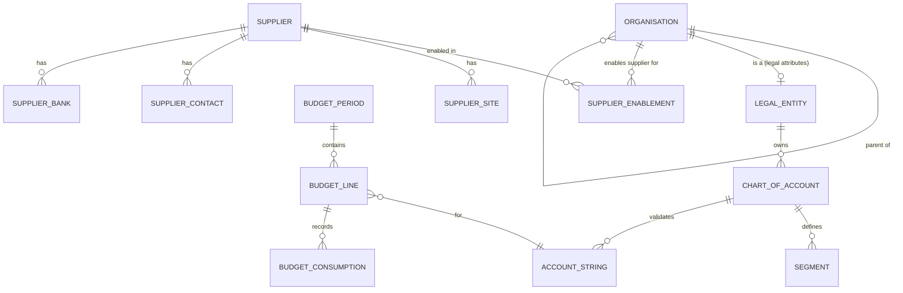

# Foundation: Business Foundation PRD

## 0. Document control

| Item | Value |
|---|---|
| Document title | Business Foundation: the shared business masters and the business configuration of kernel mechanisms, Product Requirements Document |
| Layer | Business (ADR-0029): modules `Iron.Business.<Module>` in `src/Business/`, schemas `business_<module>`; the modules are proposed in section 9 |
| Identifier prefix | `BF-`, in blocks of twenty per area (ADR-0041); the table is `business-foundation-requirements.csv` |
| Version | 0.1 SKELETON (the split of 2026-10-20) |
| Date | 2026-10-20 |
| Status | Skeleton for the design session's checkpoint: the requirements moved from the Functional Foundation PRD under their new identifiers, with every area named. The new areas and requirements, the kernel extension points in full and the modules follow after the checkpoint. |
| Inputs | The Functional Foundation PRD for procure-to-pay, version 1.2 (archived as `archive/functional-foundation-p2p-PRD-v1.md`), the map from its identifiers (`requirements-map.md`), ADR-0029 and ADR-0041, and the split brief (`docs/prompts/PRD-split.md`). |
| Dependency | Every mechanism (identity, roles, the unit tree, the approvals engine, audit, files, notifications, numbering, custom fields and lookups, imports, telemetry) is a kernel capability in the Technical Foundation PRD, cited by its TF identifier and never specified again here. The products build on this document; where a requirement here names a product's, it is an open point (section 12.2). |
| Method | The product method (`product-method.md`) is binding: a process reference pack before the first slice of each module (PM-001). |
| Tags | `[Carried]` behaviour from the current product that stays. `[Improved]` carried but changed to close a defect or gap. `[New]` not in the current product, standard practice. `[Decision]` needs the owner's confirmation; the question is in its notes. `[Later]` recorded, not in version 1. A requirement moved from the archived PRD says what it was at the start of its notes. |

Change log: 0.1 SKELETON, 2026-10-20: the split (ADR-0041). The requirements of the Functional Foundation PRD 1.2 that every product reads moved here under BF identifiers, their words unchanged except for names that changed (the layers, the kernel modules, the identifiers they cite and the section numbers of this document); the map lists every one.

## 1. Vision and goals

### 1.1 Vision

One set of business masters for every product: the organisations and legal entities, the people, the items and their classification, the finance masters, the locations and the supplier record, with the business configuration of the kernel's mechanisms (approval configurations and the delegation of authority, number series, document templates and notifications, visibility tags on masters). Procure-to-pay uses them first; sourcing, auctions, projects, surveys and expenses will use the same ones. Everything is configurable per tenant and traceable per record.

### 1.2 Goals (outcomes)

Goals 4, 5, 6, 7 and 9 of the archived PRD, in its words:

1. Finance has real-time budget consumption and accruals (received not invoiced) without spreadsheets.
2. Every control (approval limits, tolerances, duplicate checks, segregation of duties) is configuration, audited and provable to an auditor.
3. A new tenant with masters loaded can raise its first request within one day of provisioning.
4. A group of companies runs all its business units (organisations) in one tenant with separated master data, operations and visibility where they want separation, and shared where they want sharing, without any module needing rework later.
5. The product works for the largest global buyers: tens of thousands of users, tens of thousands of suppliers, hundreds of millions of documents over its life, on a dedicated deployment when required.

### 1.3 Lessons from the current product

Keep (carried), from the archived PRD's list: account-string splits with budget periods; budget blocking or warning per document type. Improve: atomic budget checks; warehouse maintenance screen; explicit behaviour for every state transition.

## 2. Scope

### 2.1 What this layer holds

| Area | Holds | Section |
|---|---|---|
| Organisations | Legal entity attributes and the finance masters of a legal entity; business units and departments as kinds of the kernel's unit tree; purchasing groups as a business master; the business rules of organisation separation | 5.1 |
| People | The people master linked to kernel principals: employee identifier, designation, job grade, manager, business groups, defaults | 5.2 |
| Items and classification | Items, categories and commodities, units of measure | 5.3 |
| Finance | Chart of accounts and segments, account strings, budgets, fiscal calendar, currencies and rates, tax codes, payment and shipping terms, projects as cost objects | 5.4 |
| Locations | Ship-to locations, warehouses | 5.5 |
| Supplier master | The supplier record and its parts, which every product reads, and its enablement per organisation | 5.6 |
| Lookups | The business lists every product uses, on the kernel's custom lookups | 5.7 |
| Approvals and delegation of authority | Approval configurations per document type on the kernel's workflow engine, and the delegation of authority matrix | 5.8 |
| Numbering, templates and notifications | Number series, document type settings, document templates, business notification templates | 5.9 |
| Content visibility on masters | Which masters carry visibility tags, on the kernel's TF-241 | 5.10 |
| Setup and data | Starter sets, readiness, country accelerator packs, reference data from standards, masters import, export and ERP sync | 5.11 |

The supplier's life cycle (invitation, registration, approval, status, compliance, performance) is the Supplier management product (`products/supplier-management-PRD.md`); supplier items are the Catalogue product's.

### 2.2 Organisation separation

Indian and Asian customers very often run several business units (they call them organisations) in one company and require separation of master data, operations and data visibility by unit, with sharing where it helps. The kernel built the mechanism in S2 (TF-220 to TF-223) and this layer and the products carry the business rules, so that no module suffers later:

- Every master record and document carries an owning organisation and a sharing mode (private, shared with listed organisations, global) through the kernel pattern (TF-220). The organisation tree, role scopes and the organisation switcher are kernel capabilities (TF-034, TF-222).
- Finance masters: chart of accounts, account strings, budgets and fiscal calendars belong to a legal entity; a legal entity is an organisation with legal attributes; a business unit may sit under a legal entity and use its chart of accounts.
- Suppliers: one supplier master per tenant (so a supplier registers once), enabled per organisation with organisation-specific terms, status and approval; a private supplier is visible only to its owner.
- Items and categories: global by default; organisation-specific items, supplier items and prices allowed; catalogues and contracts published per organisation or shared.
- Documents (requests, orders, receipts, invoices, contracts) belong to the organisation of the requester or buyer; cross-organisation documents are not allowed in version 1 (intercompany is a later feature); visibility follows organisation access.
- Configuration per organisation: numbering, templates, approval configurations, tolerances and settings can override the tenant values (TF-221).
- Reporting: per organisation, and consolidated for group roles with children included.

The archived PRD's area for this was FF-180 to FF-189, and the map says where each went. The kernel covers document visibility by organisation and consolidated reporting (TF-222, TF-035). The business rules are BF-001, BF-002, BF-003, BF-004, BF-005, BF-108 and BF-203. Catalogues and contracts per organisation are CAT-007 and CON-006, and the supplier portal across organisations is SPX-004.

### 2.3 Out of scope in version 1 (`[Later]`)

From the archived PRD's list: payment execution and bank integration (ERP); inventory and stock ledger; intercompany documents between organisations of one tenant (the record model keeps hooks: counterpart organisation, intercompany flag, mirrored document reference, so that a request in organisation A fulfilled by organisation B can be added later without rework); translation of business data (Unicode in any language from day one). The rest of that list belongs to the products and is in their scope sections.

## 3. Personas

| Persona | Goals in this layer | Surface |
|---|---|---|
| Controller / finance administrator | Chart of accounts, budgets, fiscal calendar, rates, taxes, tolerances, accruals | Enterprise app |
| Procurement administrator | Suppliers configuration, document templates, numbering, categories, approval configurations | Tenant console (kernel) and enterprise app |
| ERP integration (service account) | Pull approved orders and invoices, push payment status, sync masters | Partner API (kernel) |

The kernel provides the identity, roles and permissions for all of them. This layer declares its permission catalogue (section 9) and record policies. The people master's own personas (an HR or administration owner of designations and grades) are written with the People area after the checkpoint.

## 4. Domain model

`ORGANISATION` is the kernel's unit (TF-034), drawn for context. Every master record (supplier, item, category, tax code, payment term, template) also carries an owning organisation and a sharing mode (not drawn). The new masters (people, purchasing groups, projects as cost objects, lookups, approval configurations and the delegation of authority matrix) join the model after the checkpoint.

## 5. Requirements

Each requirement has an identifier, a priority (Must, Should, Could), a tag, the requirement statement in business terms, the reason, acceptance criteria that a tester can run (including at least one error case), dependencies and notes.

### 5.1 Organisations (BF-001 to BF-020)

Legal entity attributes, the finance masters of a legal entity, and the business rules of organisation separation (section 2.2). After the checkpoint this area also holds business units and departments as kinds of the kernel's unit tree, supplied through `IOrganisationKinds`, and purchasing groups. A purchasing group is a business master, not a unit kind: it serves several units and owns no records. The A1 amendment in `docs/prompts/S2.md` listed it among the kinds; this document corrects that.

#### BF-001 Legal entity finance attributes
*Priority:* **Must** · *Tag:* `[Carried]` · *Area:* Organisations

**Requirement:** Each legal entity (a kernel organisation unit of the kind legal entity) shall carry finance attributes: entity code, tax registrations, default currency, default chart of account, billing and shipping addresses, numbering initials, logo for documents.

**Why:** Documents belong to a legal entity; numbering and templates depend on it.

**Acceptance criteria:**

- AC1 Given a legal entity without default chart of account, When a request is created for it, Then the user must choose a chart of account and is told why.
- AC2 Given a duplicate entity code, When saved, Then it is refused. (error case)
- AC3 Given numbering initials set, When a document is numbered with the dynamic prefix on, Then the initials appear in the number.

*Depends on:* TF-034, TF-166

**Notes:** Was FF-001.

#### BF-002 Finance masters per legal entity and organisation
*Priority:* **Must** · *Tag:* `[New]` · *Area:* Organisations

**Requirement:** Chart of accounts, account strings, budgets and fiscal calendars belong to a legal entity; an organisation under a legal entity uses that entity's chart of accounts and may have its own budget lines; coding a document to an account string of another legal entity is refused; budgets and consumption are reported per organisation and consolidated.

**Why:** Accounting integrity per legal entity.

**Acceptance criteria:**

- AC1 Given organisation A under legal entity L1, When a request in A is coded, Then only L1 account strings are offered.
- AC2 Given a string of L2, When used on A's document, Then it is refused. (error case)
- AC3 Given budget lines per organisation, When the consolidated report runs, Then totals per organisation and the group total are shown.

*Depends on:* BF-061, BF-064, BF-003

**Notes:** Was FF-185. Decision G-02 default.

#### BF-003 Owning organisation on every record
*Priority:* **Must** · *Tag:* `[New]` · *Area:* Organisations

**Requirement:** Every master record (supplier, item, supplier item, catalogue, contract, category, tax code, payment term, ship-to location, template) and every document (request, order, shipment notice, receipt, return, invoice, credit note) shall carry an owning organisation and a sharing mode through the kernel pattern (TF-220); documents take the organisation of the requester or buyer and never mix organisations; the organisation is shown on lists and records.

**Why:** Decision F-13: separation by business unit from day one.

**Acceptance criteria:**

- AC1 Given a user of organisation A creating a request, When saved, Then the request's organisation is A.
- AC2 Given a request of organisation A, When a line references an item private to organisation B, Then it is refused. (error case)
- AC3 Given a list, When loaded, Then the organisation column is shown and filterable.

*Depends on:* TF-220

**Notes:** Was FF-180. The owning organisation and the sharing mode are the kernel's (TF-220: S1, A1, A3; sharing modes in A8); this requirement keeps the business rules FF-180 adds.

#### BF-004 Sharing modes for master data
*Priority:* **Must** · *Tag:* `[New]` · *Area:* Organisations

**Requirement:** Master data shall support the three sharing modes: global (default for categories, units, currencies, tax codes and payment terms), shared with listed organisations (for example a supplier or item used by two units), and private (visible to the owner only); administrators set the default mode per master type and may change a record's mode with audit.

**Why:** Shared where it helps, separated where required.

**Acceptance criteria:**

- AC1 Given an item shared with organisations A and B, When a user of C searches, Then it is not shown.
- AC2 Given a record changed from global to private, When saved, Then documents of other organisations that already reference it keep working and a warning lists them.
- AC3 Given a change by a user without the master's configuration permission, When attempted, Then it is refused. (error case)

*Depends on:* BF-003

**Notes:** Was FF-181. The three sharing modes are the kernel's (TF-220, A8); this requirement keeps the default mode per master type and what a change of mode does to documents.

#### BF-005 Organisation-specific configuration
*Priority:* **Must** · *Tag:* `[New]` · *Area:* Organisations

**Requirement:** Numbering sequences, document templates, approval configurations, tolerances, budget validation switches, receipt approval requirement and default match levels shall be settable per organisation, overriding tenant values for records owned by that organisation (TF-221); the tenant console shows effective values per organisation.

**Why:** Units run differently.

**Acceptance criteria:**

- AC1 Given a numbering sequence for organisation A with prefix A-PO, When an order of A is issued, Then its number starts with A-PO.
- AC2 Given no override for B, When an order of B is issued, Then the tenant sequence is used.
- AC3 Given a template missing for both A and the tenant, When rendering, Then it is refused naming the template. (error case)

*Depends on:* TF-221, BF-161

**Notes:** Was FF-183. The organisation scope of configuration is the kernel's (TF-221: settings in A6, numbering and templates in S4, approval configurations in S5); this requirement keeps which business configuration is set per organisation. Open point G-03 (section 12.2).

### 5.2 People (BF-021 to BF-040)

New area: the people master linked to kernel principals (employee identifier, designation, job grade, manager as the reporting line, business groups for routing and notifications, default unit, default ship-to and default account string), which implements the kernel's `IReviewEscalation`. Its requirements are written after the checkpoint.

### 5.3 Items and classification (BF-041 to BF-060)

Items, categories and commodities (with UNSPSC from BF-205), units of measure with conversions. Supplier items are the Catalogue product's.

#### BF-041 Items
*Priority:* **Must** · *Tag:* `[Carried]` · *Area:* Items and classification

**Requirement:** Items (code auto or manual, name, description, type product or service, unit, category, commodity, tax classification, default price and currency, attributes, images, status) shall be maintained with translations for name and description.

**Why:** Standard items for requests and catalogues.

**Acceptance criteria:**

- AC1 Given a new item with auto code, When saved, Then it receives the next code.
- AC2 Given an inactive item, When a requester searches, Then it is not offered.
- AC3 Given a duplicate manual code, When saved, Then it is refused. (error case)

*Depends on:* BF-042, BF-043, TF-143

**Notes:** Was FF-040.

#### BF-042 Categories and commodities
*Priority:* **Should** · *Tag:* `[Carried]` · *Area:* Items and classification

**Requirement:** A category tree with management groups and a commodity hierarchy mapped to categories shall classify items, request lines, suppliers and contracts and shall be usable in approval conditions and reports.

**Why:** Classification for routing and analytics.

**Acceptance criteria:**

- AC1 Given a category with a management group, When a request line of that category is submitted, Then the group can be resolved as approvers.
- AC2 Given a duplicate category name under the same parent, When saved, Then it is refused. (error case)
- AC3 Given a commodity moved, When viewed, Then its items keep the mapping.

**Notes:** Was FF-010.

#### BF-043 Units of measure
*Priority:* **Must** · *Tag:* `[Carried]` · *Area:* Items and classification

**Requirement:** Units with code, name, type and conversions (for example 1 box = 12 each) shall be maintained; conversions apply when receipts or invoices use a different unit than the order line.

**Why:** Real deliveries use other units.

**Acceptance criteria:**

- AC1 Given an order in boxes and a receipt in each, When received, Then quantity is converted and compared in the order unit.
- AC2 Given a unit without conversion to the order unit, When used on a receipt, Then it is refused. (error case)
- AC3 Given a duplicate unit code, When saved, Then it is refused.

**Notes:** Was FF-013.

#### BF-044 Item imports
*Priority:* **Should** · *Tag:* `[Carried]` · *Area:* Items and classification

**Requirement:** Items shall be importable through the kernel import framework with templates and validation.

**Why:** Bulk loading at go-live.

**Acceptance criteria:**

- AC1 Given a valid item file, When imported, Then items are created and codes allocated.
- AC2 Given rows with unknown units, When imported, Then they are reported and skipped. (error case)
- AC3 Given a dry run, When finished, Then nothing is created and the report shows counts.

*Depends on:* BF-041, TF-205

**Notes:** Was FF-049, the items; supplier items are CAT-006. Placed by the test: the import of the item master belongs with it.

### 5.4 Finance (BF-061 to BF-080)

Chart of accounts and segments, account strings, budgets, fiscal calendar, currencies and exchange rates, tax codes and classifications, payment and shipping terms. After the checkpoint: GL codes stated plainly as a segment (BF-061), HSN and SAC codes, and projects as cost objects.

#### BF-061 Chart of accounts and segments
*Priority:* **Must** · *Tag:* `[Carried]` · *Area:* Finance

**Requirement:** Finance administrators shall define charts of account per legal entity with ordered segments (name, length, data type, allowed values or value ranges, mandatory), buying group, billing address, and default match levels for products and services.

**Why:** Account strings are built from segments.

**Acceptance criteria:**

- AC1 Given a chart with three segments, When an account string is entered, Then each part is validated against its segment values.
- AC2 Given a chart of another legal entity, When selected on a document, Then it is refused. (error case)
- AC3 Given segment values changed, When existing documents are viewed, Then their strings are unchanged.

*Depends on:* BF-001

**Notes:** Was FF-002.

#### BF-062 Account strings
*Priority:* **Must** · *Tag:* `[Improved]` · *Area:* Finance

**Requirement:** Valid account strings shall be stored as master records (string, segment values, owner, active) so that budgets, lists and reports reference them; invalid combinations shall be refused and inactive strings shall not be selectable on new lines.

**Why:** Avoid free-text coding mistakes.

**Acceptance criteria:**

- AC1 Given an inactive string, When a line is coded with it, Then it is refused with the status shown. (error case)
- AC2 Given a new combination allowed by segment rules, When first used, Then it is created as a master record (if the setting allows) or refused (if the setting requires pre-defined strings).
- AC3 Given a string owner, When a budget line owner is not set, Then the string owner is used as the dynamic approver.

*Depends on:* BF-061

**Notes:** Was FF-003.

#### BF-063 Budget periods
*Priority:* **Must** · *Tag:* `[Carried]` · *Area:* Finance

**Requirement:** Finance administrators shall create budget periods (name, start, end, owner, status Open or Closed) per legal entity; closed periods accept no new reservations.

**Why:** Budget control by period.

**Acceptance criteria:**

- AC1 Given an Open period, When a line is split to it, Then it is accepted.
- AC2 Given a Closed period, When a new request uses it, Then it is refused. (error case)
- AC3 Given overlapping periods for one legal entity, When saved, Then a warning is shown (overlaps allowed for quarters inside years).

*Depends on:* BF-001

**Notes:** Was FF-004.

#### BF-064 Budget lines
*Priority:* **Must** · *Tag:* `[Carried]` · *Area:* Finance

**Requirement:** Budget lines shall be unique per budget period and account string, with owner, amount, reserved, consumed and available, and a consumption history with document references.

**Why:** Where the money is.

**Acceptance criteria:**

- AC1 Given a duplicate period and string, When saved, Then it is refused. (error case)
- AC2 Given amount 100,000 with reserved 20,000 and consumed 30,000, When viewed, Then available shows 50,000.
- AC3 Given history requested, When viewed, Then each row shows document type, number, amount and event (reserved, confirmed, released).

*Depends on:* BF-063, BF-062

**Notes:** Was FF-005.

#### BF-065 Budget availability check with reservation
*Priority:* **Must** · *Tag:* `[Improved]` · *Area:* Finance

**Requirement:** When a request, non-order invoice or other budget-relevant document is submitted and budget validation is on for its type, the system shall lock the budget lines in a fixed order, compute required per split, compare with available, block or warn per configuration, and reserve the required amounts in the same transaction.

**Why:** Gap: race conditions in the current product.

**Acceptance criteria:**

- AC1 Given two requests submitted at once against the last 1,000 available, When processed, Then one succeeds and the other is refused (blocking) or warned (warning mode).
- AC2 Given no budget line for a string with validation on, When submitted, Then "No budget line exists for account string X" is shown. (error case)
- AC3 Given warning mode, When exceeded, Then submission proceeds, the shortfall is stored on the document and shown to approvers.

*Depends on:* BF-064, TF-084

**Notes:** Was FF-006.

#### BF-066 Budget consumption and release
*Priority:* **Must** · *Tag:* `[Improved]` · *Area:* Finance

**Requirement:** Reservations shall become consumption at approval (or at submission when configured), be released on rejection, cancellation or close-short, be transferred from request to order to invoice without double counting, and be reversed by credit notes.

**Why:** Correct available budget at all times.

**Acceptance criteria:**

- AC1 Given an approved request later converted to an order and invoiced, When viewed, Then the budget line shows one consumption, not three.
- AC2 Given a request cancelled, When processed, Then its reservation is released.
- AC3 Given a credit note approved, When processed, Then consumption decreases by its amount. (edge)
- AC4 Given a release attempted for a reservation that no longer exists, When processed, Then it is refused and reported as an integrity error. (error case)

*Depends on:* BF-065

**Notes:** Was FF-007.

#### BF-067 Budget adjustments and transfers
*Priority:* **Should** · *Tag:* `[Improved]` · *Area:* Finance

**Requirement:** Permitted users shall adjust a budget line (positive or negative, reason mandatory) or transfer between lines in one action, never below consumed plus reserved, with approval when configured.

**Why:** Budgets change during the year.

**Acceptance criteria:**

- AC1 Given an adjustment that would make available negative, When saved, Then it is refused. (error case)
- AC2 Given a transfer of 10,000 from A to B, When approved, Then A decreases and B increases by 10,000 with one audit trail.
- AC3 Given adjustments, When listed, Then actor, reason and time are shown.

*Depends on:* BF-064, TF-090

**Notes:** Was FF-008.

#### BF-068 Budget reports
*Priority:* **Should** · *Tag:* `[Carried]` · *Area:* Finance

**Requirement:** Budget consumption by line, period and document type with reserved, consumed and available, and drill-down to documents.

**Why:** Finance visibility.

**Acceptance criteria:**

- AC1 Given consumption, When the report runs, Then totals match budget lines.
- AC2 Given drill-down, When clicked, Then documents are listed.
- AC3 Given export, When run, Then a file is produced. (edge)
- AC4 Given a user without the budget report permission, When run, Then it is refused. (error case)

*Depends on:* BF-064

**Notes:** Was FF-162.

#### BF-069 Fiscal calendar
*Priority:* **Should** · *Tag:* `[Carried]` · *Area:* Finance

**Requirement:** Fiscal years with periods (no overlaps, no gaps) per legal entity, with open and closed states; documents carry the fiscal period of their date; closed periods refuse new documents dated inside them unless the user has the permission to post into closed periods.

**Why:** Period reporting.

**Acceptance criteria:**

- AC1 Given periods with a gap, When saved, Then it is refused. (error case)
- AC2 Given a document dated in a closed period, When created by a user without the permission, Then it is refused.
- AC3 Given a document, When viewed, Then its fiscal period is shown.

*Depends on:* BF-001

**Notes:** Was FF-009.

#### BF-070 Currencies and exchange rates with revisions
*Priority:* **Must** · *Tag:* `[Carried]` · *Area:* Finance

**Requirement:** Currencies (code, decimals, symbol) and exchange rates (from, to, chart of account or legal entity, validity range, rate) shall be maintained through a revision workflow (draft, submitted, approved, applied), with a rate feed connector as a later option; conversions use the rate valid on the document date.

**Why:** Correct conversion with control.

**Acceptance criteria:**

- AC1 Given a revision approved, When applied, Then rates are valid from the start date.
- AC2 Given overlapping validity for the same pair and scope, When saved, Then it is refused. (error case)
- AC3 Given no valid rate, When a line is converted, Then the save is refused with the pair and date named.

*Depends on:* TF-090

**Notes:** Was FF-011.

#### BF-071 Tax codes and classifications
*Priority:* **Must** · *Tag:* `[Improved]` · *Area:* Finance

**Requirement:** Tax codes with components and rates, validity and country, tax classifications for items and services (such as harmonised codes), and a place-of-supply rule setting shall drive tax lines on orders and invoices; totals round per currency decimals using half away from zero; country-specific rule sets (Indian GST with CGST, SGST and IGST by place of supply) are delivered as accelerator packs (BF-204).

**Why:** Correct invoice totals; Indian GST readiness.

**Acceptance criteria:**

- AC1 Given a line of 1,000 with an 18 percent code of two components, When computed, Then two tax lines of 90 each are created.
- AC2 Given an expired tax code, When used on a new line, Then it is refused. (error case)
- AC3 Given rounding, When totals are computed, Then line taxes round to two decimals and the header equals the sum of lines.

**Notes:** Was FF-012. Decision F-08 confirmed.

#### BF-072 Payment and shipping terms
*Priority:* **Should** · *Tag:* `[Carried]` · *Area:* Finance

**Requirement:** Payment terms (net days, discount percent and days) and shipping terms shall be maintained and defaulted from supplier to order to invoice; invoice due dates and discount dates shall be computed from terms.

**Why:** Standard commercial terms.

**Acceptance criteria:**

- AC1 Given terms net 30 and an invoice date, When saved, Then the due date is 30 days later.
- AC2 Given a discount of 2 percent within 10 days, When viewed, Then the discount date and amount are shown.
- AC3 Given a term deleted while in use, When attempted, Then it is refused. (error case)

**Notes:** Was FF-014.

### 5.5 Locations (BF-081 to BF-100)

Ship-to locations and warehouses, which requests, orders and receipts offer. Bill-to addresses are the legal entity's (BF-001).

#### BF-081 Ship-to locations
*Priority:* **Should** · *Tag:* `[Carried]` · *Area:* Locations

**Requirement:** Ship-to locations per legal entity or unit with addresses shall be offered on lines and carried to orders.

**Why:** Correct delivery.

**Acceptance criteria:**

- AC1 Given locations for the unit, When a line is edited, Then they are offered.
- AC2 Given a location of another legal entity, When saved on the line, Then it is refused. (error case)
- AC3 Given a location on the line, When the order is created, Then the order line carries it.

*Depends on:* BF-001

**Notes:** Was FF-062.

#### BF-082 Warehouses and locations
*Priority:* **Should** · *Tag:* `[Improved]` · *Area:* Locations

**Requirement:** Warehouses and locations per legal entity (code, name, address, active) shall be maintained in a screen and offered on receipts.

**Why:** Gap: no screen in the current product.

**Acceptance criteria:**

- AC1 Given a warehouse created, When a receipt is made, Then it is offered.
- AC2 Given a duplicate code, When saved, Then it is refused. (error case)
- AC3 Given a warehouse deactivated, When used on a new receipt, Then it is not offered.

*Depends on:* BF-001

**Notes:** Was FF-100.

### 5.6 Supplier master (BF-101 to BF-120)

The supplier record and its parts, which every product reads, and its enablement per organisation. The life cycle is the Supplier management product's.

#### BF-101 Supplier master
*Priority:* **Must** · *Tag:* `[Carried]` · *Area:* Supplier master

**Requirement:** The supplier master shall hold identity (number auto or manual, legal name, trade name, type, registration type, country), tax identifiers (validated per country rules), classification (categories, commodities, preferred flag, diversity attributes), commercial defaults (currency, payment terms, shipping terms, match levels), portal settings (allowed channels), status fields and custom fields.

**Why:** Central master of the products.

**Acceptance criteria:**

- AC1 Given a supplier with unique identifiers, When saved, Then it is visible to buyers with status.
- AC2 Given a tax identifier already registered, When saved, Then it is refused naming the field. (error case)
- AC3 Given India validation on, When a GST or PAN with a wrong format is entered, Then it is refused.

*Depends on:* BF-042, BF-072

**Notes:** Was FF-022.

#### BF-102 Supplier addresses
*Priority:* **Should** · *Tag:* `[Carried]` · *Area:* Supplier master

**Requirement:** Addresses (type, lines, city, state, country, postal code, one primary, one remit-to) maintained by supplier or buyer, used on orders and invoices.

**Why:** Shipping and remittance.

**Acceptance criteria:**

- AC1 Given a second address marked primary, When saved, Then the first loses the primary flag.
- AC2 Given an address used on an open order, When deleted, Then it is refused; it can be deactivated. (error case)
- AC3 Given a remit-to address, When an invoice is created, Then it defaults to it.

*Depends on:* BF-101

**Notes:** Was FF-026.

#### BF-103 Supplier contacts
*Priority:* **Must** · *Tag:* `[Carried]` · *Area:* Supplier master

**Requirement:** Contacts (name, email unique, phone, role) shall be maintained; a contact with portal access is a Supplier Network user of the supplier organisation and is visible to the tenant as a linked contact; the tenant never holds supplier credentials.

**Why:** Portal access control.

**Acceptance criteria:**

- AC1 Given a network user of the supplier organisation, When the supplier is opened in the tenant, Then the user is listed as a linked contact with name, email, phone and role.
- AC2 Given a buyer tries to set a password for a supplier contact, When saved, Then it is refused because the tenant never holds supplier credentials. (error case)

*Depends on:* BF-101, TF-230

**Notes:** Was FF-027, the contact data; the portal users are SPX-005. AC1 and AC2 are written for the split from the requirement's own clauses.

#### BF-104 Supplier sites
*Priority:* **Should** · *Tag:* `[Carried]` · *Area:* Supplier master

**Requirement:** Sites (name, address, tax registration, contacts, bank link, status) with site-level approval when configured; orders may target a site; invoices carry the site's tax registration.

**Why:** Multi-site suppliers.

**Acceptance criteria:**

- AC1 Given a site with a tax registration, When an invoice for that site is created, Then the registration is used.
- AC2 Given a site without mandatory documents when required, When published, Then it is refused. (error case)
- AC3 Given a site deactivated, When a new order is created, Then it is not offered.

*Depends on:* BF-101

**Notes:** Was FF-028.

#### BF-105 Supplier bank accounts
*Priority:* **Must** · *Tag:* `[Improved]` · *Area:* Supplier master

**Requirement:** Bank accounts (bank, branch, account number encrypted, codes, currency, primary, attachments) shall be maintained; unverified accounts shall not be used for payment instructions.

**Why:** Bank account change fraud is the main payables risk.

**Acceptance criteria:**

- AC1 Given a bank account saved, When the database is read without the application, Then the account number is unreadable.
- AC2 Given a bank account whose verification is not complete, When it is chosen for a payment instruction, Then it is refused. (error case)

*Depends on:* BF-101, TF-074

**Notes:** Was FF-029, the account data and the rule that an unverified account is not used for payment; the verification is SUP-023. AC1 and AC2 are written for the split from the requirement's own clauses. Decision F-05 confirmed.

#### BF-106 Supplier configuration defaults
*Priority:* **Should** · *Tag:* `[Carried]` · *Area:* Supplier master

**Requirement:** Tenant administrators shall set defaults for new suppliers (payment terms, currency, match levels, required sections, required documents, portal channels) applied at creation and editable per supplier.

**Why:** Consistency and speed.

**Acceptance criteria:**

- AC1 Given defaults set, When a supplier is created, Then fields are pre-filled.
- AC2 Given a default changed, When existing suppliers are viewed, Then their values are unchanged.
- AC3 Given a user without the configuration permission, When saving, Then it is refused. (error case)

*Depends on:* BF-101, TF-057

**Notes:** Was FF-035.

#### BF-107 Supplier categories and preferred status
*Priority:* **Should** · *Tag:* `[New]` · *Area:* Supplier master

**Requirement:** Suppliers shall be classified by categories and commodities they serve, with preferred or approved status per category; request and order supplier suggestions shall use these classifications.

**Why:** Guide buyers to the right suppliers.

**Acceptance criteria:**

- AC1 Given a line of category X, When suppliers are suggested, Then preferred suppliers for X appear first.
- AC2 Given a supplier removed from a category, When suggested, Then it no longer appears for that category.
- AC3 Given a supplier on hold, When suggested, Then it is excluded. (edge)
- AC4 Given a category that does not exist, When assigned, Then it is refused. (error case)

*Depends on:* BF-101, BF-042

**Notes:** Was FF-038.

#### BF-108 Supplier enablement per organisation
*Priority:* **Must** · *Tag:* `[New]` · *Area:* Supplier master

**Requirement:** A supplier shall register once per tenant and be enabled per organisation with organisation-specific terms (payment and shipping terms, currency, match levels, preferred flag, status On or On Hold) and an optional organisation approval; documents of an organisation may use only suppliers enabled in it; supplier users see documents of all organisations they are enabled in, labelled by organisation.

**Why:** One registration for the supplier, separate control for each unit.

**Acceptance criteria:**

- AC1 Given a supplier enabled in A but not B, When a buyer of B creates an order for it, Then it is refused with an enablement action offered. (error case)
- AC2 Given organisation terms set, When an order in that organisation is created, Then the organisation's terms default.
- AC3 Given a supplier user, When listing orders, Then orders of all enabling organisations appear with the organisation name.

*Depends on:* BF-101, SUP-004, BF-003

**Notes:** Was FF-182. Decision G-01 default.

### 5.7 Lookups (BF-121 to BF-140)

New area: the business lists every product uses, built on the kernel's custom lookups (TF-201): which lists exist, who maintains them, the seeded values. Written after the checkpoint.

### 5.8 Approvals and delegation of authority (BF-141 to BF-160)

New area: approval configurations per document type on the kernel's workflow engine (TF-090 to TF-099, S5), and the delegation of authority matrix: approval limits by amount and currency, by designation, job grade or role, by category, per legal entity or unit, with validity dates and audit. Delegation of duties (TF-037, built in A7) is the kernel's; this matrix decides who may approve what. Written after the checkpoint.

### 5.9 Numbering, templates and notifications (BF-161 to BF-180)

Document type settings and document templates; after the checkpoint, number series per document type and unit on the kernel's numbering service (TF-166), and business notification templates and who is told what, on the kernel's notifications (TF-150 to TF-156).

#### BF-161 Document type settings
*Priority:* **Must** · *Tag:* `[Carried]` · *Area:* Numbering, templates and notifications

**Requirement:** Settings per document type for budget validation and blocking, consumption trigger, multi-currency lines, approval configurations, numbering, templates, mandatory custom fields and acknowledgement reminder days.

**Why:** Configurable control.

**Acceptance criteria:**

- AC1 Given a setting changed, When the next document is created, Then it applies.
- AC2 Given an invalid value, When saved, Then it is refused. (error case)
- AC3 Given a change, When audited, Then before and after are recorded.

*Depends on:* TF-057

**Notes:** Was FF-170.

#### BF-162 Document templates for the products
*Priority:* **Must** · *Tag:* `[Carried]` · *Area:* Numbering, templates and notifications

**Requirement:** Templates for order, change order, return note, receipt note and invoice acknowledgement per legal entity and language through kernel templates, with product placeholders documented.

**Why:** Branded documents.

**Acceptance criteria:**

- AC1 Given a template per legal entity, When rendered, Then it is used.
- AC2 Given a missing placeholder, When saved, Then it is refused. (error case)
- AC3 Given a preview, When requested, Then sample data renders.

*Depends on:* TF-162, TF-163

**Notes:** Was FF-173.

### 5.10 Content visibility on masters (BF-181 to BF-200)

New area: which masters carry visibility tags (at least suppliers, items, contracts and projects), on the kernel mechanism TF-241. Written after the checkpoint.

### 5.11 Setup and data (BF-201 to BF-220)

The approval starter set, go-live and organisation readiness as contributions to the kernel's `IUnitReadiness`, country accelerator packs, reference data from standards, and masters import, export and ERP sync.

#### BF-201 Approval configuration starter set
*Priority:* **Should** · *Tag:* `[New]` · *Area:* Setup and data

**Requirement:** A starter set of approval configurations per document type (manager chain by amount bands, budget owner for requests, finance for invoices above a threshold, procurement head for suppliers) shall be seeded as inactive examples that administrators can activate and edit.

**Why:** Faster go-live.

**Acceptance criteria:**

- AC1 Given a new tenant, When the console opens, Then the starter configurations exist inactive.
- AC2 Given activation, When a document is submitted, Then the configuration applies.
- AC3 Given an edit, When saved, Then it is versioned by the kernel workflow. (edge)
- AC4 Given a starter configuration edited to reference an unknown field, When saved, Then it is refused. (error case)

*Depends on:* TF-090, TF-095

**Notes:** Was FF-174.

#### BF-202 Go-live checklist and data readiness
*Priority:* **Should** · *Tag:* `[New]` · *Area:* Setup and data

**Requirement:** A tenant readiness view shall show what is missing before go-live: legal entities, chart of accounts, account strings, budgets, currencies, units, taxes, templates, numbering, approval configurations, suppliers, items, users and roles, with links to fix each.

**Why:** Goal 3 (first request within one day, section 1.2).

**Acceptance criteria:**

- AC1 Given missing templates, When the view loads, Then it is listed with a link.
- AC2 Given all items complete, When the view loads, Then it shows ready.
- AC3 Given a user without administration permission, When opening, Then it is refused. (error case)

*Depends on:* BF-161, SUP-005

**Notes:** Was FF-175. Its checklist is made of contributions to the kernel's IUnitReadiness (A8).

#### BF-203 Organisation readiness checklist
*Priority:* **Should** · *Tag:* `[New]` · *Area:* Setup and data

**Requirement:** Adding an organisation shall open a readiness checklist (legal entity link, chart of accounts, account strings, budgets, numbering, templates, approval configurations, enabled suppliers, users and roles).

**Why:** Companies reorganise.

**Acceptance criteria:**

- AC1 Given a new organisation, When created, Then the checklist lists missing items with links.
- AC2 Given a user without administration permission, When they open an organisation's readiness checklist, Then it is refused. (error case)

*Depends on:* TF-223, BF-202

**Notes:** Was FF-188, the checklist's items, which this layer contributes to the kernel's IUnitReadiness; creating, deactivating and merging organisations are the kernel's TF-223 (A8). AC2 is written for the part, as BF-202 AC3 says it for the tenant.

#### BF-204 Country accelerator packs
*Priority:* **Should** · *Tag:* `[New]` · *Area:* Setup and data

**Requirement:** Country-specific rules shall be delivered as accelerator packs installed per tenant by operators and configured by tenant administrators: reference data (tax codes and components, classifications, document types), validation rules (identifier formats, e-invoice fields), computation rules (for example Indian GST: CGST and SGST for intra-state, IGST for inter-state by place of supply, reverse charge flags) and report formats; packs are versioned and upgradable without code changes to the products.

**Why:** Decision F-08: Indian GST as an accelerator pack; other countries later.

**Acceptance criteria:**

- AC1 Given the Indian GST pack installed, When an intra-state invoice line is taxed, Then CGST and SGST components are computed; inter-state produces IGST.
- AC2 Given no pack installed, When a line is taxed, Then plain tax codes apply without country rules.
- AC3 Given a pack upgraded, When installed, Then existing documents keep their computed values and new documents use the new rules.
- AC4 Given a pack installation by a tenant administrator without operator rights, When attempted, Then it is refused. (error case)

*Depends on:* BF-071, INV-010, TF-088

**Notes:** Was FF-176. Decision G-05 default: operators install, tenant administrators configure.

#### BF-205 Reference data from standards
*Priority:* **Must** · *Tag:* `[New]` · *Area:* Setup and data

**Requirement:** Categories shall support UNSPSC codes (with tenant-specific trees mapped to UNSPSC), items and locations shall support GS1 identifiers (GTIN, GLN), currencies ISO 4217, dates ISO 8601, locations UN/LOCODE, shipping terms Incoterms 2020, and payment status messages ISO 20022 codes, each as optional reference attributes that packs and integrations can rely on.

**Why:** Common language with ERPs, suppliers and networks.

**Acceptance criteria:**

- AC1 Given a category mapped to a UNSPSC code, When exported, Then the code is included.
- AC2 Given an item with a GTIN of wrong length or check digit, When saved, Then it is refused. (error case)
- AC3 Given a payment status message with an ISO 20022 code, When received, Then it maps to the invoice payment state.

*Depends on:* BF-042, BF-041, INV-043

**Notes:** Was FF-202.

#### BF-206 Masters import, export and ERP sync
*Priority:* **Must** · *Tag:* `[New]` · *Area:* Setup and data

**Requirement:** All finance masters shall be importable and exportable through the kernel import framework and API, with ERP as the optional system of record (inbound sync by schedule) and conflict reporting when a record changed in both systems.

**Why:** Every tenant loads masters from an ERP.

**Acceptance criteria:**

- AC1 Given a chart of accounts file, When imported, Then segments and strings are created and errors reported per row.
- AC2 Given a record changed in both systems, When synced, Then it is reported as a conflict and not overwritten. (error case)
- AC3 Given an export, When run, Then files per master are produced.

*Depends on:* TF-205, TF-206

**Notes:** Was FF-015.

## 6. Kernel extension points

The kernel declares these interfaces in its Contracts; this layer implements them (ADR-0029, decision 5). Written in full after the checkpoint.

| Interface | Declared in | What this layer supplies |
|---|---|---|
| `IOrganisationKinds` | `Iron.Kernel.Authorization.Contracts` (A1) | The kinds of unit: legal entity, business unit, department and team, with which may hold which (section 5.1) |
| `IReviewEscalation` | `Iron.Kernel.Authorization.Contracts` (A7) | The reviewer's manager, from the people master, for an overdue access review (section 5.2) |
| `IUnitReadiness` | `Iron.Kernel.Authorization.Contracts` (A8) | The readiness items of a unit: BF-202 and BF-203 |
| `IUnitRecordOwners` | `Iron.Kernel.Data` (A8) | The masters a unit owns, which move in a unit merge |

## 7. Rules and state machines

### 7.1 Key rules

From the archived PRD's section 7.1; each is also a requirement above or in a product.

| Rule | Statement |
|---|---|
| Account splits | Each split has an account string, a budget period when budget validation is on, and 1 to 100 percent; splits of a line total exactly 100 percent at submission; no duplicate account string and period on a line. |
| Budget availability | Available = amount + adjustments − consumed − reserved. Required per split = line amount × percent. Blocking or warning per document type. Reserve at submission, confirm at approval, release on rejection or cancellation. |
| Supplier uniqueness | Supplier number, tax identifiers, registration numbers and primary contact email unique; fuzzy duplicate warning on name and address. |
| Organisation visibility | Every record has an owning organisation and a sharing mode; users see records of organisations they have access to plus records shared with them or global; documents never mix organisations; a supplier must be enabled in the document's organisation. |

### 7.2 State machines

The masters have no state machine of their own in the archived PRD beyond active and inactive: budget periods are Open or Closed (BF-063), fiscal periods open or closed (BF-069), exchange rate revisions move through draft, submitted, approved and applied (BF-070).

## 8. Data and integration

### 8.1 Data notes

From the archived PRD's section 8.1: the largest tables of this layer (budget consumption) follow the kernel's partitioning conventions (TF-226) from the first migration; masters carry custom fields (TF-200), attachments (TF-160) and tracked change history (TF-062); master records are numbered at creation by the kernel's numbering (TF-166); sensitive supplier fields (bank account, tax identifiers) use field-level encryption (TF-074).

### 8.2 Integrations

| Direction | Data | Trigger | Kernel capability |
|---|---|---|---|
| Inbound | Legal entities, chart of accounts, account strings, budgets, currencies and rates, tax codes, units, categories, suppliers (optional master in ERP), payment terms | Schedule or push | Import framework, API, connectors (TF-205, TF-206) |

### 8.3 Reports

Budget consumption by line and document (BF-068).

## 9. Modules, schemas and permissions

Proposed by the placement test after the checkpoint, each with its schema `business_<module>` and its permissions; the brief's example names are `Iron.Business.Organisations`, `.People`, `.Items`, `.Finance`, `.Locations`, `.Suppliers`, `.Lookups` and `.Approvals`.

The archived PRD's permission catalogue (its section 8.3) named these for the masters, before the split: `finance.coa.*`, `finance.budget.*`, `finance.rate.*`, `finance.tax.*`; `suppliers.supplier.{read,create,update}`, `suppliers.bank.{read,update}`; `catalogue.item.*`. Permission names name the module (ADR-0029), so they follow the modules once those are settled.

## 10. Configuration

From the archived PRD's section 8.5: budget validation and blocking per document type; consumption triggers; multi-currency on lines; numbering per document and per organisation; document templates per organisation; approval configurations per document type and organisation (kernel workflow); country accelerator packs (Indian GST first). Each is a kernel setting (TF-057) declared by the module that owns it.

## 11. Slices

Where the moved requirements sat in the archived PRD's build plan (its section 9). The business slices are proposed in the technical PRD's section 7 after the checkpoint.

| Slice of the archived plan | Its outcome | This document's requirements from it |
|---|---|---|
| P0 | Process reference packs | BF-205 |
| P1 | Masters, organisations and first request | BF-001, BF-002, BF-003, BF-004, BF-005, BF-042, BF-043, BF-061, BF-062, BF-063, BF-064, BF-065, BF-066, BF-067, BF-069, BF-070, BF-071, BF-072, BF-081, BF-108, BF-161, BF-202, BF-206 |
| P2 | Suppliers and orders | BF-101, BF-102, BF-103, BF-104, BF-105, BF-106, BF-162, BF-201, BF-203 |
| P3 | Receiving | BF-082 |
| P4 | Invoicing and matching | BF-068 |
| P5 | Catalogue, contracts, change orders | BF-041, BF-044 |
| P6 | Completeness | BF-107, BF-204 |

## 12. Decisions and open points

### 12.1 Decisions

Confirmed on 2026-10-17, from the archived PRD's section 10.1, where they apply here:

| ID | Decision | Where applied |
|---|---|---|
| F-05 | Supplier bank changes need a second approver and an out-of-band verification checklist | BF-105, SUP-023 |
| F-08 | Tax codes with components; place-of-supply rule as a setting; e-invoice fields prepared; Indian GST as an accelerator pack | BF-071, BF-204, INV-010 |
| F-11 | Manual exchange rates with revision workflow; rate feed connector later | BF-070 |
| F-13 | Organisation (business unit) separation of master data, operations and visibility built into the functional foundation | Section 2.2, BF-001 to BF-005, BF-108, BF-203 |
| F-14 | One supplier registration per tenant with per-organisation enablement | BF-108 |
| F-15 | Intercompany documents not in version 1; design hooks kept | Section 2.3 |

The split itself is ADR-0041.

### 12.2 Open points

From the archived PRD's section 10.2:

| ID | Question | Default used |
|---|---|---|
| G-02 | Can a business unit without legal status raise documents, or only legal entities? | Any organisation can own documents; the legal entity above it supplies chart of accounts and tax registration |
| G-03 | Which organisation-level overrides are needed on day one beyond numbering, templates, approvals and tolerances? | Those four plus budget validation switches |
| G-04 | Intercompany documents in a later version: which flows (one organisation buying for another, internal recharge)? | Not in version 1; hooks kept on records |
| G-05 | Accelerator pack delivery: installed by operators per tenant, or chosen by tenant administrators from a catalogue? | Operators install; tenant administrators configure |

From the split, for the design session:

| Question | Default proposed |
|---|---|
| Four business requirements cite a product's: BF-108 (supplier enablement) depends on SUP-004 (approval and publishing), BF-202 (go-live checklist) on SUP-005 (onboarding configuration), BF-204 (country packs) on INV-010 (e-invoicing readiness), BF-205 (reference data) on INV-043 (payment status). Code may not depend upward (ADR-0029). | Each becomes a contribution the product makes to this layer (as a product contributes readiness items to `IUnitReadiness`), and the dependency is reworded after the checkpoint |
| Is a bill-to location a master of its own, or only the legal entity's billing address (BF-001)? | The legal entity's billing address, as the archived PRD has it |

## 13. Glossary

| Term | Meaning |
|---|---|
| Organisation (business unit) | A sub-structure of the tenant that owns master data and documents and bounds visibility; a legal entity is an organisation with legal attributes |
| Supplier enablement | The record that makes a tenant-level supplier usable in one organisation, with that organisation's terms and status |
| Sharing mode | Private to the owning organisation, shared with listed organisations, or global to the tenant |
| Accelerator pack | Packaged configuration, reference data and rules for a country or industry (Indian GST first) |
| Account string | Coded combination of chart-of-account segment values used to code a line and track budget |
| Account split | Division of a line across account strings by percent, each with a budget period |
| Purchasing group | A group of buyers, the categories it covers and the units it serves; a business master, not a unit kind |
