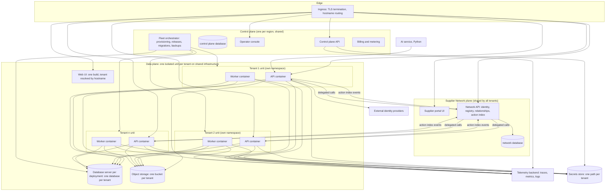
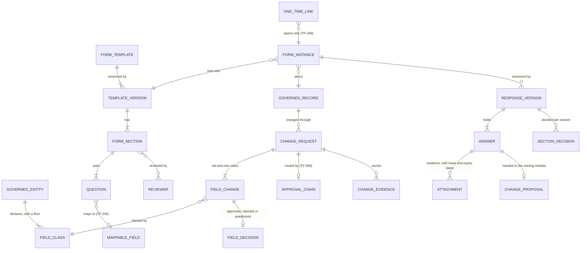

# IronSaaS Foundation: Technical Foundation PRD

## 0. Document control

| Item | Value |
|---|---|
| Document title | IronSaaS Foundation, the enterprise SaaS platform for regulated industries: Technical Foundation Product Requirements Document |
| Code namespace | `Iron.*` in three layers (ADR-0029, ADR-0043): Kernel (`Iron.Kernel`, `Iron.Kernel.*`, for example `Iron.Kernel.Identity`) and Business (`Iron.Business.*`), which together are IronSaaS Foundation, and Suite (`Iron.Suites.<Suite>.*`, for example `Iron.Suites.Procurement.Orders` in the eProcurement Suite). Database schemas carry the layer prefix, or a suite's short name, and the module name (for example `kernel_identity`, `kernel_tenancy`, `procurement_orders`). Section 2.1 lists the kernel's modules by today's names; ADR-0029 maps the S1 names the ADRs before it use, and section 3.5 shows the structure. |
| Version | 1.5 DRAFT for review (SUP-gaps, 2026-10-21: governed changes, form mapping and one-time verified access) |
| Date | 2026-10-21 |
| Status | Draft. Written for joint development. Decisions confirmed on 2026-10-17 are listed in section 8.1; remaining open points are in section 8.2. |
| Inputs | The anonymised reverse-engineered PRD of the current procurement platform (its cross-cutting services, defects and gaps), the IronSaaS build rules (simplicity, plain layers, open-source first, Linux runtime, Python for AI), the product owner's decisions of 2026-10-17, and current SaaS platform practice (OWASP ASVS, NIST 800-63, OpenTelemetry, OpenFeature, SOC 2, ISO 27001, GDPR, India DPDP, 21 CFR Part 11). Nothing of Foundation exists yet; this is a fresh start. |
| Readers | You (product owner and architect), the developers who will build Foundation, security and compliance reviewers, and the product teams who will build suites on top of Foundation (first: the eProcurement Suite). |
| Companion documents | The Business Foundation PRD beside this one in `docs/prd/foundation/`, the eProcurement Suite's product PRDs, supplier portal surface and later scopes in `docs/prd/suites/procurement/`, and the product method in `docs/prd/`, one per layer and product (ADR-0041, ADR-0043), listed in `docs/prd/README.md`. They assume everything in this document exists. The Functional Foundation PRD they replace is archived, with a map from its identifiers. |
| Tags | `[Core]` must exist before the first business product ships. `[Extended]` can follow in a later slice. `[Decision]` a choice you must confirm. `[Carried]` behaviour carried over from the current product. `[Gap]` a gap or defect found in the current product that Foundation must close. |

Change log: 1.0 DRAFT, 2026-10-17, first full draft. 1.2 DRAFT, 2026-10-17, second round: Azure as the cloud with laptop-first development; scale targets for very large tenants and a formal dedicated-deployment option; the Supplier Network plane (one portal for all suppliers of all tenants); intercompany as a design consideration; research-backed functional design principle. 1.1 DRAFT, 2026-10-17, decisions applied: per-tenant application and database isolation on shared infrastructure; all compliance frameworks in scope; AG Grid (Community first, Enterprise later) instead of open-source-only grid; subscription billing per user and module in version 1; UI-only localisation with Unicode data; mobile companion app scope; new areas for fleet operations, multi-organisation separation, regulated-industry controls and mobile readiness. 2026-10-19 (task L1): the code namespace line and section 3.5 follow ADR-0029, three layers: kernel, business, products. 2026-10-19 (task A2): TF-032 AC3 follows ADR-0031: unknown permissions refuse the apply instead of being skipped. 2026-10-19 (task A3): TF-035 AC1 follows ADR-0032: another supplier's order by identifier answers not found, so a link reveals nothing. 2026-10-20 (task A5): TF-050 AC3 follows ADR-0035: the last known value comes before the default in code, so a kill switch that is on stays on while the flag service is unavailable. 2026-10-20 (the PRD split, ADR-0041): six criteria that are error cases carry the marker `(error case)`, as the one form of acceptance criteria asks (TF-004 AC2, TF-007 AC1, TF-021 AC1, TF-029 AC2, TF-040 AC2, TF-046 AC1); the CSV is written from this document, gains the column `was`, and so also carries the three criteria amended in S2 (TF-032 AC3, TF-035 AC1, TF-050 AC3), which had reached only this document. 1.3 DRAFT, 2026-10-20 (the PRD split, ADR-0041 and ADR-0042): section 2.1 lists the kernel's modules by today's names, built and planned, and retires `Iron.Organisations`, which S2 built inside Authorization, Data and Settings, its business meaning now the Business PRD's; three requirements are new, TF-241 (content visibility and visibility tags), TF-242 (the forms engine) and TF-243 (approvals, tasks and notifications respect access, the design session's answer to the archived FF-184); TF-099 and TF-166 name the business configuration that uses them; TF-218 traces the identifiers of every PRD to tests; section 5a points to each product PRD's records and signatures; section 7 schedules TF-241 before the first business slice, proposes the business and product slices, and puts S7's requirements back in S7's row, from which a missing cell had moved them into S9's; sections 3.3 and 6 name `Iron.Kernel.Files` and `Iron.Kernel.Security`. 2026-10-20 (the split's review): TF-242 is built in S4, and section 7.2's order is accepted in principle. 1.4 DRAFT, 2026-10-20 (task L2, ADR-0043): IronSaaS Foundation and its suites; the code namespace line and section 3.5 follow the Suite layer; TF-244, suites per tenant, joins the tenancy area and slice V; the document moved to `docs/prd/foundation/`. 2026-10-21 (S3 T1's review, ADR-0044): TF-030 AC2 reads grouped by module and, within a module, by resource, and TF-030 gains AC4 (a permission's form and description); TF-033 AC1 answers not found outside the scope, as TF-035 AC1 was amended (ADR-0031, ADR-0032); TF-032 gains AC4 to AC6 (a role's create, change and delete, the audit of its permissions before and after, the export round trip), TF-033 AC5 (granting, listing and removing an assignment) TF-034 AC4 to AC8 (creating, coding, renaming and reading units, and the kinds a parent may hold) and TF-190 AC4 (the repository's top-level folders), each stating what the code already did and a test proves. 2026-10-21 (S3 T2, ADR-0046): TF-012 gains AC4 (the tenant's policy and lockout settings, within their ranges) and AC5 (a password past its maximum age, and the warning before it), and TF-017 gains AC4 (a change refused for a wrong current password, counted towards the lockout), each stating what T2 built and a test proves. 2026-10-22 (S3 T3, ADR-0047): TF-248, step-up re-authentication, joins the identity area and S3, with five criteria. 1.5 DRAFT, 2026-10-21 (SUP-gaps, the supplier management pack's sections 8.4 and 8.5): TF-245 maps form answers to records as change proposals, TF-246 gives an external respondent one-time verified access, and TF-247 governs changes to records, in the new module `Iron.Kernel.Changes`; TF-242 gains attachments with issue and expiry dates, section reviewers and decisions, pre-fill, and response versions with their comparison (AC7 to AC11); TF-206 names the verification and screening connector kinds (AC4, AC5); section 3.7 is the domain model of governed changes and forms; section 7.1 places TF-245 and TF-246 in S4 and TF-247 in S5, and section 7.2 places the requirements written from the pack, noting that TF-246 lets supplier information collection ship before the Supplier Network.

## 1. Vision and principles

### 1.1 Vision

IronSaaS Foundation is the technical base for a family of enterprise SaaS suites for regulated industries: the eProcurement Suite first, then others such as a School ERP (ADR-0043). A product team builds a suite's modules on Foundation and gets, for free and from day one: multi-tenancy, identity and access, module licensing, feature flags, settings, audit, security, telemetry, localisation, notifications, files, jobs, workflow, extensibility, a UI shell and an operations console. Product teams write business logic and screens. They never write their own login, audit or tenant code.

### 1.2 Principles (binding)

| # | Principle | What it means in practice |
|---|---|---|
| P1 | Simplicity first | Plain layers: API endpoint, service, repository, database. No CQRS, no mediator library, no message bus inside one process, no microservices in version 1. A fresh graduate must be able to read a module end to end in a day. |
| P2 | Modular monolith | One deployable application per surface (API, worker, UI), split into modules with clear public interfaces. A module owns its database schema. Modules call each other only through their public service interfaces, never through each other's tables. |
| P3 | Open source first | Every library, tool and runtime is open source with a permissive or copyleft licence that allows commercial use at no cost, unless a commercial component is approved by a written decision because it changes what the product can offer (today: AG Grid, Community edition first and Enterprise later; a commercial PDF library may be reviewed when document rendering is built). Every dependency is listed in section 6 with its licence. |
| P4 | One tenant per runtime, many tenants per fleet | Each tenant runs its own application containers against its own database. Code never mixes tenants in one process. The control plane and the fleet tooling manage many such units on shared infrastructure. Inside a tenant, every business record carries its owning organisation unit and the data layer applies unit visibility (P13). |
| P5 | Secure by default | Every operation needs authentication and a permission unless it is on a short, reviewed allow-list. Deny is the default. Secrets never live in code or configuration files. |
| P6 | Observable by default | Every request, job and event carries a correlation id and the tenant id. Traces, metrics and logs flow through one standard (OpenTelemetry). |
| P7 | Configuration, not code | Rules that differ per tenant are settings, flags, entitlements, workflow configurations or custom fields. A tenant never needs a code branch. |
| P8 | Append-only truth | Audit records, change history and workflow decisions are never updated or deleted. Business documents are never physically deleted after submission. |
| P9 | API first | Every screen uses the same public API that partners use. No hidden internal endpoints with different rules. |
| P10 | Boring technology | PostgreSQL, .NET, React and well-known open-source libraries. New technology needs a written reason and a listed licence. |
| P11 | Linux runtime | Everything runs in Linux containers. Development in WSL or Linux. |
| P12 | AI at arm's length | The AI layer is a separate Python service that talks to Foundation only through the public API with its own service account. It never reaches the database. |
| P13 | Organisation-aware by design | Tenants are groups of organisations (business units, legal entities). Master data, documents, configuration and visibility can be separated or shared per organisation through one standard pattern that every module uses from day one. |
| P14 | Compliance is built in | SOC 2, ISO 27001, GDPR, India DPDP and 21 CFR Part 11 controls are platform requirements, not product features. Products inherit them. |
| P15 | Built for the largest buyer | The design must serve a global enterprise running its procurement on this platform. Every component has a documented scale-out path and a dedicated-infrastructure option; nothing assumes a small tenant. |
| P16 | One supplier identity, many customers | A supplier registers once in the Supplier Network and works with all its customers from one portal. Customer business data never leaves the customer's tenant unit; the network holds identity, relationships and a minimal action index. |
| P17 | Research-backed functional design | Functional foundations and modules are grounded in industry process frameworks, standards and benchmarks, documented before design. What the team already knows is the starting point, never the limit. |

### 1.3 What the current product taught us

The reverse-engineered PRD of the current procurement platform found strengths worth keeping and gaps Foundation must close.

Keep: a configurable multi-stage approval engine with dynamic approvers and frozen chain instances; module entitlements; per-tenant settings with 84 keys; notification templates with per-user preferences and mandates; document numbering; change history; impersonation with attribution; import and export jobs; saved grid layouts; a partner API with its own credentials and a versioned contract; a plugin hook with block or pass semantics.

Close (all `[Gap]`): 242 of 1,231 operations had no authorisation requirement and there was no fallback deny policy; supplier-side operations did not check ownership; quantity and budget checks were not atomic; audit coverage was uneven and audit rows were not protected; no password policy, lockout or rate limiting; a live credential in a readme; no reminder or escalation job even though the setting existed; two code paths (enterprise and supplier) for the same rules; telemetry limited to logs; no feature flags; no tenant provisioning automation beyond scripts; no data retention or anonymisation; localisation partially done.

## 2. Scope

### 2.1 The kernel's modules

The kernel as it is after S2, by today's names (ADR-0029), then the modules planned. Each module owns its schema, named with the layer prefix.

| Module (namespace, schema) | Responsibility | Tag | State |
|---|---|---|---|
| `Iron.Kernel` (no schema) | The vocabulary, one namespace: results and errors, ids, time, money, paging, tenant context, principals, permissions, correlation (ADR-0007) | Core | Built (S1, L1) |
| `Iron.Kernel.Data` (`kernel_data`) | Database conventions, tenant-scoped access, migrations, soft delete, optimistic concurrency; business records with their owning unit and sharing mode, the record shares and the filters of record policies (ADR-0008, ADR-0032, ADR-0038) | Core | Built (S1, S2) |
| `Iron.Kernel.Api` (no schema) | REST conventions, envelope, problems, paging and filtering, the permission every endpoint declares (ADR-0009) | Core | Built (S1) |
| `Iron.Kernel.Telemetry` (no schema) | OpenTelemetry traces, metrics and logs, correlation, scrubbing (ADR-0010) | Core | Built (S1) |
| `Iron.Kernel.Security` (no schema) | Secrets from the store at start, security headers, CORS, signing keys (ADR-0010, ADR-0016) | Core | Built (S1) |
| `Iron.Kernel.Identity` (`kernel_identity`) | Principals, passwords, sessions, invitations, access tokens and service accounts, a principal's home unit (ADR-0014, ADR-0015); later the one-time verified access for external respondents (TF-246) | Core | Built (S1, A1); TF-246 S4 |
| `Iron.Kernel.Authorization` (`kernel_authz`) | Permission catalogue, roles and scoped assignments; the unit tree, its kinds as an extension point, scopes (ADR-0030, ADR-0031); record policies (ADR-0032); delegation of duties and access reviews (ADR-0037); cross-unit access, the working unit and the unit lifecycle (ADR-0038); explaining access and conflict rules (ADR-0039) | Core | Built (S1, S2) |
| `Iron.Kernel.Audit` (`kernel_audit`) | The append-only audit trail in the unit of work, the cross-unit read audit (ADR-0013, ADR-0038) | Core | Built (S1, A8) |
| `Iron.Kernel.Files` (`kernel_files`) | Object storage behind one interface and file metadata (ADR-0016); later the upload rules, rendering, numbering and signature capture (TF-161 to TF-166) | Core | Built in part (S1); the rest S4 |
| `Iron.Kernel.Tenancy` (`kernel_tenancy`, control plane) | The tenant registry and the control plane API, plans and tenant entitlements, flag rules and kill switches (ADR-0017, ADR-0034, ADR-0035) | Core | Built (S1, S2) |
| `Iron.Kernel.Fleet` (`kernel_fleet`, control plane) | Provisioning as resumable steps, units on Compose, updates that heal (ADR-0018, ADR-0019, ADR-0028) | Core | Built (S1, P1) |
| `Iron.Kernel.Entitlements` (`kernel_entitlements`) | Licensed modules and features in the unit, seats, the store as the channel (ADR-0034) | Core | Built (A4) |
| `Iron.Kernel.Flags` (`kernel_flags`) | Feature flags with scopes, kill switches, OpenFeature (ADR-0035) | Core | Built (A5) |
| `Iron.Kernel.Settings` (`kernel_settings`) | Typed settings with the hierarchy person, unit, tenant and default (ADR-0036) | Core | Built (A6) |
| The shell (`shell/`) and the consoles | The React shell and design system, navigation by entitlement, permission and flag, the tenant console's pages (ADR-0020, ADR-0024 to ADR-0027, ADR-0033); the operator console later | Core | Built in part (S1, S2); the operator console S6 |
| `Iron.Kernel.Visibility` (`kernel_visibility`) | Visibility tags on records and people, the filter after roles and units (TF-241) | Core | Planned, before the first business slice (section 7) |
| `Iron.Kernel.Events` (`kernel_events`) | Domain events, the outbox, in-process dispatch, webhooks with signatures and retries, the event catalogue (TF-085, TF-105, TF-110 to TF-114) | Core | Planned (S4) |
| `Iron.Kernel.Jobs` (`kernel_jobs`) | Scheduled and queued work, retries, dead letters, per-tenant fairness, the job console (TF-120 to TF-124) | Core | Planned (S4) |
| `Iron.Kernel.Localization` (`kernel_localization`) | UI strings, translation workflow, locale formats, timezones (TF-140 to TF-145) | Core | Planned (S4) |
| `Iron.Kernel.Notifications` (`kernel_notifications`) | Templates, channels, preferences, mandates, digests, delivery tracking (TF-150 to TF-156) | Core | Planned (S4) |
| `Iron.Kernel.Workflow` (`kernel_workflow`) | Approval chains, the state machine framework, SLA timers, escalation, tasks, comments, the business calendar (TF-090 to TF-099); approvals, tasks and notifications respect access (TF-243) | Core | Planned (S5) |
| `Iron.Kernel.Forms` (`kernel_forms`) | Form templates, instances on records, scored and signed responses with their versions, section reviewers, attachments with their dates (TF-242); answers mapped to the fields modules declare, handed back as change proposals (TF-245) | Core | Planned (S4) |
| `Iron.Kernel.Changes` (`kernel_changes`) | Governed changes to records: change requests with field-level values, field classes, decisions per field, effective dates, the concurrency check, one pending change per field, and the hooks a module adds (TF-247) | Core | Planned (S5, after the workflow engine) |
| `Iron.Kernel.Extensibility` (`kernel_extensibility`) | Custom fields, custom lookups, plugin hooks, saved views, export definitions (TF-200 to TF-203) | Core | Planned (S5) |
| `Iron.Kernel.Search` (no schema; PostgreSQL full text) | Unified search across record types with permission filtering (TF-204) | Extended | Planned (S5) |
| `Iron.Kernel.Integration` (`kernel_integration`) | The import and export framework, file templates, connectors for ERP and HR systems, and the verification and screening connectors (identity and tax status, bank account, sanctions) (TF-205, TF-206, TF-114) | Core | Planned (S5, S7) |
| `Iron.Kernel.Billing` (`kernel_billing`, control plane) | Plans with prices, subscriptions per user and per module, subscription invoices (TF-207) | Core | Planned (S6) |
| `Iron.Kernel.Compliance` (`kernel_compliance`) | Validation evidence, signature manifestation, audit trail review, evidence packs (TF-067, TF-218, TF-219) | Core | Planned (S3) |
| `Iron.Kernel.Mobile` (API surface) | Companion app readiness: native authentication, push, compact operations (TF-224) | Extended | Planned (S7) |
| `Iron.Kernel.Network` (`network`, Supplier Network plane) | Supplier identity and registry, relationships, the action index and inbox, delegated access to tenant units, profile propagation, the network console (TF-230 to TF-239) | Core | Planned (S8) |
| `Iron.Kernel.Scale` (no schema; patterns and tooling) | Scale-out for one tenant: horizontal scaling, pooling, replicas, partitioning, dedicated deployments, load tests (TF-225 to TF-229) | Core | Planned (S9) |

Retired: `Iron.Organisations` (owning organisation on every record, sharing modes, unit-scoped configuration, cross-unit access, unit lifecycle). S2 built it inside `Iron.Kernel.Authorization` (the tree, scopes, cross-unit access, the lifecycle), `Iron.Kernel.Data` (the owning unit and sharing mode of business records, the record shares) and `Iron.Kernel.Settings` (the unit scope); its business meaning, legal entities, the kinds of unit and purchasing groups, is `Iron.Business.Organisations` in the Business PRD.

The business layer and the products are not listed here: their modules are in the Business PRD (its section 9) and in each product PRD (its section 13), all listed in this folder's README.

### 2.2 Out of scope for Foundation

Business logic of any product; payments to suppliers; data warehouse and BI (Foundation exports data; analytics is a product concern); on-premises deployment (Foundation runs only in the company's own cloud accounts); a full mobile application (the web UI is responsive down to tablets; a lightweight mobile companion app for the approval centre and end-user expense entry is a later slice, and Foundation prepares the API and notification channel for it); AI models (a separate Python service; Foundation provides the API, service accounts and audit it needs); translation of business data (data is Unicode and can be in any language; translation of data comes later with AI features); intercompany documents between organisations of one tenant (not built in version 1, but the record pattern keeps the hooks: counterpart organisation, intercompany flag, mirrored document reference, so products can add it without rework).

## 3. Architecture

### 3.1 Logical view



### 3.2 Tenancy model (decided 2026-10-17)

| Option | Isolation | Cost | Simplicity | Decision |
|---|---|---|---|---|
| A. Shared database, tenant column, row-level security | Low to medium | Lowest | Medium | Rejected: customers do not accept shared databases |
| B. Shared application, one database per tenant | High for data, shared runtime | Low to medium | High | Rejected: runtime still shared between customers |
| **C. Isolated unit per tenant on shared infrastructure** | High: own containers, own database, own storage bucket, own secrets path | Medium; density and idle handling keep it in check | High inside a tenant (single-tenant code); fleet tooling carries the complexity | **Chosen** |
| D. Fully dedicated infrastructure per tenant | Highest | High | Low | Only for a tenant that pays for it; same images, separate deployment |

Chosen model, stated plainly:

- Every tenant gets its own deployment unit: an API container set, a worker container set, a configuration and secrets path, a database on the deployment's database server, and a bucket in the deployment's object storage. The unit lives in its own namespace with network policies that allow it to reach only its own database, bucket, secrets path and the shared platform services.
- Shared between tenants: the cluster and nodes, the ingress, the database server (one server or cluster per deployment hosting many tenant databases, each with its own database role and credentials), the object storage account, the telemetry backend, the secrets store, the identity federation endpoints and the control plane.
- Application code is single-tenant. There is no tenant column logic for isolation and no tenant switch inside a process. The tenant is a fixed property of the running unit, resolved once at start from its configuration. Requests arriving at a unit for another tenant are refused.
- Inside the tenant, organisations (business units) are the unit of separation for master data, documents, configuration and visibility (P13, section 4 area "Multi-organisation").
- The price of this model is fleet work: provisioning, release waves, migrations across many databases, backups and restores, placement and density, cost attribution. These are first-class requirements (area "Fleet operations"), with the explicit aim of making migrations and backups cheap through templates, parallel waves, rehearsal on clones and server-level backups with per-database restore.
- Option D is a formal offering, not an exception: a tenant that needs it gets a dedicated deployment (own cluster, own database server, own storage account, own telemetry) run by the same control plane and fleet tooling with the same images. The platform must scale to a global enterprise running its procurement on it (P15, area "Scale and dedicated deployments").
- The Supplier Portal is not part of a tenant unit. It is a separate shared plane, the Supplier Network, used by all suppliers of all tenants (P16, section 3.6). A tenant unit exposes supplier-facing operations through its API; the network calls them on behalf of the supplier user with delegated, tenant-scoped tokens. Supplier-facing screens inside a tenant unit do not exist.

### 3.3 Deployment topology

- Cloud: Microsoft Azure (decided), in the company's own subscriptions. On-premises is out of scope. Until the team has enough confidence, everything is built and run on a developer laptop; nothing in the design may depend on Azure to run locally.
- Local stack (laptop): containers with Compose for PostgreSQL, MinIO (object storage), OpenBao in development mode (secrets), the telemetry stack (OpenTelemetry collector, Grafana, Prometheus, Loki, Tempo), the control plane, the fleet orchestrator in single-node mode, two or three tenant units and the Supplier Network. One command starts it; one command provisions a tenant. A laptop with 32 GB of memory is the reference machine.
- Azure stack (later, same images): Azure Kubernetes Service for the clusters, Azure Database for PostgreSQL Flexible Server (one server per deployment with many tenant databases; dedicated servers for large tenants), Azure Blob Storage behind the `Iron.Kernel.Files` interface (MinIO stays for local), Azure Key Vault behind the `Iron.Kernel.Security` secrets interface (OpenBao stays for local), Azure Container Registry, the same Grafana stack on the cluster (Azure Monitor optional), Microsoft Entra ID as a common identity provider for tenants that use it. Every Azure service is reached through a Foundation interface with a local implementation, so the code is cloud-neutral.
- A deployment (also called a cell) is one cluster with one database server or cluster, one storage account, one telemetry stack and one secrets store, hosting many tenant units. A region may have several deployments; a tenant lives in exactly one. A dedicated deployment hosts exactly one tenant.
- Images: one image per surface (API, worker, UI, control plane API, fleet orchestrator, network API, supplier portal UI). The fleet may run at most two application versions at once during a release wave.
- Environments: local (laptop), integration, UAT and production. UAT mirrors production topology at smaller scale. A tenant has the same identifier in UAT and production.
- Everything is created from infrastructure code; no manual changes in production (drift detection).

### 3.4 Request lifecycle (data plane)

1. TLS at the edge; security headers added.
2. The ingress routes the hostname to the tenant's own API containers. The unit checks that the request's hostname and, for API clients, the token's tenant claim match its configured tenant; anything else is refused.
3. Authentication: session cookie (UI) or bearer token (API); token validated against issuer, audience, lifetime, signature; session checked for revocation and inactivity.
4. Authorization: permission check declared on the operation; record-level policy evaluated by the service for the record in question. Operations without a declared permission are rejected at start-up unless on the anonymous allow-list.
5. Entitlement and flag checks: module enabled for the tenant and user; flags evaluated with tenant and user context.
6. Service logic inside one database transaction per operation; domain events written to the outbox in the same transaction; audit rows written in the same transaction.
7. Response in the standard envelope; correlation id returned in a header; trace exported.
8. The tenant's worker picks up outbox events, sends notifications and webhooks, runs jobs; all inside the same tenant unit.

### 3.5 Code structure (for a fresh graduate)

Code lives in three layers (ADR-0029, ADR-0043). **Kernel**: technical mechanisms that know nothing about any business domain. **Business**: the shared business masters and the business configuration of kernel mechanisms. The two together are IronSaaS Foundation, which every tenant has. **Suite**: a set of products sold together, with the masters only its products share; the first is the eProcurement Suite (`procurement`), and a tenant has the suites it bought (TF-244). The placement test decides where a module goes: it has no business meaning, Kernel; enterprise products of any kind need it, or the products of two or more suites, Business; two or more products of one suite need it, that suite's shared master; one product owns it, that product.

```
src/
  Kernel/
    Iron.Kernel/                         the vocabulary, one namespace: results, errors, ids, tenant context,
                                         money, paging, principals, permissions
    Iron.Kernel.Data/  .Api/  .Telemetry/  .Security/      kernel libraries
    Iron.Kernel.Identity/  .Authorization/  .Audit/  .Files/  .Tenancy/  .Fleet/  ...   one folder per kernel module
      Api/        endpoints (thin)
      Services/   business logic (plain classes)
      Data/       entities, repositories, migrations for this module's schema (kernel_<module>)
      Contracts/  public interfaces and DTOs other modules may use (its own project)
  Business/
    Iron.Business.<Module>/              shared masters, same layout, schema business_<module>
  Suites/
    Procurement/                         the eProcurement Suite
      Iron.Suites.Procurement.<Module>/  a shared master or a product, same layout, schema procurement_<module>
  Hosts/
    Iron.Host.Api/                       web host that composes modules
    Iron.Host.Worker/                    worker host
    Iron.Host.ControlPlane/              control plane host
    Iron.Host.Fleet/                     fleet orchestrator host (provisioning, releases, migrations, backups)
shell/                                   React shell and design system; modules in src/modules/{kernel,business,suites/<suite>}/
tests/                                   tests/<Layer>/<Project>.Tests; the architecture and host tests at tests/
tools/   the smoke test, scaffolding, seed data
infra/   compose and kubernetes manifests, infrastructure as code
docs/    ADRs, runbooks, this PRD
```

Dependencies go downward only: a suite may use Business and Kernel, Business may use Kernel, Kernel uses only Kernel; a suite never references another suite, and the Foundation never references a suite. A module never references another module's `Data/` folder; between modules only `Contracts/` is public, in every layer. When the kernel needs something only Business can supply, the kernel declares an interface in its Contracts and Business implements it. Every project declares its layer (`<IronLayer>`), a suite's project its suite too (`<IronSuite>`), and the build refuses an upward reference, a reference between suites, a reference past a Contracts project and a schema without its layer's or suite's prefix. Permission names, audit events, error codes, routes and configuration sections name the module, not the layer or the suite.

### 3.6 Supplier Network plane

One portal for all suppliers of all tenants (decided). The design keeps customer data inside each tenant unit and gives the supplier one identity and one inbox.

| Concern | Where it lives | Notes |
|---|---|---|
| Supplier user identity and login | Supplier Network | A supplier user registers once (password, MFA, later SSO). Tenants never hold supplier passwords. |
| Supplier organisation profile (legal name, tax identifiers, addresses, contacts, bank accounts, documents) | Supplier Network as the supplier's master copy; each tenant keeps its own approved copy | The supplier maintains data once and offers updates; each tenant accepts updates through its own approval (bank changes with verification). |
| Relationship between a supplier and a tenant (invited, connected, on hold, ended), per-organisation enablement inside the tenant | Network holds the relationship; tenant holds the enablement and terms | A tenant invites by email or by network supplier identifier; the supplier accepts the connection. |
| Business documents (orders, shipment notices, receipts, invoices, contracts, questionnaires, tasks) | Tenant unit only | The network never stores document content. |
| Action index and inbox (what needs the supplier's attention across customers) | Network, minimal fields: tenant, organisation, document type, identifier, number, status, amount, due date, link | Tenant units push index events; the tenant configures which fields are shared; the index is rebuilt from the tenant on demand. |
| Acting on a document | Tenant unit, called by the network with a delegated token | The network exchanges the supplier user's session for a short-lived token scoped to one tenant, one supplier relationship and the supplier role; the tenant unit enforces its policies as for any caller and audits the supplier user identity. |
| Notifications to supplier users | Network aggregates; tenant templates and branding are kept per tenant | A supplier gets one digest across customers if they wish. |
| Availability | The network and tenant units fail independently | A tenant unit works without the network (its own API and operators); the portal shows the index and marks unreachable tenants. |

```mermaid
sequenceDiagram
  participant S as Supplier user
  participant N as Supplier Network
  participant T as Tenant unit (customer)
  T->>N: index event: order 4711 issued, awaiting acknowledgement
  S->>N: open inbox (all customers)
  N-->>S: inbox with order 4711 (customer A) and invoice holds (customer B)
  S->>N: open order 4711
  N->>N: token exchange: supplier user + relationship A to tenant-scoped token
  N->>T: read order 4711 (delegated token)
  T-->>N: order detail (policy: supplier owns it)
  N-->>S: order screen
  S->>N: acknowledge
  N->>T: acknowledge (delegated token, idempotency key)
  T-->>N: Acknowledged; audit records supplier user and network
  T->>N: index event: order 4711 acknowledged
```

Compliance notes: the network is multi-tenant by nature, but it holds supplier-owned data plus a minimal customer-configurable index; tenants cannot see each other's relationships or indexes; the trust boundary and data minimisation are requirements TF-230 to TF-239.

### 3.7 Domain model of governed changes and forms

Decided 2026-10-21 with the supplier management pack's section 8.5, because these choices are expensive to change later. Entities, relationships and rules only; the tables are decided in the slice that builds them (S4 for forms, S5 for governed changes).



- **Governed changes are a kernel mechanism** (TF-247). A module registers a governed entity and declares each field's class and floor; a tenant raises a class, never below the floor. A change request belongs to one record and carries its field changes, each with its old value, its new value and its decision. The approval chain is the workflow engine's; the field history is TF-062's.
- **No version tables.** A record holds its current values. A change effective later waits as an approved change request and applies on its date. What a record held on a past day is read from its field-level history.
- **Documents copy what they need when issued.** An order copies the supplier's address and terms when it is issued and keeps them; a payment always uses the bank account valid and verified on the payment date. Governed changes never reach back into issued documents; a product that wants an open document to take a new value does so itself.
- **Forms in the kernel, requests in the product.** Templates, their versions, sections, questions, instances and response versions are the forms engine's (TF-242). A mapped answer becomes a change proposal handed to the module that owns the field (TF-245), never a direct write. The requests and campaigns that send forms to suppliers are Supplier management's.
- **A one-time link is not a principal.** It opens one instance or one invitation for one known contact, and ends (TF-246).


## 4. Requirements
Each requirement has an identifier, a priority (Must, Should, Could), a tag, the requirement statement in business terms, the reason, acceptance criteria that a tester can run (including at least one error case), dependencies and notes.

### 4.1 Tenancy and control plane (TF-001 to TF-009 and TF-244, 10 requirements)

#### TF-001 Tenant registry  
*Priority:* **Must** · *Tag:* `[Core]` · *Area:* Tenancy and control plane

**Requirement:** The control plane shall keep a registry of tenants with a stable tenant identifier, display name, primary hostname and extra hostnames, region, status (Provisioning, Active, Suspended, ReadOnly, Decommissioned), plan, created and changed dates, and the location of the tenant database and object storage bucket.

**Why:** Everything else resolves a request to a tenant through this registry.

**Acceptance criteria:**

- AC1 Given a new tenant record, When saved with a unique hostname, Then it is visible in the operator console and resolvable by hostname.
- AC2 Given a hostname already used by another tenant, When saved, Then the save is refused. (error case)
- AC3 Given a tenant in Suspended status, When any of its users call the API, Then the request is refused with a tenant-suspended message and no business code runs.

**Notes:** Carried from the current product's per-tenant deployment list, now as data.

#### TF-002 Automated tenant provisioning  
*Priority:* **Must** · *Tag:* `[Core]` · *Area:* Tenancy and control plane

**Requirement:** The control plane shall provision a tenant with one job: create the tenant database from the current schema version, create the object storage bucket, seed reference data, create the first administrator with an invitation, register the hostname and write the tenant to the registry, finishing within 15 minutes and reporting each step.

**Why:** Manual scripts are the largest operational risk found in the current product.

**Acceptance criteria:**

- AC1 Given a valid tenant definition, When provisioning runs, Then the tenant is Active, the administrator receives an invitation and every step is logged with its duration.
- AC2 Given a step fails (for example storage unavailable), When provisioning runs, Then the tenant stays in Provisioning, the failure is reported and the job can be resumed from the failed step. (error case)
- AC3 Given provisioning is re-run for an Active tenant, When started, Then it is refused.

*Depends on:* TF-001, TF-080

**Notes:** Gap: today a runbook of manual steps.

#### TF-003 Tenant resolution and context  
*Priority:* **Must** · *Tag:* `[Core]` · *Area:* Tenancy and control plane

**Requirement:** Each tenant's deployment unit shall be bound to exactly one tenant from its configuration at start; the ingress shall route a tenant's hostnames to that unit only; the unit shall refuse any request whose hostname or token tenant claim does not match its tenant; its data layer shall hold credentials for that tenant's database only.

**Why:** Isolation by construction, not by discipline.

**Acceptance criteria:**

- AC1 Given a request on tenant A's unit with a token issued for tenant B, When processed, Then it is refused. (error case)
- AC2 Given a background job in tenant A's worker, When it runs, Then its queries run against tenant A's database only and its telemetry carries tenant A's identifier.
- AC3 Given an unknown hostname, When requested at the ingress, Then a neutral error page is shown and no tenant unit receives the request.

*Depends on:* TF-001

#### TF-004 Tenant lifecycle operations  
*Priority:* **Must** · *Tag:* `[Core]` · *Area:* Tenancy and control plane

**Requirement:** An operator shall be able to suspend, reactivate, set read-only, rename, add or remove hostnames, change region (as a migration job) and decommission a tenant, each action audited and each status having defined behaviour for users.

**Why:** Commercial and legal events (non-payment, contract end) need safe handling.

**Acceptance criteria:**

- AC1 Given a tenant set to ReadOnly, When a user tries a write, Then it is refused with a read-only message and reads still work.
- AC2 Given a decommission request, When confirmed by a second operator, Then the tenant is frozen, a final export is produced, and data is deleted after the retention hold; a single operator cannot complete it. (error case)
- AC3 Given a hostname removed, When a user opens it, Then the neutral error page is shown.

*Depends on:* TF-001, TF-181

#### TF-005 Tenant isolation guarantees  
*Priority:* **Must** · *Tag:* `[Core]` · *Area:* Tenancy and control plane

**Requirement:** No operation shall be able to read or write another tenant's data: separate containers in separate namespaces with network policies, separate databases with separate database roles, separate buckets with separate credentials, separate secrets paths, separate caches and queues per unit, and an automated test suite that attempts cross-tenant access (network, database, storage, secrets) on every release.

**Why:** The strongest promise a SaaS platform makes.

**Acceptance criteria:**

- AC1 Given the cross-tenant test suite, When run, Then zero cross-tenant reads or writes succeed.
- AC2 Given a cache entry for tenant A, When tenant B asks for the same key, Then it misses.
- AC3 Given a job queued for tenant A, When processed, Then it cannot resolve tenant B's connection. (error case)

*Depends on:* TF-003

#### TF-006 Data residency  
*Priority:* **Should** · *Tag:* `[Core]` · *Area:* Tenancy and control plane

**Requirement:** A tenant shall be assigned to one region at creation, all its data (database, files, backups, telemetry with content) shall stay in that region, and the region shall be shown in the tenant record and in contractual exports.

**Why:** Legal requirement for many customers.

**Acceptance criteria:**

- AC1 Given a tenant in region X, When backups run, Then they are stored in region X only.
- AC2 Given a request to move a tenant to region Y, When executed, Then it runs as a migration job with verification and the old copy is deleted after confirmation.
- AC3 Given telemetry that contains request bodies, When exported, Then it goes to the regional telemetry backend only. (edge)
- AC4 Given a request to store a tenant's backup outside its region, When attempted by any job, Then it is refused and alerted. (error case)

*Depends on:* TF-001

#### TF-007 Tenant limits and quotas  
*Priority:* **Should** · *Tag:* `[Core]` · *Area:* Tenancy and control plane

**Requirement:** The control plane shall hold per-tenant limits (users, storage, API requests per minute, jobs per hour, notification volume) with soft and hard thresholds, and the data plane shall enforce hard limits and raise alerts on soft limits.

**Why:** Fair use and cost control in shared infrastructure.

**Acceptance criteria:**

- AC1 Given a tenant at its hard API limit, When another request arrives, Then it is refused with a rate-limit response and a retry-after hint. (error case)
- AC2 Given a tenant at 80% of storage, When measured, Then an alert and an in-console warning are raised.
- AC3 Given limits changed by an operator, When saved, Then they apply within one minute without restart.

*Depends on:* TF-001, TF-040

#### TF-008 Usage metering  
*Priority:* **Must** · *Tag:* `[Core]` · *Area:* Tenancy and control plane

**Requirement:** The platform shall meter per tenant per day: active users and assigned seats per module, API calls, storage, documents created per module (transactions, tracked for later pricing but not billed), notifications sent, jobs run, container resource use, and make the figures available to the operator console and billing.

**Why:** Needed for per-user and transaction pricing and for capacity planning.

**Acceptance criteria:**

- AC1 Given a day of activity, When metering runs, Then figures are stored per tenant and day and match telemetry within 1%.
- AC2 Given metering fails for a day, When detected, Then it is re-run from telemetry and the gap is closed. (error case)
- AC3 Given a tenant exports usage, When requested, Then a file per month is produced.

*Depends on:* TF-001, TF-130

#### TF-009 Fleet health  
*Priority:* **Should** · *Tag:* `[Core]` · *Area:* Tenancy and control plane

**Requirement:** The control plane shall show the health of every tenant (database reachable, migration version, last backup, job backlog, error rate, SLO status) and the version of every deployed component.

**Why:** Running many tenants needs one view.

**Acceptance criteria:**

- AC1 Given a tenant behind on schema version, When the fleet view loads, Then it is flagged.
- AC2 Given a tenant with a failed backup, When the view loads, Then it is flagged and an alert exists. (error case)
- AC3 Given all tenants healthy, When the view loads, Then it shows green with the time of the last check.

*Depends on:* TF-001, TF-130, TF-191

#### TF-244 Suites per tenant
*Priority:* **Must** · *Tag:* `[Core]` `[New]` · *Area:* Tenancy and control plane

**Requirement:** The control plane shall record the suites each tenant has bought, one or more (ADR-0043), and the fleet shall install IronSaaS Foundation for every tenant and a suite only for the tenants that bought it: a suite's modules are migrated, seeded and loaded in those tenants' units and in no other. Adding a suite to an active tenant shall be an update job; removing one shall switch its modules off and keep its schemas, rows and files, so that adding it again finds them. Inside a suite, modules and features shall be entitlements (TF-040 to TF-046) with plans per suite: every tenant holds one Foundation plan, which names the business modules and the kernel's features (such as `authorization.role_transfer`), and one plan for each suite it bought, which names only that suite's modules and features; the tenant's entitlements are the union of its plans and reach the unit within a minute. One image per release carries the Foundation and every suite, and a unit loads its tenant's suites at start, from its configuration.

**Why:** A customer buys the eProcurement Suite, or a later suite such as a School ERP, and rarely both. A unit that carried every suite would migrate schemas, run seeds and expose endpoints its tenant never bought, and what the system holds would grow with every suite. Plans per suite let each suite be sold on its own beside the Foundation every tenant has.

**Acceptance criteria:**

- AC1 Given a tenant provisioned with the eProcurement Suite, When provisioning finishes, Then the suite's schemas are migrated, its seeds have run, its endpoints answer, and its shell modules are listed for the people entitled to them.
- AC2 Given a tenant provisioned without the eProcurement Suite, When its unit runs, Then its database holds none of the suite's schemas, the suite's endpoints answer not found, and the shell lists none of its modules.
- AC3 Given an active tenant without the suite, When an operator adds the suite, Then an update job migrates, seeds and loads its modules, the tenant's suites in the control plane name it, and the change is audited with the operator.
- AC4 Given an active tenant with the suite and records in it, When an operator removes the suite, Then its modules are switched off within a minute and its schemas, rows and files are kept; When the suite is added again, Then the same records are there.
- AC5 Given a tenant with the suite, When an operator switches one of the suite's modules or features off in the tenant's plan for that suite, Then the unit and the shell follow within a minute, as for any entitlement (TF-040 to TF-046).
- AC6 Given a tenant with a Foundation plan that includes `authorization.role_transfer` and a plan for the eProcurement Suite, When its entitlements are written to the store, Then they are the union of the two, and the Foundation's features apply whatever suites the tenant has.
- AC7 Given a plan of the eProcurement Suite that names a module or feature of another suite or of the Foundation, When the plan is saved or applied, Then it is refused, naming the module or feature and the group it belongs to. (error case)

*Depends on:* TF-001, TF-002, TF-004, TF-040, TF-042, TF-043, TF-046, TF-080, TF-210

**Notes:** New (ADR-0043, decided 2026-10-20). Scheduled with TF-241 in slice V, before the first suite slice (section 7). The tenant's suites live in Tenancy beside its plans; provisioning and the update job pass them into the unit's configuration; `make catalogue` already groups the licensable modules, features, flags and settings by suite, the Foundation first, which is what a plan of one group is checked against. Today's plans, Standard and Enterprise, become Foundation plans. Separate images per suite are a later option.

### 4.2 Identity and authentication (TF-010 to TF-019 and TF-248, 11 requirements)

#### TF-010 Accounts and principals  
*Priority:* **Must** · *Tag:* `[Core]` · *Area:* Identity and authentication

**Requirement:** Identity shall manage principals of types User, ServiceAccount and ApiKey, each belonging to one tenant (or to the control plane), with a unique login identifier within the tenant, status (Invited, Active, Locked, Disabled), and profile attributes (name, email, phone, locale, timezone, avatar).

**Why:** One model for everyone that can authenticate.

**Acceptance criteria:**

- AC1 Given a new user with a unique login identifier, When created, Then an invitation is sent and the status is Invited until the first login.
- AC2 Given a duplicate login identifier in the same tenant, When created, Then it is refused. (error case)
- AC3 Given a Disabled principal, When it tries to authenticate, Then it is refused and all its sessions are revoked.

*Depends on:* TF-001

**Notes:** Carried: user types Enterprise, Supplier, Platform, System, ServiceAccount become attributes, not separate code paths.

#### TF-011 Password login  
*Priority:* **Must** · *Tag:* `[Core]` · *Area:* Identity and authentication

**Requirement:** A user with a local credential shall log in with login identifier and password over TLS; passwords shall be hashed with a modern memory-hard algorithm (Argon2id) with per-user salt; failure messages shall not reveal whether the account exists.

**Why:** Baseline authentication.

**Acceptance criteria:**

- AC1 Given correct credentials, When submitted, Then a session is created and the user lands on the home page.
- AC2 Given wrong credentials, When submitted, Then the message is "The login details are not correct" and the attempt is counted. (error case)
- AC3 Given a stored password hash, When inspected, Then it is Argon2id with unique salt and the plain password is never logged.

*Depends on:* TF-010, TF-020

#### TF-012 Password policy, history and lockout  
*Priority:* **Must** · *Tag:* `[Core]` · *Area:* Identity and authentication

**Requirement:** The platform shall enforce a tenant-configurable password policy (minimum length 12 by default, no common passwords by dictionary check, no reuse of the last 10, maximum age optional), lock an account for 15 minutes after 5 failed attempts in 15 minutes, and notify the user of the lockout.

**Why:** Gap: no policy or lockout exists in the current product.

**Acceptance criteria:**

- AC1 Given a password in the common-password list, When set, Then it is refused with the reason.
- AC2 Given 5 failures within 15 minutes, When the sixth attempt is made, Then it is refused with a locked message even with the correct password and an email is sent. (error case)
- AC3 Given a reused password among the last 10, When set, Then it is refused.
- AC4 Given a tenant administrator sets the minimum length, the history depth, the maximum age or the lockout's threshold, window or duration within its allowed range, When a password is next set or a sign-in next fails, Then the new value applies; a value outside its range is refused (ADR-0046).
- AC5 Given a maximum age is set, When a user signs in with a password that has reached it, Then no session opens and the user sets a new password through a one-time link; in the 14 days before, the user is warned when the password expires.

*Depends on:* TF-011

**Notes:** NIST 800-63B aligned: no forced periodic rotation by default.

#### TF-013 Multi-factor authentication  
*Priority:* **Must** · *Tag:* `[Core]` · *Area:* Identity and authentication

**Requirement:** The platform shall support time-based one-time codes (authenticator apps), passkeys (WebAuthn) and, as fallback, one-time codes by email or SMS; a tenant shall be able to require MFA for all users or for roles; recovery codes shall be issued at enrolment.

**Why:** Phishing resistance and compliance.

**Acceptance criteria:**

- AC1 Given MFA required for the tenant, When a user without a factor logs in, Then they are forced to enrol before reaching any page.
- AC2 Given a wrong code three times, When the fourth is entered, Then a cooling period applies. (error case)
- AC3 Given a lost device, When a recovery code is used, Then login succeeds, the code is consumed and the user is asked to enrol a new factor.

*Depends on:* TF-011

**Notes:** Carried: current product has email OTP for password recovery and SMS OTP login for suppliers.

#### TF-014 Single sign-on with OpenID Connect  
*Priority:* **Must** · *Tag:* `[Core]` · *Area:* Identity and authentication

**Requirement:** A tenant shall be able to connect one or more OpenID Connect identity providers (discovery document, client credentials, claim mapping, allowed domains), mark users as SSO-only, and allow just-in-time user creation with a default role when the provider asserts an allowed domain.

**Why:** Enterprise customers require central identity.

**Acceptance criteria:**

- AC1 Given a configured provider and an allowed domain, When a new employee logs in through SSO, Then a user is created with the default role and a session starts.
- AC2 Given an SSO-only user, When they try password login, Then it is refused with "Use your company login". (error case)
- AC3 Given the provider returns an email outside allowed domains, When processed, Then login is refused and the attempt is audited.
- AC4 Given a group claim mapped to a role at a scope, When a person signs in through the provider, Then they hold the role while the provider names them in the group, added and removed at each sign-in; a mapping can name only a role its author may grant at its scope (ADR-0031).
- AC5 Given a provider whose ID token says multi-factor authentication was used, When the tenant trusts that provider's assertion, Then no second factor of this product is asked; otherwise the tenant's MFA policy applies as after a password (TF-013).
- AC6 Given a provider's discovery address, When an administrator tests the connection, Then the discovery document and the signing keys are read and each check is reported in words as passed, a warning or failed.
- AC7 Given an existing person whose email the provider has verified, When they first sign in through it, Then they are linked to it, the link is in their security activity and the audit trail, and later sign-ins find them by the provider's subject.
- AC8 Given an email the provider has not marked verified, When processed, Then it matches and creates nobody, and the sign-in is refused and audited. (error case)
- AC9 Given a deactivated person, When they sign in through a provider, Then the sign-in is refused and audited, and they are neither re-created nor reactivated. (error case)

*Depends on:* TF-010

**Notes:** AC4 to AC9 added on 2026-10-22 (S3 T4, ADR-0048): the tests prove the requirement's text beyond its first three criteria.

#### TF-015 Single sign-on with SAML 2.0  
*Priority:* **Should** · *Tag:* `[Extended]` · *Area:* Identity and authentication

**Requirement:** A tenant shall be able to connect a SAML 2.0 identity provider (metadata upload, signing certificate, attribute mapping) with the same user mapping rules as OpenID Connect.

**Why:** Some enterprises only offer SAML.

**Acceptance criteria:**

- AC1 Given valid metadata, When saved, Then the service provider metadata is available for download.
- AC2 Given an assertion with an invalid signature, When received, Then login is refused and audited. (error case)
- AC3 Given certificate expiry within 30 days, When checked daily, Then administrators are warned.

*Depends on:* TF-014

#### TF-016 Automatic user provisioning (SCIM 2.0)  
*Priority:* **Should** · *Tag:* `[Extended]` · *Area:* Identity and authentication

**Requirement:** A tenant shall be able to enable SCIM 2.0 so that its identity provider creates, updates, deactivates users and syncs group membership to roles, authenticated by a dedicated bearer token with rotation.

**Why:** Joiner, mover, leaver automation.

**Acceptance criteria:**

- AC1 Given a SCIM create, When received, Then a user exists in Invited or Active status per configuration.
- AC2 Given a SCIM deactivate, When received, Then the user is Disabled within one minute and sessions are revoked.
- AC3 Given an invalid token, When received, Then the request is refused and counted. (error case)

*Depends on:* TF-010, TF-033

#### TF-017 Password recovery and change  
*Priority:* **Must** · *Tag:* `[Core]` · *Area:* Identity and authentication

**Requirement:** A user shall recover a password through a one-time link or code sent to the verified email (valid 15 minutes, single use), and change a password by providing the current one; both actions are audited and end other sessions when the user chooses.

**Why:** Self-service without weakening security.

**Acceptance criteria:**

- AC1 Given a valid recovery code within 15 minutes, When used, Then the password can be set once and the code is consumed.
- AC2 Given a code used twice, When the second attempt is made, Then it is refused. (error case)
- AC3 Given a password change, When saved, Then the user may end all other sessions in the same step.
- AC4 Given a password change, When the current password given is wrong, Then the change is refused and the attempt counts towards the lockout like a failed sign-in. (error case)

*Depends on:* TF-011, TF-012

#### TF-018 User invitations  
*Priority:* **Must** · *Tag:* `[Core]` · *Area:* Identity and authentication

**Requirement:** Administrators shall invite users by email with a signed, time-limited link (default 72 hours, resendable), and the invitee shall set credentials (or complete SSO) and accept terms before activation.

**Why:** Carried from supplier invitation; generalised for all users.

**Acceptance criteria:**

- AC1 Given an invitation, When accepted within the window, Then the account becomes Active.
- AC2 Given an expired link, When opened, Then an expiry page with a request-new-link action is shown and nothing changes. (error case)
- AC3 Given an invitation resent, When sent, Then the previous link is invalid.

*Depends on:* TF-010

#### TF-019 Account security events to the user  
*Priority:* **Should** · *Tag:* `[Core]` · *Area:* Identity and authentication

**Requirement:** The platform shall email the user on new device login, password change, MFA change, lockout and impersonation of their account, with a link to review sessions.

**Why:** Users detect account misuse first.

**Acceptance criteria:**

- AC1 Given a login from a new device, When completed, Then a notification is sent within one minute.
- AC2 Given the user opens the link, When loaded, Then active sessions are listed with end-session actions.
- AC3 Given notifications fail to send, When detected, Then the event is still audited. (error case)

*Depends on:* TF-011, TF-022, TF-150

#### TF-248 Step-up re-authentication
*Priority:* **Must** · *Tag:* `[Core]` `[New]` · *Area:* Identity and authentication

**Requirement:** A high-risk action shall need a recent authentication: the person proved who they are within the minutes the action declares, five unless it says otherwise. When the last authentication is older, the action is refused, nothing changes, and the shell asks the person to confirm it is them in one shared dialog: their password, and their second factor when they have one (TF-013). The action is then sent again. A session's authentication is its sign-in or its latest confirmation; a bearer token's is its issue. The first actions behind it are issuing a recovery link, resetting someone's second factors, deactivating a person, granting a role that holds a high-risk or critical permission, and changing the MFA policy; break-glass access, electronic signatures and second approvals use the same mechanism when they come.

**Why:** An open session, left unattended or taken over, should not be enough to change who can do what. Asking again at the moment of the action limits what a stolen session can do without asking at every request.

**Acceptance criteria:**

- AC1 Given a person who last authenticated more than five minutes ago, When they issue a recovery link, reset someone's factors, deactivate a person, grant a role with a high-risk or critical permission, or change the MFA policy, Then the action is refused as needing a recent authentication and nothing changes. (error case)
- AC2 Given that refusal, When the person confirms their password and, when they have one, their second factor, Then the same action succeeds, and the confirmation is audited.
- AC3 Given a person who authenticated within the last five minutes, When they take one of these actions, Then it goes on without asking again.
- AC4 Given a wrong password or a wrong second factor in the confirmation, When it is sent, Then the action stays refused, the failure counts towards the lockout and the cooling period as at sign-in, and the session stays open. (error case)
- AC5 Given an action the API refuses for an old authentication, When the shell receives the refusal, Then the shared dialog opens and, once the person has confirmed, the action is sent again without the person repeating it.

- AC6 Given a person who signs in through a company login and has no password, When they confirm it is them, Then their provider is asked for a fresh sign-in (`prompt=login` and `max_age=0`), after their second factor here when they have one, and the confirmation counts only when the ID token's `auth_time` falls within the step-up window; otherwise it fails with a message that the company login did not ask for a new sign-in, the action stays refused, and either way the person returns to the page they were on, with the action ready to redo (ADR-0048).

*Depends on:* TF-011, TF-013, TF-020

**Notes:** New 2026-10-22 (S3 T3, ADR-0047); AC6 added at S3 T4's review, the same day. The API declares it on an endpoint (`RequireRecentAuthentication(minutes)`) or asks for it in a service where the rule depends on the data, a role's permissions or a setting's key; both ask one kernel interface. A token's client gets a fresh token with its credentials.

### 4.3 Sessions, tokens and service accounts (TF-020 to TF-029, 10 requirements)

#### TF-020 Sessions and tokens  
*Priority:* **Must** · *Tag:* `[Core]` · *Area:* Sessions, tokens and service accounts

**Requirement:** UI logins shall create a server-side session referenced by a secure, same-site cookie; API clients shall receive short-lived access tokens (15 minutes) and rotating refresh tokens (reuse detection revokes the family); tokens shall be signed with keys from the secrets store and validated for issuer, audience, lifetime and signature with zero clock skew.

**Why:** Carried and hardened from the current token model.

**Acceptance criteria:**

- AC1 Given a refresh token used twice, When the second use is detected, Then the whole token family is revoked and the user is notified. (error case)
- AC2 Given an access token older than 15 minutes, When used, Then it is refused and the client refreshes.
- AC3 Given a signing key rotation, When performed, Then tokens signed with the previous key stay valid until their expiry and new tokens use the new key.

*Depends on:* TF-011

#### TF-021 Session inactivity and limits  
*Priority:* **Must** · *Tag:* `[Core]` · *Area:* Sessions, tokens and service accounts

**Requirement:** A session shall end after a tenant-configurable inactivity period (default 60 minutes) and an absolute maximum (default 12 hours); a tenant may limit concurrent sessions per user; the UI shall warn before expiry and offer to continue.

**Why:** Carried from the current product; adds absolute maximum.

**Acceptance criteria:**

- AC1 Given 60 minutes without activity, When the next request arrives, Then it is refused with a session-expired signal and the UI returns to login. (error case)
- AC2 Given a limit of one concurrent session, When a second login happens, Then the first session is ended and the user informed. (edge)
- AC3 Given a session at 12 hours, When active, Then it ends and re-authentication is required.

*Depends on:* TF-020

#### TF-022 Session management console  
*Priority:* **Must** · *Tag:* `[Core]` · *Area:* Sessions, tokens and service accounts

**Requirement:** Users shall see and end their own sessions (device, approximate location, start, last activity); tenant administrators with the permission shall see and end any session, see concurrent users and a daily summary; all ends are audited with reason.

**Why:** Carried from the current product.

**Acceptance criteria:**

- AC1 Given an administrator ends a session, When the user makes a request, Then it is refused and the audit shows who ended it and why.
- AC2 Given a user without the permission, When opening all sessions, Then it is refused. (error case)
- AC3 Given no active sessions, When listed, Then an empty state is shown.
- AC4 Given a person signed in on several devices, When they open their sessions, Then each shows the browser and platform, the city and country, when it started and was last used, and how it signed in; they can end any but the one they use, or all the others at once.
- AC5 Given an administrator with the permission, When they open the sessions console, Then it shows how many people are signed in now and, for each recent day, the sessions started, the most people signed in at once, and the sessions an administrator ended.

*Depends on:* TF-020

**Notes:** AC4 and AC5 added on 2026-10-22 (S3 T5, ADR-0049): the tests prove the requirement's text beyond its first three criteria.

#### TF-023 Service accounts and client credentials  
*Priority:* **Must** · *Tag:* `[Core]` · *Area:* Sessions, tokens and service accounts

**Requirement:** A tenant administrator shall create service accounts with a client identifier and a secret shown once (stored hashed), bound to roles whose scope is "service", with optional IP allow-list and expiry; service accounts authenticate with the client-credentials flow and never through the UI.

**Why:** Carried from app registrations; generalised.

**Acceptance criteria:**

- AC1 Given valid credentials, When a token is requested, Then it carries the service account's permissions and the tenant claim.
- AC2 Given a request from an IP outside the allow-list, When made, Then it is refused. (error case)
- AC3 Given secret rotation, When performed, Then both old and new secrets work for a configurable overlap (default 24 hours), then only the new one.

*Depends on:* TF-010, TF-033

#### TF-024 API keys for simple integrations  
*Priority:* **Should** · *Tag:* `[Extended]` · *Area:* Sessions, tokens and service accounts

**Requirement:** A tenant administrator shall issue API keys bound to a service account and a reduced permission set, with expiry and last-used tracking, for integrations that cannot run an OAuth flow.

**Why:** Lower-friction integration path.

**Acceptance criteria:**

- AC1 Given a valid key, When used, Then the request runs with the key's permissions only.
- AC2 Given an expired key, When used, Then it is refused and the owner is notified. (error case)
- AC3 Given a key unused for 90 days, When reviewed, Then it is flagged in the console.

*Depends on:* TF-023

#### TF-025 Impersonation with attribution  
*Priority:* **Must** · *Tag:* `[Core]` · *Area:* Sessions, tokens and service accounts

**Requirement:** A principal with the impersonation permission shall start an impersonation session for a user of the same tenant (or, for operators, of any tenant) with a mandatory reason; every action shall record both the acting user and the impersonator; the impersonated user shall be notified; impersonation shall end automatically after a maximum duration (default 2 hours).

**Why:** Carried from the current product; adds reason and time limit.

**Acceptance criteria:**

- AC1 Given an impersonation start without reason, When submitted, Then it is refused. (error case)
- AC2 Given a change made during impersonation, When audited, Then actor and impersonator are both recorded.
- AC3 Given 2 hours pass, When the next request arrives, Then the impersonation ends and the impersonator returns to their own session.
- AC4 Given a person who holds a permission the impersonator does not, When the impersonator starts an impersonation of them, Then it is refused, as a recovery link would be (ADR-0046). (error case)
- AC5 Given an impersonation, When the impersonator confirms it is them, signs, approves as the second person, or changes the person's factors, password or sessions, Then it is refused. (error case)
- AC6 Given an impersonation, When the person impersonated opens their security activity, Then it shows who signed in as them, when, and why.

*Depends on:* TF-020, TF-060

**Notes:** AC4 to AC6 added on 2026-10-22 (S3 T5, ADR-0049): the tests prove the requirement's text beyond its first three criteria. The email to the person impersonated waits for S4's notifications.

#### TF-026 Break-glass access  
*Priority:* **Should** · *Tag:* `[Core]` · *Area:* Sessions, tokens and service accounts

**Requirement:** Operators shall have an emergency access path to a tenant that requires two operators, a ticket reference and a time limit, grants a predefined role, records every action and raises a review task when it ends.

**Why:** Incidents happen; uncontrolled admin access is worse.

**Acceptance criteria:**

- AC1 Given one operator requests break-glass, When the second approves with a ticket reference, Then access is granted for the time limit.
- AC2 Given no second approval within 30 minutes, When checked, Then the request expires. (error case)
- AC3 Given access ends, When processed, Then a review task with the full action list is created.
- AC4 Given the operator who requested break-glass, When they approve their own request, Then it is refused: the second operator is someone else. (error case)

*Depends on:* TF-025, TF-181

**Notes:** AC4 added on 2026-10-22 (S3 T5, ADR-0049). Until S5's task engine the review is a record in the control plane and an event in the tenant's audit trail.

#### TF-027 Device and login risk signals  
*Priority:* **Could** · *Tag:* `[Extended]` · *Area:* Sessions, tokens and service accounts

**Requirement:** The platform shall record device fingerprint, IP and approximate location per login, flag impossible travel and new countries, and allow a tenant to require MFA step-up on risky logins.

**Why:** Modern baseline for account protection.

**Acceptance criteria:**

- AC1 Given a login from a new country, When evaluated, Then MFA step-up is required when the tenant setting is on.
- AC2 Given two logins 1,000 km apart within 10 minutes, When evaluated, Then the second is flagged and the user notified.
- AC3 Given location lookup unavailable, When logging in, Then login still works and the flag is skipped. (error case)

*Depends on:* TF-020, TF-013

#### TF-028 Consent and terms acceptance  
*Priority:* **Should** · *Tag:* `[Core]` · *Area:* Sessions, tokens and service accounts

**Requirement:** The platform shall record acceptance of terms, privacy notice and tenant-specific documents (version, time, principal) and require re-acceptance when a document version changes.

**Why:** Carried from supplier NDA and terms signing; generalised.

**Acceptance criteria:**

- AC1 Given a new terms version, When a user logs in, Then they must accept before continuing.
- AC2 Given acceptance, When recorded, Then version, time and identity are stored and visible to administrators.
- AC3 Given a service account, When authenticating, Then no acceptance is required. (edge)
- AC4 Given a user who declines the new terms, When they try to continue, Then access is refused until acceptance. (error case)

*Depends on:* TF-010

#### TF-029 Logout and revocation  
*Priority:* **Must** · *Tag:* `[Core]` · *Area:* Sessions, tokens and service accounts

**Requirement:** Logout shall end the session server-side and clear the cookie; administrators shall be able to revoke all sessions and tokens of a user, a service account or the whole tenant (for example after an incident).

**Why:** Revocation must be immediate, not at token expiry.

**Acceptance criteria:**

- AC1 Given a tenant-wide revocation, When executed, Then every session and refresh token is invalid within one minute.
- AC2 Given a revoked access token still within its 15 minutes, When used on a sensitive operation, Then it is refused because the session check runs on every request. (error case)
- AC3 Given logout, When the back button is used, Then no protected page is served. (edge)
- AC4 Given an administrator revokes everything of a person or a service account with a reason, When their sessions or tokens are used, Then they are refused, and the audit trail and the person's security activity say who did it and why.

*Depends on:* TF-020

**Notes:** AC4 added on 2026-10-22 (S3 T5, ADR-0049): the tests prove the requirement's text beyond its first three criteria.

### 4.4 Authorization (TF-030 to TF-039, 10 requirements)

#### TF-030 Permission catalogue  
*Priority:* **Must** · *Tag:* `[Core]` · *Area:* Authorization

**Requirement:** Every module shall declare its permissions in code as `module.resource.action` with a description and risk level; the catalogue shall be registered at start-up and exposed to the role editor; an operation without a declared permission (or an explicit anonymous marker) shall fail the start-up check.

**Why:** Gap: 242 unguarded operations in the current product.

**Acceptance criteria:**

- AC1 Given an operation registered without a permission or anonymous marker, When the host starts, Then start-up fails with the operation named. (error case)
- AC2 Given a new module, When registered, Then its permissions appear in the role editor grouped by module and, within a module, by resource.
- AC3 Given the anonymous allow-list, When reviewed, Then it contains only login, recovery, invitation acceptance, public branding and health.
- AC4 Given a permission declared with a name outside the form `module.resource.action` or without a description, When declared, Then it is refused. (error case)

**Notes:** Carried: 287 permissions and their naming pattern.

#### TF-031 Permission enforcement on every operation  
*Priority:* **Must** · *Tag:* `[Core]` · *Area:* Authorization

**Requirement:** The API shall check the declared permission before any business code runs, return a forbidden response with a stable error code when missing, and log the denial with principal, operation and tenant.

**Why:** Deny by default.

**Acceptance criteria:**

- AC1 Given a principal without the permission, When calling, Then the response is forbidden and an audit event records the denial.
- AC2 Given a permission granted one second ago, When calling, Then it works without re-login (permissions are loaded per request or cached for at most 60 seconds).
- AC3 Given an anonymous operation, When called without a token, Then it works and nothing tenant-specific is exposed. (edge)
- AC4 Given a permission check that fails because the catalogue is unavailable, When evaluated, Then access is denied (fail closed) and an alert is raised. (error case)

*Depends on:* TF-030

#### TF-032 Roles  
*Priority:* **Must** · *Tag:* `[Core]` · *Area:* Authorization

**Requirement:** A tenant administrator shall create roles as named sets of permissions, scoped to a principal type (user or service), with system roles that cannot be edited (Tenant Administrator, Read Only, Service Default) and tenant roles that can; roles shall be exportable and importable between tenants.

**Why:** Carried; adds system roles and portability.

**Acceptance criteria:**

- AC1 Given a tenant role with permissions, When assigned, Then the principal's effective permissions include them on the next request.
- AC2 Given an attempt to edit a system role, When saved, Then it is refused. (error case)
- AC3 Given a role export, When imported into another tenant, Then unknown permissions are reported in the dry run and refuse the apply (ADR-0031).
- AC4 Given a tenant administrator, When they create a tenant role, change its name, description or permissions, and delete it, Then each change is saved and read back, and the deleted role is gone.
- AC5 Given a tenant role created, changed or deleted, When audited, Then the event holds the role's permissions before and after the change.
- AC6 Given the roles of one tenant exported, When imported into another, Then a dry run lists what would be created and changed and changes nothing, and the apply creates the roles with the same permissions and audits each.

*Depends on:* TF-030

#### TF-033 Role assignments with scope  
*Priority:* **Must** · *Tag:* `[Core]` · *Area:* Authorization

**Requirement:** A role shall be assigned to a principal for a scope: the whole tenant, an organisation unit (and optionally its children), or a specific record type and record; effective permissions shall be evaluated for the scope of the record being accessed.

**Why:** Enterprises need buyers for one legal entity, approvers for one business unit.

**Acceptance criteria:**

- AC1 Given a role assigned for organisation unit A, When the principal accesses a record of unit B, Then it answers not found, as for a record that does not exist (ADR-0031, ADR-0032).
- AC2 Given a role assigned for the tenant, When any record is accessed, Then the permission applies.
- AC3 Given an assignment with children included, When a record of a child unit is accessed, Then the permission applies. (edge)
- AC4 Given an assignment to a scope that does not exist, When saved, Then it is refused. (error case)
- AC5 Given an administrator, When they grant a role to a principal at a unit with its children, list the assignments of the principal and of the unit, and remove the grant, Then the grant is listed with its role and scope, and after the removal it is gone.

*Depends on:* TF-032, TF-034

#### TF-034 Organisation units  
*Priority:* **Must** · *Tag:* `[Core]` · *Area:* Authorization

**Requirement:** Each tenant shall have an organisation unit tree (legal entities, business units, departments, teams) maintained by administrators, used for role scope, settings overrides and data visibility; a principal belongs to one home unit and may be granted access to others.

**Why:** One structure for scoping across modules.

**Acceptance criteria:**

- AC1 Given a unit moved under another parent, When saved, Then scoped assignments follow it.
- AC2 Given a unit with children, When deleted, Then it is refused until children are moved. (error case)
- AC3 Given a user with home unit A, When listing records, Then the default filter is unit A and its children.
- AC4 Given a parent unit, When an administrator creates a unit under it, Then the unit takes its path under the parent and the creation is audited.
- AC5 Given a unit's code, When saved, Then it holds lowercase letters, digits and hyphens only, is stored in lowercase and is unique in the tenant, and any other code is refused on its field. (error case)
- AC6 Given a unit renamed, When saved, Then the audit records the old and the new name.
- AC7 Given a parent unit, When a child of a kind the parent may not hold is created, Then it is refused on its field. (error case)
- AC8 Given the tree, When it is read, Then the units come depth first from the root, siblings by name.

**Notes:** Carried: content groups, legal entities and departments become one tree.

#### TF-035 Record-level policies  
*Priority:* **Must** · *Tag:* `[Core]` · *Area:* Authorization

**Requirement:** Modules shall declare record-level policies (owner can edit while draft; supplier users see only their supplier's records; approvers see records they must approve; unit visibility) through a small policy interface evaluated by the service for reads by identifier and applied as filters for lists; policies shall be unit-tested per module.

**Why:** Gap: supplier operations without ownership checks.

**Acceptance criteria:**

- AC1 Given a supplier user requesting another supplier's order by identifier, When evaluated, Then it answers not found (ADR-0032). (error case)
- AC2 Given a list request, When executed, Then the policy filter is part of the query so paging counts are correct.
- AC3 Given a record with no policy declared, When accessed, Then the build check fails for that module.

*Depends on:* TF-031, TF-034

#### TF-036 Segregation of duties rules  
*Priority:* **Should** · *Tag:* `[Core]` · *Area:* Authorization

**Requirement:** A tenant administrator shall define conflict rules between permissions or roles (for example create supplier and approve supplier), and the platform shall block or warn on assignments that create conflicts and report existing conflicts.

**Why:** Financial control requirement.

**Acceptance criteria:**

- AC1 Given a blocking rule, When a conflicting role is assigned, Then it is refused with the rule named. (error case)
- AC2 Given a warning rule, When assigned, Then it is allowed and listed in the conflicts report.
- AC3 Given rules changed, When the report runs, Then existing conflicts appear within one day.

*Depends on:* TF-032

#### TF-037 Delegation of duties  
*Priority:* **Must** · *Tag:* `[Core]` · *Area:* Authorization

**Requirement:** A user (or an administrator on their behalf) shall delegate specific duties (approval, receiving, evaluation, or all) to another user for a date range with a reason; the delegate acts with the delegator's rights for those duties, actions record both identities, and overlapping or circular delegations are refused.

**Why:** Carried from the current product, including its four overlap rules.

**Acceptance criteria:**

- AC1 Given an active approval delegation, When a workflow assigns the delegator, Then the delegate is also assigned and may act.
- AC2 Given a circular delegation (A to B while B to A in the same period), When saved, Then it is refused. (error case)
- AC3 Given a delegate acts, When audited, Then the entry names the delegate and the delegator.

*Depends on:* TF-033, TF-090

#### TF-038 Access reviews  
*Priority:* **Must** · *Tag:* `[Core]` · *Area:* Authorization

**Requirement:** The platform shall support periodic access reviews: a campaign lists principals and their roles per unit, reviewers confirm or revoke, decisions are recorded and overdue reviews escalate.

**Why:** SOC 2 and ISO 27001 control.

**Acceptance criteria:**

- AC1 Given a campaign started, When reviewers open it, Then they see only their units' principals.
- AC2 Given a revoke decision, When recorded, Then the assignment ends immediately.
- AC3 Given a review overdue by 7 days, When checked, Then the reviewer's manager is notified. (edge)
- AC4 Given a reviewer who is not the owner of the unit, When they try to decide, Then it is refused. (error case)

*Depends on:* TF-033

#### TF-039 Effective access explanation  
*Priority:* **Should** · *Tag:* `[Core]` · *Area:* Authorization

**Requirement:** An administrator shall be able to ask "why can (or cannot) this principal perform this action on this record" and receive the roles, scopes, policies, entitlements and flags that led to the decision.

**Why:** Support and audit need explainability.

**Acceptance criteria:**

- AC1 Given a denied action, When explained, Then the first failing check is named.
- AC2 Given an allowed action, When explained, Then the granting role and scope are named.
- AC3 Given a principal from another tenant, When explained, Then it is refused. (error case)

*Depends on:* TF-031, TF-035, TF-040, TF-050

### 4.5 Entitlements (TF-040 to TF-046, 7 requirements)

#### TF-040 Module and feature entitlements  
*Priority:* **Must** · *Tag:* `[Core]` · *Area:* Entitlements

**Requirement:** The control plane shall hold per tenant the licensed modules and features with status (Enabled, Disabled, ReadOnly, Expired), subscription dates, user limits and subscription type (per user, per transaction, platform); the data plane shall hide and refuse operations of modules not enabled and make ReadOnly modules read-only.

**Why:** Carried from the current product.

**Acceptance criteria:**

- AC1 Given a module Disabled, When a user opens the application, Then its menu is absent and its operations are refused.
- AC2 Given a module in ReadOnly, When a write is attempted, Then it is refused with a read-only message and reads work. (error case)
- AC3 Given a subscription end date passed, When evaluated, Then the status is Expired and treated as Disabled with a grace period configurable per plan. (edge)

*Depends on:* TF-001

#### TF-041 Per-user entitlements and seats  
*Priority:* **Must** · *Tag:* `[Core]` · *Area:* Entitlements

**Requirement:** For per-user modules, administrators shall assign seats to users within the licensed count; the platform shall refuse assignments above the count and report seat usage.

**Why:** Commercial model.

**Acceptance criteria:**

- AC1 Given 50 seats with 50 assigned, When a 51st is assigned, Then it is refused with the count shown. (error case)
- AC2 Given a seat removed, When done, Then the user loses the module on the next request.
- AC3 Given seat usage, When viewed, Then assigned and remaining are shown per module.

*Depends on:* TF-040

#### TF-042 Plans and plan templates  
*Priority:* **Must** · *Tag:* `[Core]` · *Area:* Entitlements

**Requirement:** The control plane shall define plans as templates of modules, features, limits and flags, and apply a plan to a tenant in one action with differences shown before confirmation.

**Why:** Faster onboarding and fewer mistakes.

**Acceptance criteria:**

- AC1 Given a plan applied, When confirmed, Then entitlements and limits match the plan and the change is audited.
- AC2 Given a plan change that removes a module in use, When previewed, Then a warning lists affected data.
- AC3 Given a plan with an unknown feature, When applied, Then it is refused. (error case)

*Depends on:* TF-040, TF-007

#### TF-043 Entitlement checks in UI and API  
*Priority:* **Must** · *Tag:* `[Core]` · *Area:* Entitlements

**Requirement:** Both the UI shell and the API shall evaluate entitlements from one effective-entitlement service with a cache of at most 60 seconds, so that a change in the control plane is visible everywhere within a minute.

**Why:** One source of truth, no drift between surfaces.

**Acceptance criteria:**

- AC1 Given a module enabled, When 60 seconds pass, Then the menu appears without re-login.
- AC2 Given a UI that still shows a disabled module, When an operation is called, Then the API refuses it regardless of the UI. (error case)
- AC3 Given the control plane unreachable, When evaluating, Then the last known entitlements are used for up to 24 hours and an alert is raised. (edge)

*Depends on:* TF-040

#### TF-044 Trial and grace periods  
*Priority:* **Could** · *Tag:* `[Extended]` · *Area:* Entitlements

**Requirement:** A module may be in Trial with an end date and a user limit, and in Grace after expiry for a configurable number of days with warnings shown to administrators.

**Why:** Sales process support.

**Acceptance criteria:**

- AC1 Given a trial ending in 7 days, When administrators log in, Then a banner shows the date.
- AC2 Given grace ended, When evaluated, Then the module is Disabled.
- AC3 Given a trial converted, When confirmed, Then dates and status update without data change. (edge)
- AC4 Given a trial extension beyond the operator maximum, When saved, Then it is refused. (error case)

*Depends on:* TF-040

#### TF-045 Entitlement audit and history  
*Priority:* **Must** · *Tag:* `[Core]` · *Area:* Entitlements

**Requirement:** Every entitlement change shall be audited with operator, time, before and after values, and a tenant's entitlement history shall be viewable.

**Why:** Billing disputes and compliance.

**Acceptance criteria:**

- AC1 Given a change, When audited, Then before and after are stored.
- AC2 Given history requested, When viewed, Then changes are listed in order with operator.
- AC3 Given an attempt to edit history, When made, Then it is refused. (error case)

*Depends on:* TF-040, TF-060

#### TF-046 Feature-level entitlements  
*Priority:* **Should** · *Tag:* `[Core]` · *Area:* Entitlements

**Requirement:** Within a module, features (for example advanced matching, auctions pre-bidding) shall be entitleable separately and checkable by product code through the same service.

**Why:** Granular packaging.

**Acceptance criteria:**

- AC1 Given a feature disabled, When its operation is called, Then it is refused with a not-entitled code. (error case)
- AC2 Given a feature enabled, When the UI loads, Then the related controls appear.
- AC3 Given a feature of a disabled module, When enabled alone, Then it is still unavailable because the module governs. (edge)

*Depends on:* TF-040

### 4.6 Feature flags (TF-050 to TF-056, 7 requirements)

#### TF-050 Feature flags with scopes  
*Priority:* **Must** · *Tag:* `[Core]` · *Area:* Feature flags

**Requirement:** The platform shall provide feature flags of types boolean, string, number and JSON, with rules by scope: global, region, tenant, organisation unit, user, percentage rollout and attribute match; flags shall be evaluated through the OpenFeature SDK in both UI and API with the tenant and user context.

**Why:** Release behaviour without deploys; separate from commercial entitlements.

**Acceptance criteria:**

- AC1 Given a flag on for 10% of tenants, When evaluated, Then the same tenant always gets the same result (stable hashing).
- AC2 Given a flag off globally but on for tenant A, When evaluated for A, Then it is on.
- AC3 Given the flag service unavailable, When evaluated, Then the last known value is used; the default value in code is used only when no value was ever known, and then an alert is raised (ADR-0035). (error case)

*Depends on:* TF-003

**Notes:** Gap: no flags in the current product.

#### TF-051 Kill switches  
*Priority:* **Must** · *Tag:* `[Core]` · *Area:* Feature flags

**Requirement:** Critical paths (outbound email, webhooks, SMS, AI service calls, live push, imports) shall each have a kill switch flag that stops the path within one minute and shows a banner to administrators.

**Why:** Incident control.

**Acceptance criteria:**

- AC1 Given the email kill switch on, When notifications are processed, Then emails are marked Blocked and other channels continue.
- AC2 Given the switch off again, When processed, Then blocked emails are retried.
- AC3 Given a switch flipped, When audited, Then operator, time and reason are recorded.
- AC4 Given a non-operator tries to flip a kill switch, When attempted, Then it is refused. (error case)

*Depends on:* TF-050, TF-150

#### TF-052 Flag lifecycle  
*Priority:* **Should** · *Tag:* `[Core]` · *Area:* Feature flags

**Requirement:** Each flag shall have an owner, a purpose, a type (release, experiment, operational, permission-like), a planned removal date and a status; flags past their removal date shall be reported; removing a flag from code with rules still defined shall fail the build.

**Why:** Prevents flag debt.

**Acceptance criteria:**

- AC1 Given a flag past removal date, When the weekly report runs, Then it lists the flag and owner.
- AC2 Given a flag deleted in code but defined in the registry, When the build runs, Then it fails with the flag named. (error case)
- AC3 Given a flag created, When saved without owner, Then it is refused.

*Depends on:* TF-050

#### TF-053 Flag evaluation audit and exposure  
*Priority:* **Should** · *Tag:* `[Core]` · *Area:* Feature flags

**Requirement:** Flag rule changes shall be audited; evaluations for experiments shall record exposure events (flag, variant, principal, time) for analysis without storing personal data beyond the principal identifier.

**Why:** Experiments need evidence; changes need traceability.

**Acceptance criteria:**

- AC1 Given a rule change, When saved, Then operator, before and after are audited.
- AC2 Given an experiment flag, When evaluated for a user the first time, Then one exposure event is recorded.
- AC3 Given exposure recording fails, When evaluating, Then the value is still returned. (error case)

*Depends on:* TF-050, TF-060

#### TF-054 Flags in the UI shell  
*Priority:* **Must** · *Tag:* `[Core]` · *Area:* Feature flags

**Requirement:** The shell shall receive the evaluated flags for the current user at login and on change, expose them to product UIs through one hook, and never trust UI flags for security decisions.

**Why:** One way for product UIs to use flags.

**Acceptance criteria:**

- AC1 Given a flag changes, When the shell polls or receives a push, Then components re-render within one minute.
- AC2 Given a flag-hidden control, When its API is called directly, Then the API applies its own evaluation. (edge)
- AC3 Given the flag list fails to load, When the shell starts, Then defaults apply and the shell still works. (error case)

*Depends on:* TF-050, TF-170

#### TF-055 Tenant-visible flags  
*Priority:* **Could** · *Tag:* `[Extended]` · *Area:* Feature flags

**Requirement:** Some flags shall be marked tenant-visible so that a tenant administrator can switch them in the tenant console (for example enable beta features) within limits set by the operator.

**Why:** Self-service for low-risk choices.

**Acceptance criteria:**

- AC1 Given a tenant-visible flag, When the tenant administrator switches it, Then it applies to that tenant only.
- AC2 Given a flag not tenant-visible, When the tenant console is used, Then it is not shown.
- AC3 Given an operator limit (for example maximum 10% of users), When the tenant exceeds it, Then it is refused. (error case)

*Depends on:* TF-050, TF-182

#### TF-056 Flag provider portability  
*Priority:* **Should** · *Tag:* `[Core]` · *Area:* Feature flags

**Requirement:** The flag provider shall be replaceable (in-house database provider by default; Unleash or others later) without changes to product code, through the OpenFeature provider interface.

**Why:** Avoid lock-in.

**Acceptance criteria:**

- AC1 Given the provider swapped, When the application starts, Then all evaluations work with the same keys.
- AC2 Given a provider misconfiguration, When starting, Then start-up fails with a clear message. (error case)
- AC3 Given both providers configured, When evaluating, Then the configured primary wins. (edge)

*Depends on:* TF-050

### 4.7 Settings (TF-057 to TF-059, 3 requirements)

#### TF-057 Typed settings with hierarchy  
*Priority:* **Must** · *Tag:* `[Core]` · *Area:* Settings

**Requirement:** Modules shall declare settings in code with key, type (text, number, boolean, choice, JSON, secret reference), default, validation rule, scope levels allowed (system, tenant, organisation unit, user) and a description; values shall be resolved by the hierarchy user, unit (walking up the tree), tenant, system default, with one effective-value service and a cache of at most 60 seconds.

**Why:** Carried: 84 keys in the current product, now typed and scoped.

**Acceptance criteria:**

- AC1 Given a setting overridden at unit level, When a user of a child unit asks for it, Then the unit value applies over the tenant value.
- AC2 Given a value that fails validation, When saved, Then it is refused with the rule shown. (error case)
- AC3 Given a secret-type setting, When read by the UI, Then only a reference is returned, never the value.

*Depends on:* TF-034

#### TF-058 Settings administration and audit  
*Priority:* **Must** · *Tag:* `[Core]` · *Area:* Settings

**Requirement:** The tenant console shall show settings grouped by module and scope with descriptions, defaults, who changed what and when, and allow reset to default; every change shall be audited with before and after values.

**Why:** Configuration is a controlled record.

**Acceptance criteria:**

- AC1 Given a change, When saved, Then the audit shows old, new, actor and time.
- AC2 Given reset to default, When confirmed, Then the override is removed and the inherited value is shown.
- AC3 Given a user without the settings permission, When opening, Then it is refused. (error case)

*Depends on:* TF-057, TF-060

#### TF-059 Settings exposure to products and UI  
*Priority:* **Must** · *Tag:* `[Core]` · *Area:* Settings

**Requirement:** Product code shall read settings through a typed accessor generated from the declarations; the UI shall receive the effective non-secret settings for the current user; settings changes shall apply without restart.

**Why:** No scattered configuration reads.

**Acceptance criteria:**

- AC1 Given a setting key not declared, When read in code, Then it fails compilation (typed accessor).
- AC2 Given a setting changed, When 60 seconds pass, Then new reads return the new value without restart.
- AC3 Given a secret reference setting, When product code reads it, Then the secret is fetched from the secrets store at that moment and never cached longer than 5 minutes. (edge)
- AC4 Given a settings cache that cannot be refreshed, When read, Then the last value is used and an alert is raised after 5 minutes. (error case)

*Depends on:* TF-057, TF-073

### 4.8 Audit and compliance (TF-060 to TF-069, 10 requirements)

#### TF-060 Append-only audit log  
*Priority:* **Must** · *Tag:* `[Core]` · *Area:* Audit and compliance

**Requirement:** The platform shall write an audit event for every authentication event, permission denial, role or entitlement or setting or flag change, status change of a business record, approval decision, impersonation, data export and administrative action, with: event type, time (UTC, server clock), tenant, actor, impersonator, principal type, record type and identifier, summary, before and after values where applicable, reason where given, correlation id and source (UI, API, job); audit rows shall never be updated or deleted.

**Why:** Gap: uneven coverage and unprotected rows in the current product.

**Acceptance criteria:**

- AC1 Given any status change of a business record, When committed, Then an audit event exists in the same transaction.
- AC2 Given an attempt to update or delete an audit row (even by a database administrator role used by the application), When made, Then it is refused by database permissions. (error case)
- AC3 Given a job acting on behalf of the system, When audited, Then actor is the system principal and source is job.

*Depends on:* TF-003

#### TF-061 Audit integrity chain  
*Priority:* **Must** · *Tag:* `[Core]` · *Area:* Audit and compliance

**Requirement:** Audit events shall be hash-chained per tenant (each event stores the hash of the previous event and of its own content); a daily job shall verify the chain and alert on any gap or mismatch; chain anchors shall be stored outside the tenant database.

**Why:** Tamper evidence for regulated tenants.

**Acceptance criteria:**

- AC1 Given the daily verification, When the chain is intact, Then a verification record is stored.
- AC2 Given a modified row, When verified, Then the mismatch is reported with the event identifier and an alert is raised. (error case)
- AC3 Given a restored backup, When verified, Then the anchor comparison shows the restore point.

*Depends on:* TF-060

#### TF-062 Change history (field level)  
*Priority:* **Must** · *Tag:* `[Core]` · *Area:* Audit and compliance

**Requirement:** For every entity marked as tracked, the platform shall record field-level changes (field, old value, new value) grouped per save, with actor, impersonator, time and reason, and show them on the record; tracking shall be declared per entity and the build shall fail when a business document entity is not tracked.

**Why:** Carried; coverage made mandatory.

**Acceptance criteria:**

- AC1 Given a tracked entity changed in two fields, When saved, Then one history group with two detail rows exists.
- AC2 Given a business document entity without the tracked marker, When the build runs, Then it fails naming the entity. (error case)
- AC3 Given a secret or sensitive field (bank account), When changed, Then history stores a masked value.
- AC4 Given a save of a tracked record, When its history is written, Then it is an audit event in the trail's hash chain, in the save's own transaction, and a save whose history cannot be written is not saved (ADR-0051).

*Depends on:* TF-060

**Notes:** AC4 added on 2026-10-23 (S3 T7, ADR-0051): the history is part of the audit trail, not beside it.

#### TF-063 Electronic signatures  
*Priority:* **Must** · *Tag:* `[Core]` · *Area:* Audit and compliance

**Requirement:** Approval decisions, acknowledgements and document signings shall be recorded as electronic signatures: signer identity, authentication method used, time, meaning (approved, rejected, acknowledged, signed), record type, identifier and version hash, optional signature image; a tenant may require re-authentication (password or MFA) at signing for selected document types.

**Why:** 21 CFR Part 11 and similar regimes; carried from supplier NDA signing.

**Acceptance criteria:**

- AC1 Given re-authentication required, When an approver approves without it, Then the action is refused until re-authentication. (error case)
- AC2 Given a signature, When viewed, Then signer, time, meaning and record version are shown and the record content hash matches.
- AC3 Given a record changed after signing, When viewed, Then the signature is shown as applying to the earlier version.
- AC4 Given a person's first signature in a session, When they sign, Then it asks for their login identifier, their password and their second factor when they have one; a later signature in the same session asks for their password, and for the second factor only when the tenant requires it; a session that ended, by sign-out or the idle limit, starts again at the first rule (21 CFR 11.200, ADR-0051).
- AC5 Given a person who signs in through their company login, When they sign, Then each signature needs a fresh sign-in at the provider within the step-up window, taken by that signature only (ADR-0048, ADR-0051).
- AC6 Given someone signed in as another person, acting for another person, or a token or service account, When they try to sign, Then the signature is refused whatever the credentials and the attempt is recorded in the audit trail. (error case) (ADR-0049, ADR-0051)

*Depends on:* TF-060, TF-090

**Notes:** AC4 to AC6 added on 2026-10-23 (S3 T7, ADR-0051): the tests prove Part 11's components rule and who may never sign, beyond the first three criteria. Meanings: approved, rejected, acknowledged, signed and reviewed.

#### TF-064 Audit search, export and retention  
*Priority:* **Must** · *Tag:* `[Core]` · *Area:* Audit and compliance

**Requirement:** Permitted users shall search audit events by time, actor, record and type, export results to CSV, and the platform shall retain audit events for a tenant-configurable period (default 7 years) with archival to object storage after a configurable online period.

**Why:** Auditors need access; storage needs control.

**Acceptance criteria:**

- AC1 Given a search by record, When run, Then all events for the record appear in time order.
- AC2 Given events older than the online period, When archived, Then they remain searchable by date range through the archive index.
- AC3 Given a user without the audit permission, When searching, Then it is refused. (error case)
- AC4 Given an audit event of any type, When shown in the audit trail, a record's History tab or an export, Then its type reads as words; the build fails for an event type no module names (ADR-0051).

*Depends on:* TF-060

**Notes:** AC4 added on 2026-10-23 (S3 T7, ADR-0051).

#### TF-065 Time source  
*Priority:* **Must** · *Tag:* `[Core]` · *Area:* Audit and compliance

**Requirement:** All servers shall synchronise time by NTP; timestamps shall be stored in UTC; displays shall use the user's timezone with the zone named; audit and workflow shall never accept client-supplied timestamps.

**Why:** Contemporaneous records.

**Acceptance criteria:**

- AC1 Given a client sends a timestamp, When a record is created, Then the server time is stored.
- AC2 Given a user in another zone, When viewing, Then the zone is shown with the time.
- AC3 Given NTP drift above 1 second, When detected, Then an alert is raised. (error case)

#### TF-066 Data retention and legal hold  
*Priority:* **Should** · *Tag:* `[Core]` · *Area:* Audit and compliance

**Requirement:** Retention policies per record type (business documents 7 years after closure by default; notifications 12 months; sessions 12 months; telemetry 30 days online) shall be configurable per tenant within operator limits, applied by jobs that archive then delete, and overridden by legal holds that stop deletion for named records or the whole tenant.

**Why:** Compliance and cost.

**Acceptance criteria:**

- AC1 Given a record past retention, When the job runs, Then it is archived and then deleted with an audit event.
- AC2 Given a legal hold on a supplier, When the job runs, Then its records are skipped.
- AC3 Given a tenant tries to set retention below the operator minimum, When saved, Then it is refused. (error case)

*Depends on:* TF-060, TF-120

#### TF-067 Compliance evidence exports  
*Priority:* **Must** · *Tag:* `[Core]` · *Area:* Audit and compliance

**Requirement:** The platform shall produce evidence packs on demand: user access list with roles, admin actions in a period, security settings snapshot, audit chain verification results, backup and restore drill records.

**Why:** Audits (SOC 2, ISO 27001, customer audits) ask for the same artefacts repeatedly.

**Acceptance criteria:**

- AC1 Given a period, When the pack is generated, Then it contains the five documents with the tenant and time range.
- AC2 Given a pack generated, When audited, Then the export is recorded with requester.
- AC3 Given a user without the compliance permission, When requesting, Then it is refused. (error case)

*Depends on:* TF-064

#### TF-068 Approval of sensitive configuration changes  
*Priority:* **Should** · *Tag:* `[Core]` · *Area:* Audit and compliance

**Requirement:** A tenant may require a second administrator to approve changes to selected configuration areas (roles, SSO, retention, entitlements) before they apply.

**Why:** Four-eyes control.

**Acceptance criteria:**

- AC1 Given four-eyes enabled for roles, When an administrator saves a role, Then it is pending until another administrator approves.
- AC2 Given the same administrator tries to approve, When attempted, Then it is refused. (error case)
- AC3 Given approval, When done, Then the change applies and both identities are audited.

*Depends on:* TF-058, TF-090

#### TF-069 Operational logs separate from audit  
*Priority:* **Must** · *Tag:* `[Core]` · *Area:* Audit and compliance

**Requirement:** Operational logs (debug, errors, performance) shall be separate from audit events, shall never be the only record of a business action, and shall not contain personal data beyond identifiers (scrubbing enricher).

**Why:** Different purposes, retention and access.

**Acceptance criteria:**

- AC1 Given an error log entry, When inspected, Then it contains identifiers but no names, emails or document content.
- AC2 Given a business action, When logs are deleted after 30 days, Then its audit event still exists.
- AC3 Given a developer writes a personal field to the log, When the scrubber runs, Then it is masked. (edge)
- AC4 Given a developer tries to delete an audit event through the operational log tools, When attempted, Then it is refused because audit storage is separate. (error case)

*Depends on:* TF-130

### 4.9 Security (TF-070 to TF-079, 10 requirements)

#### TF-070 Secure defaults for the web surface  
*Priority:* **Must** · *Tag:* `[Core]` · *Area:* Security

**Requirement:** Every response shall carry security headers (content security policy without unsafe inline, strict transport security, frame denial, content type options, referrer policy, permissions policy); cookies shall be Secure, HttpOnly and SameSite; cross-origin access shall be allowed only for configured origins per tenant.

**Why:** ASVS Level 2 baseline.

**Acceptance criteria:**

- AC1 Given any response, When inspected, Then all headers are present with the configured values.
- AC2 Given a request from an origin not configured, When made from a browser, Then it is blocked by CORS. (error case)
- AC3 Given an inline script in a product UI, When the CSP applies, Then it is blocked and reported to the CSP report endpoint.
- AC4 Given any cookie the platform sets, When inspected, Then it is Secure, HttpOnly and SameSite=Strict.

**Notes:** AC4 added on 2026-10-27 (S3 T9a, ADR-0053): the tests prove the requirement's text beyond its first three criteria.

#### TF-071 Input validation and output encoding  
*Priority:* **Must** · *Tag:* `[Core]` · *Area:* Security

**Requirement:** All inputs shall be validated by declared schemas (type, length, range, pattern, allowed values) before reaching services; HTML shall be sanitised where rich text is allowed; file names and paths shall be normalised; all output shall be encoded by the UI framework; database access shall be parameterised only.

**Why:** Injection and scripting defences.

**Acceptance criteria:**

- AC1 Given a request with a field over its length, When received, Then a validation problem names the field.
- AC2 Given rich text with a script tag, When saved, Then the tag is removed and the rest kept.
- AC3 Given a dynamic query built by string concatenation, When the code scan runs, Then it fails the build. (error case)
- AC4 Given a file name with path parts, control characters or more than its length, When the file is stored, Then it is kept under a key the platform makes, and its name, cleaned and shortened, only as display text.
- AC5 Given a page of the shell that sets HTML from a string, When the lint runs, Then it fails, unless it is the one component that shows sanitised rich text. (error case)

*Depends on:* TF-100

**Notes:** Carried: the current product blocks script tags with a middleware; now validation by schema. AC4 and AC5 added on 2026-10-27 (S3 T9a, ADR-0053): the tests prove the requirement's text beyond its first three criteria.

#### TF-072 Rate limiting and anti-automation  
*Priority:* **Must** · *Tag:* `[Core]` · *Area:* Security

**Requirement:** The platform shall apply rate limits per IP, per principal and per tenant with sensible defaults (login 10 per minute per IP, password recovery 5 per hour per account, API 600 per minute per principal, exports 20 per hour), return retry-after hints, and apply progressive delays and CAPTCHA (self-hosted, open source) on login after repeated failures.

**Why:** Gap: no rate limiting in the current product.

**Acceptance criteria:**

- AC1 Given 11 login attempts in a minute from one IP, When the 11th arrives, Then it is refused with retry-after.
- AC2 Given a principal at its API limit, When another call arrives, Then it is refused and the event counted. (error case)
- AC3 Given limits changed for a tenant, When saved, Then they apply within one minute.
- AC4 Given 5 failed sign-ins within 15 minutes from one address or for one login identifier, When the next sign-in is made, Then it needs a solved proof-of-work challenge that the platform serves itself and checks once, and each further failure from the address makes the next challenge's work larger. (error case)

*Depends on:* TF-007

**Notes:** AC4 added on 2026-10-27 (S3 T9a, ADR-0053): the tests prove the requirement's text beyond its first three criteria; the progressive delay is the challenge's work.

#### TF-073 Secrets management  
*Priority:* **Must** · *Tag:* `[Core]` · *Area:* Security

**Requirement:** All secrets (database credentials, signing keys, provider keys, client secrets) shall live in the secrets store, be fetched at start and on rotation, never be written to logs, configuration files or the repository; the repository shall be scanned for secrets on every change and the build shall fail on a finding.

**Why:** Gap: a live credential in a readme in the current product.

**Acceptance criteria:**

- AC1 Given a secret in a committed file, When the pipeline runs, Then it fails naming the file and the secret type. (error case)
- AC2 Given a rotated database credential, When the application reloads secrets, Then connections use the new credential without restart.
- AC3 Given an exception that contains a connection string, When logged, Then the secret is masked.

#### TF-074 Encryption at rest and in transit  
*Priority:* **Must** · *Tag:* `[Core]` · *Area:* Security

**Requirement:** All traffic shall use TLS 1.2 or higher with modern ciphers; databases, backups and object storage shall be encrypted at rest; selected fields (bank accounts, tax identifiers, personal identifiers) shall be encrypted at the application level with tenant-specific keys and searchable only by exact match through a keyed hash.

**Why:** Confidential and personal data protection.

**Acceptance criteria:**

- AC1 Given a database dump, When inspected, Then application-encrypted fields are unreadable.
- AC2 Given a search by exact tax identifier, When run, Then the record is found through the keyed hash.
- AC3 Given a TLS 1.0 client, When connecting, Then the connection is refused. (error case)

*Depends on:* TF-073

#### TF-075 Key management and rotation  
*Priority:* **Must** · *Tag:* `[Core]` · *Area:* Security

**Requirement:** Encryption and signing keys shall be versioned, rotated on a schedule (signing yearly, data keys per policy) and on demand, with re-encryption jobs for data keys and overlap periods for signing keys; key operations shall be audited.

**Why:** Rotation without downtime.

**Acceptance criteria:**

- AC1 Given a data key rotated, When the re-encryption job finishes, Then all values use the new key version and the old key is retired.
- AC2 Given a signing key rotated, When old tokens arrive, Then they validate until expiry.
- AC3 Given a key operation, When performed, Then it is audited with operator and reason.
- AC4 Given a rotation attempted without the key officer permission, When requested, Then it is refused. (error case)

*Depends on:* TF-074

#### TF-076 Vulnerability and dependency management  
*Priority:* **Must** · *Tag:* `[Core]` · *Area:* Security

**Requirement:** Every pipeline shall run dependency scanning, static analysis, container scanning and produce a software bill of materials; builds shall fail on critical or high findings without an approved exception; exceptions shall expire; a monthly report shall list open findings per severity.

**Why:** Supply-chain hygiene.

**Acceptance criteria:**

- AC1 Given a dependency with a critical vulnerability, When the pipeline runs, Then it fails naming the package. (error case)
- AC2 Given an approved exception, When it expires, Then the build fails again until renewed.
- AC3 Given a release, When published, Then its bill of materials is attached.

#### TF-077 Secure development lifecycle  
*Priority:* **Must** · *Tag:* `[Core]` · *Area:* Security

**Requirement:** Every change shall pass code review by a second developer, automated tests, security checks and a threat-model check for new modules or external interfaces; security requirements shall be part of the definition of done; a yearly independent penetration test shall be performed and findings tracked.

**Why:** Process controls expected by customers and auditors.

**Acceptance criteria:**

- AC1 Given a pull request without review, When merge is attempted, Then it is blocked.
- AC2 Given a new external interface, When the design is reviewed, Then a threat model record exists before build.
- AC3 Given a penetration test finding rated high, When open for more than 30 days, Then it is escalated. (edge)
- AC4 Given a change that lowers test coverage below the threshold, When merged, Then the pipeline refuses it. (error case)

#### TF-078 Anti-tampering of files and uploads  
*Priority:* **Must** · *Tag:* `[Core]` · *Area:* Security

**Requirement:** Uploaded files shall be scanned for malware before they are stored as available, checked for type by content (not extension), limited in size per tenant setting, stored outside the web root with random names, and served only through signed, expiring links.

**Why:** Files are a common attack path.

**Acceptance criteria:**

- AC1 Given an infected test file, When uploaded, Then it is quarantined, the user informed and the event audited. (error case)
- AC2 Given a file renamed from executable to image, When uploaded, Then it is refused by content check.
- AC3 Given a download link, When used after expiry, Then it is refused.

*Depends on:* TF-160

#### TF-079 Security monitoring and incident response  
*Priority:* **Must** · *Tag:* `[Core]` · *Area:* Security

**Requirement:** Authentication failures, lockouts, permission denials, impersonations, break-glass, mass exports and configuration changes shall feed security alerts with thresholds; an incident runbook shall define severities, roles, communication and post-incident review; tenant notification duties (72 hours for personal data breaches) shall be built into the runbook.

**Why:** Detect and respond.

**Acceptance criteria:**

- AC1 Given 100 permission denials from one principal in 10 minutes, When evaluated, Then an alert is raised.
- AC2 Given an incident declared, When the runbook is followed, Then a post-incident review record exists within 10 days.
- AC3 Given a mass export (over 10,000 records), When performed, Then an alert and an audit event exist. (edge)
- AC4 Given an alert rule misconfigured, When evaluated, Then the rule is reported as failing instead of silently skipped. (error case)

*Depends on:* TF-060, TF-130

### 4.10 Data platform (TF-080 to TF-089, 10 requirements)

#### TF-080 Database conventions and schemas per module  
*Priority:* **Must** · *Tag:* `[Core]` · *Area:* Data platform

**Requirement:** Each module shall own one PostgreSQL schema named after the module; tables shall use snake_case names, a surrogate primary key, a public identifier where users see it, created and updated audit columns (by, at), optimistic concurrency version, and soft-delete flags where deletion is allowed; cross-module foreign keys are forbidden (references by identifier only) so that a module can be extracted later.

**Why:** Simplicity and module independence (P1, P2).

**Acceptance criteria:**

- AC1 Given a table without the standard columns, When the schema check runs in the pipeline, Then it fails naming the table.
- AC2 Given a foreign key from one module's schema to another's, When the check runs, Then it fails. (error case)
- AC3 Given a module removed, When its schema is dropped in a test database, Then other schemas remain valid.

**Notes:** Carried: the current product already uses schemas per module.

#### TF-081 Tenant-scoped data access  
*Priority:* **Must** · *Tag:* `[Core]` · *Area:* Data platform

**Requirement:** Repositories shall receive the tenant connection from the tenant context; the database role used by the application shall have no rights on other tenants' databases; a developer shall not be able to construct a cross-tenant query by accident.

**Why:** Isolation by construction.

**Acceptance criteria:**

- AC1 Given a repository used outside a tenant context, When called, Then it throws a clear error at the call site. (error case)
- AC2 Given the application role, When it attempts to connect to another tenant's database, Then the database refuses.
- AC3 Given a control-plane service, When it needs tenant data (for health), Then it uses the provisioning role with read-only rights and the access is audited.

*Depends on:* TF-003, TF-080

#### TF-082 Migrations  
*Priority:* **Must** · *Tag:* `[Core]` · *Area:* Data platform

**Requirement:** Schema changes shall be code-first migrations per module, forward-only and backward compatible for one application version (expand and contract), applied to every tenant database by the fleet migration orchestrator (TF-213) in parallel waves after rehearsal on a clone, with a per-tenant status view and a documented rollback plan for each migration.

**Why:** Many databases need safe, repeatable migrations.

**Acceptance criteria:**

- AC1 Given a new application version, When deployed, Then the previous version still runs against the migrated schema during the rollout.
- AC2 Given a migration fails on one tenant, When the batch runs, Then other tenants continue and the failure is reported with the tenant named. (error case)
- AC3 Given the fleet view, When opened, Then each tenant shows its schema version.

*Depends on:* TF-080, TF-002

#### TF-083 Optimistic concurrency everywhere  
*Priority:* **Must** · *Tag:* `[Core]` · *Area:* Data platform

**Requirement:** Every update shall carry the record version; a stale update shall be refused with a conflict response that includes the current version; the UI shall show a reload-and-retry message.

**Why:** Gap: only some entities protected in the current product.

**Acceptance criteria:**

- AC1 Given two users save the same record, When the second saves, Then a conflict response is returned and the first save stands. (error case)
- AC2 Given the conflict, When the UI reloads, Then the latest values are shown.
- AC3 Given an API client without version, When updating, Then the request is refused as invalid.

*Depends on:* TF-080, TF-100

#### TF-084 Transactions, locks and atomic checks  
*Priority:* **Must** · *Tag:* `[Core]` · *Area:* Data platform

**Requirement:** Each operation shall run in one transaction; checks that depend on other rows (quantities, budgets, counters, uniqueness beyond constraints) shall lock the rows they depend on in a fixed order before checking; the data layer shall provide a helper for ordered row locks and an advisory lock helper for per-tenant singletons.

**Why:** Gap: read-then-write races in the current product.

**Acceptance criteria:**

- AC1 Given two concurrent operations consuming the last unit of a counter, When both run, Then exactly one succeeds.
- AC2 Given an operation that locks rows out of order, When the lock order checker runs in tests, Then it fails.
- AC3 Given a transaction fails after audit rows were written, When rolled back, Then no audit rows remain for the failed operation. (edge)
- AC4 Given a lock wait that exceeds 10 seconds, When detected, Then the operation fails with a retryable error instead of hanging. (error case)

*Depends on:* TF-080

#### TF-085 Transactional outbox  
*Priority:* **Must** · *Tag:* `[Core]` · *Area:* Data platform

**Requirement:** Domain events shall be written to an outbox table in the same transaction as the business change; the worker shall deliver them at least once in order per aggregate, mark them delivered, and retry with backoff; consumers shall be idempotent by event identifier.

**Why:** Reliable events without a broker.

**Acceptance criteria:**

- AC1 Given a business change committed, When the worker runs, Then the event is dispatched within 10 seconds.
- AC2 Given a consumer failure, When retried, Then the event is delivered again until the retry limit, then parked in a dead-letter list with a reason. (error case)
- AC3 Given the same event delivered twice, When consumed, Then the consumer produces no duplicate effect.

*Depends on:* TF-080, TF-110, TF-120

#### TF-086 Bulk loading  
*Priority:* **Should** · *Tag:* `[Core]` · *Area:* Data platform

**Requirement:** Imports and migrations shall load large data sets with the database's native bulk copy, in batches, with validation before load and a per-row error report.

**Why:** Performance and the IronSaaS rule for bulk data.

**Acceptance criteria:**

- AC1 Given 100,000 rows, When imported, Then the load completes within 5 minutes and uses bulk copy.
- AC2 Given 10 invalid rows, When imported, Then valid rows load and the 10 are reported with reasons. (error case)
- AC3 Given a load interrupted, When restarted, Then already loaded batches are not duplicated.

*Depends on:* TF-080

#### TF-087 Backups and point-in-time recovery  
*Priority:* **Must** · *Tag:* `[Core]` · *Area:* Data platform

**Requirement:** Backups shall run once per database server (continuous archiving of the whole server plus a daily base backup, retained 35 days, encrypted, in the deployment's region) so that effort does not grow with the number of tenants, while restore shall be possible per tenant database to any point in time within the retention without affecting other tenants (TF-214); object storage shall be versioned; a quarterly restore drill per environment shall be recorded.

**Why:** Database per tenant makes per-tenant restore possible.

**Acceptance criteria:**

- AC1 Given a restore request to a point in time, When performed in the drill, Then the tenant is usable within 2 hours.
- AC2 Given backups missing for a day, When checked, Then an alert is raised and the fleet view shows it. (error case)
- AC3 Given a restore of tenant A, When done, Then tenant B is unaffected.

*Depends on:* TF-080, TF-006

#### TF-088 Reference data and seeding  
*Priority:* **Must** · *Tag:* `[Core]` · *Area:* Data platform

**Requirement:** System reference data (lookups, permissions, roles, settings defaults, templates) shall be versioned in code and applied by idempotent seed steps during provisioning and upgrades; tenant-maintained data shall never be overwritten by seeds.

**Why:** Repeatable environments.

**Acceptance criteria:**

- AC1 Given a seed run twice, When finished, Then no duplicates exist.
- AC2 Given a tenant changed a seeded value flagged as tenant-editable, When a new seed version runs, Then the tenant value is kept.
- AC3 Given a seed step fails, When run, Then the upgrade stops for that tenant and reports. (error case)

*Depends on:* TF-082

**Notes:** Carried: 106 lookup groups and 84 settings in the current product.

#### TF-089 Data export and portability  
*Priority:* **Should** · *Tag:* `[Core]` · *Area:* Data platform

**Requirement:** A tenant administrator shall be able to request a full export of the tenant's data (business records as CSV or JSON per entity, files, audit) delivered as an encrypted archive with a manifest; exports shall be audited and rate limited.

**Why:** Customer trust, contract exit, backup for the customer.

**Acceptance criteria:**

- AC1 Given an export request, When completed, Then the archive contains every entity with a manifest listing counts.
- AC2 Given a second request within the limit window, When made, Then it is refused with the next allowed time. (error case)
- AC3 Given the archive, When opened with the provided key, Then files and data are readable.

*Depends on:* TF-080, TF-064

### 4.11 Workflow (TF-090 to TF-099, 10 requirements)

#### TF-090 Generic approval workflow engine  
*Priority:* **Must** · *Tag:* `[Core]` · *Area:* Workflow

**Requirement:** Workflow shall provide, for any record type registered by a module: approval configurations with conditions on registered fields (operators per data type, dynamic dates), chain types (specific approvers, submission blocking, submission warning, exception handling), fixed ordered stages (default 3, configurable per record type) with names, priority, approvers and observers (users, groups, dynamic resolvers), parallel or sequential completion per stage, skip rules, frozen chain instances on submission, and the actions approve, reject (comment required per setting), cancel, add approver, remove approver, bypass (permission), reassign.

**Why:** Carried from the current product's engine; made generic and complete.

**Acceptance criteria:**

- AC1 Given configurations for stages 1 and 3, When a record is submitted, Then stage 2 is created as Skipped and stage 1 is In Progress.
- AC2 Given a blocking configuration matches, When submitted, Then submission is refused with the configured message and no chain is created. (error case)
- AC3 Given parallel completion requires all approvers, When one approves, Then the stage stays In Progress until all have approved.

*Depends on:* TF-030, TF-037, TF-060, TF-150

**Notes:** Includes dynamic resolvers registered by modules (budget owner, manager chain, authority matrix).

#### TF-091 Dynamic approver resolvers  
*Priority:* **Must** · *Tag:* `[Core]` · *Area:* Workflow

**Requirement:** Modules shall register dynamic resolvers (for example line manager up to N levels, owner of a referenced record, members of a group linked to a record attribute, authority matrix by amount band and dimensions); the engine shall resolve them at submission, record the resolved identities on the chain, and apply a configured fallback (skip stage, assign fallback user, or refuse submission) when a resolver returns nobody.

**Why:** Carried; adds explicit fallback behaviour (an open question in the current product).

**Acceptance criteria:**

- AC1 Given a resolver returning two users, When the chain is built, Then both are approvers of the stage.
- AC2 Given a resolver returning nobody and fallback "refuse", When submitted, Then submission is refused naming the resolver. (error case)
- AC3 Given fallback "skip", When nobody resolves, Then the stage is Skipped with an audit note.

*Depends on:* TF-090

#### TF-092 Workflow SLA, reminders and escalation  
*Priority:* **Must** · *Tag:* `[Core]` · *Area:* Workflow

**Requirement:** Each stage shall have a configurable target time; the engine shall send reminders at configured intervals, escalate to a configured principal (manager or group) after the target, and show age and overdue flags in queues and dashboards.

**Why:** Gap: setting existed without a job in the current product.

**Acceptance criteria:**

- AC1 Given a stage target of 2 days, When 2 days pass without decision, Then the escalation principal is notified and the item is flagged overdue.
- AC2 Given reminders every 24 hours, When 48 hours pass, Then two reminders were sent to pending approvers.
- AC3 Given the decision is made before the target, When evaluated, Then no reminder or escalation is sent. (edge)
- AC4 Given an escalation principal that no longer exists, When escalation runs, Then the tenant administrators are notified and the item flagged. (error case)

*Depends on:* TF-090, TF-120, TF-150

#### TF-093 Workflow queue and history  
*Priority:* **Must** · *Tag:* `[Core]` · *Area:* Workflow

**Requirement:** Every principal shall have one queue of items pending their action across all record types (as approver, delegate or observer) with stage labels, record summary, age and direct actions; every record shall show its current chain and the full history of all chains with decisions, comments and signatures.

**Why:** Carried from the workbench.

**Acceptance criteria:**

- AC1 Given items pending in three record types, When the queue loads, Then all appear with type, identifier, requester, amount, stage and age.
- AC2 Given an item actioned, When done, Then it leaves the queue without reload.
- AC3 Given a user without the history permission, When opening history, Then it is refused. (error case)

*Depends on:* TF-090

#### TF-094 State machine framework  
*Priority:* **Must** · *Tag:* `[Core]` · *Area:* Workflow

**Requirement:** Modules shall declare the states and allowed transitions of their records (with guards, required permission, side effects) in one place; the framework shall enforce transitions, record every transition in audit with reason, and expose the allowed actions for the current user and record so the UI shows only valid buttons.

**Why:** Status logic was scattered in the current product.

**Acceptance criteria:**

- AC1 Given a transition not allowed from the current state, When requested, Then it is refused with the current and requested state named. (error case)
- AC2 Given a record, When the UI asks for allowed actions, Then only transitions whose guards and permissions pass are returned.
- AC3 Given a transition, When committed, Then an audit event with before and after state exists.

*Depends on:* TF-060, TF-031

#### TF-095 Workflow configuration management  
*Priority:* **Should** · *Tag:* `[Core]` · *Area:* Workflow

**Requirement:** Approval configurations shall be versioned; in-flight chains keep the version they were built with; configurations can be simulated against an existing record to show the chain that would be built; import and export between tenants shall be supported.

**Why:** Safe configuration changes.

**Acceptance criteria:**

- AC1 Given a configuration changed, When an in-flight record is viewed, Then its chain is unchanged.
- AC2 Given a simulation on a record, When run, Then the stages and approvers that would result are shown without creating a chain.
- AC3 Given an import with unknown fields, When run, Then it is refused with the fields listed. (error case)

*Depends on:* TF-090

#### TF-096 Workflow notifications  
*Priority:* **Must** · *Tag:* `[Core]` · *Area:* Workflow

**Requirement:** The engine shall emit standard events (action required, peer rejected, revoked, submitted for observers, final status to requester, escalated, reminder) that notifications deliver through templates; products add no notification code for approvals.

**Why:** Carried template keys; made generic.

**Acceptance criteria:**

- AC1 Given a stage becomes In Progress, When processed, Then each approver gets an action-required notification through their channels.
- AC2 Given the final decision, When made, Then the requester is notified.
- AC3 Given notifications blocked by the kill switch, When processed, Then the events are still recorded and delivered later. (edge)
- AC4 Given a template missing for a workflow key, When the event fires, Then the delivery is marked Failed and alerted, and the approval still proceeds. (error case)

*Depends on:* TF-090, TF-150, TF-051

#### TF-097 Tasks and queries between parties  
*Priority:* **Should** · *Tag:* `[Core]` · *Area:* Workflow

**Requirement:** Workflow shall provide generic tasks (type, priority, title, description, assignee principal or external party, linked record, attachments) with states Draft, Open, Reopened, Resolved, Closed, reassignment and notifications, usable by any module including supplier portals.

**Why:** Carried from tasks, queries and issues.

**Acceptance criteria:**

- AC1 Given a task assigned to an external party user, When created, Then they see it in their portal queue and are notified.
- AC2 Given a Closed task, When resolve is attempted, Then it is refused. (error case)
- AC3 Given a reopen, When done, Then the assignee is notified and the history shows both events.

*Depends on:* TF-094, TF-150

#### TF-098 Comments and conversations  
*Priority:* **Should** · *Tag:* `[Core]` · *Area:* Workflow

**Requirement:** Any record shall support comments (author, time, text, mentions, attachments) with edit and soft delete by the author, visibility rules (internal only or shared with external parties), and mention notifications.

**Why:** Carried; adds visibility rules.

**Acceptance criteria:**

- AC1 Given an internal-only comment, When a supplier user views the record, Then the comment is hidden.
- AC2 Given a mention, When saved, Then the mentioned user is notified.
- AC3 Given another user edits a comment, When attempted, Then it is refused. (error case)

*Depends on:* TF-150, TF-035

#### TF-099 Business calendar and working time  
*Priority:* **Could** · *Tag:* `[Extended]` · *Area:* Workflow

**Requirement:** Tenants shall define working days, holidays and hours per organisation unit; SLA timers shall count working time when configured.

**Why:** Fair SLAs across regions.

**Acceptance criteria:**

- AC1 Given a target of 2 working days and a weekend, When computed, Then the deadline skips the weekend.
- AC2 Given a holiday added, When timers are recomputed, Then deadlines move.
- AC3 Given no calendar configured, When computed, Then calendar days are used. (edge)
- AC4 Given a calendar with an invalid time range, When saved, Then it is refused. (error case)

*Depends on:* TF-092

**Notes:** A kernel requirement, confirmed by the PRD split. The business layer's approval configurations (BF-141) count their stage targets in its working time, per unit, and so will the due dates of tasks.

### 4.12 API platform (TF-100 to TF-109, 10 requirements)

#### TF-100 REST API conventions  
*Priority:* **Must** · *Tag:* `[Core]` · *Area:* API platform

**Requirement:** All operations shall be REST resources with plural nouns, standard verbs, consistent naming (snake_case JSON), a standard response envelope for lists (data, meta, links) and problem details for errors (type, title, status, detail, error code, correlation id, field errors), documented in OpenAPI generated from code.

**Why:** Carried from the partner interface contract; now for every surface.

**Acceptance criteria:**

- AC1 Given any error, When returned, Then it follows the problem format with a stable error code.
- AC2 Given a list, When returned, Then it carries total count, page information and navigation links.
- AC3 Given the OpenAPI document, When validated, Then every operation has permission, request and response schemas documented. (edge)
- AC4 Given a request body that does not match the schema, When received, Then a problem response names the fields and nothing is processed. (error case)

#### TF-101 Paging, filtering, sorting and sparse fields  
*Priority:* **Must** · *Tag:* `[Core]` · *Area:* API platform

**Requirement:** List operations shall support cursor or offset paging (max page size 200), filtering with a bounded grammar (field, operator, value; operators per type), multi-field sorting and sparse field selection, implemented once in the data layer and whitelisted per resource.

**Why:** One grammar for UI grids and partners.

**Acceptance criteria:**

- AC1 Given a filter on a non-whitelisted field, When requested, Then a validation problem names the field. (error case)
- AC2 Given a page size of 500, When requested, Then it is capped at 200 and the cap is returned in meta.
- AC3 Given a sort by two fields, When requested, Then results are ordered accordingly.

*Depends on:* TF-100

#### TF-102 API versioning and deprecation  
*Priority:* **Must** · *Tag:* `[Core]` · *Area:* API platform

**Requirement:** The API shall be versioned in the path (v1, v2); a version shall be supported for at least 12 months after its successor; deprecations shall be announced through response headers, documentation and tenant notifications; breaking changes only in a new version.

**Why:** Partners need stability.

**Acceptance criteria:**

- AC1 Given v1 and v2 both deployed, When v1 is called, Then it still works with its original contract.
- AC2 Given a deprecated version, When called, Then the response carries a deprecation header with the sunset date.
- AC3 Given a breaking change proposed within a version, When reviewed, Then the contract test fails. (error case)

*Depends on:* TF-100

#### TF-103 Idempotent writes  
*Priority:* **Must** · *Tag:* `[Core]` · *Area:* API platform

**Requirement:** Create and action operations shall accept an idempotency key header; the same key with the same body within 24 hours shall return the original result without repeating the effect; the same key with a different body shall be refused.

**Why:** Safe retries for clients and partners.

**Acceptance criteria:**

- AC1 Given a create sent twice with the same key, When processed, Then one record exists and both responses are identical.
- AC2 Given the same key with a different body, When sent, Then a conflict problem is returned. (error case)
- AC3 Given the key expires after 24 hours, When reused, Then a new record is created.

*Depends on:* TF-100, TF-084

#### TF-104 Conditional requests and caching  
*Priority:* **Should** · *Tag:* `[Core]` · *Area:* API platform

**Requirement:** Read operations shall return ETags; updates may send If-Match to avoid lost updates; list and reference-data reads shall support If-None-Match to save bandwidth.

**Why:** Efficiency and safety.

**Acceptance criteria:**

- AC1 Given an If-Match with a stale ETag, When updating, Then a precondition-failed problem is returned. (error case)
- AC2 Given If-None-Match with the current ETag, When reading, Then not-modified is returned.
- AC3 Given no headers, When reading, Then the full response is returned with an ETag.

*Depends on:* TF-100, TF-083

#### TF-105 Webhooks  
*Priority:* **Must** · *Tag:* `[Core]` · *Area:* API platform

**Requirement:** Tenant administrators and partners shall subscribe URLs to event types with a shared secret; deliveries shall be signed (HMAC with timestamp), retried with exponential backoff for 24 hours, logged with status and response, replayable from the console, and paused automatically after persistent failure with a notification.

**Why:** Push integration without polling.

**Acceptance criteria:**

- AC1 Given an event, When delivered, Then the payload is signed and the receiver can verify it.
- AC2 Given the receiver returns errors for 24 hours, When exhausted, Then the subscription is paused and the owner notified. (error case)
- AC3 Given a replay request, When made, Then the event is re-sent with a replay marker.

*Depends on:* TF-085, TF-110

#### TF-106 Long-running operations  
*Priority:* **Should** · *Tag:* `[Core]` · *Area:* API platform

**Requirement:** Operations that take longer than a few seconds (exports, imports, mass updates) shall return an operation resource with status, progress, result link and cancel action, and shall notify the requester on completion.

**Why:** Consistent asynchronous pattern.

**Acceptance criteria:**

- AC1 Given an export started, When polled, Then progress increases and the result link appears at completion.
- AC2 Given a cancel, When requested while running, Then the operation stops and status is Cancelled.
- AC3 Given a failed operation, When polled, Then status is Failed with a reason. (error case)

*Depends on:* TF-120, TF-150

#### TF-107 Partner API gateway behaviour  
*Priority:* **Should** · *Tag:* `[Core]` · *Area:* API platform

**Requirement:** Partner traffic (service accounts, API keys) shall pass through the same API with per-principal rate limits, quotas, request and response logging (without personal data), usage metering and an optional allow-list of resources per service account.

**Why:** Carried from the partner interface; now the same API, not a second one.

**Acceptance criteria:**

- AC1 Given a service account limited to two resources, When it calls a third, Then it is forbidden. (error case)
- AC2 Given partner calls, When metered, Then counts appear in usage.
- AC3 Given a partner request, When logged, Then personal data in bodies is masked.

*Depends on:* TF-023, TF-072, TF-008

#### TF-108 SDKs and documentation portal  
*Priority:* **Could** · *Tag:* `[Extended]` · *Area:* API platform

**Requirement:** Client libraries for TypeScript and Python shall be generated from the OpenAPI document on each release, and a documentation portal shall publish the API reference, guides, changelog and a sandbox tenant.

**Why:** Partner enablement.

**Acceptance criteria:**

- AC1 Given a release, When published, Then SDKs with the same version number exist.
- AC2 Given a breaking change in a new version, When the portal updates, Then the changelog lists it.
- AC3 Given the sandbox tenant, When a partner registers, Then they can call the API with test data. (edge)
- AC4 Given SDK generation fails on an invalid OpenAPI document, When the release runs, Then it is blocked. (error case)

*Depends on:* TF-100, TF-102

#### TF-109 Bulk and batch operations  
*Priority:* **Should** · *Tag:* `[Core]` · *Area:* API platform

**Requirement:** The API shall offer batch create and update for selected resources (up to 1,000 items per call) with per-item results, and bulk export operations that stream results.

**Why:** Integration efficiency.

**Acceptance criteria:**

- AC1 Given a batch of 1,000 items with 3 invalid, When processed, Then 997 succeed and 3 are reported with reasons.
- AC2 Given a batch of 1,001 items, When sent, Then it is refused. (error case)
- AC3 Given a streamed export, When consumed, Then memory on the server stays bounded.

*Depends on:* TF-100, TF-086

### 4.13 Events and webhooks (TF-110 to TF-114, 5 requirements)

#### TF-110 Domain event catalogue  
*Priority:* **Must** · *Tag:* `[Core]` · *Area:* Events and webhooks

**Requirement:** Modules shall declare their domain events (name, version, payload schema, description) in a catalogue exposed to administrators and partners; payloads shall carry tenant, record identifiers, actor, time and a schema version; personal data shall be limited to identifiers.

**Why:** Events are a contract.

**Acceptance criteria:**

- AC1 Given a new event, When declared, Then it appears in the catalogue with its schema.
- AC2 Given a payload that fails its schema, When emitted, Then emission fails in tests. (error case)
- AC3 Given an event version change, When published, Then both versions are listed with the deprecation date.

*Depends on:* TF-085

#### TF-111 Event subscriptions inside the platform  
*Priority:* **Must** · *Tag:* `[Core]` · *Area:* Events and webhooks

**Requirement:** Modules shall subscribe to events of other modules through the event dispatcher (in-process, from the outbox), never by direct calls into another module's internals; handlers shall be idempotent and may fail independently.

**Why:** Loose coupling without a broker.

**Acceptance criteria:**

- AC1 Given a handler fails, When others run, Then they complete and only the failed one retries.
- AC2 Given a handler processes the same event twice, When run, Then no duplicate effect occurs.
- AC3 Given a module calls another module's repository directly, When the build check runs, Then it fails. (error case)

*Depends on:* TF-085, TF-110

#### TF-112 Event replay and inspection  
*Priority:* **Should** · *Tag:* `[Core]` · *Area:* Events and webhooks

**Requirement:** Administrators shall inspect delivered and failed events per tenant, replay a failed event to a handler or webhook, and see the dead-letter list with reasons.

**Why:** Operability.

**Acceptance criteria:**

- AC1 Given a dead-lettered event, When replayed, Then the handler runs again and the status updates.
- AC2 Given an event older than the retention, When searched, Then it is reported as archived.
- AC3 Given a user without the events permission, When opening, Then it is refused. (error case)

*Depends on:* TF-085, TF-182

#### TF-113 Message broker readiness  
*Priority:* **Could** · *Tag:* `[Extended]` · *Area:* Events and webhooks

**Requirement:** The dispatcher shall be replaceable by a broker-based implementation (open source) without changes to publishers or handlers, when a measured need appears (cross-process consumers, very high volume).

**Why:** Avoid designing it out while keeping version 1 simple.

**Acceptance criteria:**

- AC1 Given the broker implementation enabled in a test environment, When events flow, Then handlers receive them unchanged.
- AC2 Given the broker down, When publishing, Then events stay in the outbox and are delivered on recovery.
- AC3 Given no broker configured, When starting, Then the in-process dispatcher is used. (edge)
- AC4 Given a broker publish failure, When detected, Then the outbox keeps the event and the failure is alerted. (error case)

*Depends on:* TF-085

#### TF-114 Outbound integration connectors  
*Priority:* **Should** · *Tag:* `[Extended]` · *Area:* Events and webhooks

**Requirement:** Integration shall provide a connector pattern (configuration, mapping, schedule or event trigger, retry, error queue, run history) for pushing records to external systems (ERP, finance, HR) with the first connectors defined by products.

**Why:** Every customer has an ERP.

**Acceptance criteria:**

- AC1 Given a connector configured with a mapping, When an event fires, Then the mapped payload is sent and the run recorded.
- AC2 Given the target rejects a payload, When retried per policy, Then it lands in the error queue with the response. (error case)
- AC3 Given a mapping changed, When the next run happens, Then the new mapping applies.

*Depends on:* TF-105, TF-120

### 4.14 Jobs (TF-120 to TF-124, 5 requirements)

#### TF-120 Background jobs  
*Priority:* **Must** · *Tag:* `[Core]` · *Area:* Jobs

**Requirement:** Jobs shall be defined in code with name, schedule or trigger, tenant scope (all tenants or one), timeout, retry policy and concurrency rule; the worker shall run them in clustered mode so that one job instance runs at a time per tenant unless parallel is allowed; jobs shall be idempotent.

**Why:** Carried: 9 scheduled jobs; now with a framework.

**Acceptance criteria:**

- AC1 Given a job scheduled every minute, When two worker nodes run, Then exactly one executes per tenant per interval.
- AC2 Given a job exceeds its timeout, When detected, Then it is cancelled, logged and retried per policy. (error case)
- AC3 Given a job runs twice due to a retry, When finished, Then the effect is the same as one run.

*Depends on:* TF-003

#### TF-121 Job console  
*Priority:* **Must** · *Tag:* `[Core]` · *Area:* Jobs

**Requirement:** Administrators and operators shall see jobs, schedules, last and next runs, durations, failures with messages, backlog per tenant, and shall be able to pause, resume, trigger and re-run a job; all actions audited.

**Why:** Carried: schedules log; made complete.

**Acceptance criteria:**

- AC1 Given a failed job, When viewed, Then the error and the run log are shown.
- AC2 Given pause, When applied, Then the job skips runs until resumed and the state is visible.
- AC3 Given a user without the jobs permission, When opening, Then it is refused. (error case)

*Depends on:* TF-120

#### TF-122 Per-tenant fairness and priority  
*Priority:* **Should** · *Tag:* `[Core]` · *Area:* Jobs

**Requirement:** Because workers are per tenant, fairness shall be enforced at the shared resources: each tenant unit has connection limits on the database server, CPU and memory quotas on its containers, and rate limits on shared services, so that one tenant's backlog cannot starve others; inside a unit, priority classes (interactive, normal, bulk) order the work.

**Why:** Shared worker protection.

**Acceptance criteria:**

- AC1 Given tenant A queues 10,000 exports and saturates its own quota, When tenant B queues one, Then B's export starts within one minute because A cannot exceed its connection and CPU limits.
- AC2 Given an interactive-class item, When queued, Then it runs before bulk items.
- AC3 Given a tenant suspended, When its jobs are due, Then they are skipped and logged. (edge)
- AC4 Given a priority class not defined, When work is queued, Then it is refused in tests. (error case)

*Depends on:* TF-120, TF-007

#### TF-123 Retries, dead letters and alerts  
*Priority:* **Must** · *Tag:* `[Core]` · *Area:* Jobs

**Requirement:** Failed work shall retry with exponential backoff and jitter up to a policy limit, then move to a dead-letter list with the error; alerts shall fire on dead-letter growth and on jobs not run on schedule.

**Why:** Failures must be visible.

**Acceptance criteria:**

- AC1 Given a transient failure, When retried, Then the delay grows per policy.
- AC2 Given the limit reached, When exhausted, Then the item is dead-lettered and an alert raised. (error case)
- AC3 Given a job missed its schedule by more than one interval, When evaluated, Then an alert is raised.

*Depends on:* TF-120, TF-130

#### TF-124 Maintenance jobs supplied by Foundation  
*Priority:* **Must** · *Tag:* `[Core]` · *Area:* Jobs

**Requirement:** Foundation shall ship jobs for: session cleanup, token cleanup, outbox delivery, notification delivery, webhook delivery, retention and archival, audit chain verification, metering, file quarantine purge, orphan file purge, backup verification, flag and setting cache refresh.

**Why:** Standard housekeeping.

**Acceptance criteria:**

- AC1 Given a new tenant, When provisioned, Then all maintenance jobs are active for it.
- AC2 Given the orphan file purge, When run, Then files unreferenced for 30 days are removed and audited.
- AC3 Given backup verification fails, When run, Then an alert is raised. (error case)

*Depends on:* TF-120

### 4.15 Telemetry (TF-130 to TF-136, 7 requirements)

#### TF-130 Distributed tracing and correlation  
*Priority:* **Must** · *Tag:* `[Core]` · *Area:* Telemetry

**Requirement:** Every request, job and event shall carry a correlation id and produce an OpenTelemetry trace with tenant, principal (identifier only), operation and outcome attributes; the correlation id shall be returned to clients and shown on error pages so users can quote it to support.

**Why:** Observable by default (P6).

**Acceptance criteria:**

- AC1 Given a request, When traced, Then spans exist for the API, the database calls and any outbound calls, all under one trace id.
- AC2 Given an error page, When shown, Then the correlation id is visible.
- AC3 Given a job triggered by a request, When traced, Then it links to the originating trace. (edge)
- AC4 Given the trace exporter unavailable, When requests run, Then they still complete and spans are buffered then dropped with a metric counting the loss. (error case)

#### TF-131 Metrics and SLIs  
*Priority:* **Must** · *Tag:* `[Core]` · *Area:* Telemetry

**Requirement:** The platform shall export metrics per tenant and operation: request rate, error rate, latency distribution, saturation (connections, queue depth, worker utilisation), job outcomes, notification outcomes, and shall define SLIs for availability and latency per surface with SLOs and error budgets.

**Why:** Operate by numbers.

**Acceptance criteria:**

- AC1 Given a tenant, When the dashboard loads, Then its request rate, error rate and latency percentiles are shown.
- AC2 Given an SLO burn rate above threshold, When evaluated, Then an alert fires within 5 minutes.
- AC3 Given metrics export fails, When detected, Then an alert is raised through a second channel. (error case)

*Depends on:* TF-130

#### TF-132 Structured logs with scrubbing  
*Priority:* **Must** · *Tag:* `[Core]` · *Area:* Telemetry

**Requirement:** Logs shall be structured JSON with level, time, correlation id, tenant, module, message and properties, exported through OpenTelemetry; a scrubber shall mask personal data patterns (emails, phones, identifiers) and secret patterns before export; log level shall be adjustable per module at runtime.

**Why:** Useful logs that are safe to store.

**Acceptance criteria:**

- AC1 Given a log with an email in a property, When exported, Then the email is masked.
- AC2 Given a module set to debug at runtime, When requests run, Then debug lines appear within one minute without restart.
- AC3 Given a secret pattern in a message, When exported, Then it is masked. (error case)

*Depends on:* TF-130, TF-069

#### TF-133 Health checks  
*Priority:* **Must** · *Tag:* `[Core]` · *Area:* Telemetry

**Requirement:** Each host shall expose liveness and readiness checks (database, secrets store, object storage, telemetry exporter, job scheduler), and the control plane shall expose per-tenant health used by the fleet view and a public status page.

**Why:** Deploy and operate safely.

**Acceptance criteria:**

- AC1 Given the database unreachable, When readiness is checked, Then it fails and the node is removed from rotation.
- AC2 Given all dependencies healthy, When checked, Then readiness passes within 1 second.
- AC3 Given a tenant database down, When fleet health runs, Then only that tenant is flagged. (edge)
- AC4 Given a readiness check that times out, When evaluated, Then it is reported as failed, not as passed. (error case)

*Depends on:* TF-130, TF-009

#### TF-134 Dashboards and alerting  
*Priority:* **Must** · *Tag:* `[Core]` · *Area:* Telemetry

**Requirement:** Foundation shall ship dashboards (platform overview, per tenant, per module, jobs, notifications, security) and alert rules (SLO burn, error spikes, job failures, dead letters, backup failures, certificate expiry, disk and connection saturation, security thresholds) with routing to on-call channels and runbook links.

**Why:** Ready-made operations.

**Acceptance criteria:**

- AC1 Given a fresh environment, When telemetry is deployed, Then the dashboards exist and show data within 10 minutes.
- AC2 Given a certificate expiring in 14 days, When evaluated, Then an alert fires.
- AC3 Given an alert, When opened, Then it links to the runbook. (edge)
- AC4 Given an alert routed to a channel that fails, When sent, Then it falls back to the secondary channel. (error case)

*Depends on:* TF-131

#### TF-135 Client-side telemetry  
*Priority:* **Should** · *Tag:* `[Core]` · *Area:* Telemetry

**Requirement:** The UI shell shall report page load timing, API call outcomes, unhandled errors and user-visible errors with correlation ids, respecting a tenant privacy setting that can disable it.

**Why:** Front-end problems are invisible otherwise.

**Acceptance criteria:**

- AC1 Given an unhandled UI error, When it occurs, Then an event with stack and correlation id is exported.
- AC2 Given client telemetry disabled by the tenant, When the UI runs, Then nothing is exported.
- AC3 Given a slow page (over 3 seconds), When measured, Then it appears in the UI performance dashboard. (edge)
- AC4 Given a client event over the allowed size, When sent, Then it is rejected and counted. (error case)

*Depends on:* TF-130, TF-170

#### TF-136 Usage analytics for product teams  
*Priority:* **Could** · *Tag:* `[Extended]` · *Area:* Telemetry

**Requirement:** The platform shall record feature usage events (screen opened, action performed) per tenant with identifiers only, exportable to the product analytics tool chosen by the team.

**Why:** Product decisions by evidence.

**Acceptance criteria:**

- AC1 Given a screen opened, When recorded, Then tenant, user identifier, screen and time are stored.
- AC2 Given personal data in an event property, When scrubbed, Then it is masked.
- AC3 Given a tenant opts out, When recorded, Then events are dropped. (edge)
- AC4 Given an event with a disallowed property name, When recorded, Then it is rejected in tests. (error case)

*Depends on:* TF-135

### 4.16 Localisation (TF-140 to TF-145, 6 requirements)

#### TF-140 Externalised UI strings and translation workflow  
*Priority:* **Must** · *Tag:* `[Core]` · *Area:* Localisation

**Requirement:** All UI text shall come from resource files keyed per module; the build shall fail on hard-coded user-facing strings in components; translations shall be editable by translators in a file format they can use (JSON or XLIFF), with missing-translation reports and a fallback to English.

**Why:** Carried partially; made mandatory.

**Acceptance criteria:**

- AC1 Given a component with a literal string, When the lint check runs, Then it fails.
- AC2 Given a missing key in Spanish, When rendered, Then English is shown and the key is listed in the report.
- AC3 Given a new language file added, When loaded, Then the language is selectable without a release.
- AC4 Given a translation file with invalid syntax, When loaded, Then the build fails naming the file. (error case)

*Depends on:* TF-170

#### TF-141 Server messages and errors localised  
*Priority:* **Must** · *Tag:* `[Core]` · *Area:* Localisation

**Requirement:** Validation and business messages returned by the API shall be message codes with parameters; the UI (or API client) shall render them in the user's language; the catalogue of codes shall be documented.

**Why:** One message, many languages, stable codes for partners.

**Acceptance criteria:**

- AC1 Given a validation failure, When returned, Then the response has a code and parameters and the UI shows the translated text.
- AC2 Given an unknown code, When rendered, Then a generic translated message with the code is shown. (error case)
- AC3 Given a partner client, When it receives a code, Then it can look it up in the documented catalogue.

*Depends on:* TF-100, TF-140

**Notes:** Gap: current messages are English literals in code with typos.

#### TF-142 Locale formats  
*Priority:* **Must** · *Tag:* `[Core]` · *Area:* Localisation

**Requirement:** Dates, times, numbers and currencies shall follow the user's locale with tenant overrides (including Indian digit grouping), timezones shall be per user with tenant default, and the UI shall show the timezone next to times where it matters (deadlines, auctions).

**Why:** Carried settings for formats.

**Acceptance criteria:**

- AC1 Given the Indian grouping format, When an amount renders, Then it shows 12,34,567.89.
- AC2 Given a user in another zone, When a deadline renders, Then it is converted and the zone named.
- AC3 Given an invalid format string in a tenant override, When saved, Then it is refused. (error case)

*Depends on:* TF-057

#### TF-143 Multi-language master data  
*Priority:* **Could** · *Tag:* `[Extended]` · *Area:* Localisation

**Requirement:** Modules shall be able to mark text attributes of master data as translatable (name, description); the data layer shall store translations per language with a default, and reads shall return the user's language with fallback.

**Why:** Multinational tenants. Decided: later, together with AI-assisted translation; version 1 stores data as Unicode in any language (TF-145).

**Acceptance criteria:**

- AC1 Given a category with English and Spanish names, When a Spanish user lists categories, Then Spanish names appear.
- AC2 Given no Spanish translation, When listed, Then the default language value appears.
- AC3 Given a translation edited, When saved, Then it is audited like any field. (edge)
- AC4 Given a translation for a language not enabled for the tenant, When saved, Then it is refused. (error case)

*Depends on:* TF-080

#### TF-144 Right-to-left and script readiness  
*Priority:* **Could** · *Tag:* `[Extended]` · *Area:* Localisation

**Requirement:** The shell shall support right-to-left layout and non-Latin scripts without layout breakage.

**Why:** Future markets.

**Acceptance criteria:**

- AC1 Given an RTL language selected, When pages render, Then layout mirrors correctly.
- AC2 Given long non-Latin strings, When rendered, Then no truncation hides meaning.
- AC3 Given mixed-direction text in a field, When rendered, Then it is readable. (edge)
- AC4 Given a component that breaks in RTL, When the visual test runs, Then it fails. (error case)

*Depends on:* TF-170

#### TF-145 Unicode and locale-aware text handling  
*Priority:* **Must** · *Tag:* `[Core]` · *Area:* Localisation

**Requirement:** All text fields shall store Unicode without length loss for any script, normalise text for comparison (uniqueness, search) with a documented normalisation form, sort lists by the user's locale collation where the database supports it, and support search across scripts; no field shall assume Latin characters.

**Why:** Decided: data is in any language from day one; translation comes later.

**Acceptance criteria:**

- AC1 Given a supplier name in Hindi and another in Arabic, When saved and listed, Then both display correctly and sort by the user's locale.
- AC2 Given two names differing only by Unicode normalisation form, When the uniqueness check runs, Then they are treated as the same.
- AC3 Given a field with a byte-based length limit, When reviewed by the schema check, Then it fails; limits are in characters. (error case)

*Depends on:* TF-080

### 4.17 Notifications (TF-150 to TF-156, 7 requirements)

#### TF-150 Notification templates and channels  
*Priority:* **Must** · *Tag:* `[Core]` · *Area:* Notifications

**Requirement:** Modules shall declare notification keys (audience, description, available placeholders); tenants shall edit templates per key and language (subject, body in rich text, placeholders validated); channels shall include email, in-app and SMS in version 1 with webhooks and push later; rendering shall fail safely when a placeholder cannot be resolved.

**Why:** Carried 41 keys; adds languages and validation.

**Acceptance criteria:**

- AC1 Given a template with an unknown placeholder, When saved, Then it is refused naming the placeholder. (error case)
- AC2 Given a user whose language is Spanish, When notified, Then the Spanish template is used if present, else the default.
- AC3 Given rendering fails, When processed, Then the delivery is marked Failed and the failure alerted, never sent half-filled.

*Depends on:* TF-140

#### TF-151 Preferences, mandates and digests  
*Priority:* **Must** · *Tag:* `[Core]` · *Area:* Notifications

**Requirement:** Users shall set channel preferences per key; administrators shall set defaults and mandates (channel forced on); users may choose digests (hourly or daily summary) for non-urgent keys; keys marked urgent ignore digests.

**Why:** Carried; adds digests.

**Acceptance criteria:**

- AC1 Given a mandate for a key, When the user tries to turn its channel off, Then the change is refused with the mandate shown. (error case)
- AC2 Given daily digest chosen, When five non-urgent notifications occur, Then one summary email is sent at the configured time.
- AC3 Given an urgent key, When digests are chosen, Then it is still sent immediately.

*Depends on:* TF-150

#### TF-152 Delivery tracking and resend  
*Priority:* **Must** · *Tag:* `[Core]` · *Area:* Notifications

**Requirement:** Every notification shall record per channel: queued, sent, failed with reason, blocked, read (in-app); administrators shall search deliveries and resend; bounces and complaints from the email provider shall be recorded and suppress further email to invalid addresses.

**Why:** Operability and deliverability.

**Acceptance criteria:**

- AC1 Given a hard bounce, When received, Then the address is suppressed and the user and administrator informed.
- AC2 Given a failed delivery, When resent, Then a new attempt is recorded.
- AC3 Given a search by user and period, When run, Then all deliveries with status appear. (edge)
- AC4 Given a resend by a user without the permission, When attempted, Then it is refused. (error case)

*Depends on:* TF-150

#### TF-153 In-app notification centre and real-time push  
*Priority:* **Must** · *Tag:* `[Core]` · *Area:* Notifications

**Requirement:** The shell shall show an in-app notification centre with unread count updated in real time, mark as read, open the linked record, and archive; the real-time channel shall be reused by products for live updates.

**Why:** Carried; one real-time channel for the platform.

**Acceptance criteria:**

- AC1 Given a new notification, When the user is connected, Then the count updates without reload within 2 seconds.
- AC2 Given a notification opened, When read, Then the status is Read across devices.
- AC3 Given the connection drops, When restored, Then the centre reloads the current state. (edge)
- AC4 Given a notification opened by a user who is not its recipient, When requested by identifier, Then it is refused. (error case)

*Depends on:* TF-150, TF-170

#### TF-154 Email sending infrastructure  
*Priority:* **Must** · *Tag:* `[Core]` · *Area:* Notifications

**Requirement:** Email shall be sent through configurable SMTP or provider adapters per tenant or per platform, with DKIM and SPF guidance, per-tenant sender identity, rate control, retry and bounce handling, and a test-send action in the console.

**Why:** Deliverability is a feature.

**Acceptance criteria:**

- AC1 Given a tenant sender configured, When a test send is made, Then the email arrives with the tenant's sender name.
- AC2 Given the provider rejects, When retried per policy, Then the failure is recorded with the provider message. (error case)
- AC3 Given the platform sender, When a tenant has none, Then it is used with the tenant name in the display name.

*Depends on:* TF-150

#### TF-155 SMS and other channels  
*Priority:* **Should** · *Tag:* `[Extended]` · *Area:* Notifications

**Requirement:** SMS shall be sent through a provider adapter per region with cost controls and opt-out handling; push notifications and chat connectors (for example team chat webhooks) shall be addable as channels through the same adapter interface.

**Why:** Carried SMS OTP; generalised.

**Acceptance criteria:**

- AC1 Given an SMS over the tenant's daily cap, When queued, Then it is held and the administrator informed. (error case)
- AC2 Given an opted-out number, When queued, Then it is not sent.
- AC3 Given a chat connector channel added, When a key is routed to it, Then messages arrive in the chat tool.

*Depends on:* TF-150

#### TF-156 Announcements  
*Priority:* **Should** · *Tag:* `[Core]` · *Area:* Notifications

**Requirement:** Administrators shall publish announcements (title, body, audience by unit or role, start and end dates, severity) shown in the shell banner and the notification centre until dismissed; operators shall publish platform-wide maintenance notices to all tenants.

**Why:** Carried; adds operator notices.

**Acceptance criteria:**

- AC1 Given an announcement for unit A, When a user of unit B logs in, Then it is not shown.
- AC2 Given a maintenance notice, When published by an operator, Then all tenants see it with the scheduled time.
- AC3 Given an announcement dismissed, When the user logs in again, Then it is not shown. (edge)
- AC4 Given an announcement with an end date before the start date, When saved, Then it is refused. (error case)

*Depends on:* TF-150

### 4.18 Files and documents (TF-160 to TF-166, 7 requirements)

#### TF-160 File storage service  
*Priority:* **Must** · *Tag:* `[Core]` · *Area:* Files and documents

**Requirement:** Files shall be stored in object storage under tenant prefixes with random keys, with metadata (name, type, size, hash, uploader, record link, classification), versions, soft delete and retention; access shall be through signed, expiring links generated after a permission check on the linked record.

**Why:** Carried; adds versions, hash, classification.

**Acceptance criteria:**

- AC1 Given an upload, When stored, Then its hash is recorded and a later download verifies it.
- AC2 Given a download request for a file on a record the user may not read, When made, Then it is refused. (error case)
- AC3 Given a file replaced, When viewed, Then the version history is available.

*Depends on:* TF-035, TF-078

#### TF-161 Upload rules  
*Priority:* **Must** · *Tag:* `[Core]` · *Area:* Files and documents

**Requirement:** Allowed types (by content), size limits, per-record count limits and required attachment types shall be configurable per tenant and per record type; uploads shall be scanned (TF-078) and shown as available only after the scan passes.

**Why:** Carried settings; adds required types.

**Acceptance criteria:**

- AC1 Given a type outside the allowed list, When uploaded, Then it is refused with the allowed types.
- AC2 Given a required attachment type missing, When the record is submitted, Then submission is refused naming the type. (error case)
- AC3 Given a file scanning, When viewed, Then it shows as pending until the scan passes.

*Depends on:* TF-160, TF-057

#### TF-162 Document rendering  
*Priority:* **Must** · *Tag:* `[Core]` · *Area:* Files and documents

**Requirement:** Foundation shall render documents (orders, receipts, letters) from HTML templates with placeholders and tenant branding into PDF, store the rendered file on the record with the template version, and allow preview before issue.

**Why:** Carried PO and GRN templates; made generic.

**Acceptance criteria:**

- AC1 Given a template and a record, When rendered, Then a PDF is produced with the tenant logo and stored with the template version.
- AC2 Given a placeholder unresolved, When rendered, Then rendering fails with the placeholder named. (error case)
- AC3 Given the template changed later, When the old document is viewed, Then the original PDF is shown.

*Depends on:* TF-160, TF-140

#### TF-163 Document templates management  
*Priority:* **Should** · *Tag:* `[Core]` · *Area:* Files and documents

**Requirement:** Tenant administrators shall maintain templates per document type, organisation unit and language, with versioning, preview against sample data and validation of placeholders.

**Why:** Carried per legal entity templates.

**Acceptance criteria:**

- AC1 Given a template for unit A, When a record of A is rendered, Then that template is used.
- AC2 Given no template for the unit, When rendered, Then the tenant default is used.
- AC3 Given a template with invalid markup, When saved, Then it is refused. (error case)

*Depends on:* TF-162

#### TF-164 Signature capture and signed documents  
*Priority:* **Should** · *Tag:* `[Core]` · *Area:* Files and documents

**Requirement:** The platform shall capture drawn or typed signatures and acceptance clicks, bind them to a document version hash and the signer's identity (TF-063), and produce a signed PDF with a signature page.

**Why:** Carried supplier NDA signing.

**Acceptance criteria:**

- AC1 Given a signature captured, When stored, Then the document hash and identity are linked.
- AC2 Given the document changes, When viewed, Then the signature shows the earlier version.
- AC3 Given signing by an unauthenticated session, When attempted, Then it is refused. (error case)

*Depends on:* TF-063, TF-160

#### TF-165 File retention, archival and purge  
*Priority:* **Must** · *Tag:* `[Core]` · *Area:* Files and documents

**Requirement:** Files shall follow the retention policy of their record; deleted files shall be kept for 30 days then purged; unreferenced files shall be purged after 30 days; archived files shall move to cheaper storage classes.

**Why:** Carried purge jobs.

**Acceptance criteria:**

- AC1 Given a deleted file, When 30 days pass, Then it is purged and audited.
- AC2 Given a file under legal hold, When purge runs, Then it is skipped. (edge)
- AC3 Given a purge job failure, When detected, Then an alert is raised. (error case)

*Depends on:* TF-160, TF-066

#### TF-166 Document numbering service  
*Priority:* **Must** · *Tag:* `[Core]` · *Area:* Files and documents

**Requirement:** Foundation shall provide numbering sequences per record type and optional dimension (organisation unit, year) with prefix, suffix, length, leading zeros, reset rules, and atomic allocation that never reuses a number; numbers are allocated at submission for documents and at creation for master records.

**Why:** Carried; atomic allocation made explicit.

**Acceptance criteria:**

- AC1 Given two documents numbered at once, When allocated, Then they receive different numbers.
- AC2 Given a reset per year, When the year changes, Then the counter restarts and the year appears in the number.
- AC3 Given a sequence set inactive, When allocation is requested, Then it is refused with a configuration message. (error case)

*Depends on:* TF-084

**Notes:** A kernel requirement, confirmed by the PRD split. The business layer's number series (BF-163) configure it per document type and unit, with a legal entity's numbering initials as a dynamic prefix (BF-001).

### 4.19 UI shell and design system (TF-170 to TF-175, 6 requirements)

#### TF-170 Application shell  
*Priority:* **Must** · *Tag:* `[Core]` · *Area:* UI shell and design system

**Requirement:** The shell shall provide login flows, navigation built from module manifests filtered by entitlement, permission and flags, a header (search, notifications, help, profile), page layout patterns (list, record with tabs, wizard), global error handling with correlation ids, session expiry handling, and a product registration API so product UIs plug in without touching shell code.

**Why:** One shell for all products.

**Acceptance criteria:**

- AC1 Given a module without entitlement, When the shell renders, Then its navigation is absent.
- AC2 Given an unhandled error, When it occurs, Then a friendly page shows the correlation id and the shell stays usable.
- AC3 Given a product registers a route, When loaded, Then it appears under its module in navigation with its permission guard. (edge)
- AC4 Given a product route registered without a permission guard, When the shell starts, Then it fails in development and the route is hidden in production. (error case)

*Depends on:* TF-040, TF-031, TF-050

#### TF-171 Design system  
*Priority:* **Must** · *Tag:* `[Core]` · *Area:* UI shell and design system

**Requirement:** A component library on Mantine shall provide forms (schema-driven, inline validation, server error mapping), one data grid component wrapping AG Grid (Community first; Enterprise features such as pivoting, grouping, Excel-like editing and Excel export switched on by licence without product changes) with server paging, filtering, sorting, column chooser, saved views, export and keyboard navigation, record header with status and actions, approval panel, attachment panel, history panel, comment panel, dialogs, empty and loading states, and theming tokens; products shall use these components only.

**Why:** Consistency and speed; replaces the commercial grid.

**Acceptance criteria:**

- AC1 Given a product screen using a raw third-party grid, When the lint check runs, Then it fails.
- AC2 Given a grid with saved view, When the user returns, Then the view is restored.
- AC3 Given a form with a server validation error, When returned, Then the error appears on the field. (edge)
- AC4 Given a grid request for a page size over the limit, When made, Then it is capped and a notice shown. (error case)

*Depends on:* TF-170

#### TF-172 Accessibility  
*Priority:* **Must** · *Tag:* `[Core]` · *Area:* UI shell and design system

**Requirement:** All shell and library components shall meet WCAG 2.1 AA (contrast, labels, focus order, keyboard operation, screen-reader names, reduced motion); automated checks shall run on every build and a manual audit each quarter.

**Why:** Legal and ethical baseline.

**Acceptance criteria:**

- AC1 Given the automated scan, When run on the component gallery, Then zero AA violations are reported.
- AC2 Given a grid, When operated by keyboard only, Then rows can be selected and actions triggered.
- AC3 Given a colour-only status indicator, When reviewed, Then it also has text or icon. (edge)
- AC4 Given a pull request that introduces an accessibility violation, When the pipeline runs, Then it fails. (error case)

*Depends on:* TF-171

#### TF-173 Theming and white label  
*Priority:* **Should** · *Tag:* `[Core]` · *Area:* UI shell and design system

**Requirement:** Tenants shall set logo, colours (within contrast rules), favicon, product name shown in the shell and email templates, login page text and footer links; the platform shall validate contrast and preview before applying.

**Why:** Carried company settings; adds validation.

**Acceptance criteria:**

- AC1 Given a colour pair below contrast ratio 4.5:1, When saved, Then it is refused. (error case)
- AC2 Given a logo uploaded, When the shell loads, Then it appears in header, login and emails.
- AC3 Given no branding set, When loaded, Then the platform default applies.

*Depends on:* TF-170, TF-057

#### TF-174 Responsive and offline-tolerant behaviour  
*Priority:* **Should** · *Tag:* `[Core]` · *Area:* UI shell and design system

**Requirement:** The shell shall work on desktop and tablet widths, show clear offline and reconnecting states, keep unsaved form data on connection loss for the session, and avoid duplicate submissions on retry (idempotency keys).

**Why:** Real networks fail.

**Acceptance criteria:**

- AC1 Given the network drops during a form, When restored, Then the typed data is still present.
- AC2 Given a submit retried after a timeout, When processed, Then one record exists.
- AC3 Given a tablet width, When pages render, Then no horizontal scrolling of the page body occurs. (edge)
- AC4 Given a form submitted twice within the idempotency window, When processed, Then the second returns the first result and no duplicate is created. (error case)

*Depends on:* TF-170, TF-103

#### TF-175 Help and guidance  
*Priority:* **Could** · *Tag:* `[Extended]` · *Area:* UI shell and design system

**Requirement:** The shell shall support contextual help per screen (tenant-editable text and links), guided tours for first use, and a support page with the correlation id of the last error.

**Why:** Lower support load.

**Acceptance criteria:**

- AC1 Given help text for a screen, When the help icon is clicked, Then it is shown.
- AC2 Given first login, When the home page loads, Then the tour offers to start and can be dismissed permanently.
- AC3 Given no help configured, When clicked, Then a default page is shown. (edge)
- AC4 Given help text with a script tag, When saved, Then it is sanitised. (error case)

*Depends on:* TF-170

### 4.20 Consoles (TF-180 to TF-183, 4 requirements)

#### TF-180 Operator console  
*Priority:* **Must** · *Tag:* `[Core]` · *Area:* Consoles

**Requirement:** Operators shall have a console for tenants (create, lifecycle, entitlements, plans, limits, flags, hostnames, regions), fleet health, jobs across tenants, releases and migrations status, security alerts, break-glass, platform notices, usage and billing; every action audited and permission-controlled with operator roles.

**Why:** Running the fleet.

**Acceptance criteria:**

- AC1 Given an operator without the entitlement permission, When changing entitlements, Then it is refused. (error case)
- AC2 Given a tenant created in the console, When provisioning completes, Then the console shows Active and the administrator invitation sent.
- AC3 Given the fleet view, When a tenant is unhealthy, Then it is highlighted with the failing check.

*Depends on:* TF-001, TF-009, TF-040

#### TF-181 Operator roles and dual control  
*Priority:* **Must** · *Tag:* `[Core]` · *Area:* Consoles

**Requirement:** Operator access shall use the same identity and authorization modules with MFA mandatory, roles (read-only operator, support operator, platform administrator, security officer), and dual control for destructive or sensitive actions (decommission, break-glass, entitlement removal, retention changes).

**Why:** The control plane is the crown jewel.

**Acceptance criteria:**

- AC1 Given an operator without MFA, When logging in, Then enrolment is forced before access.
- AC2 Given a decommission started, When the same operator tries to approve, Then it is refused. (error case)
- AC3 Given a read-only operator, When viewing tenants, Then no action buttons are shown and the API refuses writes.

*Depends on:* TF-013, TF-032, TF-180

#### TF-182 Tenant administration console  
*Priority:* **Must** · *Tag:* `[Core]` · *Area:* Consoles

**Requirement:** Tenant administrators shall have a console for users and invitations, roles and assignments, organisation units, SSO and SCIM, MFA policy, sessions, settings, notification templates and preferences defaults, document templates, numbering, custom fields and lookups, webhooks, service accounts and API keys, jobs status, audit search, data export and privacy requests; grouped by area with search.

**Why:** Carried setup catalogue; completed.

**Acceptance criteria:**

- AC1 Given an administrator, When the console opens, Then only areas they have permission for are shown.
- AC2 Given an SSO configuration saved, When tested with the test action, Then the result is shown before enabling.
- AC3 Given an action, When performed, Then it is audited. (edge)
- AC4 Given an administrator saves an SSO configuration that fails the test, When they try to enable it, Then enabling is refused until the test passes. (error case)

*Depends on:* TF-180

#### TF-183 Self-service tenant sign-up  
*Priority:* **Could** · *Tag:* `[Extended]` · *Area:* Consoles

**Requirement:** The platform may offer self-service sign-up that creates a trial tenant after email verification and operator-defined guardrails (limits, regions, plan).

**Why:** Growth path.

**Acceptance criteria:**

- AC1 Given a verified email, When sign-up completes, Then a trial tenant is provisioned within 15 minutes.
- AC2 Given a disposable email domain, When used, Then sign-up is refused. (error case)
- AC3 Given the daily sign-up cap reached, When another arrives, Then it is queued with a message.

*Depends on:* TF-002, TF-044

### 4.21 SDLC, operations and privacy (TF-190 to TF-199, 10 requirements)

#### TF-190 Repository, conventions and scaffolding  
*Priority:* **Must** · *Tag:* `[Core]` · *Area:* SDLC, operations and privacy

**Requirement:** One repository shall hold Foundation and products with the layout in section 3.5, enforced conventions (naming, module boundaries, standard columns, owning organisation, permission declarations, tracked entities, externalised strings) as build checks, a scaffolding tool that creates a new module or a new entity with endpoint, service, repository, migration, permissions, tests and UI screens from templates, and a complete local stack (control plane, fleet orchestrator in single-node mode, tenant units, Supplier Network, database, object storage, secrets and telemetry) that starts on a developer laptop with one command and provisions a tenant with a second command.

**Why:** Simplicity and speed for new developers (P1).

**Acceptance criteria:**

- AC1 Given the scaffolding tool run for a new entity, When finished, Then the application builds, the entity has list and detail screens, and tests pass.
- AC2 Given a module boundary violated, When the build runs, Then it fails naming the files. (error case)
- AC3 Given a new developer following the README on a 32 GB laptop, When they start, Then the full local stack runs and a tenant is provisioned within one hour, with a slim profile available without the telemetry stack.
- AC4 Given the repository, When the architecture tests run, Then the folders of section 3.5 are at its root: the source, the tests, the tools, the platform's infrastructure, the shell and the documents.

#### TF-191 Continuous integration and delivery  
*Priority:* **Must** · *Tag:* `[Core]` · *Area:* SDLC, operations and privacy

**Requirement:** Every change shall build, test (unit, integration with real PostgreSQL in containers, contract tests for the API, UI component tests), scan and produce versioned images; deployments to integration shall be automatic, to UAT and production by approval; releases shall be reproducible from a tag with a changelog and bill of materials.

**Why:** Safe, frequent releases.

**Acceptance criteria:**

- AC1 Given a failing test, When the pipeline runs, Then no image is published.
- AC2 Given a production deployment, When requested, Then it needs an approval and records who approved.
- AC3 Given a tag, When rebuilt a month later, Then the same image digest results. (edge)
- AC4 Given a deployment with a migration that fails on UAT, When the pipeline runs, Then the production step is blocked. (error case)

*Depends on:* TF-076, TF-077

#### TF-192 Environments and infrastructure as code  
*Priority:* **Must** · *Tag:* `[Core]` · *Area:* SDLC, operations and privacy

**Requirement:** All cloud environments shall be created in the company's own Azure subscriptions from infrastructure code (Azure Kubernetes Service clusters, Azure Database for PostgreSQL Flexible Server, Blob Storage accounts, Key Vault, Container Registry, telemetry) with the same images as the laptop stack; every Azure service is used only through a Foundation interface that also has a local implementation; environment differences are limited to configuration and secrets; the UAT environment shall mirror production topology at smaller scale; on-premises is out of scope; Azure is introduced only after the laptop stack proves the design.

**Why:** Repeatability.

**Acceptance criteria:**

- AC1 Given the infrastructure code, When applied to a fresh account, Then a working environment exists within 2 hours.
- AC2 Given a manual change in production, When drift detection runs, Then it is reported. (error case)
- AC3 Given UAT, When compared with production, Then only configuration and scale differ.

#### TF-193 Zero-downtime deployment  
*Priority:* **Must** · *Tag:* `[Core]` · *Area:* SDLC, operations and privacy

**Requirement:** API and UI deployments shall be rolling with health gates; migrations shall follow expand and contract; the worker shall drain in-flight jobs before stopping; a rollback to the previous version shall be possible within 15 minutes.

**Why:** Availability target.

**Acceptance criteria:**

- AC1 Given a rollout, When measured, Then no request fails due to the deployment.
- AC2 Given a failed health gate, When detected, Then the rollout stops and rolls back automatically. (error case)
- AC3 Given a rollback, When performed, Then the previous version serves within 15 minutes and the schema remains compatible.

*Depends on:* TF-082, TF-133

#### TF-194 Disaster recovery  
*Priority:* **Must** · *Tag:* `[Core]` · *Area:* SDLC, operations and privacy

**Requirement:** A documented and tested plan shall restore the control plane and all tenants in a region after loss, within RTO 8 hours and RPO 15 minutes, using cross-zone replicas and off-site backups; a yearly region-level drill shall be recorded.

**Why:** Business continuity.

**Acceptance criteria:**

- AC1 Given the yearly drill, When performed, Then the control plane and a sample of tenants are restored within RTO.
- AC2 Given replica lag above 60 seconds, When detected, Then an alert fires. (error case)
- AC3 Given the plan, When reviewed, Then roles, steps and contacts are current within 6 months.

*Depends on:* TF-087

#### TF-195 Capacity and cost management  
*Priority:* **Should** · *Tag:* `[Core]` · *Area:* SDLC, operations and privacy

**Requirement:** Operators shall see capacity (connections, storage, worker utilisation, queue depth) and cost per tenant and per environment with trends and thresholds; autoscaling or scaling runbooks shall exist for each component.

**Why:** Shared infrastructure needs economics.

**Acceptance criteria:**

- AC1 Given storage growth, When projected to exceed capacity within 30 days, Then an alert fires.
- AC2 Given cost per tenant, When viewed, Then infrastructure and third-party costs are attributed by metering.
- AC3 Given a scaling action, When performed, Then it is recorded with before and after capacity. (edge)
- AC4 Given cost data missing for a day, When the dashboard loads, Then the gap is shown, not zero. (error case)

*Depends on:* TF-008, TF-131

#### TF-196 Privacy requests and personal data map  
*Priority:* **Must** · *Tag:* `[Core]` · *Area:* SDLC, operations and privacy

**Requirement:** Foundation shall keep a data map of personal data fields declared by modules (purpose, retention, encryption), and provide privacy request handling: export of a person's data, correction, deletion or anonymisation (keeping business documents with the person replaced by an anonymous identifier), with a case record, due dates and audit.

**Why:** GDPR and India DPDP obligations.

**Acceptance criteria:**

- AC1 Given a deletion request for a former user, When executed, Then personal fields are anonymised across modules and documents remain with an anonymous identifier.
- AC2 Given a module adds a personal field without declaring it, When the build runs, Then it fails. (error case)
- AC3 Given a request opened, When 25 days pass without completion, Then an escalation is raised.

*Depends on:* TF-060, TF-074

#### TF-197 Consent and lawful basis records  
*Priority:* **Must** · *Tag:* `[Core]` · *Area:* SDLC, operations and privacy

**Requirement:** Where consent is the basis (marketing, optional analytics), the platform shall record consent per person with version, time and source and respect withdrawal immediately.

**Why:** Privacy law.

**Acceptance criteria:**

- AC1 Given consent withdrawn, When processing runs, Then the person is excluded within one minute.
- AC2 Given a consent record, When viewed, Then version, time and source are shown.
- AC3 Given processing without a recorded basis, When reviewed, Then the data map flags it. (edge)
- AC4 Given a consent record edited by hand, When attempted, Then it is refused; consents are append-only. (error case)

*Depends on:* TF-196

#### TF-198 Sub-processor and region transparency  
*Priority:* **Should** · *Tag:* `[Core]` · *Area:* SDLC, operations and privacy

**Requirement:** The platform shall publish per tenant the list of sub-processors (hosting, email, SMS, telemetry) and the data region, and notify administrators 30 days before a change.

**Why:** Contract and regulatory requirement.

**Acceptance criteria:**

- AC1 Given a new sub-processor, When added, Then tenants are notified 30 days before use.
- AC2 Given the list requested, When viewed, Then it shows the current sub-processors and region.
- AC3 Given a tenant objects, When recorded, Then the case is tracked for the account team. (edge)
- AC4 Given a sub-processor change notified less than 30 days ahead, When saved, Then it is refused. (error case)

*Depends on:* TF-006

#### TF-199 Status page and incident communication  
*Priority:* **Should** · *Tag:* `[Core]` · *Area:* SDLC, operations and privacy

**Requirement:** A public status page per region shall show component health, incidents and maintenance windows, fed by health checks and operator updates; tenants shall be able to subscribe to updates.

**Why:** Transparency reduces support load.

**Acceptance criteria:**

- AC1 Given an incident declared, When published, Then the status page updates within 5 minutes.
- AC2 Given a maintenance window, When scheduled, Then subscribers are notified 7 days before.
- AC3 Given health checks failing for a component, When evaluated, Then the status page shows degraded automatically. (edge)
- AC4 Given a status update by a user without the operator role, When attempted, Then it is refused. (error case)

*Depends on:* TF-133, TF-156

### 4.22 Extensibility, search, integration and billing (TF-200 to TF-240, 11 requirements)

#### TF-200 Custom fields  
*Priority:* **Must** · *Tag:* `[Core]` · *Area:* Extensibility, search, integration and billing

**Requirement:** Tenant administrators shall add custom fields to extensible record types (text, long text, number, money, date, boolean, choice from a custom lookup, multi-choice, user, attachment, URL) with label per language, mandatory rule, validation, default, placement in a section and visibility by unit; values shall be stored in a typed, indexed structure, filterable in lists and usable in workflow conditions, exports and the API.

**Why:** Carried; adds workflow and API use.

**Acceptance criteria:**

- AC1 Given a mandatory custom field, When a record is submitted without it, Then submission is refused naming the field.
- AC2 Given a custom field in a filter, When a list is requested, Then results filter on it with correct paging.
- AC3 Given a custom field deleted, When attempted while values exist, Then it is refused; it can be hidden instead. (error case)

*Depends on:* TF-080, TF-090, TF-101

#### TF-201 Custom lookups  
*Priority:* **Must** · *Tag:* `[Core]` · *Area:* Extensibility, search, integration and billing

**Requirement:** Tenant administrators shall define lookups with values (code, label per language, order, active, extra attributes), use them in custom fields and in product fields that are marked lookup-driven, and import or export them; values in use cannot be deleted, only deactivated.

**Why:** Carried.

**Acceptance criteria:**

- AC1 Given a value deactivated, When a new record is edited, Then it is not offered and existing records keep it.
- AC2 Given a delete of a value in use, When attempted, Then it is refused. (error case)
- AC3 Given an import of values, When run, Then duplicates by code are reported.

*Depends on:* TF-200, TF-143

#### TF-202 Plugin hooks  
*Priority:* **Should** · *Tag:* `[Core]` · *Area:* Extensibility, search, integration and billing

**Requirement:** Modules shall declare hook points (before submit, after status change, on create) with payload schemas; tenant-specific logic shall attach to hook points as plugins (compiled packages loaded per tenant) or as webhook calls, with synchronous or asynchronous mode, block or pass failure policy, timeout, one active binding per hook point, and full audit of outcomes.

**Why:** Carried; adds webhook-based hooks so tenants need no code for simple rules.

**Acceptance criteria:**

- AC1 Given a synchronous blocking plugin that fails, When the record is submitted, Then the submission is rolled back with the plugin's message. (error case)
- AC2 Given an asynchronous plugin, When the hook fires, Then the user is not blocked and the outcome is logged.
- AC3 Given a plugin times out, When the policy is pass, Then processing continues and the timeout is recorded.

*Depends on:* TF-094, TF-105

#### TF-203 Saved views and export definitions  
*Priority:* **Should** · *Tag:* `[Core]` · *Area:* Extensibility, search, integration and billing

**Requirement:** Users shall save personal and shared list views (columns, filters, sorts) per screen; administrators shall define export definitions (entity, columns, filters, format, schedule, destination) that run as jobs and deliver files to download or to a configured destination.

**Why:** Carried.

**Acceptance criteria:**

- AC1 Given a shared view published, When another user opens the screen, Then it is selectable.
- AC2 Given a scheduled export, When due, Then it runs and the file is delivered.
- AC3 Given a destination unreachable, When delivering, Then it retries and then alerts. (error case)

*Depends on:* TF-101, TF-120

#### TF-204 Unified search  
*Priority:* **Should** · *Tag:* `[Extended]` · *Area:* Extensibility, search, integration and billing

**Requirement:** Users shall search across record types by number, name and key fields with results grouped by type, filtered by permissions and policies, built on PostgreSQL full text and trigram indexes maintained by the data layer; modules declare searchable fields.

**Why:** Carried quick search; adds permission filtering.

**Acceptance criteria:**

- AC1 Given a record the user may not see, When searched, Then it is not returned.
- AC2 Given a partial number, When searched, Then matching records appear ranked.
- AC3 Given the index out of date, When a record changes, Then it is searchable within 10 seconds. (edge)
- AC4 Given a search query over the allowed length, When sent, Then it is refused. (error case)

*Depends on:* TF-035, TF-080

#### TF-205 Import framework  
*Priority:* **Must** · *Tag:* `[Core]` · *Area:* Extensibility, search, integration and billing

**Requirement:** Modules shall declare import templates (columns, types, mandatory, lookups, uniqueness); the framework shall provide template download, upload (CSV, spreadsheet), validation preview with row errors, mapping of columns, dry run, execution as a job with bulk load, and a result report; imports shall respect permissions and policies like manual entry.

**Why:** Carried; validation made uniform.

**Acceptance criteria:**

- AC1 Given a file with 3 invalid rows, When previewed, Then the rows and reasons are shown and the valid rows can proceed.
- AC2 Given an import by a user without create permission for the entity, When attempted, Then it is refused. (error case)
- AC3 Given a dry run, When finished, Then no data changes and the report shows what would happen.

*Depends on:* TF-086, TF-120, TF-031

#### TF-206 Connector configuration for external systems  
*Priority:* **Should** · *Tag:* `[Extended]` · *Area:* Extensibility, search, integration and billing

**Requirement:** Integration shall provide inbound (push from ERP through the API or files) and outbound (TF-114) connector configurations with credentials in the secrets store, field mappings with transformation rules, schedules, run history, error queues and reconciliation reports. Verification and screening connectors are kinds of their own, each with one contract the modules call and a provider configured per country: identity and tax status (whether a tax or registration identifier is registered, its status, and the name it is registered to), bank account (whether an account exists and how closely its holder's name matches the one given), and sanctions (a name and country against the configured lists, answering each possible match with its list entry). Each answer keeps the provider's reference for audit.

**Why:** Every enterprise customer integrates with an ERP. Verifying a supplier's identity, bank account and sanctions status is done through providers that differ by country; one contract per kind keeps the modules free of providers.

**Acceptance criteria:**

- AC1 Given an inbound file connector, When a file lands, Then it is imported through the import framework and the run recorded.
- AC2 Given a mapping error, When run, Then rows land in the error queue with the reason. (error case)
- AC3 Given a reconciliation report, When run, Then counts in both systems are compared and differences listed.
- AC4 Given a bank account connector configured for India, When a module asks it to verify an account, Then the answer says whether the account exists and how closely the holder's name matches, with the provider's reference kept.
- AC5 Given no connector of a kind configured for a country, When a module asks for that kind of check there, Then the answer says the check is not available, and the module's own rule decides what follows. (error case)

*Depends on:* TF-114, TF-205, TF-073

**Notes:** Extended 2026-10-21 (SUP-gaps, gaps G4 to G6 of the supplier management pack): the verification and screening kinds, which Supplier management's re-verification, bank verification and sanctions screening call (SUP-161, SUP-162, SUP-165). The requirements name the checks, not the providers; providers are chosen per country when the connectors are built (the pack's section 8.1). A provider that receives a supplier contact's name is a sub-processor the tenant sees (TF-198).

#### TF-207 Subscription billing per user and module  
*Priority:* **Must** · *Tag:* `[Core]` · *Area:* Extensibility, search, integration and billing

**Requirement:** The control plane shall manage plans (modules with seat prices and module fees), subscriptions per tenant (term, seats per module, start and end, renewal), subscription invoices for the SaaS itself (per period, with proration on changes), payment status, dunning steps (reminder, restriction to ReadOnly, suspension) and exports to the accounting system; transactions shall be counted and stored (TF-008) but not billed in version 1.

**Why:** Decided licensing model: per number of users and per module; no transaction billing yet.

**Acceptance criteria:**

- AC1 Given 50 seats of module A and a module fee for B, When the period invoice is generated, Then it lists both with the agreed prices.
- AC2 Given seats increased mid-period, When invoiced, Then the increase is prorated from the change date.
- AC3 Given an unpaid invoice past the dunning steps, When evaluated, Then the tenant moves to ReadOnly and then Suspended per policy. (edge)
- AC4 Given an invoice generated while seat metering is missing for part of the period, When run, Then it is held for review instead of issued. (error case)

*Depends on:* TF-008, TF-040, TF-004

#### TF-208 AI service integration contract  
*Priority:* **Should** · *Tag:* `[Core]` · *Area:* Extensibility, search, integration and billing

**Requirement:** The Python AI service shall access Foundation only through the public API with a service account scoped to the operations it needs, carry a correlation id, record every action as audit with actor type "AI service", and never write without a human confirmation step defined by the product; its outputs shall be stored as suggestions with confidence until confirmed.

**Why:** Principle P12 and lessons from the receipt-reading feature.

**Acceptance criteria:**

- AC1 Given the AI service calls an operation outside its scope, When made, Then it is forbidden and audited. (error case)
- AC2 Given a suggestion stored, When viewed, Then it is marked as suggested with confidence and the human confirmation action.
- AC3 Given confirmation, When done, Then the audit shows both the AI suggestion and the human confirmation.

*Depends on:* TF-023, TF-060

#### TF-209 Developer documentation and ADRs  
*Priority:* **Must** · *Tag:* `[Core]` · *Area:* Extensibility, search, integration and billing

**Requirement:** Foundation shall ship a developer guide (how to add a module, entity, permission, setting, flag, event, job, notification, custom field support, import template), architecture decision records for every "Decision" in this PRD, runbooks for operations, and API documentation generated from code; documentation shall be part of the definition of done.

**Why:** Simplicity depends on good docs.

**Acceptance criteria:**

- AC1 Given a new module merged without its ADR when it introduces a decision, When reviewed, Then the review is blocked.
- AC2 Given the developer guide, When a new developer follows it to add an entity, Then they succeed without asking the team.
- AC3 Given a runbook referenced by an alert, When opened, Then it exists and matches the current version. (edge)
- AC4 Given a runbook missing for a new alert, When the alert is merged, Then the review is blocked. (error case)

*Depends on:* TF-190

#### TF-240 Research-backed design and process documentation  
*Priority:* **Must** · *Tag:* `[Core]` · *Area:* Extensibility, search, integration and billing

**Requirement:** Every functional module shall have, before design, a process reference pack: the industry process framework mapping (for procurement: APQC Process Classification Framework category 4, CIPS and ISM practice guides), applicable standards (for example Peppol BIS and UBL for business documents, UNSPSC for categories, ISO 4217, ISO 8601, UN/LOCODE, GS1 identifiers, ISO 20022 for payment status), benchmark indicators with target values, a process map (BPMN) per end-to-end process with variants and exceptions, a competitive feature review, and a research log with sources; the pack is versioned with the module and reviewed by an external practitioner before the module's first slice.

**Why:** Principle P17: not limited by what the team knows today.

**Acceptance criteria:**

- AC1 Given a module starting its first slice, When the design review runs, Then the process reference pack exists and is approved, or the slice is blocked.
- AC2 Given a process map, When compared with the module's state machines and requirements, Then every process step and exception maps to a requirement or a documented exclusion.
- AC3 Given a standard listed as applicable, When the data model is reviewed, Then the standard's mandatory fields exist or an exclusion is recorded. (edge)
- AC4 Given a pack without an external review record, When the slice starts, Then it is refused. (error case)

*Depends on:* TF-209

### 4.23 Fleet operations (TF-210 to TF-217, 8 requirements)

#### TF-210 Per-tenant deployment units  
*Priority:* **Must** · *Tag:* `[Core]` · *Area:* Fleet operations

**Requirement:** Provisioning shall create for each tenant a deployment unit: a namespace with network policies, API and worker container sets with resource requests and limits from the tenant's size class, configuration bound to the tenant identifier, a secrets path, a database on the deployment's server with its own role, a storage bucket with its own credentials and ingress routes for its hostnames; de-provisioning shall remove all of these in order with a retention hold on data.

**Why:** Decision D-01: isolation at every technical component.

**Acceptance criteria:**

- AC1 Given a tenant provisioned, When inspected, Then its containers, namespace, database, bucket and secrets path exist and reference only that tenant.
- AC2 Given a unit tries to reach another tenant's database or bucket, When attempted in the isolation test, Then the network policy or credentials refuse it. (error case)
- AC3 Given de-provisioning, When run, Then containers and routes are removed immediately and data is deleted only after the retention hold.

*Depends on:* TF-002, TF-005

#### TF-211 Fleet release orchestration  
*Priority:* **Must** · *Tag:* `[Core]` · *Area:* Fleet operations

**Requirement:** The fleet orchestrator shall roll out a new application version to tenants in waves (canary tenants first, then groups by size class and region), with health gates per tenant, pause and resume, rollback per tenant, pinned versions for tenants that need a freeze, a maximum of two versions in the fleet at once, and a release record per tenant.

**Why:** Many isolated units need a controlled upgrade path.

**Acceptance criteria:**

- AC1 Given a release started, When the canary wave fails its health gate, Then the release pauses and no further tenants are upgraded.
- AC2 Given a tenant pinned to the previous version, When the wave runs, Then it is skipped and listed as pinned.
- AC3 Given a third version requested while two are in the fleet, When attempted, Then it is refused until the older version is retired. (error case)

*Depends on:* TF-210, TF-193

#### TF-212 Tenant database templates and cloning  
*Priority:* **Must** · *Tag:* `[Core]` · *Area:* Fleet operations

**Requirement:** Provisioning shall create tenant databases from a maintained template database at the current schema version with seeds applied, so that creation takes seconds; the orchestrator shall clone any tenant database (with data masking option) to rehearse migrations, refresh UAT from production, or investigate incidents, with every clone audited and time-limited.

**Why:** Decision D-12: reduce provisioning and migration effort.

**Acceptance criteria:**

- AC1 Given a new tenant, When the database is created from the template, Then it is ready within 60 seconds at the current schema version.
- AC2 Given a clone for rehearsal, When created, Then it is masked per the data map and deleted automatically after its time limit.
- AC3 Given a clone requested by an operator without the permission, When attempted, Then it is refused. (error case)

*Depends on:* TF-002, TF-088, TF-196

#### TF-213 Fleet migration orchestrator  
*Priority:* **Must** · *Tag:* `[Core]` · *Area:* Fleet operations

**Requirement:** The orchestrator shall apply schema migrations to tenant databases in parallel waves with a configurable concurrency, after a mandatory rehearsal on clones of representative tenants, with per-tenant status (pending, running, done, failed), automatic stop of the wave on failure rate above a threshold, resumability, drift detection between expected and actual schema version, and a report; migrations for 100 tenants shall complete within 60 minutes.

**Why:** Decision D-12: migrations must not scale with manual effort.

**Acceptance criteria:**

- AC1 Given 100 tenants and concurrency 10, When the wave runs, Then all complete within 60 minutes and the report lists each tenant's duration.
- AC2 Given failures above the threshold, When detected, Then the wave stops, completed tenants stay migrated, and operators are alerted. (error case)
- AC3 Given drift detection, When a tenant database is behind, Then it is flagged in the fleet view before the next release.

*Depends on:* TF-082, TF-212

#### TF-214 Server-level backups with per-tenant restore  
*Priority:* **Must** · *Tag:* `[Core]` · *Area:* Fleet operations

**Requirement:** Backups shall run per database server (continuous archiving and daily base backup) so that backup effort does not grow with tenants; restore of a single tenant database to a point in time shall be automated (restore to a side server, extract the tenant database, swap in with verification) without affecting other tenants; backup verification shall run daily and the restore drill quarterly.

**Why:** Decision D-12.

**Acceptance criteria:**

- AC1 Given a point-in-time restore of tenant A, When performed, Then tenant A is restored within 2 hours and tenant B is unaffected.
- AC2 Given backup verification, When run, Then a restorable set exists for every server and a missing set alerts. (error case)
- AC3 Given the quarterly drill, When performed, Then the record shows duration and result.

*Depends on:* TF-087, TF-210

#### TF-215 Tenant placement and density  
*Priority:* **Must** · *Tag:* `[Core]` · *Area:* Fleet operations

**Requirement:** The control plane shall assign tenants to deployments by size class and region with capacity rules (maximum tenants and total connections per database server, maximum pods per cluster), show headroom per deployment, and move a tenant to another deployment as an orchestrated job with verification and cut-over.

**Why:** Shared infrastructure needs placement discipline.

**Acceptance criteria:**

- AC1 Given a deployment at capacity, When a new tenant is provisioned, Then it is placed on another deployment or refused with the reason. (error case)
- AC2 Given a move, When executed, Then the tenant is unavailable only during the cut-over window and all its objects exist on the target.
- AC3 Given headroom, When viewed, Then connections, pods and storage per deployment are shown.

*Depends on:* TF-210, TF-001

#### TF-216 Cost attribution per tenant  
*Priority:* **Must** · *Tag:* `[Core]` · *Area:* Fleet operations

**Requirement:** Resource use per tenant (container CPU and memory, database size and connections, storage, egress, notifications, AI calls) shall be metered and priced with the deployment's cost model to show cost per tenant and per module, compared with its subscription revenue.

**Why:** The isolated model is only sustainable with cost visibility.

**Acceptance criteria:**

- AC1 Given a month, When the cost report runs, Then every tenant shows cost and revenue with margin.
- AC2 Given a tenant above its cost threshold, When evaluated, Then operators are alerted.
- AC3 Given missing resource data for a day, When the report runs, Then the gap is shown, not zero. (error case)

*Depends on:* TF-008, TF-195

#### TF-217 Idle tenant handling  
*Priority:* **Could** · *Tag:* `[Extended]` · *Area:* Fleet operations

**Requirement:** Tenant units below the small size class may scale their containers to zero after a configurable idle period and start on the first request within 30 seconds, while jobs, notifications and webhooks continue through a scheduled wake; the database stays available.

**Why:** Decision O-07; cost control for very small tenants.

**Acceptance criteria:**

- AC1 Given an idle small tenant, When the first request arrives, Then the unit starts and responds within 30 seconds.
- AC2 Given a scheduled job due, When the unit is idle, Then it wakes, runs the job and idles again.
- AC3 Given a medium or large tenant, When idle, Then it never scales to zero. (edge)
- AC4 Given a wake failure, When detected, Then an alert fires and the ingress shows a maintenance page. (error case)

*Depends on:* TF-210

### 4.24 Regulated-industry controls (TF-218 to TF-219, 2 requirements)

#### TF-218 Validation support for regulated tenants  
*Priority:* **Must** · *Tag:* `[Core]` · *Area:* Regulated-industry controls

**Requirement:** Foundation shall support computer system validation: requirement identifiers traceable to automated tests and their results per release, release documentation (version, changes, risk assessment, test evidence), controlled configuration with versioned seeds, environment qualification records (installation verified against the infrastructure code), and a validation pack per release downloadable by tenants. The requirement identifiers of every PRD, the kernel's (TF), the business layer's (BF), the product method's (PM), the supplier portal's (SPX) and each product's prefix, are traced to tests the same way, by identifier and criterion (`REQ-012 AC2`, ADR-0041).

**Why:** 21 CFR Part 11 and EU Annex 11 tenants must validate the system they use.

**Acceptance criteria:**

- AC1 Given a release, When published, Then the validation pack lists every requirement with its tests and results.
- AC2 Given a requirement without a linked test, When the release pipeline runs, Then the pack flags it and the release needs an approved exception. (error case)
- AC3 Given a tenant administrator, When they request the pack, Then it is downloadable from the console with the installed version.

*Depends on:* TF-191, TF-209

#### TF-219 Signature manifestation and audit trail review  
*Priority:* **Must** · *Tag:* `[Core]` · *Area:* Regulated-industry controls

**Requirement:** Every signed record shall display and print the signer's full name, date and time (with timezone), and the meaning of the signature; signature records shall be linked to the record version so they cannot be copied to another record; audit trails shall be reviewable by permitted users with a periodic review record (reviewer, period, outcome); identification codes and passwords shall follow TF-012 and TF-013 with unique identifiers never reused.

**Why:** 21 CFR Part 11 subparts B and C.

**Acceptance criteria:**

- AC1 Given a signed record printed, When viewed, Then the signature block shows name, time and meaning.
- AC2 Given an attempt to attach a signature to another record, When made, Then it is refused because the version hash does not match. (error case)
- AC3 Given a periodic audit trail review, When recorded, Then the review record lists the period and the reviewer.
- AC4 Given a login identifier given to a person, When the person is deactivated or removed, Then it is never given to another person: creating a person with it is refused. (error case) (ADR-0051)

*Depends on:* TF-063, TF-064

**Notes:** AC4 added on 2026-10-23 (S3 T7, ADR-0051): the tombstone outlives the person. Built in `Iron.Kernel.Compliance` (signatures, manifestation, reviews) and `Iron.Kernel.Identity` (the identifiers); PDF output of the signature block comes with S4's document templates.

### 4.25 Multi-organisation (TF-220 to TF-223, 4 requirements)

#### TF-220 Organisation ownership and sharing on records  
*Priority:* **Must** · *Tag:* `[Core]` · *Area:* Multi-organisation

**Requirement:** Every business record and master record shall carry an owning organisation unit and a sharing mode (private to the owner, shared with listed organisations, or global to the tenant), set by the module's rules and the user's home organisation by default; the data layer shall apply visibility filters from the user's organisation access on every list and read, and the build shall fail when a business entity lacks the owning organisation.

**Why:** Decision D-13: separation by business unit is a frequent requirement in India and Asia and must exist before any product is built.

**Acceptance criteria:**

- AC1 Given a supplier private to organisation A, When a user of organisation B lists suppliers, Then it is not shown.
- AC2 Given a global item, When any user lists items, Then it is shown.
- AC3 Given a business entity without the owning organisation attribute, When the build check runs, Then it fails. (error case)

*Depends on:* TF-034, TF-035, TF-080

#### TF-221 Organisation-scoped configuration  
*Priority:* **Must** · *Tag:* `[Core]` · *Area:* Multi-organisation

**Requirement:** Settings, numbering sequences, document templates, approval configurations, notification templates, custom field visibility and feature flags shall support an organisation scope that overrides the tenant value for records owned by that organisation, resolved by the standard settings hierarchy.

**Why:** Business units run differently.

**Acceptance criteria:**

- AC1 Given a numbering sequence for organisation A, When a document owned by A is numbered, Then A's sequence is used.
- AC2 Given no organisation override, When resolved, Then the tenant value applies.
- AC3 Given an override saved by a user without the organisation's configuration permission, When attempted, Then it is refused. (error case)

*Depends on:* TF-057, TF-166, TF-090, TF-220

#### TF-222 Cross-organisation access  
*Priority:* **Must** · *Tag:* `[Core]` · *Area:* Multi-organisation

**Requirement:** Access across organisations shall be explicit: role assignments scoped to several organisations or to a parent with children, group-level roles for consolidated views, record sharing with listed organisations, and an audit of every cross-organisation read of private records; the UI shall offer an organisation switcher and a consolidated mode for permitted users.

**Why:** Group functions need to see across units without opening everything to everyone.

**Acceptance criteria:**

- AC1 Given a group finance role at the parent with children included, When listing invoices, Then invoices of all child organisations appear.
- AC2 Given a user of organisation A opens a private record of B by identifier, When evaluated, Then it is refused and audited. (error case)
- AC3 Given the switcher, When the user changes organisation, Then defaults (numbering, templates, visibility) follow the selected organisation.

*Depends on:* TF-033, TF-220

#### TF-223 Organisation lifecycle  
*Priority:* **Should** · *Tag:* `[Core]` · *Area:* Multi-organisation

**Requirement:** Operators and tenant administrators shall create organisations (with a readiness checklist supplied by products), move them in the tree, merge two organisations (records reassigned with audit), split by reassigning records, and deactivate (no new records; existing records readable).

**Why:** Companies reorganise.

**Acceptance criteria:**

- AC1 Given a merge, When confirmed, Then all records of the merged organisation reference the survivor and the audit lists them.
- AC2 Given a deactivated organisation, When a new document is created for it, Then it is refused. (error case)
- AC3 Given a move in the tree, When saved, Then scoped roles and settings follow.

*Depends on:* TF-220, TF-034

### 4.26 Mobile companion (TF-224 to TF-224, 1 requirements)

#### TF-224 Mobile companion readiness  
*Priority:* **Should** · *Tag:* `[Extended]` · *Area:* Mobile companion

**Requirement:** Foundation shall prepare for a lightweight mobile companion app (approval centre and end-user expense entry): native authentication with authorization code and PKCE, refresh token rotation with device binding, push notification channel with device registration, compact API operations for queues and actions with idempotency keys, offline-tolerant action submission, and mobile telemetry; the app itself is a later slice.

**Why:** Decision D-08.

**Acceptance criteria:**

- AC1 Given a native client, When it authenticates with PKCE, Then it receives tokens bound to the device and can refresh.
- AC2 Given an approval action submitted twice after a network retry, When processed, Then one decision is recorded.
- AC3 Given a device registered for push, When an approval is due, Then a push notification is sent and recorded as a delivery.
- AC4 Given a revoked device, When it tries to refresh, Then it is refused. (error case)

*Depends on:* TF-020, TF-093, TF-150

**Notes:** Technology for the app to be decided (O-05).

### 4.27 Scale and dedicated deployments (TF-225 to TF-229, 5 requirements)

#### TF-225 Horizontal scaling of one tenant unit  
*Priority:* **Must** · *Tag:* `[Core]` · *Area:* Scale and dedicated deployments

**Requirement:** A tenant unit's API and worker container sets shall scale horizontally by configuration and by load (CPU, request latency, queue depth), with stateless API nodes, server-side sessions in the database or a shared cache so that no node affinity is needed, worker partitioning of queued work, and real-time connections backed by a shared backplane when more than one API node exists.

**Why:** Principle P15; a global enterprise tenant needs many nodes.

**Acceptance criteria:**

- AC1 Given latency above target, When autoscaling evaluates, Then API replicas increase within 2 minutes and latency returns to target.
- AC2 Given two API nodes, When a user's requests land on different nodes, Then the session and real-time updates work unchanged.
- AC3 Given a worker node failure, When detected, Then its in-flight jobs are retried on other nodes without duplication. (error case)

*Depends on:* TF-210, TF-120, TF-153

#### TF-226 Database scaling for a large tenant  
*Priority:* **Must** · *Tag:* `[Core]` · *Area:* Scale and dedicated deployments

**Requirement:** The data layer shall support, by configuration and without code change in products: connection pooling per unit, read replicas for reporting and for list queries marked read-only, table partitioning for the largest tables (by organisation or by period) with partition maintenance jobs, archival of closed documents to cheaper storage with on-demand recall, and index and statistics maintenance; schema conventions shall forbid patterns that prevent partitioning (for example unique constraints without the partition key).

**Why:** 100 million documents in one tenant.

**Acceptance criteria:**

- AC1 Given a reporting query marked read-only, When executed, Then it runs on a replica and replica lag is visible in telemetry.
- AC2 Given a partitioned table, When a new period starts, Then its partition exists before the first row (maintenance job) and queries by period use only the relevant partitions.
- AC3 Given a module adds a unique constraint without the partition key on a partitioned table, When the schema check runs, Then it fails. (error case)

*Depends on:* TF-080, TF-082

#### TF-227 Dedicated deployment for a tenant  
*Priority:* **Must** · *Tag:* `[Core]` · *Area:* Scale and dedicated deployments

**Requirement:** The control plane shall provision a dedicated deployment (own cluster, own database server, own storage account, own telemetry and secrets) for a tenant that requires it, run by the same fleet tooling and images, with the tenant's region, size and compliance options recorded; moving a tenant from a shared deployment to a dedicated one shall be an orchestrated migration with verification and a planned cut-over.

**Why:** Decision D-15: dedicated infrastructure must be an option.

**Acceptance criteria:**

- AC1 Given a dedicated deployment requested, When provisioned, Then the tenant runs there with the same version as the fleet and appears in the fleet view as dedicated.
- AC2 Given a move from shared to dedicated, When executed, Then data, files and secrets are migrated, verified and cut over within the planned window, and the shared copy is deleted after confirmation.
- AC3 Given a dedicated deployment missing a required component, When provisioning runs, Then it stops and reports the component. (error case)

*Depends on:* TF-210, TF-215, TF-211

#### TF-228 Load and capacity testing harness  
*Priority:* **Must** · *Tag:* `[Core]` · *Area:* Scale and dedicated deployments

**Requirement:** Foundation shall ship a load test pack (scenario per module, data generator for large tenants, realistic think times) runnable on the laptop at small scale and on a dedicated deployment at the largest-tenant targets of section 5, with results stored per release and regression alerts on latency or throughput loss above 10 percent.

**Why:** Scale claims need proof on every release.

**Acceptance criteria:**

- AC1 Given a release, When the laptop-scale load test runs in the pipeline, Then results are stored and compared with the previous release.
- AC2 Given a regression above 10 percent, When detected, Then the release is blocked until reviewed. (error case)
- AC3 Given the dedicated deployment, When the full-scale test runs, Then the section 5 targets are met or the gaps are listed.

*Depends on:* TF-191, TF-227

#### TF-229 Multi-region readiness  
*Priority:* **Should** · *Tag:* `[Extended]` · *Area:* Scale and dedicated deployments

**Requirement:** The design shall allow a second region later without rework: region recorded on every tenant and deployment, one control plane per region, no cross-region database joins, region-aware object storage and backups, and a documented plan for linking a supplier identity across regions.

**Why:** Global enterprises operate in several regions.

**Acceptance criteria:**

- AC1 Given a second region added in a test, When a tenant is created there, Then it is provisioned by that region's control plane and served there.
- AC2 Given a request for a tenant of another region, When it arrives at the wrong region's ingress, Then it is redirected, not served. (error case)
- AC3 Given the architecture review, When checked, Then no component holds cross-region state except the documented supplier identity link.

*Depends on:* TF-006, TF-215

### 4.28 Supplier Network (TF-230 to TF-239, 10 requirements)

#### TF-230 Supplier Network identity  
*Priority:* **Must** · *Tag:* `[Core]` · *Area:* Supplier Network

**Requirement:** Supplier users shall register once in the Supplier Network with email verification, password policy and MFA as in TF-011 to TF-013, belong to one supplier organisation (roles: primary contact, contact), and log in to one portal for all customers; tenants shall never store supplier credentials; supplier SSO is a later slice.

**Why:** Decision D-19: one portal for all suppliers of all tenants.

**Acceptance criteria:**

- AC1 Given a supplier user with relationships to customers A and B, When they log in once, Then they see both customers' items.
- AC2 Given a tenant tries to create a supplier credential, When attempted, Then it is refused; it creates an invitation instead. (error case)
- AC3 Given MFA required by any connected customer, When the user logs in, Then MFA is enforced for the whole session.

*Depends on:* TF-010, TF-011, TF-013

#### TF-231 Supplier organisation registry  
*Priority:* **Must** · *Tag:* `[Core]` · *Area:* Supplier Network

**Requirement:** The network shall hold supplier organisations with legal name, country, tax identifiers (with a verified flag), addresses, contacts, bank accounts (encrypted), documents with expiry and a public profile; the supplier maintains this master copy; duplicate organisations shall be detected on registration; a tenant invitation shall match an existing organisation by tax identifier or email domain before creating a new one.

**Why:** One registration, many customers.

**Acceptance criteria:**

- AC1 Given a tenant invites a supplier whose tax identifier exists in the network, When the invitation is sent, Then it targets the existing organisation.
- AC2 Given two organisations with the same verified tax identifier, When the second registers, Then it is flagged as a duplicate and blocked until resolved. (error case)
- AC3 Given a profile change by the supplier, When saved, Then it is versioned and offered to connected tenants (TF-235).

*Depends on:* TF-230, TF-074

#### TF-232 Relationships and invitations  
*Priority:* **Must** · *Tag:* `[Core]` · *Area:* Supplier Network

**Requirement:** A relationship between a supplier organisation and a tenant shall have states Invited, Connected, OnHold, Ended; a tenant creates it by inviting (email or network identifier) with its own supplier record identifier; the supplier accepts or declines; either side may end it; a tenant sees only its own relationships; the supplier sees all of theirs.

**Why:** Trust boundary between customers.

**Acceptance criteria:**

- AC1 Given an invitation accepted, When the relationship is Connected, Then the tenant's supplier record is linked to the network organisation and the supplier's inbox starts receiving that tenant's items.
- AC2 Given tenant A queries relationships, When executed, Then tenant B's relationships are never returned. (error case)
- AC3 Given a relationship ended by the tenant, When the supplier opens the portal, Then that customer's items are read-only history.

*Depends on:* TF-231, TF-001

#### TF-233 Action index and inbox  
*Priority:* **Must** · *Tag:* `[Core]` · *Area:* Supplier Network

**Requirement:** Tenant units shall push index events (create, update, close) for supplier-relevant items with a minimal, tenant-configurable field set (tenant, organisation, document type, identifier, number, status, amount, currency, due date, link); the network shall keep one inbox per supplier organisation across all customers with filters by customer, type, status and due date, bulk selection, and shall never store document content; the index for a tenant shall be rebuildable from the tenant on demand and reconciled nightly.

**Why:** The supplier's single view across customers.

**Acceptance criteria:**

- AC1 Given an order issued in tenant A, When the event arrives, Then the inbox shows it within 10 seconds with the configured fields.
- AC2 Given a tenant removes the amount field from its index configuration, When new events arrive, Then amounts are absent for that tenant.
- AC3 Given a rebuild requested, When run, Then the index for that tenant matches the tenant's open items and differences are reported. (error case)

*Depends on:* TF-232, TF-085

#### TF-234 Delegated access to tenant units  
*Priority:* **Must** · *Tag:* `[Core]` · *Area:* Supplier Network

**Requirement:** When a supplier user opens or acts on a customer's document, the network shall exchange the user's session for a short-lived token scoped to that tenant, that relationship and the supplier role, call the tenant unit's API with it, and the tenant unit shall enforce its own permissions and ownership policies and audit the supplier user, the relationship and the network as caller; tokens shall not be reusable across tenants or relationships.

**Why:** Business data and rules stay in the tenant.

**Acceptance criteria:**

- AC1 Given a token for tenant A, When used against tenant B, Then it is refused. (error case)
- AC2 Given an acknowledgement submitted through the network, When audited in the tenant, Then the supplier user, relationship and network caller are recorded.
- AC3 Given a relationship on hold, When a token is requested for it, Then it is refused and the inbox shows the hold.

*Depends on:* TF-232, TF-020, TF-035

#### TF-235 Profile propagation and acceptance  
*Priority:* **Must** · *Tag:* `[Core]` · *Area:* Supplier Network

**Requirement:** Changes to the supplier's master profile shall be offered to each connected tenant as proposed changes; each tenant applies its own approval and verification rules (for example bank verification) before accepting; a tenant may decline; the supplier sees the acceptance status per customer; tenants may keep tenant-specific values that the network never overwrites.

**Why:** One maintenance point for the supplier, full control for each customer.

**Acceptance criteria:**

- AC1 Given a changed bank account in the network, When offered to tenants A and B, Then each sees a pending change with its own verification checklist.
- AC2 Given tenant A declines, When viewed by the supplier, Then the status shows declined for A and accepted for B.
- AC3 Given a tenant-specific payment term, When the network profile changes, Then the term is unchanged. (edge)
- AC4 Given a propagation message that fails validation in the tenant, When received, Then it is rejected with the reason and shown to the supplier. (error case)

*Depends on:* TF-231, TF-232

#### TF-236 Cross-customer operations for suppliers  
*Priority:* **Should** · *Tag:* `[Core]` · *Area:* Supplier Network

**Requirement:** The portal shall let a supplier user act efficiently across customers: a unified inbox, bulk acknowledgement of orders across customers (each executed in its tenant), a customer switcher that filters all screens, one notification digest across customers, saved views, and exports of their own documents index per customer.

**Why:** The reason for one portal.

**Acceptance criteria:**

- AC1 Given five orders from three customers selected, When bulk acknowledged, Then each is acknowledged in its tenant and per-item results are shown.
- AC2 Given one tenant unreachable, When the bulk action runs, Then the other items succeed and the failed ones are listed for retry. (error case)
- AC3 Given the daily digest chosen, When items arrive from several customers, Then one email lists them grouped by customer.

*Depends on:* TF-233, TF-234, TF-151

#### TF-237 Network isolation and data minimisation  
*Priority:* **Must** · *Tag:* `[Core]` · *Area:* Supplier Network

**Requirement:** The network shall hold only supplier-owned data and the minimal action index; tenants shall not see other tenants' relationships, indexes or configurations; index fields shall be configurable per tenant with a minimal default; index data shall follow the tenant's retention; supplier personal data shall follow privacy requirements; the network shall have its own audit, its own SLO and its own evidence pack.

**Why:** Compliance for a multi-tenant plane next to isolated units.

**Acceptance criteria:**

- AC1 Given the cross-tenant test suite run against the network, When executed, Then no tenant can read another tenant's relationship or index.
- AC2 Given a tenant decommissioned, When processed, Then its index and relationships are removed within the retention hold.
- AC3 Given a request for document content from the network database, When made, Then none exists by design (schema check). (error case)

*Depends on:* TF-233, TF-196, TF-064

#### TF-238 Network availability and decoupling  
*Priority:* **Must** · *Tag:* `[Core]` · *Area:* Supplier Network

**Requirement:** The network and tenant units shall fail independently: tenant units queue index events in their outbox when the network is down; the portal shows the index and marks a tenant as unreachable when its unit is down; the network runs in at least two availability zones with its own backups and SLO (99.9 percent).

**Why:** One portal must not become a single point of failure.

**Acceptance criteria:**

- AC1 Given the network down for an hour, When it returns, Then queued index events are delivered in order and the inbox is complete.
- AC2 Given tenant A's unit down, When the supplier opens the inbox, Then A's items are shown as unreachable and B's items open normally. (error case)
- AC3 Given a network zone failure, When it happens, Then the portal continues from the other zone.

*Depends on:* TF-233, TF-085, TF-194

#### TF-239 Network console and supplier support  
*Priority:* **Should** · *Tag:* `[Core]` · *Area:* Supplier Network

**Requirement:** Operators shall manage the network (supplier organisations, duplicates, relationships, index health, unreachable tenants, supplier support cases) in a console; tenant buyers shall see only their relationships and may impersonate a supplier user within their tenant's scope only, with network audit; supplier primary contacts shall manage their own users.

**Why:** Operations and support of the shared plane.

**Acceptance criteria:**

- AC1 Given a duplicate organisation flagged, When an operator merges, Then relationships and users move to the survivor and the audit lists them.
- AC2 Given a tenant buyer impersonates a supplier user, When they try to open another customer's item, Then it is refused. (error case)
- AC3 Given a supplier primary contact, When they add a user, Then the user can log in with access to all the organisation's customers per role.

*Depends on:* TF-231, TF-025, TF-180


### 4.29 Visibility and access (TF-241 and TF-243, 2 requirements)

#### TF-241 Content visibility and visibility tags  
*Priority:* **Must** · *Tag:* `[Core]` `[New]` · *Area:* Visibility and access

**Requirement:** Visibility tags shall narrow what a person sees, by six rules: (1) administrators define the visibility tags; (2) master data and transactions can carry tags, and a record without tags is visible to everyone who passes roles and units; (3) a person can hold tags, and a person without tags sees every record; (4) a person sees a tagged record when they share at least one tag with it; (5) a person can only put tags they hold on a record; (6) transactions may take their tags from their master, and each product says how. The filter applies after roles, permissions and units, inside the same query, and only narrows (ADR-0032); changes of tags on records and on people are audited; the access explanation shows the tags as a check (ADR-0039); access reviews cover who holds which tags.

**Why:** Carried: the current product's content groups. Roles and units decide what a person may do and where; tags decide which of those records they see, without a unit or a role for every region, programme or category.

**Acceptance criteria:**

- AC1 Given a record tagged APAC and LATAM and a person holding only APAC, When the person lists the records, Then the record is shown (rule 4).
- AC2 Given a record tagged LATAM and a person holding only APAC, When the person opens it by identifier, Then it answers not found, and the explanation of the person's access names the tag check. (error case)
- AC3 Given a record without tags, When a person who passes roles and units lists the records, Then it is shown (rule 2).
- AC4 Given a person who holds no tags, When they list records they pass roles and units for, Then tagged and untagged records are shown (rule 3).
- AC5 Given a person holding only APAC, When they put LATAM on a record, Then it is refused naming the tag (rule 5). (error case)
- AC6 Given 100 records of which the person may see 40 by their tags, When the list is paged, Then the total and the pages count the 40.
- AC7 Given a tag added to a person or a record, When saved, Then the audit records the change with before and after, and the next access review lists the person's tags.
- AC8 Given a transaction created from a master with tags and a product rule that the transaction takes them, When it is saved, Then it carries the master's tags (rule 6).

*Depends on:* TF-033, TF-035, TF-038, TF-039, TF-060, TF-220

**Notes:** Also called content groups, the current product's name. Scheduled before the first business slice (section 7), because every business record type needs it from its first day. The Business PRD says which masters carry tags (its section 5.10); each product says how its transactions take theirs (its section 10).

#### TF-243 Approvals, tasks and notifications respect access  
*Priority:* **Must** · *Tag:* `[Core]` `[New]` · *Area:* Visibility and access

**Requirement:** An approval step, a task or a notification shall go only to a person who can read the record it concerns, by scope, record policy and visibility tags; a configured approver who cannot read the record is reported as a configuration error and the approval configuration's fallback applies (TF-091); a notification never contains data its reader may not read.

**Why:** Organisation separation and visibility tags would mean little if an approval, a task or an email showed a record to someone the record's own page refuses. The archived Functional Foundation PRD asked it for organisations (its FF-184).

**Acceptance criteria:**

- AC1 Given an approval configuration whose approver has no scope over the record's unit, When the chain is built, Then the step is not given to that approver, a configuration error names the configuration, the step and the approver, and the configuration's fallback applies. (error case)
- AC2 Given a task about a record its intended assignee cannot read, When it is assigned, Then it is refused naming the missing access. (error case)
- AC3 Given a daily digest that would list a record tagged LATAM for a reader holding only APAC, When the digest is built, Then that record is left out.
- AC4 Given an approver who can read the record, When the chain is built, Then the step is given to them as configured.

*Depends on:* TF-035, TF-091, TF-097, TF-151, TF-222, TF-241

**Notes:** Written at the PRD split's checkpoint, the design session's answer to FF-184's clause that approvals, tasks and notifications respect the same access (`../requirements-map.md`).

### 4.30 Forms engine and external respondents (TF-242, TF-245 and TF-246, 3 requirements)

#### TF-242 Forms engine  
*Priority:* **Should** · *Tag:* `[Core]` `[New]` · *Area:* Forms engine

**Requirement:** The kernel shall provide forms: form templates with sections, questions of typed answers, validation, conditional questions, scoring and weights, and versions; attachments with typed metadata, an issue date and an expiry date among them; instances of a template attached to a record; sections that name their own reviewers and are approved or returned on their own, a returned section going back to the respondent with comments per question while the others wait; answers pre-filled from the record (TF-245); responses audited, with an optional electronic signature (TF-063); and every response kept as a version, with a comparison of any two versions of the same instance's responses. Supplier information collection, onboarding forms, surveys and sourcing evaluations use it.

**Why:** Four products need structured questions with answers that can be scored and signed; one engine keeps them alike and saves building it four times. Supplier information collection also needs evidence with its validity, review by the team each section belongs to (finance for financial statements, quality for certificates), and this year's answers set against last year's.

**Acceptance criteria:**

- AC1 Given a question shown only when an earlier answer is yes, When the earlier answer is no, Then the question is hidden and not required.
- AC2 Given a required number question answered with text, When the response is submitted, Then it is refused naming the question. (error case)
- AC3 Given a template with scored questions and weights, When a response is scored, Then its score is the weighted sum and is stored with the response.
- AC4 Given a template changed after an instance was sent, When the instance is opened, Then it shows the version it was sent with.
- AC5 Given a template that requires a signature, When a response is submitted without the re-authentication the tenant requires, Then it is refused. (error case)
- AC6 Given a response submitted, When the audit is searched for its record, Then the submitter, the time and the answers are there.
- AC7 Given a question that asks for a certificate with its issue and expiry dates, When a response is submitted with an expiry date before the issue date, Then it is refused naming the question. (error case)
- AC8 Given a template whose financial section names the finance reviewers, When a response is submitted, Then that section waits for a finance reviewer's decision, and each section's decision is recorded with its reviewer and time.
- AC9 Given a section returned with a comment on one question, When the respondent opens the response, Then only that section can be edited, the comment shows beside its question, and the other sections keep their decisions.
- AC10 Given a person who is not among a section's reviewers, When they approve that section, Then it is refused naming the section. (error case)
- AC11 Given last year's and this year's responses to the same recurring instance, When they are compared, Then each changed answer is listed with both values, and unchanged answers are not.

*Depends on:* TF-060, TF-063, TF-094, TF-160

**Notes:** Decided 2026-10-20: built in S4, before supplier questionnaires (SUP-042, replaced by supplier information collection, SUP-221 to SUP-231, on 2026-10-21) and onboarding forms (SUP-002) need it; surveys and sourcing come later. Its module is `Iron.Kernel.Forms` (section 2.1). Extended 2026-10-21 (SUP-gaps, the supplier management pack's section 8.4): attachments with issue and expiry dates, section reviewers and decisions per section, pre-fill, and versions of responses with their comparison (AC7 to AC11).

#### TF-245 Mapping form answers to records  
*Priority:* **Should** · *Tag:* `[Core]` `[New]` · *Area:* Forms engine

**Requirement:** A module shall declare which fields of its records are mappable (a field of a master record, a document type of its own, a custom field, TF-200), each with its type; a form question may map to one mappable field. When an instance is sent for a record, each mapped question is pre-filled with the field's current value, and the respondent confirms it or changes it. A mapped answer is never written to the record by the forms engine: when the response is approved, each changed mapped answer is handed to the module that owns the field as a change proposal (the field, its value when the instance was sent, the new value, and the response as source and evidence), and that module decides what happens, under its own rules, approvals and verification.

**Why:** Forms collect what records already hold. Without mapping, a reviewer retypes approved answers into the record, with mistakes; with direct writes, a form would bypass the owning module's approvals and verification, and a bank account from a questionnaire would reach a payment unchecked.

**Acceptance criteria:**

- AC1 Given a question mapped to a supplier's website and a supplier whose record holds a website, When the instance is sent, Then the question shows the current website pre-filled.
- AC2 Given a mapped answer the respondent changed, When the response is approved, Then the owning module receives one change proposal with the field, the value when sent, the new value and the response, and the record is unchanged until the module applies it.
- AC3 Given a mapped answer confirmed unchanged, When the response is approved, Then no change proposal is made for it.
- AC4 Given a question mapped to a field its module has not declared mappable, When the template is saved, Then it is refused naming the field. (error case)
- AC5 Given an answer whose type does not fit its field (text for a date), When the response is submitted, Then it is refused naming the question. (error case)
- AC6 Given a change proposal the owning module refuses (its module switched off for the tenant), When the response is approved, Then the response stays approved, the proposal is recorded as refused with the module's reason, and the reviewers are told. (error case)

*Depends on:* TF-242, TF-200

**Notes:** New 2026-10-21 (SUP-gaps, the supplier management pack's section 8.4). Built in S4 with the forms engine. Its first user is supplier information collection, whose change proposals become supplier change requests on the governed changes of TF-247 (SUP-227); the forms engine knows nothing of governed changes, so it can ship before them (section 7.1). Templates, responses, sections and their versions are the forms engine's; the requests that target records are the product's (the pack's section 8.5, decision 6).

#### TF-246 One-time verified access for external respondents  
*Priority:* **Should** · *Tag:* `[Core]` `[New]` · *Area:* Forms engine

**Requirement:** A module shall be able to send a one-time verified link to an external contact it already knows, for one purpose: answering one form instance, or accepting one invitation. The link names its purpose and its contact; opening it asks for a code sent to that contact's email address, valid for 10 minutes; a verified link opens its purpose and nothing else, holds no session beyond it, ends when its purpose is submitted or when it expires (14 days after it was sent, unless the module sets less), and locks for an hour after five wrong codes. Every send, opening, code check and submission is audited with the contact's address, and the module that sent the link may revoke it at any time.

**Why:** Some suppliers answer one questionnaire a year and will never work in a portal; asking them to register first slows every collection and onboarding. A link that proves who opens it, does one thing and then ends, lets them answer safely, and lets supplier information collection run before the Supplier Network exists (S8).

**Acceptance criteria:**

- AC1 Given a link sent to a supplier contact for one information request, When the contact opens it and enters the emailed code, Then the request's form opens, and only that form.
- AC2 Given a verified link, When its holder asks for any other form, record, file or page of the tenant, Then it is refused. (error case)
- AC3 Given a link past its expiry, or one whose form was submitted, When it is opened, Then it is refused, saying the sender can send a new link. (error case)
- AC4 Given five wrong codes within an hour, When a sixth is entered, Then the link is locked for an hour and the sender is told. (error case)
- AC5 Given an email address that is not a contact on the record the link is for, When a module asks to send a link to it, Then it is refused. (error case)
- AC6 Given a link revoked by the module that sent it, When it is opened, Then it is refused.
- AC7 Given a link that was used, When the audit is searched for it, Then its send, its opening, every code check and its submission are there, each with the contact's address and the time.

*Depends on:* TF-060, TF-072, TF-150, TF-242

**Notes:** New 2026-10-21 (SUP-gaps, gap G13 of the supplier management pack). Built in S4 with the forms engine; its part is `Iron.Kernel.Identity`'s, beside invitations (section 2.1). It is not a login: no password, no session beyond its purpose, and the Supplier Network (TF-230) stays the way a supplier works. Decided 2026-10-21 at the review: the code's validity (10 minutes), the link's validity (14 days at most) and the lock after five wrong codes in an hour are the defaults. What a module does with what arrives this way is the module's: Supplier management still verifies a critical field out of band (SUP-205, SPX-008).

### 4.31 Governed changes (TF-247, 1 requirement)

#### TF-247 Governed changes to records  
*Priority:* **Must** · *Tag:* `[Core]` `[New]` · *Area:* Governed changes

**Requirement:** The kernel shall govern changes to the records a module registers. A change is a change request: the record, its source, who asked, a reason, evidence, an effective date, and field-level changes, each with its old and its new value. The module declares a class for each field of a governed entity, uncontrolled, controlled or critical, and a floor below which a tenant may not lower it; the tenant may raise a class. Uncontrolled changes apply at once and are recorded. Controlled and critical changes are routed through the workflow engine (TF-090) by the approval configuration of the module's document type, and decided field by field: approve, reject with a reason, or return a question to the requester; a request may end partly applied. Nobody decides a change they requested (TF-036). An approved change applies on its effective date, by a job, and only when each field's old value is still the current value; otherwise that field stops and returns to review. A field has at most one pending change; a second waits for the first to end. The module adds its own steps through hooks: a verification that must pass before a critical field applies, the notifications after a change applies, and the impact preview of the documents that use the values. Every applied change is in the field-level history (TF-062) with its request.

**Why:** Every master needs controlled change: suppliers first, then items, legal entities, people, and the records of later suites. One mechanism keeps the rules alike (approval, segregation, effective dates, concurrency, history), and each module adds only what is its own. A change written straight to a record, by a person, an import or a form, is how bank fraud and silent master-data errors begin.

**Acceptance criteria:**

- AC1 Given a change request with an uncontrolled and a controlled field, When it is submitted, Then the uncontrolled field applies at once and is in the history, and the controlled field waits for approval.
- AC2 Given one field approved and another rejected with a reason, When the decisions are recorded, Then the first applies, the second does not, and the requester sees both outcomes with the reason.
- AC3 Given a change requested by a person, When the same person approves it, Then it is refused naming the segregation rule. (error case)
- AC4 Given an approved change effective on the first of next month, When that day comes, Then the job applies it, and until then the record keeps its current value.
- AC5 Given a change whose old value is no longer the record's value when it comes to apply, When the job runs, Then that field is not applied and returns to review, naming the field and both values. (error case)
- AC6 Given a pending change to a field, When a second change to the same field is submitted, Then it waits until the first ends, and the requester is told why.
- AC7 Given a module's verification hook on a critical field, When the change is approved, Then it applies only after the hook reports success, and a failed verification leaves the record unchanged with the reason on the request. (error case)
- AC8 Given a tenant that lowers a field below its module's floor (a critical field to controlled), When the classes are saved, Then it is refused naming the field and its floor. (error case)
- AC9 Given an applied change, When the record's history is opened, Then the field, the old and new values, the source, the requester, the deciders and the effective date are shown.

*Depends on:* TF-036, TF-062, TF-090, TF-094, TF-120

**Notes:** New 2026-10-21 (SUP-gaps, the supplier management pack's sections 8.2, 8.4 and 8.5). Built in S5, after the workflow engine; its module is `Iron.Kernel.Changes` (section 2.1). Supplier management is its first user (SUP-201 to SUP-211) and adds through hooks only what is a supplier's own: bank verification, the cooling period, and the announcement to the contacts known before a change (ADR-0043, decision 8). No version tables: a record holds its current values, a future-dated change waits as an approved request, and history is TF-062's (the pack's section 8.5, decision 2). Decided 2026-10-21 at the review: a module sets a floor per field and a tenant may raise a class but never lower it below the floor.

## 5. Non-functional targets

| Area | Target | Measured by |
|---|---|---|
| Interactive latency | 95% of reads under 500 ms at the API, 95% of writes under 1 s, with 500 concurrent users per tenant | Load test per release; production metrics |
| Throughput | 1,000 requests per second per application node; horizontal scale by adding nodes | Load test |
| Availability | 99.9% monthly per tenant for the data plane; 99.95% for the control plane | Synthetic checks and SLO dashboards |
| Recovery | RPO 15 minutes, RTO 2 hours per tenant (point-in-time recovery); quarterly restore drill | Drill records |
| Data volume | 10 million business documents and 500 GB of files per tenant without changing the design | Capacity test |
| Security baseline | OWASP ASVS Level 2 for all surfaces, Level 3 controls for authentication and session management | Independent assessment yearly; automated checks per release |
| Audit integrity | Every audit chain verifiable; zero gaps in daily verification | Verification job |
| Observability | 100% of requests traced; alert within 5 minutes of SLO burn | Telemetry backend |
| Localisation | 100% of UI strings externalised; new language added without a release | Build check |
| Accessibility | WCAG 2.1 AA on every shell component | Automated scan plus manual audit per quarter |
| Upgrade | Zero-downtime deploys for API and UI; migrations backward compatible for one version | Release checklist |
| Tenant provisioning | New tenant usable within 15 minutes, fully automated, including its own containers and database | Provisioning metrics |
| Fleet release | Whole fleet upgraded within one maintenance window of 4 hours, in waves with canary tenants, with rollback per tenant | Release records |
| Fleet migration | Schema migrations for 100 tenant databases complete within 60 minutes, rehearsed on clones first | Migration records |
| Tenant restore | One tenant restored to a point in time without affecting any other tenant on the same server | Restore drill |
| Density | At least 50 small tenants per deployment without breaching latency targets | Capacity test |
| Largest tenant (dedicated deployment) | 50,000 named users, 10,000 concurrent, 100 million business documents, 10 TB of files, 1,000 documents created per minute at peak, 20,000 suppliers, with the same latency targets | Load test on a dedicated deployment before any such customer goes live |
| Supplier Network | 1 million supplier users, 100,000 supplier organisations, inbox refresh under 2 seconds across all customers of a supplier | Load test |
| Compliance evidence | Evidence pack for any framework produced in under 1 hour | Operator console |

## 5a. Compliance mapping

All five frameworks are in scope for every tenant (operator decision). The table maps control families to the requirements that implement them. Certification order is an operational decision (section 8.2).

| Framework | Control family | Requirements |
|---|---|---|
| SOC 2 Type II | Logical access (CC6) | TF-010 to TF-039, TF-073, TF-074, TF-181 |
| | System operations and change management (CC7, CC8) | TF-076, TF-077, TF-082, TF-120 to TF-124, TF-130 to TF-134, TF-191 to TF-194, TF-211, TF-213 |
| | Risk mitigation and monitoring | TF-079, TF-134, TF-195, TF-199 |
| ISO 27001 (Annex A) | Access control, cryptography, operations security, communications, supplier relationships, incident management, continuity | TF-010 to TF-039, TF-070 to TF-079, TF-087, TF-194, TF-198, TF-199 |
| GDPR and India DPDP | Lawful basis and consent, data subject rights, retention, breach notification, processors and transfers, residency | TF-006, TF-066, TF-079, TF-196, TF-197, TF-198, TF-074 |
| 21 CFR Part 11 and EU Annex 11 | Validation of systems, audit trails, record integrity, electronic signatures, signature manifestation, controls for identification codes and passwords, record retention and retrieval | TF-060 to TF-065, TF-012, TF-013, TF-029, TF-218, TF-219, TF-064, TF-066 |
| All | Evidence on demand | TF-067 |

Each product PRD lists, in its section 9, the records it signs, the audit-trail reviews it needs and their retention class; the controls themselves are the requirements above.

## 6. Technology decisions (open source first) `[Decision]`

| Concern | Choice | Licence | Note |
|---|---|---|---|
| Runtime | .NET (current LTS) on Linux | MIT | Plain ASP.NET Core minimal APIs, no mediator |
| Database | PostgreSQL 16+ | PostgreSQL licence | One database per tenant; schemas per module; Npgsql COPY for bulk loads |
| Data access | Entity Framework Core (queries, migrations) and Npgsql | MIT, PostgreSQL licence | No commercial extensions |
| Identity server | OpenIddict (OIDC and OAuth 2.1 server) with ASP.NET Core Identity | Apache 2.0 | Replaces commercial identity servers; supports authorization code with PKCE, client credentials, refresh token rotation, device flow |
| SAML | Sustainsys.Saml2 or ITfoxtec Identity Saml2 | LGPL / BSD 3 | For tenants that only have SAML; evaluate both |
| MFA | TOTP (RFC 6238) via ASP.NET Core Identity; WebAuthn/passkeys via Fido2-net-lib | MIT | Email and SMS codes only as fallback |
| SCIM | Custom SCIM 2.0 endpoints (small spec) | n/a | For user provisioning from Entra ID, Okta and others |
| Authorization | Own permission catalogue and role model in `authz`; policy evaluation in code with a small rules interface | n/a | Avoid external policy engines in version 1; keep the door open for OpenFGA later |
| Feature flags | OpenFeature .NET SDK with an in-house database provider | Apache 2.0 | Unleash (Apache 2.0) can replace the provider later without code changes |
| Settings | In-house, PostgreSQL | n/a | Typed, hierarchical, cached |
| Secrets | Azure Key Vault in Azure; OpenBao (development mode) on the laptop; both behind one interface; one path per tenant; sops with age for infrastructure files | MPL 2.0 / MIT | Never in environment files in the repository |
| Jobs | Quartz.NET | Apache 2.0 | Clustered mode on PostgreSQL |
| Events | Transactional outbox in PostgreSQL; in-process dispatch; webhooks | n/a | A broker (RabbitMQ or NATS) only when a measured need appears |
| Real time | ASP.NET Core SignalR (self-hosted, PostgreSQL or Redis backplane only when scaling out) | MIT | |
| Caching | In-memory per node; Valkey (open-source Redis fork) when a shared cache is needed | BSD 3 | |
| Telemetry | OpenTelemetry .NET SDK and Collector; Grafana, Prometheus, Loki, Tempo (or SigNoz) | Apache 2.0 / AGPL (Grafana stack) | Vendor neutral; export to any backend |
| Logging | Serilog with OpenTelemetry sink; structured JSON | Apache 2.0 | PII scrubbing enricher |
| Email | MailKit | MIT | Any SMTP provider |
| SMS | Provider adapter interface; first adapter chosen per region | n/a | |
| Object storage | Azure Blob Storage in Azure; MinIO (S3 API) on the laptop; both behind the `Iron.Kernel.Files` interface | AGPL (MinIO) | Provider chosen by configuration |
| Virus scanning | ClamAV | GPL | Called over its network protocol |
| PDF and document rendering | Headless Chromium through Playwright for .NET to print HTML templates as the default; commercial libraries to be reviewed when document rendering is built (decided) | Apache 2.0 | HTML templates are easier for product teams; the rendering engine sits behind one interface |
| Spreadsheets and CSV | ClosedXML (MIT) and CsvHelper (MS-PL/Apache) | MIT / Apache | |
| Search | PostgreSQL full text and trigram indexes first; OpenSearch (Apache 2.0) later if needed | PostgreSQL licence | |
| UI | React 19, TypeScript, Vite, Mantine, TanStack Query, react-i18next, Zod for validation | MIT | |
| Data grid | AG Grid Community first, AG Grid Enterprise later (decided) | MIT (Community); commercial (Enterprise) | Wrapped in one Foundation grid component so Enterprise features (pivoting, grouping, Excel-like editing, Excel export) switch on by licence without product changes |
| Charts | Apache ECharts or Recharts | Apache 2.0 / MIT | |
| Testing | xUnit, Testcontainers, Playwright, k6 (AGPL) for load | Apache 2.0 / MIT / AGPL | |
| CI/CD and infrastructure | GitHub Actions, Docker, Kubernetes manifests with Kustomize, OpenTofu with the Azure provider, Azure Kubernetes Service, Azure Database for PostgreSQL Flexible Server, Azure Container Registry | Apache 2.0 / MPL 2.0 | Laptop first; Azure when confidence is reached |
| Connection pooling | PgBouncer (or the managed pooler of the database service) per deployment | ISC | Needed for density and for large tenants |
| Load testing | k6 with a reusable scenario pack per module | AGPL | Runs on the laptop and on a dedicated deployment |
| Security scanning | Trivy, Semgrep community rules, OWASP Dependency-Check, gitleaks, CycloneDX SBOM | Apache 2.0 | In every pipeline |

Excluded on licence grounds: Duende IdentityServer, Hangfire Pro, Z.EntityFramework.Extensions, commercial APM agents. Approved commercial exception: AG Grid Enterprise (later). Under review when built: PDF rendering library. Billing is built in-house (per user and per module subscriptions) on PostgreSQL; no third-party billing service in version 1.

## 7. Build plan in slices

Each slice is a thin end-to-end increment that can be demonstrated. Numbers in brackets are requirement IDs delivered by the slice.

### 7.1 The kernel's slices

| Slice | Demonstrable outcome | Requirements | State |
|---|---|---|---|
| S1 Walking skeleton | Repository, module layout, hosts, one tenant provisioned by the control plane as its own deployment unit (namespace, containers, database, bucket, secrets path), login with password, one protected API operation, one shell page with the grid component, traces visible, deployed to integration by pipeline | TF-001, 002, 003, 010, 011, 020, 021, 030, 031, 060, 070, 080, 100, 101, 130, 160, 170, 171, 180, 190, 209, 210, 220 | Done |
| S2 Access control and organisations | Permission catalogue, roles, assignments with scope, deny by default check at start-up, record policies, entitlements and flags evaluated, settings hierarchy, organisation ownership and sharing pattern on records, unit-scoped configuration | TF-032 to 039, 040 to 046, 050 to 056, 057 to 059, 221 to 223 | Done |
| V Content visibility and suites | Visibility tags on records and people, the filter inside the query after roles and units, the explanation and the reviews; a tenant's suites installed by purchase, with a plan per suite beside the Foundation plan | TF-241, TF-244 | Before the first business slice |
| S3 Trust and compliance | MFA and step-up re-authentication, SSO (OIDC), sessions console, password policy and lockout, audit log with chain, change history, secrets from the store, security headers, rate limits, vulnerability pipeline | TF-012 to 019, 022 to 029, 061 to 069, 071 to 079, 218, 219, 248 | Next |
| S4 Platform services | Files with virus scan, notifications with templates and preferences, jobs with console, outbox and webhooks, import and export framework, localisation with a second language, the forms engine with answers mapped to records and one-time verified access for external respondents | TF-081 to 089, 110 to 114, 120 to 124, 131 to 136, 140 to 142, 145, 150 to 156, 161 to 166, 242, 245, 246 | |
| S5 Workflow and extensibility | Generic approval engine, SLA timers, delegation, custom fields and lookups, plugin hooks, saved views, unified search; access in what is sent; governed changes to records, after the approval engine | TF-090 to 099, 200 to 205, 208, 243, 247 | |
| S6 Fleet and operations | Operator console, tenant console, release waves with canary tenants, fleet migration orchestrator, server-level backups with per-tenant restore drill, placement and density, cost attribution, subscription billing, SLO dashboards and alerts, status page, privacy requests, retention jobs | TF-004 to 009, 171 to 175, 181 to 183, 191 to 199, 207, 211 to 217 | |
| S7 Partner and companion surfaces | Partner API gateway behaviour, SCIM, SAML, API keys, SDK generation, connectors, mobile companion readiness, later localisation of data | TF-102 to 109, 143, 144, 206, 224 | |
| S8 Supplier Network | Network identity and registry, invitations and relationships, action index and inbox, delegated access to tenant units, profile propagation, network console; two tenant units and one supplier on the laptop | TF-230 to TF-239 | |
| S9 Scale proof | Horizontal scaling of one tenant unit, connection pooling, read replicas, partitioning, dedicated deployment path, load test at the largest-tenant targets on Azure | TF-225 to TF-229 | |

S9 runs when the first Azure deployment exists; until then scale patterns are designed in and tested at laptop size. There is no time pressure on the market (owner decision); Foundation strength comes before product speed.

### 7.2 The business slices and the eProcurement Suite's slices (accepted in principle, 2026-10-20)

The order stands in principle; its interleaving with S3 to S5 comes with S3's tasks. It follows the dependencies of the requirements. TF-241 comes before the first business slice, because every business record type needs visibility tags from its first day; TF-244 comes with it, before the first suite slice (PR1), so the eProcurement Suite's first module is installed only for the tenants that bought the suite. A business slice follows the kernel slices it needs: approval configurations after the workflow engine (S5), notification templates after notifications (S4), lookups after custom lookups (S5). The eProcurement Suite's purchasing master (PR0) follows the business slices and comes before the suite's first product, since every product reads it (ADR-0043). A product slice follows the business slices, the purchasing master and the earlier products it calls (ADR-0042); supplier information collection follows the forms engine with its mapping and its one-time verified access (TF-242, TF-245, TF-246, S4), and supplier change management the governed changes (TF-247, S5). Each module's first slice follows its process reference pack (PM-001), which a slice P0 prepares beside the kernel's slices. A requirement whose part needs a later kernel slice is built in two steps: the translations of item names (TF-143) and the ERP sync of masters (TF-206) come with S7, and every supplier-facing part waits for the Supplier Network (S8).

| Order | Slice | Builds | Needs |
|---|---|---|---|
| 1 | P0 Process reference packs | PM-001 to PM-003, and PM-021 and PM-022 as each product's models and measures arrive | Beside the kernel's slices, before each module's first slice |
| 2 | B1 Organisations, finance and masters | BF-001 to BF-004, BF-006, BF-041 to BF-044, BF-061 to BF-073, BF-075, BF-081 to BF-083, BF-101 to BF-108 (BF-103's portal users with S8), BF-181, BF-207 | V, S4, S5 |
| 3 | B2 People and lookups | BF-021 to BF-024, BF-026, BF-121, BF-122 | B1 |
| 4 | B3 Documents and setup | BF-005, BF-074, BF-161 to BF-164, BF-202 to BF-206 (BF-206's ERP sync and BF-204's status checks with S7) | B2 |
| 5 | B4 Approvals | BF-141 to BF-143 | B3 |
| 6 | PR0 The eProcurement Suite's purchasing master | PUR-001, PUR-021 to PUR-026, PUR-041, PUR-061, PUR-081 | B4, V (TF-244) |
| 7 | PR1 Supplier management in the tenant | SUP-003, SUP-004, SUP-005 (its registration sections with S8), SUP-006, SUP-007, SUP-021, SUP-024, SUP-025, SUP-041, SUP-043, SUP-044 (its privacy requests with S6), SUP-061, SUP-121, SUP-141, SUP-142, SUP-161 to SUP-165 (their connectors with S7), SUP-181 to SUP-184, SUP-201 to SUP-210, SUP-221 to SUP-231; SPX-008 | PR0 |
| 8 | PR2 Requests | REQ-001 to REQ-009, REQ-041, REQ-042, REQ-061, REQ-081 | PR1 |
| 9 | PR3 Orders | REQ-021 to REQ-023; ORD-001 to ORD-007, ORD-010, ORD-011, ORD-021 to ORD-023, ORD-041, ORD-042, ORD-081, ORD-141, ORD-142 | PR2, S4 (rendering) |
| 10 | PR4 Receiving | RCV-021 to RCV-029 (RCV-028's supplier view with S8), RCV-041 to RCV-046, RCV-061, RCV-081 to RCV-083, RCV-101, RCV-141, RCV-142; and ORD-009, ORD-043, ORD-061, ORD-082 and ORD-121, which hear from Receiving | PR3 |
| 11 | PR5 Invoicing | INV-001 to INV-008, INV-010, INV-011, INV-021 to INV-027, INV-041 to INV-046, INV-061, INV-062, INV-081 to INV-087 (INV-081's supplier list with S8), INV-121, INV-122 | PR4 |
| 12 | PR6 Contracts and catalogue | CON-001 to CON-007, CON-021, CON-022, CON-041; CAT-001 to CAT-007, CAT-021 to CAT-023, CAT-041; ORD-008, ORD-062, CON-081, CAT-081 | PR3 |
| 13 | PR7 Supplier performance and capture | SUP-062 to SUP-064, SUP-211, INV-009 | PR5 |
| 14 | PR8 The supplier side | SUP-001, SUP-002, SUP-101; SPX-001 to SPX-007, SPX-021 to SPX-030; CAT-061, CON-061, ORD-101, RCV-001, RCV-002, RCV-121, RCV-122, INV-101 | S8, PR1 to PR7 |

Every business and product requirement is in one row, and no requirement depends on one in a later row, except through an event. A retired requirement is in no row: its successors are (SUP-022, SUP-023, SUP-042 and SUP-102 since 2026-10-21).

Placed on 2026-10-21 (SUP-gaps), the requirements written from the supplier management pack's decisions. The one-time verified access for external respondents (TF-246, S4) lets suppliers answer information requests, and later accept invitations, before the Supplier Network exists (S8); so supplier information collection ships with Supplier management in the tenant (PR1, SUP-221 to SUP-231 with SPX-008), and moves into the portal with the supplier side (PR8, SPX-029). Supplier change management (SUP-201 to SUP-210) needs the governed changes of S5, and verification and screening (SUP-161 to SUP-165) the connectors of S7, until which their checks are recorded by hand and every bank change needs the call-back (SUP-163). Regulated qualification (SUP-181 to SUP-184) comes with PR1, and the order check that uses it with Orders (ORD-010); the quality agreement that links to it with Contracts (CON-007). The onboarding and change measures come with the other reports (PR7), and India's MSME rules with Receiving and Invoicing (RCV-029, INV-011, INV-086, INV-087). Change orders come with Orders, because the supplier's acknowledgement accepts a proposal as a change order (ORD-021 on ORD-023); the archived plan had them apart (its P2 and P5).

The names P1 to P6 of the archived functional PRD's build plan are kept in the product PRDs' slices sections, which show where each requirement sat; this table replaces that plan.

## 8. Decisions, open points and risks

### 8.1 Decisions confirmed on 2026-10-17

| ID | Decision | Effect on this document |
|---|---|---|
| D-01 | Clear separation at every technical component: own database, own backend containers per tenant; only infrastructure shared; one database server per deployment hosts many tenant databases | Tenancy model C (section 3.2), area "Fleet operations" (TF-210 to TF-217), TF-003, TF-005, TF-082, TF-087, TF-122, TF-192 rewritten |
| D-02 | Identity on OpenIddict with ASP.NET Core Identity | Section 6 unchanged |
| D-03 | SOC 2 Type II, ISO 27001, GDPR, India DPDP and 21 CFR Part 11 all in scope | Section 5a mapping; TF-038, TF-061, TF-063, TF-067, TF-068, TF-197 raised to Core; new TF-218, TF-219 |
| D-04 | Own cloud accounts only; on-premises out of scope | Section 3.3, TF-192, section 2.2 |
| D-05 | AG Grid Community first, Enterprise later; frontend features are not to be compromised | P3 reworded to open source first; section 6; TF-171 |
| D-06 | Billing in version 1: licensing per number of users and per module; no transaction billing; transactions tracked for later | TF-207 Core and reworded; TF-008, TF-041, TF-042 raised to Must |
| D-07 | Localisation is for the UI; data is Unicode in any language; data translation later with AI | TF-143 moved to Extended and later; new TF-145 Unicode handling |
| D-08 | Web only, responsive for tablets; a lightweight mobile app later for the approval centre and end-user expenses | Section 2.2; new TF-224 mobile readiness; TF-174 |
| D-09 | Nothing of IronSaaS decided or built before; fresh start | Companion v3.0 reference removed |
| D-10 | AI service through the API only with its own service account and audit | TF-208 unchanged |
| D-11 | No rush to market; Foundation strength first | Section 7 note |
| D-12 | Database per tenant is a compliance requirement; be innovative to reduce migration and backup effort | TF-212 to TF-214 (templates and cloning, parallel rehearsed migrations, server-level backups with per-database restore) |
| D-13 | Business-unit (organisation) separation of master data, operations and visibility is a foundation concern | P13; area "Multi-organisation" (TF-220 to TF-223); product PRD area "Organisation separation" |
| D-14 | Cloud is Azure; until confidence is reached everything is built and run on the laptop | Section 3.3, TF-190, TF-192 |
| D-15 | Size classes confirmed; the system must scale to a global enterprise (tens of thousands of users) with dedicated infrastructure options | P15; area "Scale and dedicated deployments" (TF-225 to TF-229); section 5 targets |
| D-16 | Certification order: SOC 2 Type II, then ISO 27001; Part 11 controls active from S3 for all tenants | Section 5a |
| D-17 | One supplier registration per tenant with per-organisation enablement is enough | Product PRD FF-182 |
| D-18 | Intercompany documents not in version 1 but an important design consideration | Record model hooks (section 2.2); product PRD open point G-04 |
| D-19 | One Supplier Portal for all suppliers of all tenants; suppliers see and act on documents of many customers easily | P16; section 3.6; area "Supplier Network" (TF-230 to TF-239); product PRD area "Supplier Network experience" |
| D-20 | Functional foundations and modules must be backed by industry research and strong process documentation | P17; TF-240; product PRD area "Process reference and research basis" |

Decided at the review of SUP-gaps, 2026-10-21 (they were O-13 and O-14 for a day): a one-time verified link's code is valid 10 minutes, the link at most 14 days, and five wrong codes lock it for an hour (TF-246); a module sets a floor per field, and a tenant may raise a field's class but never lower it below the floor (TF-247).

### 8.2 Open points

| ID | Question | Why it matters | Default used |
|---|---|---|---|
| O-02 | Supplier Network residency: one global network, or one per region with cross-region supplier identity? | Data protection for supplier personal data; latency | One network per region first; a supplier identity can be linked across regions later |
| O-03 | When does AG Grid Enterprise start, and which Enterprise features first? | Licence cost and UI roadmap | Community in S1 to S5; Enterprise evaluated at S6 |
| O-04 | PDF rendering: keep headless Chromium or buy a library? | Document fidelity and cost | Chromium until document rendering is built (S4), then review |
| O-05 | Mobile companion technology (React Native, Flutter, or responsive web wrapped)? | Team skills | Decide before S7; API readiness does not depend on it |
| O-07 | Idle tenant handling: scale small tenants to zero when unused? | Cost of the isolated model | Allowed for tenants below the small class, with a 30-second wake time (TF-217) |
| O-09 | Which fields may appear in the Supplier Network action index by default? | Data minimisation | Tenant, organisation, document type, number, status, amount, currency, due date; configurable per tenant |
| O-10 | Should suppliers log in to the network with their own corporate SSO in version 1? | Supplier adoption | Password and MFA first; SSO for suppliers in a later slice |
| O-11 | Laptop reference machine (32 GB memory assumed): is that available to every developer? | Local stack size | Yes assumed; a slim profile without the telemetry stack is provided |
| O-12 | Which industry frameworks are the primary references (APQC PCF, CIPS, ISM, Peppol and UBL, UNSPSC)? | Research basis | All listed are used; see product PRD section 2.4 |

### 8.3 Risks

| Risk | Impact | Mitigation |
|---|---|---|
| Isolated units multiply operational objects (namespaces, databases, secrets, backups) | Operations cost; human error | Fleet orchestrator owns every tenant object; nothing is created by hand; density classes and idle handling; cost attribution per tenant |
| Two application versions in the fleet during a wave | Support confusion | Maximum two versions; expand and contract migrations; version shown per tenant in the fleet view |
| Compliance scope for all frameworks is large | Effort before first product | Controls are platform requirements built once in S3; evidence packs automated |
| AG Grid Enterprise licence cost grows with developers | Budget | Wrapper component keeps Enterprise optional until needed |
| Multi-organisation pattern retrofits are expensive if missed | Product rework | Pattern is in S2, before any product work; build check enforces owning unit on every business record |
| Supplier Network becomes a single point of failure for all suppliers | Supplier work stops for all customers | Network and tenant units fail independently; tenant units keep their own API; network runs in two zones with its own SLO |
| Network index drifts from tenant truth | Wrong inbox | Index is rebuildable from the tenant on demand; nightly reconciliation; every open action re-reads the tenant |
| Scale targets for a global enterprise are not proven until Azure exists | Late surprises | Scale patterns designed in from S1; load scenarios run at laptop size per slice; S9 proves them on a dedicated deployment |

## 9. Glossary

| Term | Meaning |
|---|---|
| Control plane | The part of the platform that manages tenants, provisioning, licensing, flags definitions and fleet operations. It holds no business data. |
| Data plane | The application and databases that serve a tenant's users and hold business data. |
| Tenant | One customer with its own deployment unit (containers, database, bucket, secrets path), settings, users and entitlements. |
| Deployment (cell) | One cluster with one database server, object storage, telemetry and secrets store hosting many tenant units in one region. |
| Deployment unit | The set of containers, namespace, database, bucket and secrets path that serve one tenant. |
| Fleet | All tenant units managed by one control plane. |
| Release wave | A group of tenants upgraded together; canary tenants go first. |
| Organisation (business unit) | A sub-structure of a tenant that owns master data and documents and bounds visibility; a legal entity is an organisation with legal attributes. |
| Sharing mode | How a master record is visible across organisations: private to its owner, shared with listed organisations, or global to the tenant. |
| Supplier Network | The shared plane where suppliers register once, connect to customers and work from one inbox; holds identity, relationships and a minimal action index, never customer documents. |
| Relationship | The link between a supplier organisation in the network and a tenant; it carries the connection status and the tenant's supplier record identifier. |
| Delegated token | A short-lived token the network obtains for a supplier user, scoped to one tenant and one relationship, used to call that tenant's API. |
| Dedicated deployment | A deployment hosting exactly one tenant on its own cluster, database server and storage. |
| Accelerator pack | A packaged set of configuration, reference data and rules for a country or industry (for example Indian GST), installed per tenant. |
| Signature manifestation | The display and print of signer name, date and time and meaning on a signed record. |

| Permission | A named right to perform an action (`module.resource.action`). Declared by code, granted through roles. |
| Role | A named set of permissions. Assigned to a principal with a scope. |
| Principal | A user, a service account or an API key that can be authenticated. |
| Entitlement | A licensed module or feature for a tenant, with limits and dates. |
| Feature flag | A switch that turns behaviour on or off for a scope without a release. |
| Setting | A typed configuration value with a hierarchy of defaults and overrides. |
| Audit event | An append-only record of who did what to which record, when, and why. |
| Change history | Field-level before and after values for a record change. |
| Electronic signature | A recorded, attributable, time-stamped act of approval or acknowledgement linked to a record version. |
| Outbox | A table where domain events are written in the same transaction as the business change, then delivered by the worker. |
| Webhook | An outbound notification to a partner URL about an event, signed and retried. |
| Idempotency key | A client-supplied key that makes a write safe to retry. |
| SLO / SLI | Service level objective and the indicator that measures it. |
| Correlation id | An identifier carried through a request, its jobs and its events so that all telemetry can be joined. |
| SCIM | A standard for automatic user provisioning from an identity provider. |
| OIDC / SAML | Standards for single sign-on. |
| Passkey | A phishing-resistant login credential based on WebAuthn. |
| Break-glass | A tightly controlled emergency access path with mandatory review. |
