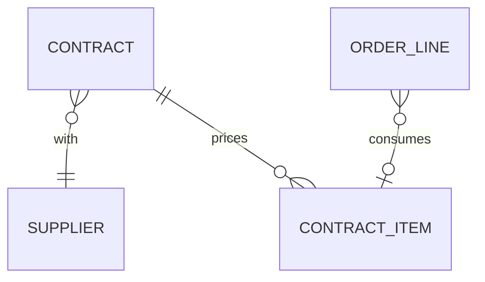

# Foundation: Contracts PRD

## 0. Document control

| Item | Value |
|---|---|
| Document title | Contracts: the contract repository, pricing and consumption, Product Requirements Document |
| Layer | Products (ADR-0029); the module is proposed in section 13 |
| Identifier prefix | `CON-`, in blocks of twenty per area (ADR-0041); the table is `contracts-requirements.csv` |
| Version | 0.1 SKELETON (the split of 2026-10-20) |
| Date | 2026-10-20 |
| Status | Skeleton for the design session's checkpoint: the requirements moved from the Functional Foundation PRD under their new identifiers. The sections marked "after the checkpoint" are written then. |
| Inputs | The Functional Foundation PRD for procure-to-pay, version 1.2 (archived as `../archive/functional-foundation-p2p-PRD-v1.md`), the map (`../requirements-map.md`), ADR-0029 and ADR-0041. |
| Dependency | Suppliers and items are the Business PRD's; orders are the Orders product's; every mechanism is a kernel capability cited by its TF identifier. |
| Tags | `[Carried]` behaviour from the current product that stays. `[Improved]` carried but changed to close a defect or gap. `[New]` not in the current product, standard practice. `[Decision]` needs the owner's confirmation; the question is in its notes. `[Later]` recorded, not in version 1. A requirement moved from the archived PRD says what it was at the start of its notes. |

Change log: 0.1 SKELETON, 2026-10-20: the split (ADR-0041). Contracts moved here from the Functional Foundation PRD 1.2, their words unchanged except for names that changed.

## 1. Vision and goals

### 1.1 Vision

Agreed terms in one place: contracts with suppliers, their items and prices, published to the organisations they cover, consumed by orders, with alerts before they run out or expire.

### 1.2 Goals (outcomes)

Written after the checkpoint.

## 2. Scope

### 2.1 In scope

The contract repository with approval and publishing, contract items and pricing, documents and clauses, imports, applicability per organisation, consumption, expiry and renewal alerts, and the contract reports.

### 2.2 Out of scope in version 1 (`[Later]`)

Contract authoring and negotiation are later scope.

## 3. Personas

| Persona | Goals in this product | Surface |
|---|---|---|
| Buyer | Maintain contracts | Enterprise app |
| Approver (manager, budget owner, finance, legal) | Approve contracts with context, within SLA, or delegate | Enterprise app, email links |
| Requester | Pick contract items | Enterprise app |

## 4. Domain model

`SUPPLIER` is the Business master; `ORDER_LINE` the Orders product's. They are drawn for context.

## 5. Processes

### 5.1 Contract consumption

From the archived PRD's section 5.5: buyer publishes a contract with items and prices → requesters pick contract items → order lines carry the contract reference → released quantity and value accumulate on the contract → alerts at thresholds and before expiry.

## 6. Requirements

Each requirement has an identifier, a priority (Must, Should, Could), a tag, the requirement statement in business terms, the reason, acceptance criteria that a tester can run (including at least one error case), dependencies and notes.

### 6.1 Contracts (CON-001 to CON-020)

#### CON-001 Contract repository
*Priority:* **Should** · *Tag:* `[Carried]` · *Area:* Contracts

**Requirement:** Contracts (number, name, type, supplier, legal entities covered, currency, start, end, value ceiling, owner, renewal terms, documents and clauses as attachments, custom fields) shall be maintained with approval (new and change) and publishing.

**Why:** Agreed terms in one place.

**Acceptance criteria:**

- AC1 Given mandatory fields, When saved, Then the contract is Draft with a number at submission.
- AC2 Given an end date before start, When saved, Then it is refused. (error case)
- AC3 Given publishing, When done, Then items become orderable.

*Depends on:* BF-101, TF-090

**Notes:** Was FF-140.

#### CON-002 Contract items and pricing
*Priority:* **Should** · *Tag:* `[Carried]` · *Area:* Contracts

**Requirement:** Contract items (item or description, unit, price, currency, validity, quantity or value ceiling per item) with price tiers by quantity and validity.

**Why:** Pricing basis for orders.

**Acceptance criteria:**

- AC1 Given tiers 1 to 99 at 10 and 100 plus at 9, When a line of 150 is created, Then price 9 applies.
- AC2 Given a duplicate item in a contract, When saved, Then it is refused. (error case)
- AC3 Given validity ended, When picked, Then the item is not offered.

*Depends on:* CON-001, BF-041

**Notes:** Was FF-141.

#### CON-003 Contract approval and publishing
*Priority:* **Should** · *Tag:* `[Carried]` · *Area:* Contracts

**Requirement:** New contracts and changes run the contract approval configurations; only published contracts are offered; unpublishing hides items but keeps references on existing orders.

**Why:** Control.

**Acceptance criteria:**

- AC1 Given approval, When published, Then items appear in browsing.
- AC2 Given a contract unpublished, When an existing order is viewed, Then its reference remains.
- AC3 Given a change to a published contract, When saved, Then it runs the change approval and the published version stays until approval. (edge)
- AC4 Given publishing attempted before approval, When requested, Then it is refused. (error case)

*Depends on:* CON-001, TF-090

**Notes:** Was FF-142.

#### CON-004 Contract documents and clauses
*Priority:* **Could** · *Tag:* `[New]` · *Area:* Contracts

**Requirement:** Contracts hold documents (signed copies, amendments) and key clause fields (liability cap, payment terms, termination notice) as structured attributes for reporting.

**Why:** Findability of terms.

**Acceptance criteria:**

- AC1 Given clause fields, When filtered in the list, Then matching contracts appear.
- AC2 Given a signed copy uploaded, When viewed, Then it is listed with version.
- AC3 Given a document deleted, When attempted on a published contract, Then it is refused. (error case)

*Depends on:* CON-001, TF-160

**Notes:** Was FF-145.

#### CON-005 Contract import
*Priority:* **Could** · *Tag:* `[New]` · *Area:* Contracts

**Requirement:** Contracts and items importable through the import framework.

**Why:** Migration from spreadsheets.

**Acceptance criteria:**

- AC1 Given a valid file, When imported, Then contracts and items exist as Draft.
- AC2 Given an unknown supplier, When imported, Then the row is reported. (error case)
- AC3 Given a dry run, When finished, Then nothing is created.

*Depends on:* CON-001, TF-205

**Notes:** Was FF-147.

#### CON-006 Contract applicability per organisation
*Priority:* **Should** · *Tag:* `[New]` · *Area:* Contracts

**Requirement:** Contracts shall list the organisations they cover; contract consumption is tracked per organisation and in total.

**Why:** Different units buy from different agreements.

**Acceptance criteria:**

- AC1 Given a contract covering A and B, When an order of C references it, Then it is refused. (error case)
- AC2 Given consumption by A and B, When the contract is viewed, Then per-organisation and total consumption are shown.

*Depends on:* CON-001, BF-003

**Notes:** Was FF-186, the contracts; the catalogues are CAT-007.

### 6.2 Consumption and renewal (CON-021 to CON-040)

#### CON-021 Contract consumption
*Priority:* **Should** · *Tag:* `[New]` · *Area:* Consumption and renewal

**Requirement:** Released quantity and value accumulate from issued order lines referencing the contract and release on cancellation or close-short; thresholds (for example 80 percent) alert the owner; exceeding the ceiling blocks or warns per setting.

**Why:** Know when a contract runs out.

**Acceptance criteria:**

- AC1 Given 80 percent reached, When the next order is issued, Then the owner is alerted.
- AC2 Given 100 percent reached with blocking, When an order is submitted, Then it is refused. (error case)
- AC3 Given an order cancelled, When processed, Then the consumption is released.

*Depends on:* ORD-008, CON-001

**Notes:** Was FF-143. Decision F-07 confirmed.

#### CON-022 Expiry and renewal alerts
*Priority:* **Should** · *Tag:* `[New]` · *Area:* Consumption and renewal

**Requirement:** Contracts expiring within 90, 60 and 30 days shall alert owners; a renewal creates a new version with new dates and optional price changes while keeping history.

**Why:** Avoid lapses.

**Acceptance criteria:**

- AC1 Given 60 days to expiry, When the job runs, Then the owner is notified.
- AC2 Given a renewal, When saved, Then a new version exists and the old one is read-only.
- AC3 Given an expired contract, When items are browsed, Then they are hidden. (edge)
- AC4 Given a renewal with an end date before the new start date, When saved, Then it is refused. (error case)

*Depends on:* CON-001, TF-120

**Notes:** Was FF-144.

### 6.3 Reports (CON-041 to CON-060)

#### CON-041 Contract reports
*Priority:* **Could** · *Tag:* `[New]` · *Area:* Reports

**Requirement:** Reports on contract coverage (spend on contract versus off contract per category), consumption, expiry calendar and supplier contract list.

**Why:** Compliance evidence.

**Acceptance criteria:**

- AC1 Given orders with and without contract references, When the coverage report runs, Then on-contract percent is shown per category.
- AC2 Given export, When run, Then a file is produced.
- AC3 Given no contracts, When run, Then an empty state is shown. (edge)
- AC4 Given a user without the contract report permission, When run, Then it is refused. (error case)

*Depends on:* CON-021

**Notes:** Was FF-146.

## 7. Supplier views

The archived PRD gave suppliers no contract view: its portal requirements cover orders, shipment notices, receipts, invoices, catalogues, company data, questionnaires and tasks. What a supplier sees of its contracts is written after the checkpoint.

## 8. Rules and state machines

### 8.1 Key rules

None of the archived PRD's key rules is this product's alone; the consumption rules are CON-021.

### 8.2 State machines

From the archived PRD's section 7.2: Contract: Draft → In approval → Approved → Published → Expiring (alert) → Expired or Renewed; Unpublished from Published.

## 9. Records and signatures (Part 11)

Which records are approved, acknowledged or signed and so need electronic signatures (TF-063, TF-219), which need an audit-trail review, and their retention class (TF-066). Written after the checkpoint.

## 10. Visibility tags

How this product's records take their tags (TF-241, rule 6). Written after the checkpoint.

## 11. Data, integration and reports

### 11.1 Data notes

Written after the checkpoint.

### 11.2 Integrations

None in the archived PRD's table is this product's.

### 11.3 Reports

From the archived PRD's section 8.4: contract consumption and expiry (CON-041).

### 11.4 Search, exports and analytics feed

What this product indexes for search (TF-204), exports for audit and the ERP (TF-203, TF-205, TF-206) and feeds to analytics (TF-089, TF-203), as the archived FF-164 to FF-166 asked. Declared after the checkpoint.

## 12. Dependencies

The business and kernel requirements this product needs, by identifier. Written after the checkpoint.

## 13. Layer, module, schema and permissions

Written after the checkpoint. The archived PRD's permission catalogue (its section 8.3) named `contracts.contract.{read,create,update,publish}`. The module's name is an open point (section 16.2).

## 14. Configuration

Written after the checkpoint.

## 15. Slices

Where the moved requirements sat in the archived PRD's build plan (its section 9). The product slices are proposed in the technical PRD's section 7 after the checkpoint.

| Slice of the archived plan | Its outcome | This document's requirements from it |
|---|---|---|
| P2 | Suppliers and orders | CON-006 |
| P5 | Catalogue, contracts, change orders | CON-001, CON-002, CON-003, CON-004, CON-005, CON-021, CON-022, CON-041 |

## 16. Decisions and open points

### 16.1 Decisions

Confirmed on 2026-10-17, from the archived PRD's section 10.1:

| ID | Decision | Where applied |
|---|---|---|
| F-07 | Contract consumption in version 1 (slice P5) | CON-021, ORD-008 |

### 16.2 Open points

From the split, for the design session:

| Question | Default proposed |
|---|---|
| A module named `Iron.Products.Contracts` would have the public project `Iron.Products.Contracts.Contracts` (ADR-0001), which reads like a mistake. | Name the module `Iron.Products.ContractManagement` (schema `products_contract_management`) and keep "Contracts" as the product's name |
| CON-021 (consumption) and the Orders product's ORD-008 (contract reference on order lines) depend on each other. | The module dependencies between products are settled with the modules after the checkpoint |

## 17. Glossary

Written after the checkpoint.
