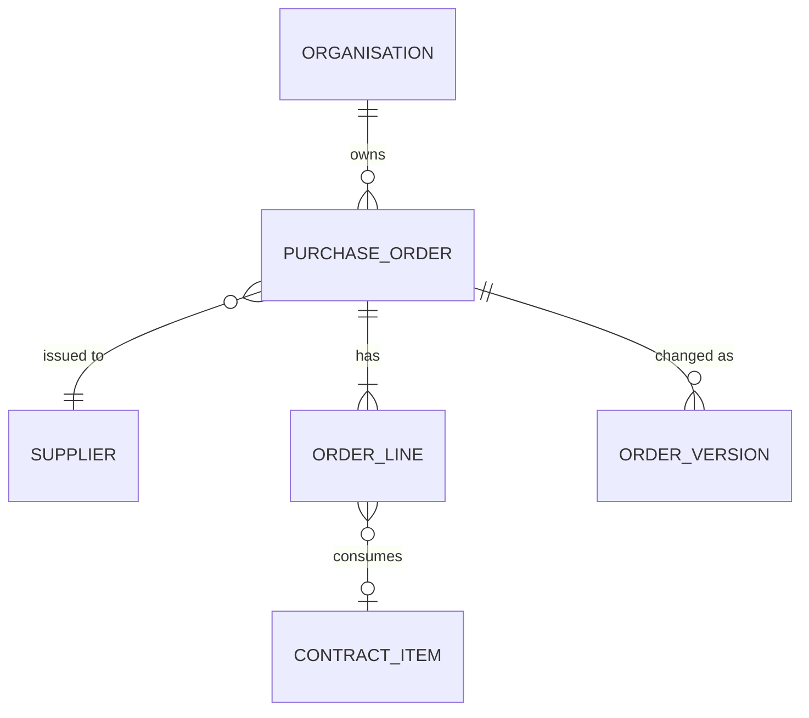
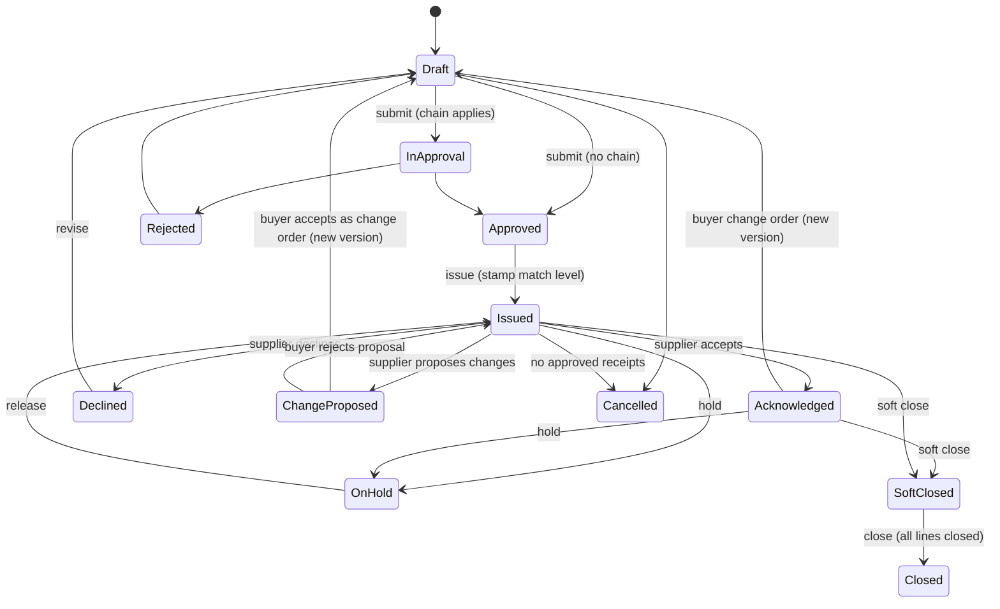

# Foundation: Purchase orders PRD

## 0. Document control

| Item | Value |
|---|---|
| Document title | Purchase orders: compliant ordering from approved suppliers, Product Requirements Document |
| Layer | Products (ADR-0029); the module is proposed in section 13 |
| Identifier prefix | `ORD-`, in blocks of twenty per area (ADR-0041); the table is `orders-requirements.csv` |
| Version | 0.1 SKELETON (the split of 2026-10-20) |
| Date | 2026-10-20 |
| Status | Skeleton for the design session's checkpoint: the requirements moved from the Functional Foundation PRD under their new identifiers. The sections marked "after the checkpoint" are written then. |
| Inputs | The Functional Foundation PRD for procure-to-pay, version 1.2 (archived as `../archive/functional-foundation-p2p-PRD-v1.md`), the map (`../requirements-map.md`), ADR-0029 and ADR-0041. |
| Dependency | Legal entities, finance masters, budgets, terms and suppliers are the Business PRD's; requests, receipts, invoices and contracts are their products'; every mechanism is a kernel capability cited by its TF identifier. |
| Tags | `[Carried]` behaviour from the current product that stays. `[Improved]` carried but changed to close a defect or gap. `[New]` not in the current product, standard practice. `[Decision]` needs the owner's confirmation; the question is in its notes. `[Later]` recorded, not in version 1. A requirement moved from the archived PRD says what it was at the start of its notes. |

Change log: 0.1 SKELETON, 2026-10-20: the split (ADR-0041). Purchase orders moved here from the Functional Foundation PRD 1.2, their words unchanged except for names that changed.

## 1. Vision and goals

### 1.1 Vision

Compliant ordering: approved orders to approved suppliers, stamped with the match level and tolerances that decide how they are received and invoiced, issued by the channel the supplier uses, acknowledged by the supplier, and changed only through versions the supplier sees.

### 1.2 Goals (outcomes)

Goal 1 of the archived PRD is shared with the Purchase requests product (its section 1.2). The acknowledgement goal is the supplier portal surface's goal 1. This product's own goals are written after the checkpoint.

### 1.3 Lessons from the current product

Keep, from the archived PRD's list: configurable match levels per supplier and chart of account stamped on order lines; multi-channel order issue; supplier acknowledgement. Improve: closure flags per order line and close-short; order change versions with re-acknowledgement.

## 2. Scope

### 2.1 In scope

Orders from requests or direct, lines and totals, splits and budget, submission and approval, match level and tolerance stamping, issue by channel, taxes and documents, contract references, requester notifications, acknowledgement and reminders, change orders with versions, hold, close and cancel, line closure flags, lists, and the orders' reports.

### 2.2 Out of scope in version 1 (`[Later]`)

From the archived PRD's list: blanket orders with releases (recorded as a later feature, ORD-062).

## 3. Personas

| Persona | Goals in this product | Surface |
|---|---|---|
| Buyer | Convert requests to orders, manage order changes, resolve supplier queries | Enterprise app |
| Approver (manager, budget owner, finance, legal) | Approve orders with context, within SLA, or delegate | Enterprise app, email links |
| Requester | Follow the order, confirm receipt when asked | Enterprise app |
| Supplier contact | Acknowledge orders | Supplier Network portal |

## 4. Domain model

`ORGANISATION` is the kernel's unit; `SUPPLIER` the Business master; `CONTRACT_ITEM` the Contracts product's. They are drawn for context.

## 5. Processes

### 5.1 Request to order (the order's part)

From the archived PRD's section 5.2, after the request's part (the Purchase requests product's section 5): an order converted from a request, or a direct order → order approval (when configured) → match level and tolerances stamped → issue by channel → supplier acknowledges (accept, decline, or propose changes) → buyer accepts proposal as a change order (new version) or rejects.

## 6. Requirements

Each requirement has an identifier, a priority (Must, Should, Could), a tag, the requirement statement in business terms, the reason, acceptance criteria that a tester can run (including at least one error case), dependencies and notes.

### 6.1 Orders (ORD-001 to ORD-020)

#### ORD-001 Create orders
*Priority:* **Must** · *Tag:* `[Carried]` · *Area:* Orders

**Requirement:** Orders shall be created from requests (REQ-021) or directly by buyers with the permission (header: supplier and site, legal entity, chart of account, currency, delivery and billing addresses, payment and shipping terms, delivery channel, template, contact; lines: item, quantity, unit, price, tax code, ship-to, need-by, contract reference, splits), as Draft with the number allocated at submission.

**Why:** The commitment document.

**Acceptance criteria:**

- AC1 Given an order created from a request, When viewed, Then each line links to its request line and splits are copied.
- AC2 Given a supplier not published, When an order is created, Then it is refused. (error case)
- AC3 Given a direct order, When created, Then the buyer must have the direct-order permission.

*Depends on:* BF-101, BF-001, BF-072

**Notes:** Was FF-070.

#### ORD-002 Order lines and totals
*Priority:* **Must** · *Tag:* `[Carried]` · *Area:* Orders

**Requirement:** Order lines carry quantity or amount basis, unit price, discounts, tax lines from tax codes, charges (freight, handling) at header or line, and compute totals in order currency with converted amounts in legal entity currency.

**Why:** Correct commitments.

**Acceptance criteria:**

- AC1 Given lines, taxes and charges, When totals compute, Then the total equals lines plus taxes plus charges minus discounts.
- AC2 Given a tax code expired, When used, Then it is refused. (error case)
- AC3 Given a change in a line, When saved, Then totals recompute.

*Depends on:* ORD-001, BF-071

**Notes:** Was FF-071.

#### ORD-003 Order splits and budget
*Priority:* **Must** · *Tag:* `[Carried]` · *Area:* Orders

**Requirement:** Order lines inherit splits from request lines or require splits for direct orders with the same rules; budget reservation moves from request to order without double counting; direct orders reserve budget at submission when configured.

**Why:** Accounting continuity.

**Acceptance criteria:**

- AC1 Given a converted line, When viewed, Then splits equal the request line's splits.
- AC2 Given a direct order with splits short of 100 percent, When submitted, Then it is refused. (error case)
- AC3 Given a direct order submitted with validation on, When processed, Then budget is reserved.

*Depends on:* ORD-001, REQ-003, BF-065

**Notes:** Was FF-072.

#### ORD-004 Order submission and approval
*Priority:* **Must** · *Tag:* `[Carried]` · *Area:* Orders

**Requirement:** Submission shall validate header and lines, supplier status and documents, contract limits, and run the order approval configuration (new and change types) when configured; otherwise the order is Approved.

**Why:** Control before commitment.

**Acceptance criteria:**

- AC1 Given an order above a threshold with a configuration, When submitted, Then it is In Approval with the configured approvers.
- AC2 Given a supplier with a blocking expired document, When submitted, Then it is refused naming the document. (error case)
- AC3 Given no configuration, When submitted, Then it is Approved.

*Depends on:* ORD-001, TF-090, SUP-041

**Notes:** Was FF-073.

#### ORD-005 Match level and tolerance stamping
*Priority:* **Must** · *Tag:* `[Carried]` · *Area:* Orders

**Requirement:** On approval each line shall be stamped with the resolved match level (supplier value for the line type, else chart of account, else system default) and the over-receipt and invoice tolerances in force; stamps never change; later configuration changes affect new orders only.

**Why:** Predictable matching.

**Acceptance criteria:**

- AC1 Given supplier 2-way and chart 3-way for products, When approved, Then product lines are stamped 2-way.
- AC2 Given a stamped line, When the supplier's match level changes, Then the line keeps its stamp.
- AC3 Given a line with match level None, When stamped, Then no quantity tracking applies to it. (edge)
- AC4 Given a stamping attempt on a line that is not approved, When attempted, Then it is refused. (error case)

*Depends on:* ORD-004, BF-101, BF-061

**Notes:** Was FF-074.

#### ORD-006 Issue orders by channel
*Priority:* **Must** · *Tag:* `[Carried]` · *Area:* Orders

**Requirement:** Approved orders shall be issued through the chosen channel: email with the rendered PDF, supplier portal notification, or internal only; the rendered document uses the legal entity's template; issue sets Issued, records time and channel, and stores the PDF.

**Why:** Formal commitment to the supplier.

**Acceptance criteria:**

- AC1 Given channel email, When issued, Then the supplier contact receives the PDF and the order is Issued.
- AC2 Given no template, When issued, Then it is refused naming the missing template. (error case)
- AC3 Given channel portal, When issued, Then the supplier sees it with an acknowledge action.

*Depends on:* ORD-004, TF-162, TF-150

**Notes:** Was FF-075.

#### ORD-007 Order totals, taxes and documents
*Priority:* **Must** · *Tag:* `[Carried]` · *Area:* Orders

**Requirement:** Orders shall show totals by currency, tax breakdown by code and component, charges, and the rendered PDF per version; printing uses the template with tenant branding.

**Why:** Shared commercial document.

**Acceptance criteria:**

- AC1 Given taxes with two components, When viewed, Then the breakdown shows both.
- AC2 Given version 2 issued, When the PDF list is viewed, Then both versions' PDFs exist.
- AC3 Given a missing tax code on a taxable line, When submitted, Then a warning asks for confirmation. (edge)
- AC4 Given a tax component total that does not equal the header tax, When computed, Then the document is refused as inconsistent. (error case)

*Depends on:* ORD-002, TF-162

**Notes:** Was FF-084.

#### ORD-008 Contract reference on order lines
*Priority:* **Should** · *Tag:* `[New]` · *Area:* Orders

**Requirement:** Order lines may reference a contract item; price is taken from the contract; released quantity and value accumulate on the contract at issue and are released on cancellation; exceeding the contract limit is blocked or warned per setting.

**Why:** Contract compliance.

**Acceptance criteria:**

- AC1 Given a contract line with 100 remaining, When an order line of 60 is issued, Then remaining shows 40.
- AC2 Given an order line of 150 against 100 remaining with blocking on, When submitted, Then it is refused. (error case)
- AC3 Given the order cancelled, When processed, Then remaining returns to 100.

*Depends on:* ORD-001, CON-021

**Notes:** Was FF-083.

#### ORD-009 Requester confirmation and notifications
*Priority:* **Should** · *Tag:* `[New]` · *Area:* Orders

**Requirement:** Requesters shall be notified when their lines are ordered, issued, acknowledged, received and invoiced; they may confirm receipt for desk deliveries when configured (creating a receipt in their name).

**Why:** Close the loop with the requester.

**Acceptance criteria:**

- AC1 Given an order issued for the requester's line, When processed, Then the requester is notified with the order number.
- AC2 Given desk-delivery confirmation enabled, When the requester confirms, Then a receipt is created and routed per configuration.
- AC3 Given confirmation disabled, When the requester views the order, Then no confirm action appears. (edge)
- AC4 Given a requester confirming receipt for a line not theirs, When attempted, Then it is refused. (error case)

*Depends on:* ORD-006, RCV-021

**Notes:** Was FF-085.

### 6.2 Acknowledgement and change (ORD-021 to ORD-040)

#### ORD-021 Supplier acknowledgement
*Priority:* **Must** · *Tag:* `[Improved]` · *Area:* Acknowledgement and change

**Requirement:** Supplier users shall acknowledge an issued order by accepting, declining with reason, or proposing changes (dates, quantities, prices per line) within a configurable period; the buyer is notified; proposals are accepted as a change order or rejected; on-time acknowledgement is measured.

**Why:** Carried; adds change proposals.

**Acceptance criteria:**

- AC1 Given acceptance, When saved, Then status is Acknowledged and the buyer notified.
- AC2 Given a proposal, When the buyer accepts it, Then a change order version is created with the proposed values and re-issued.
- AC3 Given a declined order, When the supplier later tries to accept, Then it is refused. (error case)

*Depends on:* ORD-006, ORD-023

**Notes:** Was FF-076.

#### ORD-022 Acknowledgement reminders
*Priority:* **Should** · *Tag:* `[New]` · *Area:* Acknowledgement and change

**Requirement:** Unacknowledged orders shall trigger reminders to the supplier after configurable days and escalation to the buyer; the order list shall flag overdue acknowledgements.

**Why:** Delivery risk is visible early.

**Acceptance criteria:**

- AC1 Given 3 days without acknowledgement, When the job runs, Then the supplier is reminded and the order flagged.
- AC2 Given acknowledgement received, When evaluated, Then no further reminder is sent.
- AC3 Given 7 days, When the job runs, Then the buyer is notified. (edge)
- AC4 Given reminder days set to zero or negative, When saved, Then it is refused. (error case)

*Depends on:* ORD-021, TF-120

**Notes:** Was FF-077.

#### ORD-023 Change orders with versions
*Priority:* **Must** · *Tag:* `[New]` · *Area:* Acknowledgement and change

**Requirement:** Buyers shall change issued orders by creating a new version (lines added, changed or cancelled; header changes), with a change summary, re-approval per configuration, and re-issue; quantities cannot be reduced below received or invoiced; prices cannot change for fully invoiced lines; previous versions remain viewable and the supplier sees the diff.

**Why:** Gap: current product sets the order back to draft without versions.

**Acceptance criteria:**

- AC1 Given a quantity reduced below received, When saved, Then it is refused naming the line. (error case)
- AC2 Given a change approved and issued, When the supplier opens it, Then version 2 with the diff and a new acknowledgement request is shown.
- AC3 Given version history, When viewed, Then each version shows who, when and what changed.

*Depends on:* ORD-006, ORD-021, TF-090

**Notes:** Was FF-079.

### 6.3 Hold, close and cancel (ORD-041 to ORD-060)

#### ORD-041 Hold and release
*Priority:* **Should** · *Tag:* `[Carried]` · *Area:* Hold, close and cancel

**Requirement:** Buyers shall put an order on hold with reason (no receipts or invoices accepted) and release it; suppliers see the hold notice.

**Why:** Pause without cancel.

**Acceptance criteria:**

- AC1 Given an order on hold, When a receipt is created, Then it is refused with the hold reason. (error case)
- AC2 Given release, When done, Then receipts and invoices are accepted again.
- AC3 Given hold, When the supplier views the order, Then the notice is shown.

*Depends on:* ORD-006

**Notes:** Was FF-080.

#### ORD-042 Soft close, close and cancel
*Priority:* **Must** · *Tag:* `[Improved]` · *Area:* Hold, close and cancel

**Requirement:** Soft close stops receipts and allows invoices; close requires all lines closed for receiving and invoicing (or close-short); cancel is allowed only without approved receipts or submitted invoices; each with reason, budget release of remaining reservation, and supplier notification.

**Why:** Clean open-order reporting.

**Acceptance criteria:**

- AC1 Given approved receipts, When cancel is attempted, Then it is refused; soft close is offered. (error case)
- AC2 Given soft close, When an invoice is created, Then it is allowed and a receipt is refused.
- AC3 Given close, When done, Then remaining reservations are released.

*Depends on:* ORD-006, BF-066

**Notes:** Was FF-081.

#### ORD-043 Line closure flags and close-short
*Priority:* **Must** · *Tag:* `[New]` · *Area:* Hold, close and cancel

**Requirement:** Each order line shall have closed-for-receiving and closed-for-invoicing flags set automatically when quantities are met within tolerance, or manually by close-short with reason; closed lines refuse the related documents and release remaining budget.

**Why:** Standard practice (final delivery and final invoice indicators).

**Acceptance criteria:**

- AC1 Given a line fully received within tolerance, When the receipt is approved, Then closed-for-receiving is set automatically.
- AC2 Given a line closed for invoicing, When an invoice line references it, Then it is refused. (error case)
- AC3 Given close-short, When applied, Then both flags are set and the budget remainder released.

*Depends on:* ORD-005, RCV-081

**Notes:** Was FF-082.

### 6.4 Lists and later order types (ORD-061 to ORD-080)

#### ORD-061 Order lists and views
*Priority:* **Must** · *Tag:* `[Carried]` · *Area:* Lists and later order types

**Requirement:** Order lists with filters and saved views; order line view across orders with ordered, received, invoiced and open quantities; service orders view; supplier-specific list in the portal.

**Why:** Tracking fulfilment.

**Acceptance criteria:**

- AC1 Given the line view, When loaded, Then each line shows the four quantities.
- AC2 Given a supplier user, When listing, Then only their orders appear.
- AC3 Given a user without read permission, When opening, Then it is refused. (error case)

*Depends on:* ORD-001, RCV-081

**Notes:** Was FF-078.

#### ORD-062 Blanket and standing orders
*Priority:* **Could** · *Tag:* `[New]` · *Area:* Lists and later order types

**Requirement:** Blanket orders with a value or quantity ceiling and validity, against which release orders are created without approval up to the ceiling. Recorded for a later slice.

**Why:** Common for services and recurring supplies.

**Acceptance criteria:**

- AC1 Given a blanket order, When a release is created within the ceiling, Then it is issued without approval when configured.
- AC2 Given a release above the ceiling, When submitted, Then it is refused. (error case)
- AC3 Given validity ended, When a release is created, Then it is refused.

*Depends on:* ORD-001

**Notes:** Was FF-086. Later.

### 6.5 Reports (ORD-081 to ORD-100)

#### ORD-081 Operational reports
*Priority:* **Must** · *Tag:* `[Carried]` · *Area:* Reports

**Requirement:** The reports in section 11.3 shall be available as grids with filters, saved views and export, respecting permissions and visibility.

**Why:** Run the operation.

**Acceptance criteria:**

- AC1 Given the open orders report, When filtered by supplier, Then only that supplier's lines appear.
- AC2 Given a user without the reports permission, When opening, Then it is refused. (error case)
- AC3 Given export, When run, Then the file matches the grid.

*Depends on:* TF-171, TF-203

**Notes:** Was FF-160, the order reports; the others are REQ-061, RCV-101, INV-084 and CAT-041. Placed by the test: each product owns its reports.

#### ORD-082 Order cycle time measures
*Priority:* **Should** · *Tag:* `[New]` · *Area:* Reports

**Requirement:** The system shall compute cycle times (request to approval, approval to order, order to acknowledgement, order to receipt) by period, legal entity and supplier.

**Why:** Goal 1 of the supplier portal surface (its section 1.2) is measured here.

**Acceptance criteria:**

- AC1 Given documents in a period, When computed, Then medians and percentiles are shown.
- AC2 Given no data, When viewed, Then "no data" is shown. (edge)
- AC3 Given a period with inconsistent data (an approval before submission), When computed, Then the record is excluded and listed in a data quality note. (error case)

*Depends on:* ORD-081

**Notes:** Was FF-161, the order cycle times; the invoice measures are INV-085.

## 7. Supplier views

What the supplier sees and does in the portal for this product; the narrative is written after the checkpoint. The requirements (ORD-101 to ORD-120):

#### ORD-101 Orders and acknowledgement in the portal
*Priority:* **Must** · *Tag:* `[Carried]` · *Area:* Supplier views

**Requirement:** Suppliers see issued orders and versions with PDFs, acknowledge (ORD-021), and see holds, soft closes and cancellations.

**Why:** Core supplier task.

**Acceptance criteria:**

- AC1 Given an issued order, When opened, Then the PDF and the acknowledge actions are shown.
- AC2 Given version 2, When opened, Then the diff and a new acknowledgement request are shown.
- AC3 Given an order of another supplier by identifier, When requested, Then it is refused. (error case)

*Depends on:* ORD-006, ORD-021, SUP-081

**Notes:** Was FF-151.

## 8. Rules and state machines

### 8.1 Key rules

From the archived PRD's section 7.1:

| Rule | Statement |
|---|---|
| Match level stamp | Resolved once at order approval: supplier value for the line type, else chart of account value, else system default; never changed afterwards. |
| Closure | A line closed for receiving accepts no receipts; closed for invoicing accepts no invoices; close-short sets both and releases remaining budget reservation. |

### 8.2 State machines

#### Purchase order

## 9. Records and signatures (Part 11)

Which records are approved, acknowledged or signed and so need electronic signatures (TF-063, TF-219), which need an audit-trail review, and their retention class (TF-066). Written after the checkpoint.

## 10. Visibility tags

How this product's records take their tags (TF-241, rule 6). Written after the checkpoint.

## 11. Data, integration and reports

### 11.1 Data notes

From the archived PRD's section 8.1: order lines follow the kernel's partitioning conventions (TF-226) from the first migration; every order has a public number from the kernel's numbering (TF-166), standard columns, version, soft delete only before submission, custom fields (TF-200), attachments (TF-160), tracked change history (TF-062).

### 11.2 Integrations

| Direction | Data | Trigger | Kernel capability |
|---|---|---|---|
| Outbound | Issued orders and change orders | Events | Webhooks, outbound connectors (TF-105, TF-114) |
| Outbound | Order PDF to supplier by email, portal notification | Issue | Notifications, document rendering (TF-150, TF-162) |

### 11.3 Reports

From the archived PRD's section 8.4: open orders and lines with received and invoiced quantities; cycle times (request to order, order to receipt).

### 11.4 Search, exports and analytics feed

What this product indexes for search (TF-204), exports for audit and the ERP (TF-203, TF-205, TF-206) and feeds to analytics (TF-089, TF-203), as the archived FF-164 to FF-166 asked. Declared after the checkpoint.

## 12. Dependencies

The business and kernel requirements this product needs, by identifier. Written after the checkpoint.

## 13. Layer, module, schema and permissions

Written after the checkpoint; the proposed module is `Iron.Products.Orders` (schema `products_orders`). The archived PRD's permission catalogue (its section 8.3) named `orders.order.{read,create,update,submit,issue,change,hold,close,cancel}`, each with `read_all` versus `read_own` variants where ownership applies.

## 14. Configuration

From the archived PRD's section 8.5: acknowledgement reminder days; auto-close rules.

## 15. Slices

Where the moved requirements sat in the archived PRD's build plan (its section 9). The product slices are proposed in the technical PRD's section 7 after the checkpoint.

| Slice of the archived plan | Its outcome | This document's requirements from it |
|---|---|---|
| P2 | Suppliers and orders | ORD-001, ORD-002, ORD-003, ORD-004, ORD-005, ORD-006, ORD-021, ORD-022, ORD-061, ORD-101 |
| P4 | Invoicing and matching | ORD-081, ORD-082 |
| P5 | Catalogue, contracts, change orders | ORD-007, ORD-008, ORD-009, ORD-023, ORD-041, ORD-042, ORD-043, ORD-062 |

## 16. Decisions and open points

### 16.1 Decisions

Confirmed on 2026-10-17, from the archived PRD's section 10.1:

| ID | Decision | Where applied |
|---|---|---|
| F-07 | Contract consumption in version 1 (slice P5) | ORD-008, CON-021 |

### 16.2 Open points

From the split: ORD-008 (contract reference on order lines) and the Contracts product's CON-021 (consumption) depend on each other, and ORD-009 (requester confirmation) depends on the Receiving product's RCV-021. The module dependencies between products are settled with the modules after the checkpoint.

## 17. Glossary

| Term | Meaning |
|---|---|
| Acknowledgement | Supplier's accept, decline or change proposal on an issued order |
| Change order | A new version of an issued order with changed lines, re-approved and re-issued |
| Match level | None, 2-way, 3-way or 3-way direct; decides the capacity source for invoice lines |
