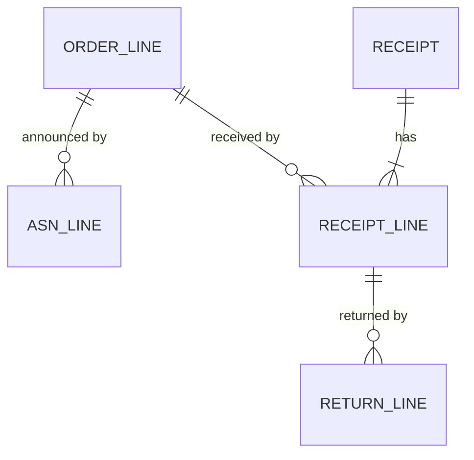
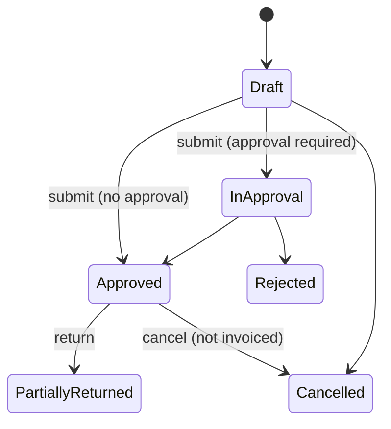

# Foundation: Receiving PRD

## 0. Document control

| Item | Value |
|---|---|
| Document title | Receiving: shipment notices, goods and service receipts, returns, Product Requirements Document |
| Layer | Products (ADR-0029); the module is proposed in section 13 |
| Identifier prefix | `RCV-`, in blocks of twenty per area (ADR-0041); the table is `receiving-requirements.csv` |
| Version | 0.1 SKELETON (the split of 2026-10-20) |
| Date | 2026-10-20 |
| Status | Skeleton for the design session's checkpoint: the requirements moved from the Functional Foundation PRD under their new identifiers. The expanded service receipts and the sections marked "after the checkpoint" are written then. |
| Inputs | The Functional Foundation PRD for procure-to-pay, version 1.2 (archived as `../archive/functional-foundation-p2p-PRD-v1.md`), the map (`../requirements-map.md`), ADR-0029 and ADR-0041. |
| Dependency | Units of measure and warehouses are the Business PRD's; orders and invoices are their products'; every mechanism is a kernel capability cited by its TF identifier. |
| Tags | `[Carried]` behaviour from the current product that stays. `[Improved]` carried but changed to close a defect or gap. `[New]` not in the current product, standard practice. `[Decision]` needs the owner's confirmation; the question is in its notes. `[Later]` recorded, not in version 1. A requirement moved from the archived PRD says what it was at the start of its notes. |

Change log: 0.1 SKELETON, 2026-10-20: the split (ADR-0041). Shipment notices, receipts, returns and the received and invoiced buckets moved here from the Functional Foundation PRD 1.2, their words unchanged except for names that changed. Warehouses went to the Business PRD.

## 1. Vision and goals

### 1.1 Vision

Reliable receiving: suppliers announce what they ship, receivers record what arrived against order lines under atomic quantity and tolerance checks, approved receipts become invoiceable, and returns go back with their paperwork.

### 1.2 Goals (outcomes)

Written after the checkpoint.

### 1.3 Lessons from the current product

Keep, from the archived PRD's list: GRN pending quantity counting in-progress receipts. Improve: atomic quantity checks; return-to-supplier documents.

## 2. Scope

### 2.1 In scope

Shipment notices with their tracking, receipts with tolerance, inspection and approval, rejection and cancellation, receipt documents, receiving delegation and requester receipts, service receipts (expanded after the checkpoint: service entry against an order line, milestones, percentage of completion, acceptance by the requester, partial acceptance), returns, the received and invoiced buckets and open quantities, and the receiving reports.

### 2.2 Out of scope in version 1 (`[Later]`)

The inventory and stock ledger (the Business PRD's section 2.3).

## 3. Personas

| Persona | Goals in this product | Surface |
|---|---|---|
| Receiver (stores, site) | Record receipts against orders, note inspection, return goods | Enterprise app (tablet) |
| Buyer | Approve shipment notices | Enterprise app |
| Requester | Confirm receipt when asked | Enterprise app |
| Approver | Approve receipts with context, within SLA, or delegate | Enterprise app, email links |
| Supplier contact | Send shipment notices | Supplier Network portal |

## 4. Domain model

`ORDER_LINE` is the Orders product's, drawn for context.

## 5. Processes

### 5.1 Receive to invoice (the receipt's part)

From the archived PRD's section 5.3: supplier sends shipment notice → buyer approves → receiver records receipt against order lines (pending quantity and tolerance checks under row locks) → receipt approval when required (else approved directly) → receipt lines become invoiceable. The invoice's part is the Invoicing product's section 5.

## 6. Requirements

Each requirement has an identifier, a priority (Must, Should, Could), a tag, the requirement statement in business terms, the reason, acceptance criteria that a tester can run (including at least one error case), dependencies and notes.

### 6.1 Shipment notices (RCV-001 to RCV-020)

#### RCV-001 Shipment notices (ASN)
*Priority:* **Must** · *Tag:* `[Carried]` · *Area:* Shipment notices

**Requirement:** Supplier users shall create shipment notices against issued or acknowledged order lines (quantities not above open quantity, ship date, expected date, carrier, tracking, packages, attachments), save and submit; buyers shall approve or reject when approval is configured; approved notices are shown when creating receipts.

**Why:** Receiving preparation.

**Acceptance criteria:**

- AC1 Given open lines, When a notice is submitted, Then the buyer is notified and the notice is In Approval or Approved per configuration.
- AC2 Given a quantity above open quantity, When submitted, Then it is refused naming the line. (error case)
- AC3 Given an approved notice, When a receipt is created, Then its lines are offered with announced quantities.

*Depends on:* ORD-006, TF-035, TF-234

**Notes:** Was FF-090. It obeys the supplier portal's ownership rule, SPX-006, and depends on the kernel requirements that enforce it (ADR-0042).

#### RCV-002 Shipment notice visibility and tracking
*Priority:* **Should** · *Tag:* `[New]` · *Area:* Shipment notices

**Requirement:** Buyers and receivers shall see notices per order and per expected date, with status; a notice may be marked received in full or partially by the receipts created from it.

**Why:** Plan the dock.

**Acceptance criteria:**

- AC1 Given notices expected this week, When filtered, Then they are listed by date.
- AC2 Given receipts created from a notice, When viewed, Then the notice shows received versus announced per line.
- AC3 Given a notice cancelled by the supplier before receipt, When viewed, Then it is marked cancelled. (edge)
- AC4 Given a notice marked received by a user without the receiving permission, When attempted, Then it is refused. (error case)

*Depends on:* RCV-001

**Notes:** Was FF-091.

### 6.2 Receipts (RCV-021 to RCV-040)

#### RCV-021 Create a receipt
*Priority:* **Must** · *Tag:* `[Improved]` · *Area:* Receipts

**Requirement:** Receivers shall create receipts against order lines (optionally from a notice) with received quantity and unit, warehouse, inspection result (accepted, rejected, damaged with quantities), received date, delivery note number, notes and attachments; the pending quantity shall be computed under row locks as ordered × (1 + tolerance) − receipts submitted − receipts approved, and a receipt above it shall be refused.

**Why:** Gap: non-atomic check in the current product.

**Acceptance criteria:**

- AC1 Given two receipts created at once for the last 5 units, When processed, Then exactly one succeeds.
- AC2 Given quantity above pending, When saved, Then "Quantity exceeds the open quantity of N" is shown. (error case)
- AC3 Given a receipt in boxes for an order in each, When saved, Then the quantity is converted.

*Depends on:* ORD-005, BF-043, TF-084

**Notes:** Was FF-092.

#### RCV-022 Receipt tolerance
*Priority:* **Must** · *Tag:* `[Carried]` · *Area:* Receipts

**Requirement:** Receipts shall respect the over-receipt tolerance stamped on the order line (else the legal entity or system tolerance) by percentage or value; receipts beyond tolerance are refused; receipts below quantity are allowed (partial deliveries).

**Why:** Controlled over-delivery.

**Acceptance criteria:**

- AC1 Given tolerance 5 percent and ordered 100, When 105 is received cumulatively, Then it is accepted; 106 is refused.
- AC2 Given tolerance zero, When 101 is received, Then it is refused. (error case)
- AC3 Given a partial receipt, When saved, Then the remaining quantity is shown.

*Depends on:* RCV-021

**Notes:** Was FF-093.

#### RCV-023 Inspection and warehouse
*Priority:* **Should** · *Tag:* `[Carried]` · *Area:* Receipts

**Requirement:** Inspection results per line (accepted, rejected, damaged quantities with reasons and photos) and warehouse or location shall be recorded; only accepted quantity counts as received for invoicing when the inspection setting is on; rejected quantities create a return proposal.

**Why:** Quality at receipt.

**Acceptance criteria:**

- AC1 Given 10 received with 2 rejected and the setting on, When approved, Then 8 counts for invoicing and a return proposal for 2 exists.
- AC2 Given rejected quantity without reason, When saved, Then it is refused. (error case)
- AC3 Given the setting off, When approved, Then the full received quantity counts.

*Depends on:* RCV-021

**Notes:** Was FF-094.

#### RCV-024 Receipt submission and approval
*Priority:* **Must** · *Tag:* `[Carried]` · *Area:* Receipts

**Requirement:** Submission shall re-run the pending and tolerance checks, then route through the receipt approval configuration when receipt approval is required (a tenant-wide switch in version 1, with the setting model prepared for per-organisation, per-supplier and per-category control later), else approve directly; approved receipt lines become invoiceable for 3-way lines and update buckets.

**Why:** Verified goods are payable.

**Acceptance criteria:**

- AC1 Given approval required, When submitted, Then approvers see it with lines and inspection.
- AC2 Given approval not required, When submitted, Then it is Approved at once and buckets update.
- AC3 Given approval, When done, Then the receipt date and approver are recorded. (edge)
- AC4 Given a submitted receipt approved by the receiver who created it when self-approval is disallowed, When attempted, Then it is refused. (error case)

*Depends on:* RCV-021, TF-090

**Notes:** Was FF-095. Decision F-02 confirmed.

#### RCV-025 Receipt rejection and cancellation
*Priority:* **Must** · *Tag:* `[Improved]` · *Area:* Receipts

**Requirement:** Rejection by an approver releases the receipt quantity; cancellation of an approved receipt requires the permission, a reason, and is refused when any quantity has been invoiced (credit note path instead); both notify the receiver.

**Why:** Integrity of buckets.

**Acceptance criteria:**

- AC1 Given an approved receipt partly invoiced, When cancel is attempted, Then it is refused naming the invoice. (error case)
- AC2 Given rejection, When done, Then the pending quantity increases accordingly.
- AC3 Given cancellation, When done, Then received approved decreases and the audit shows the reason.

*Depends on:* RCV-024

**Notes:** Was FF-096.

#### RCV-026 Receipt documents and print
*Priority:* **Should** · *Tag:* `[Carried]` · *Area:* Receipts

**Requirement:** Receipts shall render as PDF with the legal entity template (goods receipt note) and be downloadable by buyers and the supplier.

**Why:** Dock paperwork and supplier evidence.

**Acceptance criteria:**

- AC1 Given a template, When rendered, Then the PDF shows lines, quantities and inspection.
- AC2 Given no template, When rendered, Then it is refused naming the template. (error case)
- AC3 Given the supplier user, When they open their receipt, Then the same PDF is available.

*Depends on:* RCV-024, TF-162

**Notes:** Was FF-101.

#### RCV-027 Receiving delegation and requester receipts
*Priority:* **Should** · *Tag:* `[New]` · *Area:* Receipts

**Requirement:** Receiving duties shall be delegable (kernel delegation, the receiving duty); requesters may be allowed to confirm receipt for their own lines per configuration, creating receipts routed per the receipt approval setting.

**Why:** Desk deliveries and absences.

**Acceptance criteria:**

- AC1 Given a delegation to user B, When B records a receipt for A's unit, Then it is allowed and attributed to both.
- AC2 Given requester confirmation enabled, When the requester confirms, Then a receipt exists in their name.
- AC3 Given requester confirmation disabled, When attempted, Then it is refused. (error case)

*Depends on:* RCV-021, TF-037

**Notes:** Was FF-103.

#### RCV-028 Receipt lists and supplier view
*Priority:* **Must** · *Tag:* `[Carried]` · *Area:* Receipts

**Requirement:** Receipt lists (all, per order, per supplier, pending approval) for buyers and receivers; suppliers see their receipts in the portal with quantities and inspection results.

**Why:** Visibility for both parties.

**Acceptance criteria:**

- AC1 Given a supplier user, When listing, Then only their receipts appear.
- AC2 Given filters by pending approval, When applied, Then only those appear.
- AC3 Given a user without read permission, When opening, Then it is refused. (error case)

*Depends on:* RCV-024, TF-035, TF-234

**Notes:** Was FF-104. It obeys the supplier portal's ownership rule, SPX-006, and depends on the kernel requirements that enforce it (ADR-0042).

### 6.3 Service receipts (RCV-041 to RCV-060)

The service entry against an order line, milestones, percentage of completion, acceptance by the requester and partial acceptance are written here after the checkpoint.

#### RCV-041 Service receipts
*Priority:* **Should** · *Tag:* `[New]` · *Area:* Service receipts

**Requirement:** For service lines on amount basis, receipts shall record amount received (service entry) instead of quantity, with the same pending and tolerance logic on amounts.

**Why:** Services are bought by amount.

**Acceptance criteria:**

- AC1 Given a service line of 10,000 and a service receipt of 6,000, When saved, Then open to receive is 4,000.
- AC2 Given a service receipt above open amount plus tolerance, When saved, Then it is refused. (error case)
- AC3 Given invoicing of the service line, When submitted, Then capacity uses received amounts for 3-way.

*Depends on:* RCV-021, RCV-081

**Notes:** Was FF-102.

### 6.4 Returns (RCV-061 to RCV-080)

#### RCV-061 Returns to supplier
*Priority:* **Should** · *Tag:* `[New]` · *Area:* Returns

**Requirement:** A return document shall reference approved receipt lines with return quantity and reason, run approval when configured, reduce received approved quantity on approval, be refused for quantities already invoiced (credit note required first), and notify the supplier with a return note PDF.

**Why:** Standard practice; absent in the current product.

**Acceptance criteria:**

- AC1 Given 10 received approved and 0 invoiced, When a return of 3 is approved, Then received approved is 7 and open to receive increases by 3.
- AC2 Given 10 received with 10 invoiced, When a return is attempted, Then it is refused with the credit note path explained. (error case)
- AC3 Given approval, When done, Then the supplier receives the return note.

*Depends on:* RCV-024, RCV-081

**Notes:** Was FF-097. Its dependency on credit notes (INV-044) became one on the buckets (RCV-081), which Invoicing updates through this product's Contracts (ADR-0042).

### 6.5 Quantities (RCV-081 to RCV-100)

#### RCV-081 Received and invoiced buckets
*Priority:* **Must** · *Tag:* `[Improved]` · *Area:* Quantities

**Requirement:** Order lines shall carry received submitted, received approved, invoiced submitted and invoiced approved; receipt lines shall carry invoiced submitted and invoiced approved; every transition shall update buckets in the same transaction under row locks (submit adds to submitted, approve moves to approved, reject releases submitted, cancel and return release approved, credit note reverses approved).

**Why:** The system of record for matching.

**Acceptance criteria:**

- AC1 Given a receipt approved for 6 of 10, When viewed, Then received approved is 6 and open to receive is 4 (tolerance zero).
- AC2 Given an invoice submitted for 6 against a 2-way line, When viewed, Then invoiced submitted is 6 and open to invoice is 4.
- AC3 Given a transition that would make a bucket negative, When attempted, Then it is refused as an integrity error. (error case)

*Depends on:* ORD-005, TF-084

**Notes:** Was FF-098.

#### RCV-082 Open quantities view
*Priority:* **Should** · *Tag:* `[New]` · *Area:* Quantities

**Requirement:** Buyers, receivers and payables shall see per order line the open-to-receive and open-to-invoice quantities and amounts, computed from buckets, with drill-down to the documents.

**Why:** One truth for everyone.

**Acceptance criteria:**

- AC1 Given buckets, When the view loads, Then open quantities match the formulas in section 8.1.
- AC2 Given a drill-down, When clicked, Then the receipts and invoices of the line are listed.
- AC3 Given a line with match level None, When viewed, Then quantities show as not tracked. (edge)
- AC4 Given a user without read permission on orders, When the view is requested, Then it is refused. (error case)

*Depends on:* RCV-081

**Notes:** Was FF-099.

#### RCV-083 Nightly reconciliation of the received buckets
*Priority:* **Must** · *Tag:* `[New]` · *Area:* Quantities

**Requirement:** A nightly job shall recompute the received buckets (received submitted and received approved, RCV-081) from receipts and returns, compare them with the stored values, write differences to a drift report and alert operators; drift is an incident, not auto-healed. It runs in the one nightly reconciliation window of the kernel's jobs (TF-120 to TF-124).

**Why:** Counters are a cache; documents are the truth.

**Acceptance criteria:**

- AC1 Given consistent data, When the job runs, Then zero drift rows exist and a success record is stored.
- AC2 Given a manual database change that breaks a counter, When the job runs, Then the drift row names the line and values and an alert fires. (error case)
- AC3 Given the job fails, When detected, Then an alert fires.

*Depends on:* RCV-081, RCV-061, TF-120, TF-123

**Notes:** Was FF-133, the received buckets; Orders, Invoicing and the Business budgets reconcile their own counters in ORD-121, INV-027 and BF-073, in the same window.

### 6.6 Reports (RCV-101 to RCV-120)

#### RCV-101 Operational reports
*Priority:* **Must** · *Tag:* `[Carried]` · *Area:* Reports

**Requirement:** The reports in section 11.3 shall be available as grids with filters, saved views and export, respecting permissions and visibility.

**Why:** Run the operation.

**Acceptance criteria:**

- AC1 Given a user without the reports permission, When opening, Then it is refused. (error case)
- AC2 Given export, When run, Then the file matches the grid.

*Depends on:* TF-171, TF-203

**Notes:** Was FF-160, the receiving reports; the others are REQ-061, ORD-081, INV-084 and CAT-041. Placed by the test: each product owns its reports.

## 7. Supplier views

What the supplier sees and does in the portal for this product; the narrative is written after the checkpoint. The requirements (RCV-121 to RCV-140):

#### RCV-121 Shipment notices in the portal
*Priority:* **Must** · *Tag:* `[Carried]` · *Area:* Supplier views

**Requirement:** Suppliers create and submit shipment notices (RCV-001) from their orders and see their status.

**Why:** Delivery coordination.

**Acceptance criteria:**

- AC1 Given open lines, When a notice is submitted, Then it appears in the buyer's list.
- AC2 Given a notice rejected, When viewed, Then the reason is shown.
- AC3 Given a cancelled order, When a notice is attempted, Then it is refused. (error case)

*Depends on:* RCV-001

**Notes:** Was FF-152.

#### RCV-122 Receipts and returns in the portal
*Priority:* **Should** · *Tag:* `[Carried]` · *Area:* Supplier views

**Requirement:** Suppliers see receipts and returns for their orders with quantities, inspection results and PDFs.

**Why:** Transparency before invoicing.

**Acceptance criteria:**

- AC1 Given a receipt approved, When viewed, Then quantities and inspection are shown.
- AC2 Given a return approved, When viewed, Then the return note is available.
- AC3 Given a receipt of another supplier, When requested, Then it is refused. (error case)

*Depends on:* RCV-026, RCV-061

**Notes:** Was FF-154.

## 8. Rules and state machines

### 8.1 Key rules

From the archived PRD's section 7.1:

| Rule | Statement |
|---|---|
| Pending receipt quantity | Ordered × (1 + over-receipt tolerance) − receipts submitted − receipts approved, computed under row locks. |
| Open to invoice | 2-way: ordered − invoiced submitted − invoiced approved. 3-way: sum over approved receipt lines of received − invoiced submitted − invoiced approved. Strict mode option: any prior consumption blocks. |
| Returns | A return references an approved receipt line; reduces received approved quantity; refused when the quantity is already invoiced (credit note path). |

The open-to-invoice formula is here because the buckets it reads are this product's (RCV-081); the Invoicing product applies it.

### 8.2 State machines

#### Receipt (GRN) and shipment notice

Return: Draft → Submitted → Approved.

## 9. Records and signatures (Part 11)

Which records are approved, acknowledged or signed and so need electronic signatures (TF-063, TF-219), which need an audit-trail review, and their retention class (TF-066). Written after the checkpoint.

## 10. Visibility tags

How this product's records take their tags (TF-241, rule 6). Written after the checkpoint.

## 11. Data, integration and reports

### 11.1 Data notes

From the archived PRD's section 8.1: receipt lines and the buckets follow the kernel's partitioning conventions (TF-226) from the first migration; every receipt has a public number from the kernel's numbering (TF-166), standard columns, version, soft delete only before submission, custom fields (TF-200), attachments (TF-160), tracked change history (TF-062). The consumption buckets live on order lines and receipt lines and are recomputed by the nightly reconciliation job (INV-027).

### 11.2 Integrations

| Direction | Data | Trigger | Kernel capability |
|---|---|---|---|
| Outbound | Approved receipts | Events | Webhooks, outbound connectors (TF-105, TF-114) |

### 11.3 Reports

From the archived PRD's section 8.4: receipts pending approval.

### 11.4 Search, exports and analytics feed

What this product indexes for search (TF-204), exports for audit and the ERP (TF-203, TF-205, TF-206) and feeds to analytics (TF-089, TF-203), as the archived FF-164 to FF-166 asked. Declared after the checkpoint.

## 12. Dependencies

The business and kernel requirements this product needs, by identifier. Written after the checkpoint.

## 13. Layer, module, schema and permissions

Written after the checkpoint; the proposed module is `Iron.Products.Receiving` (schema `products_receiving`). The archived PRD's permission catalogue (its section 8.3) named `receiving.asn.*` and `receiving.receipt.{read,create,submit,approve,cancel,return}`, each with `read_all` versus `read_own` variants where ownership applies.

## 14. Configuration

From the archived PRD's section 8.5: receipt approval required (tenant-wide in version 1, designed for per-organisation, per-supplier and per-category later).

## 15. Slices

Where the moved requirements sat in the archived PRD's build plan (its section 9). The product slices are proposed in the technical PRD's section 7 after the checkpoint.

| Slice of the archived plan | Its outcome | This document's requirements from it |
|---|---|---|
| P2 | Suppliers and orders | RCV-121 |
| P3 | Receiving | RCV-001, RCV-002, RCV-021, RCV-022, RCV-023, RCV-024, RCV-025, RCV-026, RCV-027, RCV-028, RCV-041, RCV-061, RCV-081, RCV-082, RCV-122 |
| P4 | Invoicing and matching | RCV-083, RCV-101 |

## 16. Decisions and open points

### 16.1 Decisions

Confirmed on 2026-10-17, from the archived PRD's section 10.1:

| ID | Decision | Where applied |
|---|---|---|
| F-02 | Receipt approval tenant-wide in version 1; design allows per organisation, per supplier and per category later | RCV-024, INV-061 |

### 16.2 Open points

From the archived PRD's section 10.2:

| ID | Question | Default used |
|---|---|---|
| G-06 | Mobile companion scope for this product: approval centre only, or also receipt confirmation? | Approval centre first; receipt confirmation second |

Decided at the PRD split's checkpoint, on 2026-10-20: Products depend on each other in the process order, Supplier management, Contracts, Catalogue, Requests, Orders, Receiving, Invoicing: a later product calls an earlier one through its Contracts, and an earlier one hears from a later one only through events (ADR-0042). Receiving calls Orders (RCV-001, RCV-021, RCV-081); Invoicing updates the invoiced buckets through this product's Contracts, so returns read the buckets, not credit notes (RCV-061). Each module reconciles its own counters in one nightly window (RCV-083).

## 17. Glossary

| Term | Meaning |
|---|---|
| ASN (shipment notice) | Supplier's notice of goods dispatched against order lines |
| Buckets | Per order line and receipt line counters: received submitted and approved, invoiced submitted and approved |
| GRN (receipt) | Record of goods or services received against order lines |
| Return to supplier | Document reducing an approved receipt for goods sent back |
| Tolerance | Allowed difference between ordered, received and invoiced quantities, prices and amounts |
