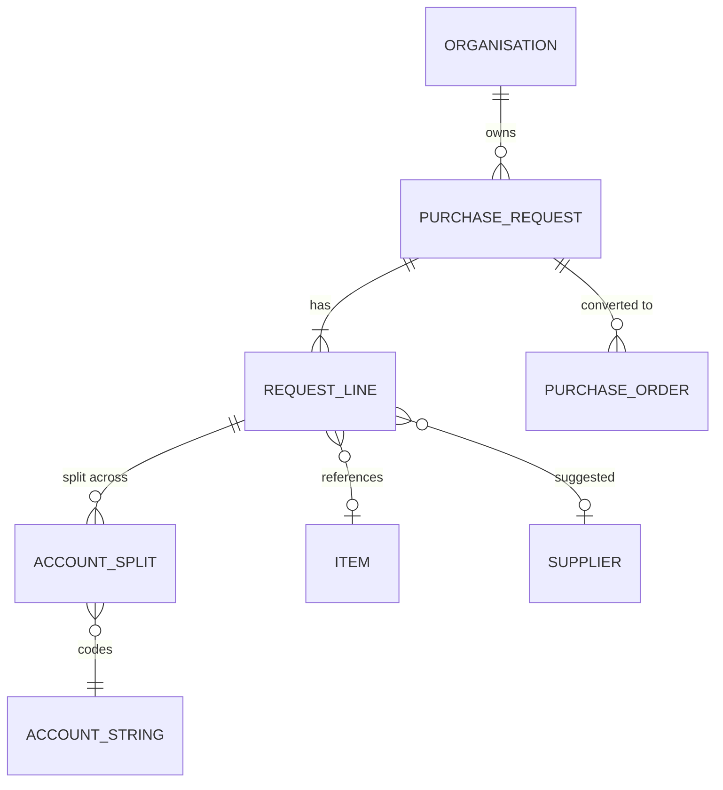
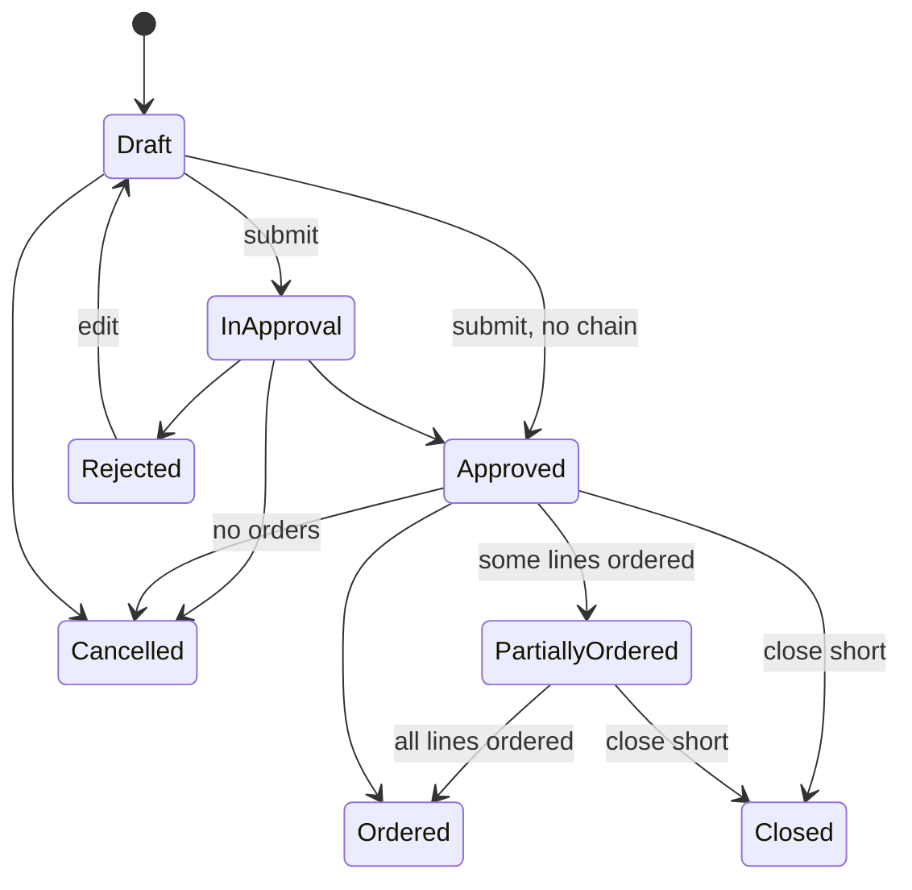

# Foundation: Purchase requests PRD

## 0. Document control

| Item | Value |
|---|---|
| Document title | Purchase requests: controlled demand with budget, Product Requirements Document |
| Layer | Products (ADR-0029); the module is proposed in section 13 |
| Identifier prefix | `REQ-`, in blocks of twenty per area (ADR-0041); the table is `requests-requirements.csv` |
| Version | 0.1 SKELETON (the split of 2026-10-20) |
| Date | 2026-10-20 |
| Status | Skeleton for the design session's checkpoint: the requirements moved from the Functional Foundation PRD under their new identifiers. The sections marked "after the checkpoint" are written then. |
| Inputs | The Functional Foundation PRD for procure-to-pay, version 1.2 (archived as `../archive/functional-foundation-p2p-PRD-v1.md`), the map (`../requirements-map.md`), ADR-0029 and ADR-0041. |
| Dependency | Legal entities, finance masters, budgets, items, units, locations and suppliers are the Business PRD's; orders are the Orders product's; every mechanism is a kernel capability cited by its TF identifier. |
| Tags | `[Carried]` behaviour from the current product that stays. `[Improved]` carried but changed to close a defect or gap. `[New]` not in the current product, standard practice. `[Decision]` needs the owner's confirmation; the question is in its notes. `[Later]` recorded, not in version 1. A requirement moved from the archived PRD says what it was at the start of its notes. |

Change log: 0.1 SKELETON, 2026-10-20: the split (ADR-0041). Purchase requests moved here from the Functional Foundation PRD 1.2, their words unchanged except for names that changed. Ship-to locations went to the Business PRD.

## 1. Vision and goals

### 1.1 Vision

Controlled demand: every purchase starts as a request with its lines coded to account strings and checked against budget, approved by the right people, and converted into orders without re-keying.

### 1.2 Goals (outcomes)

Goal 1 of the archived PRD, in its words, shared with the Orders product:

1. Every purchase goes through a request, an approval and an order; no spend outside the system for in-scope categories.

## 2. Scope

### 2.1 In scope

Requests with lines and lots, account splits, line currencies, submission validations, the budget check, approval, cancellation, totals, conversion into orders, partial ordering and close-short, copy and templates, lists and visibility, and the requests' reports.

### 2.2 Out of scope in version 1 (`[Later]`)

Recurring requests (decision F-12: templates yes, recurring requests later).

## 3. Personas

| Persona | Goals in this product | Surface |
|---|---|---|
| Requester | Raise a request from catalogue or free text, see budget, follow approval | Enterprise app |
| Buyer | Convert requests to orders | Enterprise app |
| Approver (manager, budget owner, finance, legal) | Approve requests with context, within SLA, or delegate | Enterprise app, email links |

## 4. Domain model

`ORGANISATION` is the kernel's unit; `ACCOUNT_STRING`, `ITEM` and `SUPPLIER` are Business masters; `PURCHASE_ORDER` is the Orders product's. They are drawn for context.

## 5. Processes

### 5.1 Request to order (the request's part)

From the archived PRD's section 5.2: create request (header, lines, lots, splits) → submit (validations, budget check, hook) → approval chain → approved → buyer reviews and converts to one order per supplier (lines without supplier are sourced or assigned first). The order's part of the process is the Orders product's section 5.

## 6. Requirements

Each requirement has an identifier, a priority (Must, Should, Could), a tag, the requirement statement in business terms, the reason, acceptance criteria that a tester can run (including at least one error case), dependencies and notes.

### 6.1 Requests (REQ-001 to REQ-020)

#### REQ-001 Create and edit a request
*Priority:* **Must** · *Tag:* `[Carried]` · *Area:* Requests

**Requirement:** Requesters shall create requests (title, legal entity, currency, chart of account, requested for, organisation unit, project, need-by date, fiscal period, ship-to location, notes, custom fields, attachments) as Draft and edit them in Draft or Rejected; editing in other states is refused.

**Why:** Entry document.

**Acceptance criteria:**

- AC1 Given mandatory header fields, When saved, Then a Draft exists without a number.
- AC2 Given a request in approval, When edited, Then it is refused with the state named. (error case)
- AC3 Given a rejected request edited and resubmitted, When processed, Then a new approval chain is built.

*Depends on:* BF-001, BF-061, BF-070

**Notes:** Was FF-050.

#### REQ-002 Request lines and lots
*Priority:* **Must** · *Tag:* `[Carried]` · *Area:* Requests

**Requirement:** Lines (item or free text, type product or service, quantity or amount basis, quantity, unit, unit price, currency, supplier suggestion, category, need-by, ship-to, custom fields) and lots with child lines, numbered per request, with a duplicate rule on item plus supplier plus account coding plus ship-to.

**Why:** Line detail for ordering.

**Acceptance criteria:**

- AC1 Given a complete line, When saved, Then it gets the next line number and the request total updates.
- AC2 Given a duplicate line, When saved, Then it is refused with the duplicate named. (error case)
- AC3 Given a lot, When child lines are added, Then the lot total equals the sum of children.

*Depends on:* REQ-001, BF-041, BF-043

**Notes:** Was FF-051.

#### REQ-003 Account splits on lines
*Priority:* **Must** · *Tag:* `[Carried]` · *Area:* Requests

**Requirement:** Each line shall be split across account strings with budget period and percent per the account split rule; a default split from the requester's organisation unit shall be proposed.

**Why:** Accounting on every line.

**Acceptance criteria:**

- AC1 Given splits of 60 and 40 percent, When submitted, Then validation passes.
- AC2 Given splits totalling 90 percent, When submitted, Then "Allocations for line N total 90 percent; they must total 100" is shown. (error case)
- AC3 Given a default split configured, When a line is created, Then it is pre-filled and editable.

*Depends on:* REQ-002, BF-062, BF-063

**Notes:** Was FF-052.

#### REQ-004 Line currencies and conversion
*Priority:* **Should** · *Tag:* `[Carried]` · *Area:* Requests

**Requirement:** When multi-currency lines are allowed, lines may be in allowed currencies and are converted to the header currency with the rate valid on the request date; the request shows both amounts.

**Why:** Imports and foreign suppliers.

**Acceptance criteria:**

- AC1 Given a line in USD and header in INR, When saved, Then the converted amount uses the valid rate.
- AC2 Given no rate, When saved, Then it is refused naming the pair and date. (error case)
- AC3 Given multi-currency off, When editing, Then only the header currency is offered.

*Depends on:* BF-070, REQ-002

**Notes:** Was FF-053.

#### REQ-005 Submission validations
*Priority:* **Must** · *Tag:* `[Improved]` · *Area:* Requests

**Requirement:** On submit the system shall validate header mandatory fields, at least one line, mandatory line fields, splits totalling 100 percent, supplier status (published, not on hold, no critical flag, no blocking expired document), item status, budget period open, and run hook points; it shall then allocate the number and start the approval chain (or approve directly when no configuration applies).

**Why:** Clean documents reach approvers.

**Acceptance criteria:**

- AC1 Given a complete request, When submitted, Then it is numbered and In Approval (or Approved).
- AC2 Given a supplier on hold on a line, When submitted, Then it is refused naming the line and supplier. (error case)
- AC3 Given a hook that blocks, When submitted, Then the message is shown and the request stays Draft.

*Depends on:* REQ-001, REQ-003, SUP-004, TF-090, TF-202

**Notes:** Was FF-054.

#### REQ-006 Budget check at submission
*Priority:* **Must** · *Tag:* `[Improved]` · *Area:* Requests

**Requirement:** Submission shall apply the budget availability check with reservation (BF-065) when request budget validation is on, blocking or warning as configured, and show approvers the budget status per split.

**Why:** Spend control at the source.

**Acceptance criteria:**

- AC1 Given blocking on and budget short, When submitted, Then it is refused with the shortfall per account string. (error case)
- AC2 Given warning on, When submitted, Then it proceeds and the approval screen shows the shortfall.
- AC3 Given validation off, When submitted, Then no budget check runs and no reservation is made. (edge)

*Depends on:* REQ-005, BF-065

**Notes:** Was FF-055. AC1 is marked as the error case it is (ADR-0041).

#### REQ-007 Approval of requests
*Priority:* **Must** · *Tag:* `[Carried]` · *Area:* Requests

**Requirement:** Requests shall use the kernel workflow with the request document type, conditions on header, line and split fields (amount, category, legal entity, supplier, account string, custom fields), dynamic approvers (manager chain, budget owner, account string owner, category group) and the standard actions; approvers shall see lines, splits, budget status and attachments in the approval view.

**Why:** Core governance.

**Acceptance criteria:**

- AC1 Given a configuration on amount above 10,000 with manager chain, When submitted, Then the requester's manager is an approver.
- AC2 Given a rejection, When done, Then the requester is notified and may edit.
- AC3 Given an approver who is also the requester and self-approval is disallowed, When they try, Then it is refused. (error case)

*Depends on:* REQ-005, TF-090, TF-091

**Notes:** Was FF-056.

#### REQ-008 Cancel a request
*Priority:* **Must** · *Tag:* `[Carried]` · *Area:* Requests

**Requirement:** The requester or a permitted user shall cancel a request in Draft, In Approval or Approved without orders, with a reason, releasing budget reservations and notifying pending approvers.

**Why:** Needs change.

**Acceptance criteria:**

- AC1 Given an Approved request without orders, When cancelled, Then it is Cancelled and reservations released.
- AC2 Given a request with an order, When cancelled, Then it is refused; close-short is offered instead. (error case)
- AC3 Given cancellation, When audited, Then the reason is recorded.

*Depends on:* REQ-001, BF-066

**Notes:** Was FF-057.

#### REQ-009 Request totals and summary
*Priority:* **Should** · *Tag:* `[Carried]` · *Area:* Requests

**Requirement:** Requests shall show line totals, converted totals in header currency, tax estimate when codes are set, budget status per split, linked orders and a summary panel for approvers.

**Why:** Context for decisions.

**Acceptance criteria:**

- AC1 Given lines in two currencies, When viewed, Then the total is in header currency with the rates used.
- AC2 Given linked orders, When viewed, Then order numbers and statuses are listed.
- AC3 Given no rate for a line, When totals compute, Then the total shows as unavailable with the reason instead of a wrong number. (error case)

*Depends on:* REQ-004

**Notes:** Was FF-063.

### 6.2 Ordering (REQ-021 to REQ-040)

#### REQ-021 Convert a request to orders
*Priority:* **Must** · *Tag:* `[Improved]` · *Area:* Ordering

**Requirement:** A buyer shall convert an Approved request into one draft order per supplier (default) with the option to split or merge lines across orders before submission; lines without supplier must be assigned a supplier first; converted lines are linked and the request becomes Partially Ordered or Ordered.

**Why:** No re-keying.

**Acceptance criteria:**

- AC1 Given approved lines for two suppliers, When converted, Then two draft orders exist and the request is Ordered.
- AC2 Given a line without supplier, When converted, Then it is refused naming the line. (error case)
- AC3 Given only some lines converted, When saved, Then the request is Partially Ordered with remaining quantities visible.

*Depends on:* REQ-007, ORD-001

**Notes:** Was FF-058. Decision F-01 confirmed.

#### REQ-022 Partial ordering and close-short
*Priority:* **Should** · *Tag:* `[New]` · *Area:* Ordering

**Requirement:** Remaining quantities on request lines shall be orderable later; a buyer or requester shall close a request or line short with a reason, releasing remaining budget reservation.

**Why:** Demand changes.

**Acceptance criteria:**

- AC1 Given a line of 10 with 6 ordered, When viewed, Then 4 remains orderable.
- AC2 Given close-short, When applied, Then the remaining 4 is released and the line is Closed.
- AC3 Given a closed line, When conversion is attempted, Then it is refused. (error case)

*Depends on:* REQ-021, BF-066

**Notes:** Was FF-059.

### 6.3 Templates and lists (REQ-041 to REQ-060)

#### REQ-041 Copy and templates
*Priority:* **Could** · *Tag:* `[Carried]` · *Area:* Templates and lists

**Requirement:** Users shall copy a request into a new draft and save requests as personal or shared templates; templates pre-fill header and lines without numbers.

**Why:** Repeat buying.

**Acceptance criteria:**

- AC1 Given a copy, When created, Then lines and splits are copied as a new Draft.
- AC2 Given a template used, When created, Then the request is Draft with template lines.
- AC3 Given a template with an inactive item, When used, Then the line is flagged for review. (edge)
- AC4 Given a template shared by a user without the share permission, When saved, Then it is refused. (error case)

*Depends on:* REQ-001

**Notes:** Was FF-060. Decision F-12 confirmed.

#### REQ-042 Request lists and visibility
*Priority:* **Must** · *Tag:* `[Carried]` · *Area:* Templates and lists

**Requirement:** Lists of requests with filters (status, requester, unit, period, supplier, amount) shall respect visibility: requesters see their own and those requested for them, buyers see their units, approvers see those they act on, administrators see all.

**Why:** Need to know.

**Acceptance criteria:**

- AC1 Given a requester, When listing, Then only their requests appear.
- AC2 Given a buyer scoped to unit A, When listing, Then requests of unit A and children appear.
- AC3 Given a user without any request permission, When opening, Then it is refused. (error case)

*Depends on:* REQ-001, TF-033, TF-035

**Notes:** Was FF-061.

### 6.4 Reports (REQ-061 to REQ-080)

#### REQ-061 Operational reports
*Priority:* **Must** · *Tag:* `[Carried]` · *Area:* Reports

**Requirement:** The reports in section 11.3 shall be available as grids with filters, saved views and export, respecting permissions and visibility.

**Why:** Run the operation.

**Acceptance criteria:**

- AC1 Given a user without the reports permission, When opening, Then it is refused. (error case)
- AC2 Given export, When run, Then the file matches the grid.

*Depends on:* TF-171, TF-203

**Notes:** Was FF-160, the request reports; the others are ORD-081, RCV-101, INV-084 and CAT-041. Placed by the test: each product owns its reports.

## 7. Supplier views

Suppliers do not see requests; they see the orders made from them (ORD-101). Written in full after the checkpoint.

## 8. Rules and state machines

### 8.1 Key rules

The account split and budget rules this product applies are the Business PRD's (its section 7.1).

### 8.2 State machines

#### Purchase request

## 9. Records and signatures (Part 11)

Which records are approved, acknowledged or signed and so need electronic signatures (TF-063, TF-219), which need an audit-trail review, and their retention class (TF-066). Written after the checkpoint.

## 10. Visibility tags

How this product's records take their tags (TF-241, rule 6). Written after the checkpoint.

## 11. Data, integration and reports

### 11.1 Data notes

From the archived PRD's section 8.1: request lines follow the kernel's partitioning conventions (TF-226) from the first migration; every request has a public number from the kernel's numbering (TF-166), standard columns, version, soft delete only before submission, custom fields (TF-200), attachments (TF-160), tracked change history (TF-062).

### 11.2 Integrations

None in the archived PRD's table is this product's.

### 11.3 Reports

From the archived PRD's section 8.4: open requests. The request's cycle times are the Orders product's (ORD-082).

### 11.4 Search, exports and analytics feed

What this product indexes for search (TF-204), exports for audit and the ERP (TF-203, TF-205, TF-206) and feeds to analytics (TF-089, TF-203), as the archived FF-164 to FF-166 asked. Declared after the checkpoint.

## 12. Dependencies

The business and kernel requirements this product needs, by identifier. Written after the checkpoint.

## 13. Layer, module, schema and permissions

Written after the checkpoint; the proposed module is `Iron.Products.Requests` (schema `products_requests`). The archived PRD's permission catalogue (its section 8.3) named `requests.request.{read,create,update,submit,cancel,convert,close}`, each with `read_all` versus `read_own` variants where ownership applies.

## 14. Configuration

From the archived PRD's section 8.5: multi-currency on lines. Budget validation and blocking per document type are the Business PRD's document type settings (BF-161).

## 15. Slices

Where the moved requirements sat in the archived PRD's build plan (its section 9). The product slices are proposed in the technical PRD's section 7 after the checkpoint.

| Slice of the archived plan | Its outcome | This document's requirements from it |
|---|---|---|
| P1 | Masters, organisations and first request | REQ-001, REQ-002, REQ-003, REQ-004, REQ-005, REQ-006, REQ-007, REQ-008, REQ-009, REQ-042 |
| P4 | Invoicing and matching | REQ-061 |
| P5 | Catalogue, contracts, change orders | REQ-021, REQ-022, REQ-041 |

## 16. Decisions and open points

### 16.1 Decisions

Confirmed on 2026-10-17, from the archived PRD's section 10.1:

| ID | Decision | Where applied |
|---|---|---|
| F-01 | One order per supplier on conversion; buyer can split or merge before submit | REQ-021 |
| F-12 | Request templates yes; recurring requests later | REQ-041 |

### 16.2 Open points

From the split: REQ-021 (conversion) depends on the Orders product's ORD-001, and ORD-001 is created from REQ-021; the module dependency between the two products is settled with the modules after the checkpoint.

## 17. Glossary

| Term | Meaning |
|---|---|
| Close short | Closing an order or request line with remaining quantity not expected, releasing budget |
