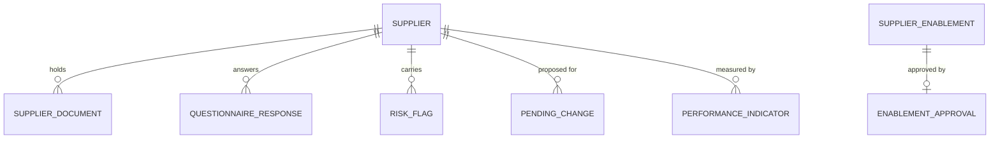
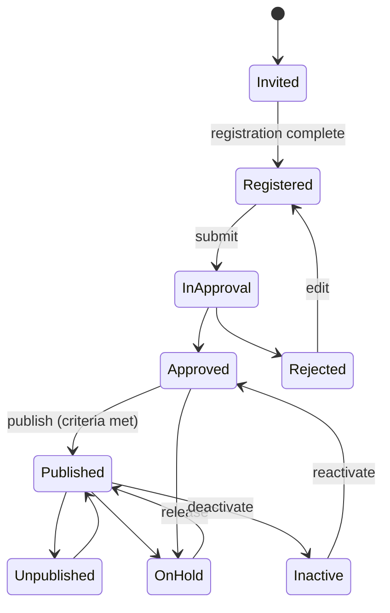

# Foundation: Supplier management PRD

## 0. Document control

| Item | Value |
|---|---|
| Document title | Supplier management: the supplier's life cycle with the tenant, Product Requirements Document |
| Layer | Products (ADR-0029); the module is proposed in section 13 |
| Identifier prefix | `SUP-`, in blocks of twenty per area (ADR-0041); the table is `supplier-management-requirements.csv` |
| Version | 1.0 (accepted at the review of 2026-10-20) |
| Date | 2026-10-20 |
| Status | Accepted at the design session's review of 2026-10-20, its decisions written into the requirements and marked "decided 2026-10-20" in their notes. |
| Inputs | The Functional Foundation PRD for procure-to-pay, version 1.2 (archived as `../archive/functional-foundation-p2p-PRD-v1.md`), the map (`../requirements-map.md`), ADR-0029 and ADR-0041. |
| Dependency | The supplier record and its parts are the Business PRD's (BF-101 to BF-108); every mechanism is a kernel capability cited by its TF identifier. The supplier's own screens are served through the supplier portal surface (`../surfaces/supplier-portal-PRD.md`). |
| Tags | `[Carried]` behaviour from the current product that stays. `[Improved]` carried but changed to close a defect or gap. `[New]` not in the current product, standard practice. `[Decision]` needs the owner's confirmation; the question is in its notes. `[Later]` recorded, not in version 1. A requirement moved from the archived PRD says what it was at the start of its notes. |

Change log: 1.0, 2026-10-20: accepted at the review; its decisions are written into the requirements, and the proposals of the split's sections stand. 0.2 DRAFT, 2026-10-20: the design session's answers at the checkpoint and the split's sections (supplier views, records and signatures, visibility tags, search and exports, dependencies by ADR-0042, module and permissions). 0.1 SKELETON, 2026-10-20: the split (ADR-0041). The supplier's life cycle moved here from the Functional Foundation PRD 1.2, its words unchanged except for names that changed.

## 1. Vision and goals

### 1.1 Vision

Only vetted suppliers receive orders. A buyer invites a supplier, the supplier registers once in the Supplier Network and completes the tenant's sections, the tenant checks for duplicates, approves and publishes it, and then controls its status, its changes, its bank details, its documents, its questionnaires, its risks and its performance for as long as the relationship lasts.

### 1.2 Goals (outcomes)

1. Only suppliers that are approved and published, with their mandatory documents valid, receive orders (SUP-004, SUP-041).
2. A change to a supplier's controlled fields, its bank accounts above all, takes effect only after approval and verification (SUP-022, SUP-023).
3. Each supplier's status, compliance, risks and performance are in one place (SUP-061, SUP-062).

The archived PRD's goal 3 (suppliers self-serve, onboarding included) is the supplier portal surface's goal 1.

### 1.3 Lessons from the current product

Improve, from the archived PRD's list: supplier ownership on every portal operation.

## 2. Scope

### 2.1 In scope

Onboarding (invitation, registration, duplicates, approval and publishing, onboarding configuration), changes and status (status control, change approval, bank account verification, merge), compliance and risk (documents and expiry, questionnaires, risk flags), the relationship view and performance, and the binding of every supplier-facing operation to its supplier.

### 2.2 Out of scope in version 1 (`[Later]`)

From the archived PRD's list: supplier risk scoring from external data; multi-tier supplier collaboration.

## 3. Personas

| Persona | Goals in this product | Surface |
|---|---|---|
| Buyer | Qualify suppliers, resolve supplier queries | Enterprise app |
| Approver (manager, budget owner, finance, legal) | Approve suppliers with context, within SLA, or delegate | Enterprise app, email links |
| Procurement administrator | Suppliers configuration, approval configurations | Tenant console (kernel) and enterprise app |
| Supplier primary contact | Register once in the Supplier Network, accept customer connections, maintain one company profile, manage users and bank accounts | Supplier Network portal |

## 4. Domain model

`SUPPLIER` and `SUPPLIER_ENABLEMENT` are the Business masters (BF-101, BF-108), drawn for context. A questionnaire response is an instance of a kernel form (TF-242); approvals are the kernel's workflow chains (TF-090).

## 5. Processes

### 5.1 Supplier onboarding

From the archived PRD's section 5.1: invite (buyer, by email or network identifier) → network matches or creates the supplier organisation → supplier registers once or accepts the connection → customer-specific sections completed (per customer configuration) → duplicate check in the tenant → approval chain (supplier new) → enabled per organisation → published when mandatory documents and sections are complete → supplier available for requests and orders → profile changes offered by the network and accepted per customer rules; customer-side changes run the supplier change chain → documents expire and trigger actions → hold, end relationship or deactivate when needed (warned when open documents exist).

## 6. Requirements

Each requirement has an identifier, a priority (Must, Should, Could), a tag, the requirement statement in business terms, the reason, acceptance criteria that a tester can run (including at least one error case), dependencies and notes.

### 6.1 Onboarding (SUP-001 to SUP-020)

#### SUP-001 Supplier invitation
*Priority:* **Must** · *Tag:* `[Carried]` · *Area:* Onboarding

**Requirement:** A buyer with the invite permission shall invite a supplier (company name, country, primary contact email or network identifier, optional category and documents to sign), creating a supplier in Invited status in the tenant and a relationship invitation in the Supplier Network, which matches an existing network organisation by tax identifier or email domain or sends a time-limited registration link (72 hours, resendable); duplicates in the tenant shall be flagged before sending.

**Why:** Start of onboarding.

**Acceptance criteria:**

- AC1 Given a new company and contact, When invited, Then the supplier exists as Invited and the email is sent.
- AC2 Given a company that matches an existing supplier by tax identifier or name similarity, When invited, Then a duplicate warning lists the matches and requires confirmation. (error case)
- AC3 Given an expired link, When resent, Then a new link is sent and the old one stops working.
- AC4 Given the supplier already exists in the network, When invited, Then the existing organisation receives a connection request instead of a registration link. (edge)

*Depends on:* TF-018, TF-232

**Notes:** Was FF-020.

#### SUP-002 Supplier self-registration
*Priority:* **Must** · *Tag:* `[Carried]` · *Area:* Onboarding

**Requirement:** A new supplier shall register once in the Supplier Network (credentials, MFA, terms, network profile: legal name, country, tax identifiers, one contact); an existing supplier shall accept the connection; then the customer-specific wizard with sections enabled per tenant (addresses, contacts, sites, bank accounts, tax and compliance, documents, questionnaires) pre-fills from the network profile, saves progress and submits when mandatory sections are complete.

**Why:** Supplier self-service.

**Acceptance criteria:**

- AC1 Given mandatory sections complete, When submitted, Then the supplier moves to Registered and the buyer is notified.
- AC2 Given a mandatory document missing, When submitted, Then the section and document are named and submission is refused. (error case)
- AC3 Given progress saved, When the contact returns, Then the wizard resumes where they left.

*Depends on:* SUP-001, TF-028, TF-164

**Notes:** Was FF-021.

#### SUP-003 Duplicate supplier detection
*Priority:* **Should** · *Tag:* `[New]` · *Area:* Onboarding

**Requirement:** On create and on registration the system shall check exact matches (tax identifiers, registration numbers, email, phone, bank account) and fuzzy matches (name and address similarity above a configurable threshold) and show candidates; a buyer may mark a candidate as "not a duplicate" with a reason.

**Why:** Duplicate suppliers break spend analysis and payments.

**Acceptance criteria:**

- AC1 Given a name similar above the threshold, When saved, Then candidates are shown and confirmation required.
- AC2 Given an exact tax identifier match, When saved, Then it is refused. (error case)
- AC3 Given a candidate marked not duplicate, When saved again, Then it is not shown again for that pair.

*Depends on:* BF-101

**Notes:** Was FF-023.

#### SUP-004 Supplier approval and publishing
*Priority:* **Must** · *Tag:* `[Carried]` · *Area:* Onboarding

**Requirement:** New suppliers shall run the supplier-new approval configuration; approved suppliers shall be published only when publishing criteria are met (mandatory documents valid, required sections complete, at least one active contact, bank account verified when required); unpublishing shall remove the supplier from selection on new documents.

**Why:** Only vetted suppliers receive orders.

**Acceptance criteria:**

- AC1 Given criteria met, When published, Then the supplier can be selected on requests and orders.
- AC2 Given an expired mandatory document, When publishing, Then it is refused naming the document. (error case)
- AC3 Given unpublished, When a new request line is edited, Then the supplier is not offered and existing documents keep it.

*Depends on:* BF-101, TF-090

**Notes:** Was FF-024.

#### SUP-005 Supplier onboarding configuration
*Priority:* **Must** · *Tag:* `[Carried]` · *Area:* Onboarding

**Requirement:** Settings for enabled registration sections, required documents and questionnaires, bank verification rules, duplicate thresholds, portal channels and supplier defaults.

**Why:** Different onboarding per tenant.

**Acceptance criteria:**

- AC1 Given a section disabled, When a supplier registers, Then it is not shown.
- AC2 Given bank verification required, When a bank change is approved without checklist, Then it is refused. (error case)
- AC3 Given a threshold changed, When duplicate detection runs, Then the new threshold applies.

*Depends on:* TF-057, SUP-002

**Notes:** Was FF-171.

#### SUP-006 Organisation approval of an enablement
*Priority:* **Must** · *Tag:* `[New]` · *Area:* Onboarding

**Requirement:** Enabling a supplier in an organisation (BF-108) shall run an optional organisation approval.

**Why:** One registration for the supplier, separate control for each unit.

**Acceptance criteria:**

- AC1 Given organisation approval required in organisation A, When a supplier is enabled in A, Then the enablement takes effect when the approval completes.
- AC2 Given an enablement in organisation A still in approval, When a buyer of A creates an order for the supplier, Then it is refused naming the pending approval. (error case)

*Depends on:* BF-108, SUP-004, TF-090

**Notes:** Was FF-182, its optional organisation approval; the enablement is BF-108. AC1 and AC2 are written for the split from the requirement's own clauses.

### 6.2 Changes and status (SUP-021 to SUP-040)

#### SUP-021 Supplier status control
*Priority:* **Must** · *Tag:* `[Improved]` · *Area:* Changes and status

**Requirement:** Permitted users shall put a supplier on hold, release, deactivate and reactivate with a mandatory reason; hold and deactivation shall warn when open orders, receipts in approval or submitted invoices exist and shall require a second confirmation; on hold or inactive suppliers shall not be selectable and their portal users shall see a status notice.

**Why:** Carried; adds guards and reasons.

**Acceptance criteria:**

- AC1 Given open orders, When deactivation is requested, Then the list of open documents is shown and confirmation is required.
- AC2 Given a supplier on hold, When a buyer creates an order for it, Then it is refused. (error case)
- AC3 Given reactivation, When done, Then the previous published status is restored.

*Depends on:* SUP-004

**Notes:** Was FF-025.

#### SUP-022 Supplier change approval
*Priority:* **Must** · *Tag:* `[Carried]` · *Area:* Changes and status

**Requirement:** Changes to approved suppliers (by supplier or buyer) in controlled fields (legal name, tax identifiers, bank, addresses, contacts) shall run the supplier-change approval configuration; uncontrolled fields apply immediately; pending changes shall be visible side by side with current values.

**Why:** Control over master changes.

**Acceptance criteria:**

- AC1 Given a controlled field changed, When saved, Then the record keeps current values until approval and shows the pending change.
- AC2 Given rejection, When done, Then the change is discarded and the proposer notified.
- AC3 Given an uncontrolled field changed, When saved, Then it applies at once with history. (edge)
- AC4 Given a change to a controlled field by a user without permission, When saved, Then it is refused. (error case)

*Depends on:* BF-101, TF-090

**Notes:** Was FF-033.

#### SUP-023 Supplier bank account verification
*Priority:* **Must** · *Tag:* `[Improved]` · *Area:* Changes and status

**Requirement:** Any addition or change of a supplier's bank account shall run an approval with a mandatory out-of-band verification checklist (call-back to a known number, document check) recorded by the approver; changes shall notify the supplier's primary contact and the buyer owner.

**Why:** Bank account change fraud is the main payables risk.

**Acceptance criteria:**

- AC1 Given a bank change by a supplier user, When submitted, Then the approver sees the checklist and cannot approve until it is completed.
- AC2 Given a change approved without the checklist, When attempted, Then it is refused. (error case)
- AC3 Given a change, When saved, Then the primary contact and the buyer owner are notified.

*Depends on:* BF-105, TF-090

**Notes:** Was FF-029, the verification; the account data is BF-105. Decision F-05 confirmed.

#### SUP-024 Supplier merge
*Priority:* **Could** · *Tag:* `[New]` · *Area:* Changes and status

**Requirement:** A permitted user shall merge a duplicate supplier into a surviving supplier, moving documents, contacts and portal users, with a preview and an audit of the merge; the merged supplier becomes inactive with a pointer to the survivor.

**Why:** Clean master data.

**Acceptance criteria:**

- AC1 Given a merge preview, When confirmed, Then all documents reference the survivor and the duplicate is inactive.
- AC2 Given a merge of suppliers with different tax identifiers, When attempted, Then a warning requires confirmation. (edge)
- AC3 Given a merge, When audited, Then the full list of moved records is recorded.
- AC4 Given a merge requested by a user without the merge permission, When attempted, Then it is refused. (error case)

*Depends on:* SUP-003

**Notes:** Was FF-037.

### 6.3 Compliance and risk (SUP-041 to SUP-060)

#### SUP-041 Supplier documents and compliance expiry
*Priority:* **Must** · *Tag:* `[Improved]` · *Area:* Compliance and risk

**Requirement:** Document types (name, issuer type, mandatory for publishing, expiry rule, expiry action: warn, block new orders, unpublish) shall be configured; supplier documents carry issue and expiry dates and attachments; a daily job shall apply expiry actions and notify the supplier and buyer 30, 14 and 1 days before expiry.

**Why:** Compliance at all times.

**Acceptance criteria:**

- AC1 Given a document expiring in 14 days, When the job runs, Then supplier and buyer are notified.
- AC2 Given an expired document with action "block new orders", When an order is created, Then it is refused naming the document. (error case)
- AC3 Given a renewed document uploaded, When saved, Then the block is lifted.

*Depends on:* BF-101, TF-120, TF-150

**Notes:** Was FF-030.

#### SUP-042 Supplier questionnaires
*Priority:* **Should** · *Tag:* `[Carried]` · *Area:* Compliance and risk

**Requirement:** Buyers shall send questionnaires (kernel forms) to suppliers for qualification and periodic review; responses shall be scored by evaluators and stored on the supplier with dates; questionnaires may be required for publishing.

**Why:** Structured qualification.

**Acceptance criteria:**

- AC1 Given a required questionnaire unanswered, When publishing, Then it is refused. (error case)
- AC2 Given a response scored, When viewed on the supplier, Then score and date are shown.
- AC3 Given a questionnaire sent, When the supplier logs in, Then it appears in their portal with status. (edge)

*Depends on:* BF-101

**Notes:** Was FF-031. AC1 is marked as the error case it is (ADR-0041). Kernel forms are the kernel's forms engine, TF-242, a capability to be added.

#### SUP-043 Supplier risk flags
*Priority:* **Could** · *Tag:* `[New]` · *Area:* Compliance and risk

**Requirement:** Buyers shall record risk flags on suppliers (type, severity, source, date, note) that show on supplier selection and may block new orders when severity is critical.

**Why:** Manual risk management before any external data source.

**Acceptance criteria:**

- AC1 Given a critical flag, When an order is created, Then it is refused with the flag shown. (error case)
- AC2 Given a medium flag, When a supplier is selected, Then a warning is shown.
- AC3 Given a flag cleared, When saved, Then the history keeps it with the clearing reason.

*Depends on:* BF-101

**Notes:** Was FF-039.

### 6.4 Relationship and performance (SUP-061 to SUP-080)

#### SUP-061 Supplier 360 view and lists
*Priority:* **Must** · *Tag:* `[Carried]` · *Area:* Relationship and performance

**Requirement:** Buyers shall see a supplier page with tabs (profile, addresses, contacts, sites, banks, documents, questionnaires, performance, orders, receipts, invoices, contracts, catalogue, approvals, history) and lists with filters by status, category, country and document expiry.

**Why:** One place for the relationship.

**Acceptance criteria:**

- AC1 Given a supplier, When opened, Then all tabs load with counts.
- AC2 Given a filter by documents expiring within 30 days, When applied, Then only matching suppliers appear.
- AC3 Given a user without read permission, When opened, Then it is refused. (error case)

*Depends on:* BF-101

**Notes:** Was FF-034.

#### SUP-062 Supplier performance indicators
*Priority:* **Should** · *Tag:* `[New]` · *Area:* Relationship and performance

**Requirement:** The system shall compute per supplier and period: on-time acknowledgement rate, on-time delivery rate (receipt date versus need-by), receipt rejection rate, invoice accuracy (invoices held or rejected), and show them on the supplier and in reports.

**Why:** Supplier management needs facts.

**Acceptance criteria:**

- AC1 Given orders and receipts in a quarter, When indicators compute, Then the rates match the underlying documents.
- AC2 Given no activity, When viewed, Then indicators show "no data" not zero. (edge)
- AC3 Given an indicator below a threshold, When evaluated, Then the supplier is flagged for review.
- AC4 Given a user without the supplier performance permission, When indicators are requested, Then it is refused. (error case)

*Depends on:* ORD-021 (event), RCV-024 (event), INV-022 (event)

**Notes:** Was FF-032. Orders, Receiving and Invoicing are later products, so the rates come from the events they publish (ADR-0042). Decision F-09 confirmed.

#### SUP-063 Supplier reports
*Priority:* **Should** · *Tag:* `[Carried]` · *Area:* Relationship and performance

**Requirement:** Supplier master reports (status, categories, documents expiring, pending changes, bank verifications) and performance indicators per period.

**Why:** Supplier management.

**Acceptance criteria:**

- AC1 Given documents expiring within 30 days, When the report runs, Then suppliers and documents are listed.
- AC2 Given performance indicators, When run for a quarter, Then rates per supplier are shown.
- AC3 Given export, When run, Then a file is produced. (edge)
- AC4 Given a user without the supplier report permission, When run, Then it is refused. (error case)

*Depends on:* SUP-062, SUP-061

**Notes:** Was FF-163.

### 6.5 Supplier access (SUP-081 to SUP-100)

Portal ownership (was FF-036) moved to the supplier portal surface at the checkpoint, as SPX-006: a rule every product's supplier views obey. It was SUP-081 in the checkpoint's skeleton; the identifier is not reused, and the block stays this area's.

## 7. Supplier views

In the portal (`../surfaces/supplier-portal-PRD.md`) the supplier registers once and completes this tenant's sections (SUP-002, through SPX-021), maintains its company data and sees what awaits each customer's approval (SUP-101), answers questionnaires and uploads the documents the tenant requires, with what is missing for publishing (SUP-102), and sees its relationship's status and the indicators the customer shares (SPX-028). Every view obeys the portal's ownership rule (SPX-006): a supplier user sees and acts only on its own supplier's records.

The requirements (SUP-101 to SUP-120):

#### SUP-101 Company data in the portal
*Priority:* **Must** · *Tag:* `[Improved]` · *Area:* Supplier views

**Requirement:** The primary contact maintains one company profile in the network (company data, addresses, contacts, bank accounts, documents) and customer-specific data (sites, questionnaires, customer-required documents) per customer; profile changes are offered to every connected customer and each applies its approval and verification rules; a per-customer pending indicator shows what awaits approval and what was declined.

**Why:** Current data without buyer effort.

**Acceptance criteria:**

- AC1 Given a bank change in the network profile, When submitted, Then every connected customer shows a pending change with its own verification checklist.
- AC2 Given a non-primary contact, When they try to change bank data, Then it is refused. (error case)
- AC3 Given a document expiring for customer A, When the supplier logs in, Then a reminder names customer A.

*Depends on:* SUP-023, SUP-041, SUP-022, TF-235

**Notes:** Was FF-153.

#### SUP-102 Questionnaires and documents in the portal
*Priority:* **Should** · *Tag:* `[Carried]` · *Area:* Supplier views

**Requirement:** Suppliers answer questionnaires and upload required documents with expiry dates; the portal shows what is missing for publishing.

**Why:** Onboarding completeness.

**Acceptance criteria:**

- AC1 Given a missing mandatory document, When the home page loads, Then it is listed as a to-do.
- AC2 Given a questionnaire submitted, When viewed, Then it is read-only with status.
- AC3 Given an expired document, When replaced, Then the block lifts. (edge)
- AC4 Given a document uploaded with an expiry date in the past, When saved, Then it is refused. (error case)

*Depends on:* SUP-041, SUP-042

**Notes:** Was FF-157.

## 8. Rules and state machines

### 8.1 Key rules

| Rule | Statement |
|---|---|
| Ownership | The supplier portal surface's rule (SPX-006, its section 6), which this product's supplier views obey. |

### 8.2 State machines

#### Supplier

## 9. Records and signatures (Part 11)

Records approved, acknowledged or signed carry an electronic signature (TF-063) with signer, time, meaning and record version, shown and printed as TF-219 asks; a tenant may require re-authentication at signing for the record types it selects. The table names this product's; the mechanism is the kernel's and is not repeated here.

| Record | Electronic signature (TF-063) | Audit-trail review (TF-219) |
|---|---|---|
| Supplier approval and publishing (SUP-004), organisation approval of an enablement (SUP-006) | Each approval decision, meaning approved or rejected | Yes: who approved which supplier, and in which organisation |
| Bank account verification (SUP-023) | The approver's decision with the verification checklist, meaning approved; re-authentication required by default (decided 2026-10-20) | Yes: every addition, change and verification |
| Supplier change approval (SUP-022) | Each approval decision | Yes: controlled fields before and after |
| Status changes and merges (SUP-021, SUP-024) | Not signed; audited with the reason (TF-060) | Yes: holds, deactivations and merges |
| Documents to sign at invitation (SUP-001) and questionnaire responses (SUP-042) | Signed by the supplier user where the tenant asks (TF-164, TF-242) | No |

Retention: this product's records are business documents and follow TF-066's default, 7 years after closure, which a tenant may change within the operator's limits; legal holds stop their deletion. A supplier's records close when its relationship ends (decided 2026-10-20).

## 10. Visibility tags

The supplier master carries the tags (BF-181). This product's records about a supplier, its pending changes, documents, questionnaire responses, risk flags and indicators, take the supplier's tags (TF-241, rule 6) and change with them; a record of this product carries no tags of its own. Decided 2026-10-20.

## 11. Data, integration and reports

### 11.1 Data notes

The bank account and tax identifiers of the supplier record use field-level encryption (TF-074, in the Business PRD's section 8.1).

### 11.2 Integrations

| Direction | Data | Trigger | Kernel capability |
|---|---|---|---|
| Outbound | Approved suppliers and bank changes | Events | Webhooks, outbound connectors (TF-105, TF-114) |

### 11.3 Reports

From the archived PRD's section 8.4: supplier master with status and documents expiring (SUP-063).

### 11.4 Search, exports and analytics feed

- Search (TF-204): the supplier itself is indexed by the Business layer (by number, name and tax identifier); this product indexes its supplier documents by type and expiry.
- Exports (TF-203, TF-205, TF-206): approved suppliers and bank changes to the ERP (section 11.2); for auditors, the period's supplier approvals and bank verifications with their decisions and signatures.
- Analytics feed (TF-089, TF-203): the daily snapshot of supplier status, documents expiring and performance indicators.

These are what the archived FF-164 to FF-166 asked of this product; the mechanisms are the kernel's.

## 12. Dependencies

### 12.1 Its place in the process order

First of the products (ADR-0042): it calls no other product, and hears from the later ones only through their events.

### 12.2 What it uses

- Kernel, cited by its requirements: TF-018 (invitations), TF-028 (terms), TF-057 (settings), TF-090 (approvals), TF-120 (jobs), TF-150 (notifications), TF-164 (signature capture), TF-232 and TF-235 (the Supplier Network's relationships and profile propagation). Through its sections: TF-035 (record policies), TF-063 and TF-219 (signatures), TF-241 (visibility tags), TF-242 (forms, for questionnaires), TF-243 (access in what is sent).
- Business: BF-101 (the supplier master), BF-105 (bank accounts), BF-108 (enablement per organisation).

### 12.3 Events

- Publishes: supplier approved, published, unpublished, on hold, released, deactivated and reactivated; bank account verified; document expired and renewed. The outbound integration (section 11.2) rests on them.
- Subscribes: from Orders, order issued, acknowledged, declined, closed and cancelled; from Receiving, receipt submitted, approved and rejected; from Invoicing, invoice submitted, held, approved, rejected and cancelled. SUP-062's indicators and SUP-021's warning about open documents count them.

### 12.4 Extension points it implements

- BF-207: which of its records use a master (a supplier's documents, questionnaires and risk flags use the supplier).

The 360 view's tabs for orders, receipts, invoices, contracts and the catalogue (SUP-061) are contributed by those products' shell modules, which register a tab on this product's page, so this product reads none of their data.

## 13. Layer, module, schema and permissions

The module is `Iron.Products.SupplierManagement` (schema `products_supplier_management`), accepted at the checkpoint; not `Iron.Products.Suppliers`, since the supplier master is `Iron.Business.Suppliers` and two modules whose names end in the same segment cannot both be named to `make ef-add MODULE=` (ADR-0029). Its shell module is `shell/src/modules/products/supplier-management/`, and it is licensed as a module (ADR-0034).

Permissions, decided 2026-10-20, naming the module: `supplier_management.suppliers.{invite,approve,publish,hold,deactivate,impersonate}`, `supplier_management.changes.approve`, `supplier_management.bank_accounts.verify`, `supplier_management.documents.{read,manage}`, `supplier_management.questionnaires.{read,send,score}`, `supplier_management.risk_flags.{read,manage}`, `supplier_management.performance.read`, `supplier_management.merges.run`, `supplier_management.configuration.manage`, `supplier_management.reports.read`. They replace the archived PRD's `suppliers.supplier.{approve,publish,hold,deactivate,invite,impersonate}`, `suppliers.bank.verify` and `suppliers.document.*`. A supplier user's own actions arrive through the network with a delegated token and the supplier role (TF-234), not with these.

## 14. Configuration

From the archived PRD's section 8.5: supplier onboarding sections and required documents; duplicate detection thresholds.

## 15. Slices

Where the moved requirements sat in the archived PRD's build plan (its section 9). The product slices are in the technical PRD's section 7.

| Slice of the archived plan | Its outcome | This document's requirements from it |
|---|---|---|
| P1 | Masters, organisations and first request | SUP-006 |
| P2 | Suppliers and orders | SUP-001, SUP-002, SUP-003, SUP-004, SUP-005, SUP-021, SUP-022, SUP-023, SUP-041, SUP-042, SUP-061, SUP-101 |
| P6 | Completeness | SUP-024, SUP-043, SUP-062, SUP-063, SUP-102 |

## 16. Decisions and open points

### 16.1 Decisions

Confirmed on 2026-10-17, from the archived PRD's section 10.1:

| ID | Decision | Where applied |
|---|---|---|
| F-05 | Supplier bank changes need a second approver and an out-of-band verification checklist | SUP-023, BF-105 |
| F-09 | Supplier performance indicators: on-time acknowledgement, on-time delivery, receipt rejections, invoice accuracy | SUP-062 |

Decided at the PRD split's checkpoint, on 2026-10-20:

| Decision | Where applied |
|---|---|
| Portal ownership is the supplier portal surface's rule, which every product's supplier views obey | SPX-006; section 6.5 |
| The optional organisation approval of an enablement is this product's; the enablement is Business's | SUP-006, BF-108 |
| Products depend on each other in the process order, Supplier management, Contracts, Catalogue, Requests, Orders, Receiving, Invoicing: a later product calls an earlier one through its Contracts, and an earlier one hears from a later one only through events (ADR-0042) | Section 12 |
| The module is `Iron.Products.SupplierManagement` | Section 13 |

### 16.2 Open points

None from the split.

## 17. Glossary

| Term | Meaning |
|---|---|
| Publishing | Making an approved supplier selectable on new requests and orders, once its publishing criteria are met |
| Controlled field | A supplier field whose change runs the supplier-change approval (legal name, tax identifiers, bank, addresses, contacts) |

The terms of the supplier master are in the Business PRD's glossary, the terms of the network in the supplier portal surface's.

