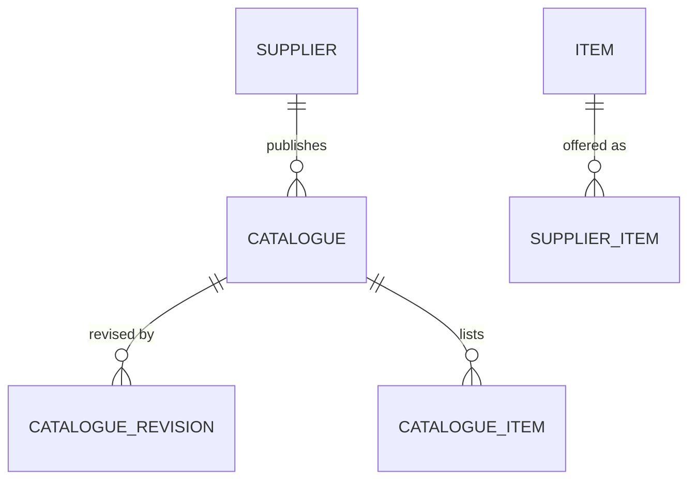

# eProcurement Suite: Catalogue PRD

## 0. Document control

| Item | Value |
|---|---|
| Document title | Catalogue: supplier items, supplier catalogues and shopping, Product Requirements Document |
| Layer | Suite (ADR-0043): a product of the eProcurement Suite, on IronSaaS Foundation; the module is proposed in section 13 |
| Identifier prefix | `CAT-`, in blocks of twenty per area (ADR-0041); the table is `catalogue-requirements.csv` |
| Version | 1.1 (accepted at the review of 2026-10-20; moved by ADR-0043) |
| Date | 2026-10-20 |
| Status | Accepted at the design session's review of 2026-10-20, its decisions written into the requirements and marked "decided 2026-10-20" in their notes. |
| Inputs | The Functional Foundation PRD for procure-to-pay, version 1.2 (archived as `../../archive/functional-foundation-p2p-PRD-v1.md`), the map (`../../requirements-map.md`), ADR-0029 and ADR-0041. |
| Dependency | Items, categories, units and suppliers are the Business PRD's (BF-041 to BF-044, BF-101); contract items are the Contracts product's; every mechanism is a kernel capability cited by its TF identifier. |
| Tags | `[Carried]` behaviour from the current product that stays. `[Improved]` carried but changed to close a defect or gap. `[New]` not in the current product, standard practice. `[Decision]` needs the owner's confirmation; the question is in its notes. `[Later]` recorded, not in version 1. A requirement moved from the archived PRD says what it was at the start of its notes. |

Change log: 1.1, 2026-10-20: moved to `docs/prd/suites/procurement/` as a product of the eProcurement Suite on IronSaaS Foundation (ADR-0043); its module's names follow the Suite layer; no requirement changed. 1.0, 2026-10-20: accepted at the review; its decisions are written into the requirements, and the proposals of the split's sections stand. 0.2 DRAFT, 2026-10-20: the design session's answers at the checkpoint and the split's sections (supplier views, records and signatures, visibility tags, search and exports, dependencies by ADR-0042, module and permissions). 0.1 SKELETON, 2026-10-20: the split (ADR-0041). Supplier items, catalogues and shopping moved here from the Functional Foundation PRD 1.2, their words unchanged except for names that changed. The item master went to the Business PRD.

## 1. Vision and goals

### 1.1 Vision

Approved content to buy from: supplier items with their prices, catalogues that suppliers maintain and buyers accept, published to the organisations that may use them, and a shopping experience that turns a cart into a request, with contract items at contract prices.

### 1.2 Goals (outcomes)

1. Requesters buy from published content at agreed prices: catalogue and contract items within their validity (CAT-004, CAT-005, CAT-022).
2. Suppliers maintain their catalogues, and no price changes without the buyer's acceptance (CAT-002, CAT-003).

### 1.3 Lessons from the current product

Keep, from the archived PRD's list: catalogue revisions accepted by the buyer.

## 2. Scope

### 2.1 In scope

Supplier items, catalogue upload, revisions and acceptance, publishing per organisation, price validity, supplier item imports, browse and cart, contract items in browsing, search and favourites, and the catalogue's reports.

### 2.2 Out of scope in version 1 (`[Later]`)

From the archived PRD's list: punch-out catalogues.

## 3. Personas

| Persona | Goals in this product | Surface |
|---|---|---|
| Requester | Raise a request from the catalogue | Enterprise app |
| Buyer | Maintain catalogues | Enterprise app |
| Supplier primary contact | Upload catalogues per customer | Supplier Network portal |

## 4. Domain model

`SUPPLIER` and `ITEM` are the Business masters (BF-101, BF-041), drawn for context.

## 5. Processes

The requirements describe it: a supplier uploads a catalogue, which creates a revision with a diff; the buyer accepts or rejects it, whole or per line; accepted lines become current items; the buyer publishes the catalogue to organisations; requesters browse, fill a cart and convert it into a request. The process maps come with the catalogue's process reference pack (PM-001).

## 6. Requirements

Each requirement has an identifier, a priority (Must, Should, Could), a tag, the requirement statement in business terms, the reason, acceptance criteria that a tester can run (including at least one error case), dependencies and notes.

### 6.1 Supplier items and catalogues (CAT-001 to CAT-020)

#### CAT-001 Supplier items
*Priority:* **Should** · *Tag:* `[Carried]` · *Area:* Supplier items and catalogues

**Requirement:** Supplier items link an item to a supplier with supplier part number, price, currency, unit, lead time, minimum order quantity, availability and validity dates.

**Why:** Supplier-specific prices.

**Acceptance criteria:**

- AC1 Given a supplier item in validity, When a request line picks item and supplier, Then the price is pre-filled.
- AC2 Given a duplicate item and supplier pair, When saved, Then it is refused. (error case)
- AC3 Given validity ended, When picked, Then the price is not pre-filled and a notice is shown.

*Depends on:* BF-041, BF-101

**Notes:** Was FF-041.

#### CAT-002 Catalogue upload and revisions
*Priority:* **Should** · *Tag:* `[Carried]` · *Area:* Supplier items and catalogues

**Requirement:** Suppliers shall upload catalogues (template download; CSV, spreadsheet or archive with images) creating a revision with lines; validation and duplicate checks run before the revision is submitted; buyers see a diff against the current catalogue (new, changed price, removed).

**Why:** Price list maintenance by suppliers.

**Acceptance criteria:**

- AC1 Given a valid file, When uploaded, Then a revision in Submitted status with a diff exists and the buyer is notified.
- AC2 Given duplicate part numbers in the file, When uploaded, Then it is refused listing them. (error case)
- AC3 Given a changed price, When the diff is viewed, Then old and new prices and percent change are shown.

*Depends on:* BF-101, TF-205

**Notes:** Was FF-042.

#### CAT-003 Catalogue revision acceptance
*Priority:* **Should** · *Tag:* `[Carried]` · *Area:* Supplier items and catalogues

**Requirement:** Buyers shall accept or reject a revision (whole or per line, with comments); accepted lines become current catalogue items with validity; rejected lines are reported to the supplier.

**Why:** Buyer control of prices.

**Acceptance criteria:**

- AC1 Given a revision accepted, When the catalogue is viewed, Then lines reflect it and the supplier is notified.
- AC2 Given lines rejected with comments, When the supplier views the revision, Then the comments are shown per line.
- AC3 Given a revision accepted twice, When attempted, Then it is refused. (error case)

*Depends on:* CAT-002

**Notes:** Was FF-043.

#### CAT-004 Catalogue publishing
*Priority:* **Should** · *Tag:* `[Carried]` · *Area:* Supplier items and catalogues

**Requirement:** Buyers shall publish catalogues with accepted lines to requesters (optionally per organisation unit) and unpublish them; only published lines in validity are orderable.

**Why:** Only approved content is bought from.

**Acceptance criteria:**

- AC1 Given a published catalogue, When a requester browses, Then its lines appear.
- AC2 Given a catalogue without accepted lines, When published, Then it is refused. (error case)
- AC3 Given a line past validity, When browsed, Then it is hidden.

*Depends on:* CAT-003

**Notes:** Was FF-044.

#### CAT-005 Price validity and currency rules
*Priority:* **Should** · *Tag:* `[New]` · *Area:* Supplier items and catalogues

**Requirement:** Catalogue and supplier item prices shall have validity dates and currencies; price changes shall never apply to issued orders; expiring prices shall be reported to buyers 30 days before.

**Why:** Stable orders, timely renewals.

**Acceptance criteria:**

- AC1 Given a price changed after an order is issued, When the order is viewed, Then its price is unchanged.
- AC2 Given a price expiring in 30 days, When the job runs, Then the buyer is notified.
- AC3 Given a price in a currency not allowed for the tenant, When uploaded, Then it is refused. (error case)

*Depends on:* CAT-001, CAT-003

**Notes:** Was FF-047.

#### CAT-006 Supplier item imports
*Priority:* **Should** · *Tag:* `[Carried]` · *Area:* Supplier items and catalogues

**Requirement:** Supplier items shall be importable through the kernel import framework with templates and validation.

**Why:** Bulk loading at go-live.

**Acceptance criteria:**

- AC1 Given a valid supplier item file, When imported, Then supplier items are created for their items and suppliers.
- AC2 Given rows with unknown units, When imported, Then they are reported and skipped. (error case)
- AC3 Given a dry run, When finished, Then nothing is created and the report shows counts.

*Depends on:* CAT-001, TF-205

**Notes:** Was FF-049, the supplier items; items are BF-044. AC1 is written for the split, after FF-049 AC1.

#### CAT-007 Catalogue applicability per organisation
*Priority:* **Should** · *Tag:* `[New]` · *Area:* Supplier items and catalogues

**Requirement:** Catalogues shall be published per organisation or to all; browsing shows only items published to the user's organisation.

**Why:** Different units buy from different agreements.

**Acceptance criteria:**

- AC1 Given a catalogue published to A, When a user of B browses, Then its items are hidden.
- AC2 Given a catalogue item published only to organisation A, When a user of organisation B requests it by identifier, Then it is refused. (error case)

*Depends on:* CAT-004, BF-003

**Notes:** Was FF-186, the catalogues; the contracts are CON-006. AC2 is written for the split, after CAT-022 AC4.

### 6.2 Shopping (CAT-021 to CAT-040)

#### CAT-021 Browse and cart
*Priority:* **Should** · *Tag:* `[Carried]` · *Area:* Shopping

**Requirement:** Requesters shall browse published catalogue and contract items across suppliers with search, filters (category, supplier, price) and favourites, add to a cart with quantities, and convert the cart into a request with one line per item and supplier pre-filled.

**Why:** Shopping experience.

**Acceptance criteria:**

- AC1 Given items in the cart, When converted, Then a draft request exists with the lines, prices and suppliers.
- AC2 Given an empty cart, When converted, Then a message says the cart is empty. (error case)
- AC3 Given a favourite, When the requester returns, Then it is listed first.

*Depends on:* CAT-004

**Notes:** Was FF-045. A requester converts the cart on Requests' screen, which reads the cart through this product's Contracts and creates the draft request at once; this product depends on no later product (ADR-0042).

#### CAT-022 Contract items in the catalogue
*Priority:* **Should** · *Tag:* `[New]` · *Area:* Shopping

**Requirement:** Published contract items shall appear in browsing with contract price and remaining quantity or value, and lines created from them shall carry the contract reference.

**Why:** Contract compliance by default.

**Acceptance criteria:**

- AC1 Given a contract item picked, When the request line is created, Then it references the contract and uses its price.
- AC2 Given a contract expired, When browsed, Then its items are hidden.
- AC3 Given remaining quantity zero, When picked, Then a notice is shown and the line is created without contract reference. (edge)
- AC4 Given a contract item of an unpublished contract, When requested by identifier, Then it is refused. (error case)

*Depends on:* CON-002

**Notes:** Was FF-046.

#### CAT-023 Catalogue search and favourites
*Priority:* **Could** · *Tag:* `[New]` · *Area:* Shopping

**Requirement:** Search shall cover item names, descriptions, part numbers and attributes with synonyms configurable by the tenant; users may keep favourites and recent items.

**Why:** Findability.

**Acceptance criteria:**

- AC1 Given a synonym configured, When searched, Then matching items appear.
- AC2 Given no results, When searched, Then suggestions by category are shown.
- AC3 Given recent items, When the catalogue opens, Then they are listed. (edge)
- AC4 Given a synonym list upload with invalid rows, When imported, Then the rows are reported and skipped. (error case)

*Depends on:* CAT-021, TF-204

**Notes:** Was FF-048.

### 6.3 Reports (CAT-041 to CAT-060)

#### CAT-041 Operational reports
*Priority:* **Must** · *Tag:* `[Carried]` · *Area:* Reports

**Requirement:** The reports in section 11.3 shall be available as grids with filters, saved views and export, respecting permissions and visibility.

**Why:** Run the operation.

**Acceptance criteria:**

- AC1 Given a user without the reports permission, When opening, Then it is refused. (error case)
- AC2 Given export, When run, Then the file matches the grid.

*Depends on:* TF-171, TF-203

**Notes:** Was FF-160, the catalogue reports; the others are REQ-061, ORD-081, RCV-101 and INV-084. Placed by the test: each product owns its reports.

## 7. Supplier views

In the portal the supplier downloads templates, uploads catalogues, sees each revision with its diff and the buyer's comments, and its current published items (CAT-061). Every view obeys the portal's ownership rule (SPX-006): a supplier user sees and acts only on its own supplier's records.

The requirements (CAT-061 to CAT-080):

#### CAT-061 Catalogue in the portal
*Priority:* **Should** · *Tag:* `[Carried]` · *Area:* Supplier views

**Requirement:** Suppliers download templates, upload catalogues, see revisions with diffs and buyer comments, and current published items.

**Why:** Supplier-maintained content.

**Acceptance criteria:**

- AC1 Given an upload, When valid, Then a revision with diff appears.
- AC2 Given a rejected line, When viewed, Then the buyer comment is shown.
- AC3 Given no accepted revision, When items are viewed, Then an empty state explains. (edge)
- AC4 Given a file over the size limit, When uploaded, Then it is refused with the limit shown. (error case)

*Depends on:* CAT-002, CAT-003

**Notes:** Was FF-156.

## 8. Rules and state machines

### 8.1 Key rules

None of the archived PRD's key rules is this product's alone.

### 8.2 State machines

From the archived PRD's section 7.2: Catalogue: Draft → Accepted → Published ↔ Unpublished; Revision: Submitted → Accepted or Rejected.

## 9. Records and signatures (Part 11)

Records approved, acknowledged or signed carry an electronic signature (TF-063) with signer, time, meaning and record version, shown and printed as TF-219 asks; a tenant may require re-authentication at signing for the record types it selects. The table names this product's; the mechanism is the kernel's and is not repeated here.

| Record | Electronic signature (TF-063) | Audit-trail review (TF-219) |
|---|---|---|
| Catalogue revision (CAT-003) | The buyer's acceptance or rejection, whole or per line, meaning approved or rejected | Yes: accepted price changes |
| Catalogue publishing (CAT-004, CAT-007) | Not signed; audited | No |
| Supplier items and prices (CAT-001, CAT-005) | Not signed; changes tracked (TF-062) | No |

Retention: this product's records are business documents and follow TF-066's default, 7 years after closure, which a tenant may change within the operator's limits; legal holds stop their deletion.

## 10. Visibility tags

A catalogue, its lines and the supplier items take their supplier's tags (TF-241, rule 6), so a buyer group that may not see a supplier does not see its prices either; contract items in browsing (CAT-022) take their contract's. Decided 2026-10-20.

## 11. Data, integration and reports

### 11.1 Data notes

Supplier items and catalogue lines carry their prices with validity and currency, and a price change never reaches an issued order (CAT-005). Catalogues and revisions have public numbers from the kernel's numbering (TF-166), standard columns, version, custom fields (TF-200), attachments for images (TF-160) and tracked change history (TF-062).

### 11.2 Integrations

None in the archived PRD's table is this product's.

### 11.3 Reports

From the archived PRD's section 8.4: catalogue status.

### 11.4 Search, exports and analytics feed

- Search (TF-204): catalogue lines and supplier items by name, description, part number and attributes, with the tenant's synonyms (CAT-023); the items themselves are indexed by the Business layer.
- Exports (TF-203, TF-205, TF-206): supplier items and prices to the ERP through export definitions; the catalogue status for auditors.
- Analytics feed (TF-089, TF-203): the daily snapshot of catalogue status and prices.

These are what the archived FF-164 to FF-166 asked of this product; the mechanisms are the kernel's.

## 12. Dependencies

### 12.1 Its place in the process order

Third, after Supplier management and Contracts (ADR-0042): it calls Contracts for the contract items it shows (CAT-022 on CON-002), and depends on no later product: Requests turns a cart into a request on its own screen, reading the cart through this product's Contracts.

### 12.2 What it uses

- Kernel, cited by its requirements: TF-171 (the grid), TF-203 (saved views and exports), TF-204 (search), TF-205 (imports). Through its sections: TF-035, TF-063 and TF-219, TF-241, TF-243.
- Business: BF-003 (organisation of records), BF-041 (items), BF-101 (suppliers).
- Earlier products: Contracts (CON-002, contract items and prices).

### 12.3 Events

- Publishes: revision submitted, accepted and rejected; catalogue published and unpublished.
- Subscribes: none.

### 12.4 Extension points it implements

- BF-207: supplier items and catalogue lines use items and suppliers.

## 13. Layer, module, schema and permissions

The module is `Iron.Suites.Procurement.Catalogue` (schema `procurement_catalogue`), its shell module `shell/src/modules/suites/procurement/catalogue/`, licensed as a module (ADR-0034).

Permissions, decided 2026-10-20: `catalogue.supplier_items.{read,manage}`, `catalogue.catalogues.{read,accept,reject,publish}`, `catalogue.synonyms.manage`, `catalogue.reports.read`. They replace the archived PRD's `catalogue.catalogue.{read,accept,reject,publish}`; its `catalogue.item.*` is now the Business item master's.

## 14. Configuration

Search synonyms (CAT-023) and the organisations a catalogue is published to (CAT-007). None of the archived PRD's section 8.5 settings is this product's.

## 15. Slices

Where the moved requirements sat in the archived PRD's build plan (its section 9). The product slices are in the technical PRD's section 7.

| Slice of the archived plan | Its outcome | This document's requirements from it |
|---|---|---|
| P2 | Suppliers and orders | CAT-007 |
| P4 | Invoicing and matching | CAT-041 |
| P5 | Catalogue, contracts, change orders | CAT-001, CAT-002, CAT-003, CAT-004, CAT-005, CAT-006, CAT-021, CAT-022, CAT-023 |
| P6 | Completeness | CAT-061 |

## 16. Decisions and open points

### 16.1 Decisions

None of the archived PRD's decisions is this product's alone.

### 16.2 Open points

From the archived PRD's section 10.2:

| ID | Question | Default used |
|---|---|---|
| G-08 | Catalogues: one catalogue per customer (default) or one network catalogue offered to many customers? | Per customer in version 1; network catalogue later |

Decided at the PRD split's checkpoint, on 2026-10-20: Products depend on each other in the process order, Supplier management, Contracts, Catalogue, Requests, Orders, Receiving, Invoicing: a later product calls an earlier one through its Contracts, and an earlier one hears from a later one only through events (ADR-0042). Catalogue may call Contracts (CAT-022 on CON-002); a requester turns a cart into a request on Requests' screen, which reads the cart through this product's Contracts (CAT-021). Corrected at the review of 2026-10-20: a person's conversion is a call from the later product's screen, and only automatic conversions are events.

## 17. Glossary

| Term | Meaning |
|---|---|
| Supplier item | An item one supplier offers, with its part number, price, unit, lead time and validity |
| Catalogue revision | A supplier's upload of its catalogue, accepted or rejected by the buyer, whole or per line |

