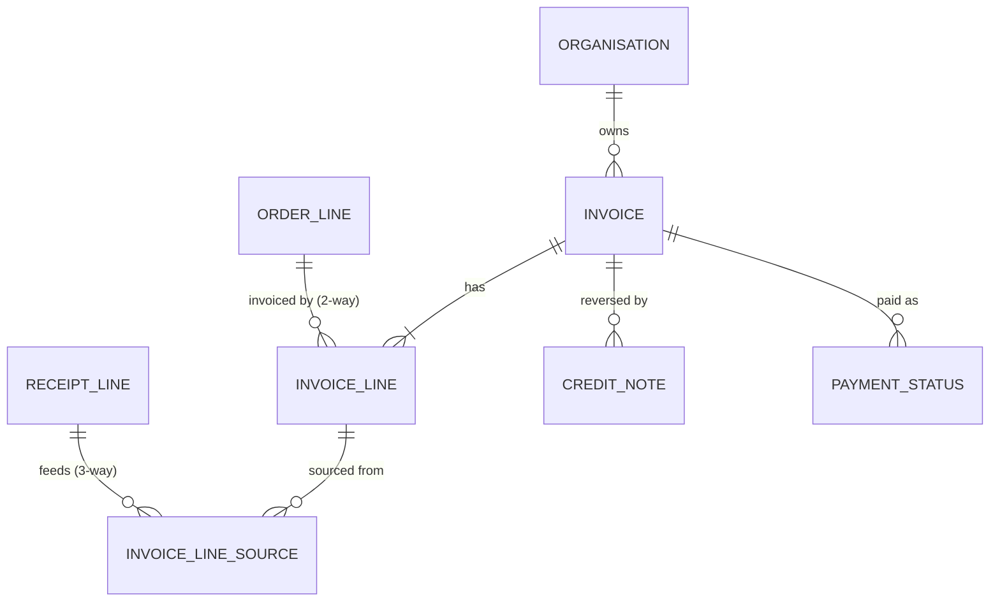
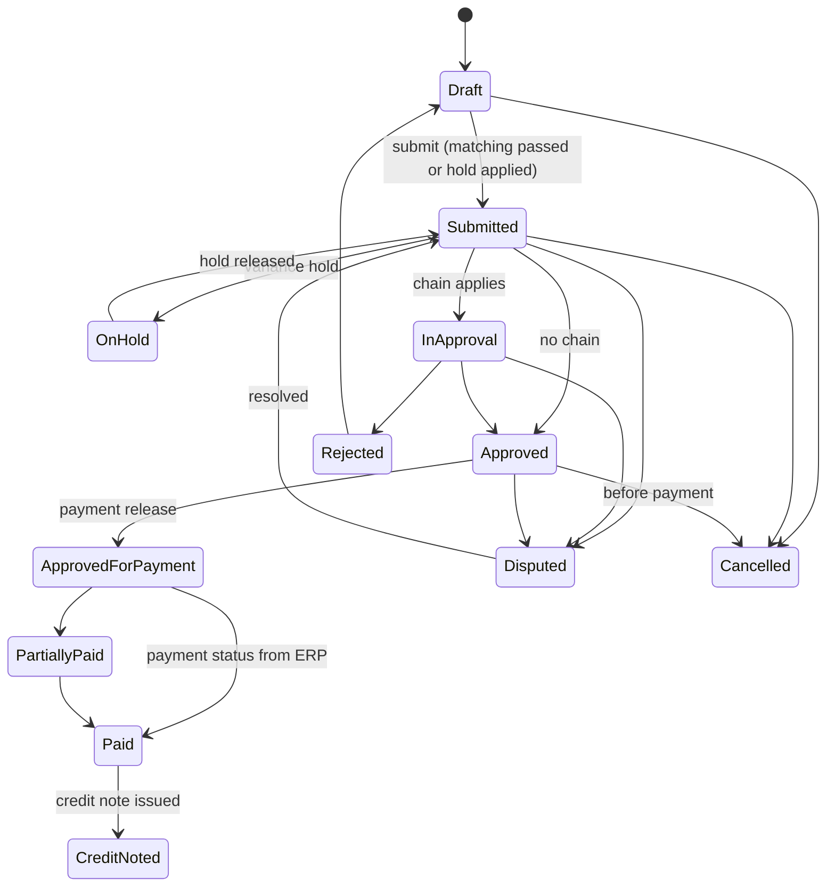

# eProcurement Suite: Invoicing PRD

## 0. Document control

| Item | Value |
|---|---|
| Document title | Invoicing: invoices, matching, approval for payment and credit notes, Product Requirements Document |
| Layer | Suite (ADR-0043): a product of the eProcurement Suite, on IronSaaS Foundation; the module is proposed in section 13 |
| Identifier prefix | `INV-`, in blocks of twenty per area (ADR-0041); the table is `invoicing-requirements.csv` |
| Version | 1.1 (accepted at the review of 2026-10-20; moved by ADR-0043) |
| Date | 2026-10-20 |
| Status | Accepted at the design session's review of 2026-10-20, its decisions written into the requirements and marked "decided 2026-10-20" in their notes. |
| Inputs | The Functional Foundation PRD for procure-to-pay, version 1.2 (archived as `../../archive/functional-foundation-p2p-PRD-v1.md`; its module was called Payables), the map (`../../requirements-map.md`), ADR-0029 and ADR-0041. |
| Dependency | Finance masters, budgets, tax codes, payment terms and suppliers are the Business PRD's; orders and receipts are their products'; every mechanism is a kernel capability cited by its TF identifier. |
| Tags | `[Carried]` behaviour from the current product that stays. `[Improved]` carried but changed to close a defect or gap. `[New]` not in the current product, standard practice. `[Decision]` needs the owner's confirmation; the question is in its notes. `[Later]` recorded, not in version 1. A requirement moved from the archived PRD says what it was at the start of its notes. |

Change log: 1.1, 2026-10-20: moved to `docs/prd/suites/procurement/` as a product of the eProcurement Suite on IronSaaS Foundation (ADR-0043); its module's names follow the Suite layer; no requirement changed. 1.0, 2026-10-20: accepted at the review; its decisions are written into the requirements, and the proposals of the split's sections stand. 0.2 DRAFT, 2026-10-20: the design session's answers at the checkpoint and the split's sections (supplier views, records and signatures, visibility tags, search and exports, dependencies by ADR-0042, module and permissions). 0.1 SKELETON, 2026-10-20: the split (ADR-0041). The Payables area of the Functional Foundation PRD 1.2 moved here as Invoicing, its words unchanged except for names that changed. The payment terms master went to the Business PRD; the due-date rules stayed here (INV-008).

## 1. Vision and goals

### 1.1 Vision

Invoice matching that pays the right amount once: invoices of every type built from orders and receipts, checked atomically against what is open, held or blocked by tolerances, approved, released for payment, and reversed by credit notes, with the accrual the finance team needs at period end.

### 1.2 Goals (outcomes)

Goal 2 of the archived PRD, in its words:

1. Invoices are matched to orders and receipts automatically; a first-pass match rate of at least 85% for order-based invoices.

### 1.3 Lessons from the current product

Keep, from the archived PRD's list: tolerances by value or percentage; invoice types (order-based, receipt-based, non-order, proforma, credit). Improve: duplicate supplier invoice number check; credit notes that reverse consumption; price-variance hold instead of hard block when configured; accrual report built on consumption buckets.

## 2. Scope

### 2.1 In scope

Invoices of all types with lines, taxes, charges, discounts and withholding, account coding, due dates and discounts, capture suggestions and e-invoicing fields; matching (capacity, variances and holds, duplicate check, stale match levels, budget for non-order invoices, the holds console, the nightly reconciliation); approval and disputes, cancellation, payment release and status, credit notes; the matching configuration; lists, the accrual report, open-order views and the invoicing reports.

### 2.2 Out of scope in version 1 (`[Later]`)

From the archived PRD's list: e-invoicing network connections (fields are prepared; Indian GST comes as an accelerator pack); 4-way match with inspection quantities beyond the inspection result flag. Payment execution is the ERP's (the Business PRD's section 2.3).

## 3. Personas

| Persona | Goals in this product | Surface |
|---|---|---|
| Accounts payable clerk | Create and match invoices, resolve variances and holds, get invoices approved for payment, handle credit notes | Enterprise app |
| Approver (manager, budget owner, finance, legal) | Approve invoices with context, within SLA, or delegate | Enterprise app, email links |
| Controller / finance administrator | Tolerances, accruals | Enterprise app |
| Supplier contact | Submit invoices | Supplier Network portal |
| ERP integration (service account) | Pull approved invoices, push payment status | Partner API (kernel) |

## 4. Domain model

`ORGANISATION` is the kernel's unit; `ORDER_LINE` and `RECEIPT_LINE` are the Orders and Receiving products'. They are drawn for context.

## 5. Processes

### 5.1 Receive to invoice (the invoice's part)

From the archived PRD's section 5.3, after the receipt's part (the Receiving product's section 5): invoice created from receipt lines (supplier portal or AP) → submit (capacity, variances, duplicate number, budget for non-order lines) → price variance beyond tolerance blocks or holds per configuration → approval chain → approved → approved for payment → payment status from the ERP → credit note for returns or disputes reverses consumption.

### 5.2 Two-way and non-order invoices

From the archived PRD's section 5.4: order-based invoice for lines stamped 2-way uses order quantities as capacity; non-order invoices require coding and budget check; proforma invoices reference an order and consume nothing.

## 6. Requirements

Each requirement has an identifier, a priority (Must, Should, Could), a tag, the requirement statement in business terms, the reason, acceptance criteria that a tester can run (including at least one error case), dependencies and notes.

### 6.1 Invoices (INV-001 to INV-020)

#### INV-001 Invoice types
*Priority:* **Must** · *Tag:* `[Carried]` · *Area:* Invoices

**Requirement:** The system shall support order-based invoices (lines from order lines stamped 2-way or from approved receipt lines for 3-way), non-order invoices (coded lines), proforma invoices (referencing an order, consuming nothing) and credit notes (referencing an approved invoice); type decides creation path, validations and effects.

**Why:** Different documents, one engine.

**Acceptance criteria:**

- AC1 Given an order with 2-way and 3-way lines, When an invoice is created from it, Then 2-way lines take order quantities and 3-way lines offer approved receipt lines.
- AC2 Given a credit note without reference, When saved, Then it is refused. (error case)
- AC3 Given a proforma, When approved, Then no bucket or budget changes.

*Depends on:* ORD-005, RCV-024

**Notes:** Was FF-110.

#### INV-002 Create invoice from orders
*Priority:* **Must** · *Tag:* `[Carried]` · *Area:* Invoices

**Requirement:** AP users and supplier users shall create an invoice from one or more orders of the same supplier with open 2-way lines (eligibility check), copying lines with open quantities and prices, allowing partial quantities, and appending further orders to a draft invoice of the same supplier.

**Why:** Fast and accurate entry.

**Acceptance criteria:**

- AC1 Given an order with open lines, When an invoice is created, Then a draft with those lines exists and the order is linked.
- AC2 Given all lines invoiced, When created, Then "All lines of this order are already invoiced" is shown. (error case)
- AC3 Given a draft of another supplier, When appending, Then it is refused.

*Depends on:* INV-001, RCV-081

**Notes:** Was FF-111.

#### INV-003 Create invoice from receipts
*Priority:* **Must** · *Tag:* `[Carried]` · *Area:* Invoices

**Requirement:** For 3-way lines, invoices shall be built from approved receipt lines with open quantity, one invoice line per order line fed by one or more receipt lines (allocations summing to the line quantity), with the source picker showing pending-approval receipts as not yet billable.

**Why:** Goods-receipt-based invoice verification.

**Acceptance criteria:**

- AC1 Given two approved receipts of 5 for one order line, When an invoice line of 10 is created, Then two source rows of 5 exist.
- AC2 Given a receipt line in approval, When selected, Then it is shown as pending and cannot be used. (error case)
- AC3 Given an allocation sum different from the line quantity, When saved, Then it is refused.

*Depends on:* INV-001, RCV-024, RCV-081

**Notes:** Was FF-112.

#### INV-004 Non-order invoices
*Priority:* **Must** · *Tag:* `[Carried]` · *Area:* Invoices

**Requirement:** Non-order invoices shall require supplier, legal entity, chart of account, currency, supplier invoice number and date, and lines with description, amount, tax code and account splits totalling 100 percent; routing uses the invoice approval configuration; budget check applies when configured.

**Why:** Capture all spend.

**Acceptance criteria:**

- AC1 Given complete coding, When submitted, Then it is Submitted and routed.
- AC2 Given a line without splits, When submitted, Then it is refused naming the line. (error case)
- AC3 Given the tenant policy "orders required" or a supplier flagged "orders required", When a non-order invoice is created, Then it is refused or warned per the tenant or supplier setting (the supplier setting overrides the tenant setting).

*Depends on:* INV-001, REQ-003, BF-065

**Notes:** Was FF-113. Decision F-06 confirmed: policy at tenant and supplier level.

#### INV-005 Proforma invoices
*Priority:* **Should** · *Tag:* `[Carried]` · *Area:* Invoices

**Requirement:** Proforma invoices reference an order, carry amounts for advance payment, follow approval, and never consume order quantities or budget; later final invoices may reference the proforma for netting (advance applied).

**Why:** Advance payments.

**Acceptance criteria:**

- AC1 Given a proforma approved, When the final invoice is created, Then the advance can be applied and the payable amount reduced.
- AC2 Given a proforma without order, When saved, Then it is refused. (error case)
- AC3 Given a proforma, When buckets are viewed, Then nothing changed.

*Depends on:* INV-001

**Notes:** Was FF-114.

#### INV-006 Invoice lines, taxes, charges, discounts and withholding
*Priority:* **Must** · *Tag:* `[Carried]` · *Area:* Invoices

**Requirement:** Lines (item or description, quantity, unit, unit price, tax code, account splits where needed), taxes at header or line level (one or the other), charges (freight, handling, other) at header or line, discounts and withholding at header or line, with totals computed and rounded per currency; the supplier's totals as printed shall be entered and compared to computed totals with a tolerance.

**Why:** Invoices rarely match perfectly.

**Acceptance criteria:**

- AC1 Given header taxes switched to line level, When saved, Then header tax lines are removed and line taxes required.
- AC2 Given the entered total differs from the computed total beyond tolerance, When submitted, Then a warning or block applies per setting. (error case)
- AC3 Given rounding, When totals compute, Then header equals the sum of rounded lines.

*Depends on:* INV-001, BF-071

**Notes:** Was FF-115.

#### INV-007 Account coding for invoice lines
*Priority:* **Must** · *Tag:* `[Carried]` · *Area:* Invoices

**Requirement:** Order-based lines inherit splits from order lines (editable only with permission); non-order lines require splits; a single chart of account per invoice is enforced when the setting is on.

**Why:** Correct accounting.

**Acceptance criteria:**

- AC1 Given an order-based line, When viewed, Then splits equal the order line's splits.
- AC2 Given the single-chart setting on and lines of two charts, When submitted, Then it is refused. (error case)
- AC3 Given a user with the override permission, When splits are changed on an order-based line, Then the change is audited.

*Depends on:* INV-006, REQ-003

**Notes:** Was FF-116.

#### INV-008 Payment terms, due dates and discounts
*Priority:* **Should** · *Tag:* `[Carried]` · *Area:* Invoices

**Requirement:** Invoices shall carry payment terms (from supplier or order), compute due date and early-payment discount date and amount, and lists shall flag invoices due within 7 days or overdue.

**Why:** Working capital.

**Acceptance criteria:**

- AC1 Given net 30, When the invoice date is set, Then the due date is 30 days later.
- AC2 Given a discount term, When viewed, Then the discount date and amount are shown.
- AC3 Given an overdue unpaid invoice, When listed, Then it is flagged. (edge)
- AC4 Given payment terms missing on the supplier and the order, When an invoice is submitted, Then it is refused until terms are set. (error case)

*Depends on:* BF-072, INV-001

**Notes:** Was FF-125. It keeps the due-date rules; the payment terms master is BF-072.

#### INV-009 Invoice attachments and capture suggestions
*Priority:* **Should** · *Tag:* `[New]` · *Area:* Invoices

**Requirement:** Invoices shall store the supplier's PDF or image; when the AI capture feature is enabled, the AI service shall propose header and line values from the document as suggestions with confidence; the user confirms before any value is saved; suggestions and confirmations are audited.

**Why:** Faster entry with human control.

**Acceptance criteria:**

- AC1 Given a PDF uploaded and capture enabled, When processed, Then suggestions appear marked as suggested with confidence.
- AC2 Given the user confirms, When saved, Then the confirmed values are stored and the audit shows suggestion and confirmation.
- AC3 Given the AI service unavailable, When processed, Then the user is told and enters values manually. (error case)

*Depends on:* INV-001, TF-208

**Notes:** Was FF-128. Decision F-10 confirmed.

#### INV-010 E-invoicing readiness
*Priority:* **Should** · *Tag:* `[New]` · *Area:* Invoices

**Requirement:** Invoice headers shall hold the fields needed for statutory e-invoices (for example registration numbers, place of supply, invoice reference number, QR code text, document type codes) as configurable fields per country, validated when the country rule is on.

**Why:** Indian GST e-invoice and similar regimes; the Indian rules themselves arrive as an accelerator pack (BF-204).

**Acceptance criteria:**

- AC1 Given the India rule on and a missing invoice reference number on a B2B invoice above the threshold, When submitted, Then a warning or block applies per setting.
- AC2 Given the rule off, When submitted, Then no e-invoice validation runs.
- AC3 Given the fields present, When exported to the ERP, Then they are included. (edge)
- AC4 Given an e-invoice field with an invalid format, When submitted with the rule on, Then it is refused naming the field. (error case)

*Depends on:* INV-001, BF-071, BF-204

**Notes:** Was FF-129. It depends on the country packs (BF-204), whose e-invoice field rules it applies (ADR-0042). Decision F-08 confirmed.

### 6.2 Matching and controls (INV-021 to INV-040)

#### INV-021 Capacity checks at submission
*Priority:* **Must** · *Tag:* `[Improved]` · *Area:* Matching and controls

**Requirement:** On submission, for each order-based line the system shall lock the order line and source receipt lines in a fixed order and check: 2-way quantity ≤ open to invoice on the order line; 3-way allocations ≤ open on each receipt line and receipt lines approved; strict-invoice-once setting blocks any prior consumption; closed-for-invoicing lines refused; then update invoiced submitted buckets.

**Why:** No over-billing; atomic.

**Acceptance criteria:**

- AC1 Given open 4 and an invoice of 4, When submitted, Then it passes and open becomes 0; an invoice of 5 is refused naming the line.
- AC2 Given two invoices for the same last units submitted at once, When processed, Then exactly one succeeds.
- AC3 Given strict mode and a line with any prior invoice, When submitted, Then it is refused. (error case)

*Depends on:* RCV-081, TF-084

**Notes:** Was FF-117. Decision F-04 confirmed.

#### INV-022 Variance tolerances and holds
*Priority:* **Must** · *Tag:* `[Improved]` · *Area:* Matching and controls

**Requirement:** Submission shall check unit price, quantity, line amount and total amount variances against the stamped or configured tolerances (percentage or value); per tolerance type the action is block (refuse) or hold (submit with a hold reason that must be released by a permitted user before approval completes); holds are listed in a holds console.

**Why:** Carried tolerances; adds hold.

**Acceptance criteria:**

- AC1 Given price variance 3 percent with tolerance 2 percent and action hold, When submitted, Then the invoice is Submitted with a price hold and approval cannot complete until release.
- AC2 Given action block, When submitted, Then it is refused naming the line and variance. (error case)
- AC3 Given a hold released with reason, When approval completes, Then the release is in the audit.

*Depends on:* INV-021, ORD-005

**Notes:** Was FF-118. Decision F-03 confirmed.

#### INV-023 Duplicate invoice check
*Priority:* **Must** · *Tag:* `[New]` · *Area:* Matching and controls

**Requirement:** No two live invoices (not cancelled or rejected) of the same supplier may share the supplier invoice number; a fuzzy check (same supplier, same amount, date within 7 days) shall warn.

**Why:** Gap in the current product; standard control.

**Acceptance criteria:**

- AC1 Given an existing live invoice with number X for supplier S, When another with X is submitted, Then it is refused. (error case)
- AC2 Given the earlier invoice is Cancelled, When submitted, Then it is allowed.
- AC3 Given same amount within 7 days, When submitted, Then a warning asks for confirmation.

*Depends on:* INV-001

**Notes:** Was FF-119.

#### INV-024 Stale match level and refresh
*Priority:* **Must** · *Tag:* `[Carried]` · *Area:* Matching and controls

**Requirement:** A draft invoice shall snapshot the match level of each order line; at submission a mismatch with the current stamp (possible only for lines approved later) refuses submission and the draft can be refreshed.

**Why:** Consistency.

**Acceptance criteria:**

- AC1 Given a stale snapshot, When submitted, Then it is refused with "Order line N changed; refresh the draft". (error case)
- AC2 Given refresh, When done, Then the snapshot updates and lines are re-validated.
- AC3 Given no change, When submitted, Then no refresh is needed.

*Depends on:* ORD-005

**Notes:** Was FF-120.

#### INV-025 Budget check for non-order invoices
*Priority:* **Must** · *Tag:* `[Carried]` · *Area:* Matching and controls

**Requirement:** Non-order invoices shall apply the budget check with reservation when invoice budget validation is on; order-based invoices do not consume again.

**Why:** Avoid double counting.

**Acceptance criteria:**

- AC1 Given validation on and short budget with blocking, When submitted, Then it is refused with the shortfall. (error case)
- AC2 Given an order-based invoice, When submitted, Then no new reservation is made. (edge)
- AC3 Given validation off, When submitted, Then no check runs.

*Depends on:* INV-004, BF-065

**Notes:** Was FF-121. AC1 is marked as the error case it is (ADR-0041).

#### INV-026 Holds console
*Priority:* **Should** · *Tag:* `[New]` · *Area:* Matching and controls

**Requirement:** A console lists invoices on hold with reason, age, owner and release action requiring a reason; releasing is permission-controlled and audited.

**Why:** Variances need owners.

**Acceptance criteria:**

- AC1 Given held invoices, When the console loads, Then they are listed by age.
- AC2 Given release by a user without the permission, When attempted, Then it is refused. (error case)
- AC3 Given release, When done, Then approval can complete and the audit shows the reason.

*Depends on:* INV-022

**Notes:** Was FF-134.

#### INV-027 Nightly reconciliation of the invoiced buckets
*Priority:* **Must** · *Tag:* `[New]` · *Area:* Matching and controls

**Requirement:** A nightly job shall recompute the invoiced buckets (invoiced submitted and invoiced approved, RCV-081) from invoices and credit notes, compare them with the stored values, write differences to a drift report and alert operators; drift is an incident, not auto-healed. It runs in the one nightly reconciliation window of the kernel's jobs (TF-120 to TF-124).

**Why:** Counters are a cache; documents are the truth.

**Acceptance criteria:**

- AC1 Given consistent data, When the job runs, Then zero drift rows exist and a success record is stored.
- AC2 Given a manual database change that breaks a counter, When the job runs, Then the drift row names the line and values and an alert fires. (error case)
- AC3 Given the job fails, When detected, Then an alert fires.

*Depends on:* RCV-081, INV-044, TF-120, TF-123

**Notes:** Was FF-133, the invoiced buckets; Orders, Receiving and the Business budgets reconcile their own counters in ORD-121, RCV-083 and BF-073, in the same window.

### 6.3 Approval and payment (INV-041 to INV-060)

#### INV-041 Invoice approval and disputes
*Priority:* **Must** · *Tag:* `[Carried]` · *Area:* Approval and payment

**Requirement:** Invoices shall run the invoice approval configuration with conditions (amount, supplier, variance flags, non-order flag, hold flags); approvers see lines, matched documents, variances and holds; a permitted user may mark an invoice Disputed with reason and resolve it back to Submitted.

**Why:** Control before payment.

**Acceptance criteria:**

- AC1 Given an invoice with a hold, When all approvers approve, Then status remains pending until the hold is released. (edge)
- AC2 Given a dispute, When marked, Then the supplier is notified with the reason.
- AC3 Given rejection, When done, Then the invoice returns to Draft with the reason and buckets release submitted quantities.
- AC4 Given a dispute marked by a user without the permission, When attempted, Then it is refused. (error case)

*Depends on:* INV-021, INV-022, TF-090

**Notes:** Was FF-122.

#### INV-042 Cancel an invoice
*Priority:* **Must** · *Tag:* `[Carried]` · *Area:* Approval and payment

**Requirement:** Cancellation with reason shall be allowed in Draft, Submitted and Approved before payment release, releasing invoiced buckets and budget; after payment release only credit notes apply.

**Why:** Clean reversal before payment.

**Acceptance criteria:**

- AC1 Given an Approved invoice not released, When cancelled, Then buckets and budget are released.
- AC2 Given an invoice released for payment, When cancel is attempted, Then it is refused with the credit note path. (error case)
- AC3 Given cancellation, When audited, Then the reason is recorded.

*Depends on:* INV-041, RCV-081

**Notes:** Was FF-123.

#### INV-043 Payment release and payment status
*Priority:* **Must** · *Tag:* `[Improved]` · *Area:* Approval and payment

**Requirement:** Approved invoices shall be released for payment by a permitted user (manual or automatic per setting) moving to Approved For Payment with a payment run reference; payment status (paid, partially paid, date, reference, amount) shall be received from the ERP through the API and shown on the invoice; fully paid invoices become Paid.

**Why:** Close the loop with finance.

**Acceptance criteria:**

- AC1 Given release, When done, Then status is Approved For Payment and the event is published for the ERP.
- AC2 Given a payment status for an unknown invoice, When received, Then it is rejected with an error. (error case)
- AC3 Given partial payment, When received, Then status is Partially Paid with the paid amount.

*Depends on:* INV-041, TF-105

**Notes:** Was FF-124.

#### INV-044 Credit notes
*Priority:* **Must** · *Tag:* `[New]` · *Area:* Approval and payment

**Requirement:** Credit notes shall reference an approved or paid invoice (whole or lines), carry the supplier's credit note number (unique per supplier), run approval, and on approval reverse invoiced approved buckets and budget consumption as negative movement and publish an event for the ERP; source rows are never deleted.

**Why:** Gap in the current product; required for returns and disputes.

**Acceptance criteria:**

- AC1 Given a credit note for 3 units of an invoiced line, When approved, Then invoiced approved decreases by 3 and the receipt line shows 3 open again.
- AC2 Given a credit note above the invoiced quantity, When saved, Then it is refused. (error case)
- AC3 Given approval, When done, Then an event is published with the reference to the original invoice.

*Depends on:* INV-001, RCV-081, BF-066

**Notes:** Was FF-127.

#### INV-045 Payment status codes from ISO 20022
*Priority:* **Must** · *Tag:* `[New]` · *Area:* Approval and payment

**Requirement:** Payment status messages shall carry ISO 20022 codes as optional reference attributes that integrations can rely on.

**Why:** Common language with ERPs, suppliers and networks.

**Acceptance criteria:**

- AC1 Given a payment status message with an ISO 20022 code, When received, Then it maps to the invoice payment state.
- AC2 Given a payment status message whose code is not an ISO 20022 payment status code, When received, Then it is rejected naming the code. (error case)

*Depends on:* INV-043

**Notes:** Was FF-202, the payment status codes; the reference data of the masters is BF-205. AC2 is written for the split, after INV-043 AC2.

### 6.4 Configuration (INV-061 to INV-080)

#### INV-061 Matching configuration
*Priority:* **Must** · *Tag:* `[Carried]` · *Area:* Configuration

**Requirement:** Tenant settings shall define default match levels, receipt approval required, strict invoice-once, single chart per invoice, tolerance values and actions per type, duplicate fuzzy window, non-order invoice policy (tenant level, overridable per supplier), payment release mode and e-invoice rules; each setting shall be overridable per organisation where the Business PRD's section 2.2 allows.

**Why:** Different customers, different controls.

**Acceptance criteria:**

- AC1 Given strict invoice-once switched on, When the next invoice is submitted, Then the strict rule applies.
- AC2 Given a tolerance set to a negative value, When saved, Then it is refused. (error case)
- AC3 Given a setting changed, When 60 seconds pass, Then it applies without restart.

*Depends on:* TF-057

**Notes:** Was FF-132.

#### INV-062 Matching and tolerance configuration screen
*Priority:* **Must** · *Tag:* `[Carried]` · *Area:* Configuration

**Requirement:** One screen for the matching configuration (INV-061) with explanations and a simulation that shows how a sample invoice would be treated.

**Why:** Administrators must understand the controls.

**Acceptance criteria:**

- AC1 Given a sample invoice entered in the simulation, When run, Then the outcome per check (pass, hold, block) is shown.
- AC2 Given a change saved, When audited, Then it is recorded.
- AC3 Given a user without the permission, When opening, Then it is refused. (error case)

*Depends on:* INV-061

**Notes:** Was FF-172.

### 6.5 Lists and reports (INV-081 to INV-100)

#### INV-081 Invoice lists, queue and summaries
*Priority:* **Must** · *Tag:* `[Carried]` · *Area:* Lists and reports

**Requirement:** Lists (all, per order, per supplier, drafts, held, disputed, due) with saved views; an AP work queue of invoices needing action by age; summaries per invoice (totals, taxes, matched documents) and global (counts and amounts by status).

**Why:** Daily operations.

**Acceptance criteria:**

- AC1 Given invoices in several states, When the queue loads, Then items needing action appear with age and reason.
- AC2 Given a supplier user, When listing, Then only their invoices appear.
- AC3 Given global summary, When viewed, Then counts match the lists. (edge)
- AC4 Given a user without invoice read permission, When the queue is opened, Then it is refused. (error case)

*Depends on:* INV-001, TF-035, TF-234

**Notes:** Was FF-126. It obeys the supplier portal's ownership rule, SPX-006, and depends on the kernel requirements that enforce it (ADR-0042).

#### INV-082 Accrual report
*Priority:* **Must** · *Tag:* `[Improved]` · *Area:* Lists and reports

**Requirement:** A received-not-invoiced report per legal entity, period and account string shall compute (received approved − invoiced approved) × order price per line, excluding receipts pending approval, exportable and reconcilable to buckets.

**Why:** Period-end liabilities.

**Acceptance criteria:**

- AC1 Given received approved 10 and invoiced approved 6 at price 100, When the report runs, Then the line shows 400.
- AC2 Given a receipt in approval, When the report runs, Then it is excluded.
- AC3 Given export, When run, Then the file totals match the screen. (edge)
- AC4 Given a user without the accrual report permission, When run, Then it is refused. (error case)

*Depends on:* RCV-081

**Notes:** Was FF-130.

#### INV-083 Uninvoiced and open-order views
*Priority:* **Should** · *Tag:* `[Carried]` · *Area:* Lists and reports

**Requirement:** Views of orders and lines not fully invoiced and not fully received, with ages and supplier, to drive follow-up.

**Why:** Follow-up work.

**Acceptance criteria:**

- AC1 Given lines open to invoice, When the view loads, Then they are listed with open quantity and value.
- AC2 Given a line closed for invoicing, When the view loads, Then it is excluded.
- AC3 Given a filter by supplier, When applied, Then only that supplier's lines appear. (edge)
- AC4 Given a user without order read permission, When the view is requested, Then it is refused. (error case)

*Depends on:* RCV-081

**Notes:** Was FF-131.

#### INV-084 Operational reports
*Priority:* **Must** · *Tag:* `[Carried]` · *Area:* Lists and reports

**Requirement:** The reports in section 11.3 shall be available as grids with filters, saved views and export, respecting permissions and visibility.

**Why:** Run the operation.

**Acceptance criteria:**

- AC1 Given a user without the reports permission, When opening, Then it is refused. (error case)
- AC2 Given export, When run, Then the file matches the grid.

*Depends on:* TF-171, TF-203

**Notes:** Was FF-160, the invoicing reports; the others are REQ-061, ORD-081, RCV-101 and CAT-041. Placed by the test: each product owns its reports.

#### INV-085 Invoice cycle time and first-pass match measures
*Priority:* **Should** · *Tag:* `[New]` · *Area:* Lists and reports

**Requirement:** The system shall compute the invoice to approval cycle time and the first-pass match rate (invoices approved without hold or rejection) by period, legal entity and supplier.

**Why:** Goal 1 (section 1.2) is measured here.

**Acceptance criteria:**

- AC1 Given documents in a period, When computed, Then medians and percentiles are shown.
- AC2 Given an invoice with a hold later released, When counted, Then it is not first-pass.
- AC3 Given no data, When viewed, Then "no data" is shown. (edge)
- AC4 Given a period with inconsistent data (an approval before submission), When computed, Then the record is excluded and listed in a data quality note. (error case)

*Depends on:* INV-084

**Notes:** Was FF-161, the invoice measures; the order cycle times are ORD-082.

## 7. Supplier views

In the portal the supplier creates order-based, receipt-based and proforma invoices and credit notes for its orders, uploads its invoice document, sees the validations before it submits, and follows status, holds, disputes and payment (INV-101). Every view obeys the portal's ownership rule (SPX-006): a supplier user sees and acts only on its own supplier's records.

The requirements (INV-101 to INV-120):

#### INV-101 Invoices in the portal
*Priority:* **Must** · *Tag:* `[Carried]` · *Area:* Supplier views

**Requirement:** Suppliers create order-based, receipt-based, proforma invoices and credit notes for their orders, upload their invoice document, see validations before submission, and track status, holds, disputes and payment status.

**Why:** Faster, cleaner invoices.

**Acceptance criteria:**

- AC1 Given an order with open lines, When the supplier creates an invoice, Then eligible lines are offered with open quantities.
- AC2 Given a variance block, When submitted, Then the supplier sees the reason per line. (error case)
- AC3 Given payment status received, When viewed, Then it is shown with date and reference.

*Depends on:* INV-002, INV-003, INV-043, TF-035, TF-234

**Notes:** Was FF-155. It obeys the supplier portal's ownership rule, SPX-006, and depends on the kernel requirements that enforce it (ADR-0042).

## 8. Rules and state machines

### 8.1 Key rules

From the archived PRD's section 7.1. The open-to-invoice formula is in the Receiving product's section 8.1, beside the buckets it reads.

| Rule | Statement |
|---|---|
| Tolerances | Percentage or value ranges around the reference for quantity, unit price, line amount and total; stamped over-receipt tolerance wins over system settings; action per tolerance type: block or hold. |
| Duplicate invoice | No two live invoices (not cancelled or rejected) of a supplier share the supplier invoice number. |
| Credit notes | Reference an approved invoice; reverse consumption and budget as negative movement; never delete source rows. |

### 8.2 State machines

#### Invoice

Credit note: Draft → Submitted → Approved → Applied.

## 9. Records and signatures (Part 11)

Records approved, acknowledged or signed carry an electronic signature (TF-063) with signer, time, meaning and record version, shown and printed as TF-219 asks; a tenant may require re-authentication at signing for the record types it selects. The table names this product's; the mechanism is the kernel's and is not repeated here.

| Record | Electronic signature (TF-063) | Audit-trail review (TF-219) |
|---|---|---|
| Invoice approval (INV-041) | Each approval decision, meaning approved or rejected | Yes: approvals that followed a released hold |
| Hold release (INV-022, INV-026) | The release with its reason, signed by the person who releases it | Yes: every release |
| Payment release (INV-043) | The release for payment, meaning approved; re-authentication required by default (decided 2026-10-20) | Yes |
| Credit notes (INV-044) | Each approval decision | No |
| Capture suggestions (INV-009) | The user's confirmation, beside the AI service's suggestion (TF-208) | Yes: confirmations of suggested values |
| Split overrides on order-based lines (INV-007 AC3) | Not signed; audited | Yes |

Retention: this product's records are business documents and follow TF-066's default, 7 years after closure, which a tenant may change within the operator's limits; legal holds stop their deletion.

## 10. Visibility tags

An order-based invoice takes its order's tags, a non-order invoice its supplier's, and a credit note its invoice's (TF-241, rule 6). Decided 2026-10-20.

## 11. Data, integration and reports

### 11.1 Data notes

From the archived PRD's section 8.1: invoice lines follow the kernel's partitioning conventions (TF-226) from the first migration; every invoice has a public number from the kernel's numbering (TF-166), standard columns, version, soft delete only before submission, custom fields (TF-200), attachments (TF-160), tracked change history (TF-062).

### 11.2 Integrations

| Direction | Data | Trigger | Kernel capability |
|---|---|---|---|
| Outbound | Approved invoices and credit notes | Events | Webhooks, outbound connectors (TF-105, TF-114) |
| Inbound | Payment status per invoice (paid, partially paid, date, reference) | Push | API, connector |
| Inbound | Invoice capture suggestions from the AI service (fields and lines from a PDF or image) | Upload | AI service contract (TF-208) |

### 11.3 Reports

From the archived PRD's section 8.4: invoices by status and age; invoice holds and disputes; received not invoiced (accrual) by period and legal entity; cycle times (invoice to approval); first-pass match rate.

### 11.4 Search, exports and analytics feed

- Search (TF-204): invoices and credit notes by number, supplier invoice number, supplier and order number.
- Exports (TF-203, TF-205, TF-206): approved invoices and credit notes to the ERP (section 11.2), and the period's approved invoices with their decisions and signatures for auditors.
- Analytics feed (TF-089, TF-203): the daily snapshot of invoices, holds and payment status.

These are what the archived FF-164 to FF-166 asked of this product; the mechanisms are the kernel's.

## 12. Dependencies

### 12.1 Its place in the process order

Last (ADR-0042): it calls Orders, Receiving and Requests, and no product depends on it except through its events.

### 12.2 What it uses

- Kernel, cited by its requirements: TF-035 and TF-234 (for its supplier views), TF-057 (settings), TF-084 (row locks), TF-090 (approvals), TF-105 (webhooks), TF-120 and TF-123 (jobs), TF-171 (the grid), TF-203 (saved views and exports), TF-208 (the AI service). Through its sections: TF-063 and TF-219, TF-166, TF-241, TF-243.
- Business: BF-065 and BF-066 (budget), BF-071 (tax codes), BF-072 (terms), BF-204 (country packs); and through their use, BF-074 (HSN and SAC codes), BF-083 (bill-to), BF-105 (bank accounts for payment), BF-143 (approvers), BF-163 (number series).
- Earlier products: Orders (INV-001, INV-022 and INV-024 on ORD-005, the stamped match levels and tolerances); Receiving (the approved receipts and the buckets, which it updates for the invoiced quantities: INV-001 to INV-003, INV-021, INV-027, INV-042, INV-044, INV-082 and INV-083); Requests (INV-004 and INV-007 on REQ-003, the split rules).

### 12.3 Events

- Publishes: invoice submitted, held, released, approved, rejected, disputed, cancelled, approved for payment and paid; credit note approved. Supplier management's indicators and the ERP (section 11.2) use them.
- Subscribes: none.

### 12.4 Extension points it implements

- BF-207: invoice lines use suppliers, terms, tax codes, account strings and bank accounts.

## 13. Layer, module, schema and permissions

The module is `Iron.Suites.Procurement.Invoicing` (schema `procurement_invoicing`), its shell module `shell/src/modules/suites/procurement/invoicing/`, licensed as a module (ADR-0034).

Permissions, decided 2026-10-20: `invoicing.invoices.{read,read_all,create,update,submit,approve,dispute,cancel,release_payment}`, `invoicing.holds.release`, `invoicing.credit_notes.{read,create,approve}`, `invoicing.splits.override`, `invoicing.configuration.manage`, `invoicing.accruals.read`, `invoicing.reports.read`. They replace the archived PRD's `payables.invoice.*` and `payables.credit_note.*`, named after the module then called Payables.

## 14. Configuration

From the archived PRD's section 8.5: match levels by default (product 3-way, service 2-way); tolerances per type with block or hold; strict invoice-once (default off); single chart of account per invoice; non-order invoice policy at tenant and supplier level.

## 15. Slices

Where the moved requirements sat in the archived PRD's build plan (its section 9). The product slices are in the technical PRD's section 7.

| Slice of the archived plan | Its outcome | This document's requirements from it |
|---|---|---|
| P0 | Process reference packs | INV-045 |
| P4 | Invoicing and matching | INV-001, INV-002, INV-003, INV-004, INV-005, INV-006, INV-007, INV-008, INV-021, INV-022, INV-023, INV-024, INV-025, INV-026, INV-027, INV-041, INV-042, INV-043, INV-061, INV-062, INV-081, INV-082, INV-083, INV-084, INV-085, INV-101 |
| P6 | Completeness | INV-009, INV-010, INV-044 |

## 16. Decisions and open points

### 16.1 Decisions

Confirmed on 2026-10-17, from the archived PRD's section 10.1:

| ID | Decision | Where applied |
|---|---|---|
| F-02 | Receipt approval tenant-wide in version 1; design allows per organisation, per supplier and per category later | INV-061, RCV-024 |
| F-03 | Price variance: hold by default; block configurable | INV-022 |
| F-04 | Strict invoice-once as a tenant setting, default off | INV-021, INV-061 |
| F-06 | Non-order invoices allowed; approval configuration routes them; policy configurable at tenant and supplier level | INV-004, INV-061 |
| F-08 | Tax codes with components; place-of-supply rule as a setting; e-invoice fields prepared; Indian GST as an accelerator pack | INV-010, BF-071, BF-204 |
| F-10 | AI invoice capture in version 1 (slice P6) as suggestions only | INV-009 |

### 16.2 Open points

Decided at the PRD split's checkpoint, on 2026-10-20:

| Decision | Where applied |
|---|---|
| Each module reconciles its own counters in its own requirement, in one nightly window of the kernel's jobs (TF-120 to TF-124) | INV-027 for the invoiced buckets; ORD-121, RCV-083 and BF-073 for the others |
| Products depend on each other in the process order, Supplier management, Contracts, Catalogue, Requests, Orders, Receiving, Invoicing: a later product calls an earlier one through its Contracts, and an earlier one hears from a later one only through events (ADR-0042); Invoicing is the last, so it calls every earlier one | Section 12 |
| The ISO 20022 payment status codes are this product's | INV-045 (was part of FF-202) |

## 17. Glossary

| Term | Meaning |
|---|---|
| Credit note | A document from the supplier reducing an invoice, reversing consumption |
| Hold | Invoice state when a variance needs review before approval |
| Non-order invoice | Invoice without an order, coded directly to account strings |
| Proforma invoice | Advance invoice referencing an order, consuming nothing |
| Strict invoice-once | Setting that blocks any second invoice against a line already invoiced |
