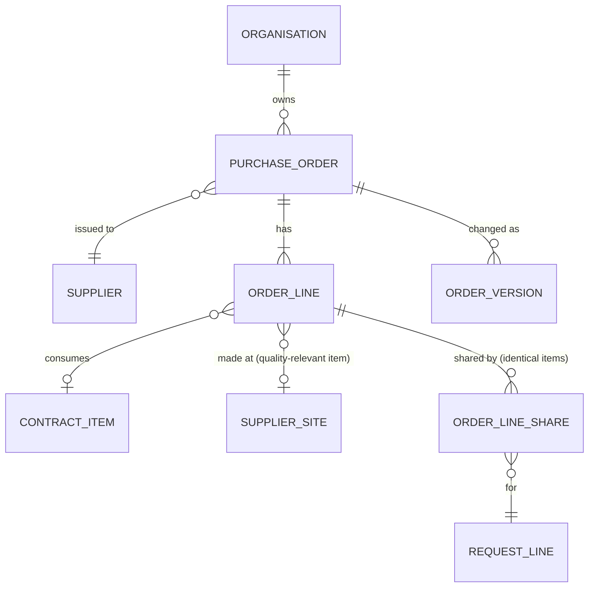
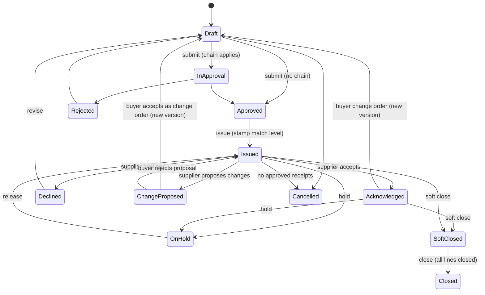

# eProcurement Suite: Purchase orders PRD

## 0. Document control

| Item | Value |
|---|---|
| Document title | Purchase orders: compliant ordering from approved suppliers, Product Requirements Document |
| Layer | Suite (ADR-0043): a product of the eProcurement Suite, on IronSaaS Foundation; the module is proposed in section 13 |
| Identifier prefix | `ORD-`, in blocks of twenty per area (ADR-0041); the table is `orders-requirements.csv` |
| Version | 1.4 (EPS-modules, 2026-10-30: consolidated and automatic orders, and identical items as one line) |
| Date | 2026-10-30 |
| Status | Accepted at the design session's review of 2026-10-20, its decisions written into the requirements and marked "decided 2026-10-20" in their notes. The changes of 1.3 (SUP-gaps) were accepted at the design session's review of 2026-10-21, their decisions marked "decided 2026-10-21" in their notes. The changes of 1.4 (EPS-modules) wait for the design session's review. |
| Inputs | The Functional Foundation PRD for procure-to-pay, version 1.2 (archived as `../../archive/functional-foundation-p2p-PRD-v1.md`), the map (`../../requirements-map.md`), ADR-0029 and ADR-0041. |
| Dependency | Legal entities, finance masters, budgets, terms and suppliers are the Business PRD's; requests, receipts, invoices and contracts are their products'; every mechanism is a kernel capability cited by its TF identifier. |
| Tags | `[Carried]` behaviour from the current product that stays. `[Improved]` carried but changed to close a defect or gap. `[New]` not in the current product, standard practice. `[Decision]` needs the owner's confirmation; the question is in its notes. `[Later]` recorded, not in version 1. A requirement moved from the archived PRD says what it was at the start of its notes. |

Change log: 1.4, 2026-10-30: EPS-modules, the owner's decisions of 2026-10-29 for Requests and Intake (ADR-0058), on this product's side: ORD-161 orders a buyer's selection of lines from many requests, a call into Requests; ORD-162 and ORD-163 make automatic orders and the orders of an automatic consolidation from Requests' events; ORD-164 merges identical items into one order line, keeping each requester's share; ORD-142 declares the key "automatic order returned to the queue"; sections 2, 4, 5, 8, 12, 14 and 15 follow; no requirement retired. 1.3, 2026-10-21: SUP-gaps, from the supplier management pack (`process-reference/supplier-management.md`): ORD-010 lets a line for a quality-relevant item be ordered only from an approved supplier, site and material, checked at submission (gap G3); ORD-011 lets open orders take a supplier change the reviewer chose them to take (its section 8.2, rule 7); the domain model draws the line's manufacturing site; no requirement retired. At SUP-gaps' review the same day, ORD-009 came to depend on ORD-142 rather than the reverse, and ORD-142's AC2 took a key of its own slice (order acknowledged), so that no requirement depends on one of a later slice, which `make prd-check` now refuses. 1.2, 2026-10-20: the review of L2 (ADR-0043, decision 8): ORD-005 takes its match levels from the purchasing master, ORD-022 holds the acknowledgement reminder days (from BF-161), ORD-141 names the order and change order templates (from BF-162), and ORD-142 declares the product's notification keys (from BF-164); no other requirement changed. 1.1, 2026-10-20: moved to `docs/prd/suites/procurement/` as a product of the eProcurement Suite on IronSaaS Foundation (ADR-0043); its module's names follow the Suite layer; no requirement changed. 1.0, 2026-10-20: accepted at the review; its decisions are written into the requirements, and the proposals of the split's sections stand. 0.2 DRAFT, 2026-10-20: the design session's answers at the checkpoint and the split's sections (supplier views, records and signatures, visibility tags, search and exports, dependencies by ADR-0042, module and permissions). 0.1 SKELETON, 2026-10-20: the split (ADR-0041). Purchase orders moved here from the Functional Foundation PRD 1.2, their words unchanged except for names that changed.

## 1. Vision and goals

### 1.1 Vision

Compliant ordering: approved orders to approved suppliers, stamped with the match level and tolerances that decide how they are received and invoiced, issued by the channel the supplier uses, acknowledged by the supplier, and changed only through versions the supplier sees.

### 1.2 Goals (outcomes)

Goal 1 of the archived PRD is shared with the Purchase requests product (its section 1.2). The acknowledgement goal is the supplier portal surface's goal 1. This product's own:

1. Every order carries, from its approval, the match level and tolerances that decide how it is received and invoiced (ORD-005).
2. A change to an issued order is a version the supplier sees and acknowledges (ORD-023).

### 1.3 Lessons from the current product

Keep, from the archived PRD's list: configurable match levels per supplier and chart of account stamped on order lines; multi-channel order issue; supplier acknowledgement. Improve: closure flags per order line and close-short; order change versions with re-acknowledgement.

## 2. Scope

### 2.1 In scope

Orders from requests or direct, lines and totals, splits and budget, submission and approval, match level and tolerance stamping, issue by channel, taxes and documents, contract references, requester notifications, acknowledgement and reminders, change orders with versions, hold, close and cancel, line closure flags, lists, and the orders' reports. Since 2026-10-30: orders consolidated from many requests by a buyer, automatic orders and the orders of an automatic consolidation, and identical items as one order line with each requester's share (section 6.8).

### 2.2 Out of scope in version 1 (`[Later]`)

From the archived PRD's list: blanket orders with releases (recorded as a later feature, ORD-062).

## 3. Personas

| Persona | Goals in this product | Surface |
|---|---|---|
| Buyer | Convert requests to orders, manage order changes, resolve supplier queries | Enterprise app |
| Approver (manager, budget owner, finance, legal) | Approve orders with context, within SLA, or delegate | Enterprise app, email links |
| Requester | Follow the order, confirm receipt when asked | Enterprise app |
| Supplier contact | Acknowledge orders | Supplier Network portal |

## 4. Domain model

Since 2026-10-30 an order line made from identical request lines holds a share per request line, with its quantity, account split and requester (ORD-164); `REQUEST_LINE` is the Requests and Intake product's, drawn for context.

`ORGANISATION` is the kernel's unit; `SUPPLIER` and `SUPPLIER_SITE` the Business masters; `CONTRACT_ITEM` the Contracts product's. They are drawn for context. An order copies the supplier's address and terms when it is issued and keeps them; it takes a supplier's later change only by a change order (ORD-011, the supplier management pack's section 8.5).

## 5. Processes

### 5.1 Request to order (the order's part)

From the archived PRD's section 5.2, after the request's part (the Purchase requests product's section 5): an order converted from a request, or a direct order → order approval (when configured) → match level and tolerances stamped → issue by channel → supplier acknowledges (accept, decline, or propose changes) → buyer accepts proposal as a change order (new version) or rejects.

### 5.2 Orders from requests (since 2026-10-30)

The owner's decisions of 2026-10-29 (ADR-0058), on this product's side: a buyer selects approved lines of many requests in the work queue and orders them on this product's screen, one order per supplier, legal entity, currency and payment terms (ORD-161); a catalogue or contract line within the automatic order rules arrives as Requests' event and becomes an order without a buyer (ORD-162), or, where a consolidation window is set, a window's group arrives and becomes one order (ORD-163); identical items may become one order line with each requester's share (ORD-164). From there each order follows section 5.1: approval when configured, stamping, issue and acknowledgement.

## 6. Requirements

Each requirement has an identifier, a priority (Must, Should, Could), a tag, the requirement statement in business terms, the reason, acceptance criteria that a tester can run (including at least one error case), dependencies and notes.

### 6.1 Orders (ORD-001 to ORD-020)

#### ORD-001 Create orders
*Priority:* **Must** · *Tag:* `[Carried]` · *Area:* Orders

**Requirement:** Orders shall be created from requests (REQ-021) or directly by buyers with the permission (header: supplier and site, legal entity, chart of account, currency, delivery and billing addresses, payment and shipping terms, delivery channel, template, contact; lines: item, quantity, unit, price, tax code, ship-to, need-by, contract reference, splits), as Draft with the number allocated at submission.

**Why:** The commitment document.

**Acceptance criteria:**

- AC1 Given an order created from a request, When viewed, Then each line links to its request line and splits are copied.
- AC2 Given a supplier not published, When an order is created, Then it is refused. (error case)
- AC3 Given a direct order, When created, Then the buyer must have the direct-order permission.

*Depends on:* BF-101, BF-001, BF-072

**Notes:** Was FF-070.

#### ORD-002 Order lines and totals
*Priority:* **Must** · *Tag:* `[Carried]` · *Area:* Orders

**Requirement:** Order lines carry quantity or amount basis, unit price, discounts, tax lines from tax codes, charges (freight, handling) at header or line, and compute totals in order currency with converted amounts in legal entity currency.

**Why:** Correct commitments.

**Acceptance criteria:**

- AC1 Given lines, taxes and charges, When totals compute, Then the total equals lines plus taxes plus charges minus discounts.
- AC2 Given a tax code expired, When used, Then it is refused. (error case)
- AC3 Given a change in a line, When saved, Then totals recompute.

*Depends on:* ORD-001, BF-071

**Notes:** Was FF-071.

#### ORD-003 Order splits and budget
*Priority:* **Must** · *Tag:* `[Carried]` · *Area:* Orders

**Requirement:** Order lines inherit splits from request lines or require splits for direct orders with the same rules; budget reservation moves from request to order without double counting; direct orders reserve budget at submission when configured.

**Why:** Accounting continuity.

**Acceptance criteria:**

- AC1 Given a converted line, When viewed, Then splits equal the request line's splits.
- AC2 Given a direct order with splits short of 100 percent, When submitted, Then it is refused. (error case)
- AC3 Given a direct order submitted with validation on, When processed, Then budget is reserved.

*Depends on:* ORD-001, REQ-003, BF-065

**Notes:** Was FF-072.

#### ORD-004 Order submission and approval
*Priority:* **Must** · *Tag:* `[Carried]` · *Area:* Orders

**Requirement:** Submission shall validate header and lines, supplier status and documents, contract limits, and run the order approval configuration (new and change types) when configured; otherwise the order is Approved.

**Why:** Control before commitment.

**Acceptance criteria:**

- AC1 Given an order above a threshold with a configuration, When submitted, Then it is In Approval with the configured approvers.
- AC2 Given a supplier with a blocking expired document, When submitted, Then it is refused naming the document. (error case)
- AC3 Given no configuration, When submitted, Then it is Approved.

*Depends on:* ORD-001, TF-090, SUP-041

**Notes:** Was FF-073.

#### ORD-005 Match level and tolerance stamping
*Priority:* **Must** · *Tag:* `[Carried]` · *Area:* Orders

**Requirement:** On approval each line shall be stamped with the resolved match level (in the order of PUR-025: the supplier's terms in the order's organisation, else the supplier's purchasing profile, else the legal entity's default, else the system default) and the over-receipt and invoice tolerances in force; stamps never change; later configuration changes affect new orders only.

**Why:** Predictable matching.

**Acceptance criteria:**

- AC1 Given supplier 2-way and legal entity 3-way for products, When approved, Then product lines are stamped 2-way.
- AC2 Given a stamped line, When the supplier's match level changes, Then the line keeps its stamp.
- AC3 Given a line with match level None, When stamped, Then no quantity tracking applies to it. (edge)
- AC4 Given a stamping attempt on a line that is not approved, When attempted, Then it is refused. (error case)

*Depends on:* ORD-004, PUR-021, PUR-023, PUR-025

**Notes:** Was FF-074. The match levels come from the eProcurement Suite's purchasing master since the review of L2 (ADR-0043).

#### ORD-006 Issue orders by channel
*Priority:* **Must** · *Tag:* `[Carried]` · *Area:* Orders

**Requirement:** Approved orders shall be issued through the chosen channel: email with the rendered PDF, supplier portal notification, or internal only; the rendered document uses the legal entity's template; issue sets Issued, records time and channel, and stores the PDF.

**Why:** Formal commitment to the supplier.

**Acceptance criteria:**

- AC1 Given channel email, When issued, Then the supplier contact receives the PDF and the order is Issued.
- AC2 Given no template, When issued, Then it is refused naming the missing template. (error case)
- AC3 Given channel portal, When issued, Then the supplier sees it with an acknowledge action.

*Depends on:* ORD-004, ORD-141, TF-162, TF-150

**Notes:** Was FF-075.

#### ORD-007 Order totals, taxes and documents
*Priority:* **Must** · *Tag:* `[Carried]` · *Area:* Orders

**Requirement:** Orders shall show totals by currency, tax breakdown by code and component, charges, and the rendered PDF per version; printing uses the template with tenant branding.

**Why:** Shared commercial document.

**Acceptance criteria:**

- AC1 Given taxes with two components, When viewed, Then the breakdown shows both.
- AC2 Given version 2 issued, When the PDF list is viewed, Then both versions' PDFs exist.
- AC3 Given a missing tax code on a taxable line, When submitted, Then a warning asks for confirmation. (edge)
- AC4 Given a tax component total that does not equal the header tax, When computed, Then the document is refused as inconsistent. (error case)

*Depends on:* ORD-002, TF-162

**Notes:** Was FF-084.

#### ORD-008 Contract reference on order lines
*Priority:* **Should** · *Tag:* `[New]` · *Area:* Orders

**Requirement:** Order lines may reference a contract item; price is taken from the contract; released quantity and value accumulate on the contract at issue and are released on cancellation; exceeding the contract limit is blocked or warned per setting.

**Why:** Contract compliance.

**Acceptance criteria:**

- AC1 Given a contract line with 100 remaining, When an order line of 60 is issued, Then remaining shows 40.
- AC2 Given an order line of 150 against 100 remaining with blocking on, When submitted, Then it is refused. (error case)
- AC3 Given the order cancelled, When processed, Then remaining returns to 100.

*Depends on:* ORD-001, CON-021

**Notes:** Was FF-083.

#### ORD-009 Requester confirmation and notifications
*Priority:* **Should** · *Tag:* `[New]` · *Area:* Orders

**Requirement:** Requesters shall be notified when their lines are ordered, issued, acknowledged, received and invoiced; they may confirm receipt for desk deliveries when configured (creating a receipt in their name).

**Why:** Close the loop with the requester.

**Acceptance criteria:**

- AC1 Given an order issued for the requester's line, When processed, Then the requester is notified with the order number.
- AC2 Given desk-delivery confirmation enabled, When the requester confirms, Then a receipt is created and routed per configuration.
- AC3 Given confirmation disabled, When the requester views the order, Then no confirm action appears. (edge)
- AC4 Given a requester confirming receipt for a line not theirs, When attempted, Then it is refused. (error case)

*Depends on:* ORD-006, ORD-142, RCV-021 (event)

**Notes:** Was FF-085. Orders hears of receipts and invoices from their events (ADR-0042); the requester's receipt confirmation is Receiving's, RCV-027, which says the same from its side.

#### ORD-010 Approved supplier, site and material for quality-relevant lines
*Priority:* **Should** · *Tag:* `[New]` · *Area:* Orders

**Requirement:** With Supplier management's regulated qualification (its licensed feature `supplier_management.gxp_qualification`), an order line for a quality-relevant item (SUP-182) shall name the manufacturing site the material comes from, offered from the supplier's approved combinations for that item and filled in when there is only one; submission shall check, through Supplier management's Contracts, that the supplier, site and material are an approved combination (SUP-183), and refuse the order naming each line that is not. A conditionally approved combination is allowed, with its conditions shown on the line, unless the tenant's setting in Supplier management is approved only (SUP-183), when it is refused like a combination not approved.

**Why:** EU GMP chapter 5.26: starting materials only from approved suppliers, and for a regulated buyer that means the supplier's approved site for that material. The check belongs at submission, before the order commits anyone.

**Acceptance criteria:**

- AC1 Given an approved combination of supplier S, its site in Pune and item 4711, When an order line for item 4711 to S is created, Then Pune is offered and filled in.
- AC2 Given a line for item 4711 to S with its site in Mumbai, not approved, When the order is submitted, Then it is refused naming the line, the site and the missing approval. (error case)
- AC3 Given a combination approved with increased incoming inspection as its condition, When the order is submitted, Then it is allowed and the line shows the condition.
- AC4 Given a tenant without the feature, When an order is submitted, Then no line is checked for a combination.
- AC5 Given a conditionally approved combination and a tenant whose setting is approved only, When the order is submitted, Then it is refused naming the line and the conditional approval. (error case)

*Depends on:* ORD-004, SUP-182, SUP-183, BF-104

**Notes:** New 2026-10-21 (SUP-gaps, gap G3 of the supplier management pack, variant V4). Orders calls Supplier management, an earlier product, through its Contracts (ADR-0042). Decided 2026-10-21 at the review: a conditional approval allows ordering with its conditions shown, by default, and a strict tenant sets Supplier management's setting to approved only, which this check follows (AC5); the site is filled in when the supplier has one approved site for the item.

#### ORD-011 Open orders take a supplier change
*Priority:* **Could** · *Tag:* `[New]` · *Area:* Orders

**Requirement:** When a supplier change applies (Supplier management's event, SUP-208) and its reviewer chose that open orders take the new values, the open orders of that supplier that use the old values shall take them: an order not yet issued at once, an issued order by a change order with the new values (ORD-023); an order on hold, closed for receiving and invoicing, or cancelled is left as it was and listed for its buyer. An order whose reviewer left it keeps the values it was issued with.

**Why:** A supplier that moves its remit-to address or its ordering contact should not receive forty orders that still point at the old one; and an issued order changes only by a change order the supplier sees.

**Acceptance criteria:**

- AC1 Given a reviewer's choice that open orders take a new ordering address, When the change applies, Then each issued open order gets a change order with the new address, and each order in draft takes it at once.
- AC2 Given a reviewer's choice that open orders keep their values, When the change applies, Then the orders keep the address they were issued with.
- AC3 Given an open order on hold, When the change applies, Then it is not changed and is listed for its buyer with the reason. (error case)

*Depends on:* ORD-023, SUP-208

**Notes:** New 2026-10-21 (SUP-gaps, the supplier management pack's section 8.2, rule 7). Orders hears the change applied from Supplier management's event. Decided 2026-10-21 at the review: the change order is how an issued order takes the new values, and an order on hold or closed is listed rather than changed.

### 6.2 Acknowledgement and change (ORD-021 to ORD-040)

#### ORD-021 Supplier acknowledgement
*Priority:* **Must** · *Tag:* `[Improved]` · *Area:* Acknowledgement and change

**Requirement:** Supplier users shall acknowledge an issued order by accepting, declining with reason, or proposing changes (dates, quantities, prices per line) within a configurable period; the buyer is notified; proposals are accepted as a change order or rejected; on-time acknowledgement is measured.

**Why:** Carried; adds change proposals.

**Acceptance criteria:**

- AC1 Given acceptance, When saved, Then status is Acknowledged and the buyer notified.
- AC2 Given a proposal, When the buyer accepts it, Then a change order version is created with the proposed values and re-issued.
- AC3 Given a declined order, When the supplier later tries to accept, Then it is refused. (error case)

*Depends on:* ORD-006, ORD-023

**Notes:** Was FF-076.

#### ORD-022 Acknowledgement reminders
*Priority:* **Should** · *Tag:* `[New]` · *Area:* Acknowledgement and change

**Requirement:** Unacknowledged orders shall trigger reminders to the supplier after a number of days Orders sets per document type and organisation, and escalation to the buyer; the order list shall flag overdue acknowledgements.

**Why:** Delivery risk is visible early.

**Acceptance criteria:**

- AC1 Given 3 days without acknowledgement, When the job runs, Then the supplier is reminded and the order flagged.
- AC2 Given acknowledgement received, When evaluated, Then no further reminder is sent.
- AC3 Given 7 days, When the job runs, Then the buyer is notified. (edge)
- AC4 Given reminder days set to zero or negative, When saved, Then it is refused. (error case)

*Depends on:* ORD-021, TF-120, TF-057

**Notes:** Was FF-077, FF-170 and BF-161: FF-077 whole, with the acknowledgement reminder days of BF-161's document type settings, moved at the review of L2, 2026-10-20 (ADR-0043).

#### ORD-023 Change orders with versions
*Priority:* **Must** · *Tag:* `[New]` · *Area:* Acknowledgement and change

**Requirement:** Buyers shall change issued orders by creating a new version (lines added, changed or cancelled; header changes), with a change summary, re-approval per configuration, and re-issue; quantities cannot be reduced below received or invoiced; prices cannot change for fully invoiced lines; previous versions remain viewable and the supplier sees the diff.

**Why:** Gap: current product sets the order back to draft without versions.

**Acceptance criteria:**

- AC1 Given a quantity reduced below received, When saved, Then it is refused naming the line. (error case)
- AC2 Given a change approved and issued, When the supplier opens it, Then version 2 with the diff and a new acknowledgement request is shown.
- AC3 Given version history, When viewed, Then each version shows who, when and what changed.

*Depends on:* ORD-006, ORD-021, TF-090

**Notes:** Was FF-079.

### 6.3 Hold, close and cancel (ORD-041 to ORD-060)

#### ORD-041 Hold and release
*Priority:* **Should** · *Tag:* `[Carried]` · *Area:* Hold, close and cancel

**Requirement:** Buyers shall put an order on hold with reason (no receipts or invoices accepted) and release it; suppliers see the hold notice.

**Why:** Pause without cancel.

**Acceptance criteria:**

- AC1 Given an order on hold, When a receipt is created, Then it is refused with the hold reason. (error case)
- AC2 Given release, When done, Then receipts and invoices are accepted again.
- AC3 Given hold, When the supplier views the order, Then the notice is shown.

*Depends on:* ORD-006

**Notes:** Was FF-080.

#### ORD-042 Soft close, close and cancel
*Priority:* **Must** · *Tag:* `[Improved]` · *Area:* Hold, close and cancel

**Requirement:** Soft close stops receipts and allows invoices; close requires all lines closed for receiving and invoicing (or close-short); cancel is allowed only without approved receipts or submitted invoices; each with reason, budget release of remaining reservation, and supplier notification.

**Why:** Clean open-order reporting.

**Acceptance criteria:**

- AC1 Given approved receipts, When cancel is attempted, Then it is refused; soft close is offered. (error case)
- AC2 Given soft close, When an invoice is created, Then it is allowed and a receipt is refused.
- AC3 Given close, When done, Then remaining reservations are released.

*Depends on:* ORD-006, BF-066

**Notes:** Was FF-081.

#### ORD-043 Line closure flags and close-short
*Priority:* **Must** · *Tag:* `[New]` · *Area:* Hold, close and cancel

**Requirement:** Each order line shall have closed-for-receiving and closed-for-invoicing flags set automatically when quantities are met within tolerance, or manually by close-short with reason; closed lines refuse the related documents and release remaining budget.

**Why:** Standard practice (final delivery and final invoice indicators).

**Acceptance criteria:**

- AC1 Given a line fully received within tolerance, When the receipt is approved, Then closed-for-receiving is set automatically.
- AC2 Given a line closed for invoicing, When an invoice line references it, Then it is refused. (error case)
- AC3 Given close-short, When applied, Then both flags are set and the budget remainder released.

*Depends on:* ORD-005, RCV-081 (event)

**Notes:** Was FF-082. The closure flags follow the quantities Orders keeps from Receiving's bucket events (ORD-121, ADR-0042).

### 6.4 Lists and later order types (ORD-061 to ORD-080)

#### ORD-061 Order lists and views
*Priority:* **Must** · *Tag:* `[Carried]` · *Area:* Lists and later order types

**Requirement:** Order lists with filters and saved views; order line view across orders with ordered, received, invoiced and open quantities; service orders view; supplier-specific list in the portal.

**Why:** Tracking fulfilment.

**Acceptance criteria:**

- AC1 Given the line view, When loaded, Then each line shows the four quantities.
- AC2 Given a supplier user, When listing, Then only their orders appear.
- AC3 Given a user without read permission, When opening, Then it is refused. (error case)

*Depends on:* ORD-001, RCV-081 (event)

**Notes:** Was FF-078. The received and invoiced quantities are those Orders keeps from Receiving's bucket events (ORD-121, ADR-0042).

#### ORD-062 Blanket and standing orders
*Priority:* **Could** · *Tag:* `[New]` · *Area:* Lists and later order types

**Requirement:** Blanket orders with a value or quantity ceiling and validity, against which release orders are created without approval up to the ceiling. Recorded for a later slice.

**Why:** Common for services and recurring supplies.

**Acceptance criteria:**

- AC1 Given a blanket order, When a release is created within the ceiling, Then it is issued without approval when configured.
- AC2 Given a release above the ceiling, When submitted, Then it is refused. (error case)
- AC3 Given validity ended, When a release is created, Then it is refused.

*Depends on:* ORD-001

**Notes:** Was FF-086. Later.

### 6.5 Reports (ORD-081 to ORD-100)

#### ORD-081 Operational reports
*Priority:* **Must** · *Tag:* `[Carried]` · *Area:* Reports

**Requirement:** The reports in section 11.3 shall be available as grids with filters, saved views and export, respecting permissions and visibility.

**Why:** Run the operation.

**Acceptance criteria:**

- AC1 Given the open orders report, When filtered by supplier, Then only that supplier's lines appear.
- AC2 Given a user without the reports permission, When opening, Then it is refused. (error case)
- AC3 Given export, When run, Then the file matches the grid.

*Depends on:* TF-171, TF-203

**Notes:** Was FF-160, the order reports; the others are REQ-061, RCV-101, INV-084 and CAT-041. Placed by the test: each product owns its reports.

#### ORD-082 Order cycle time measures
*Priority:* **Should** · *Tag:* `[New]` · *Area:* Reports

**Requirement:** The system shall compute cycle times (request to approval, approval to order, order to acknowledgement, order to receipt) by period, legal entity and supplier.

**Why:** Goal 1 of the supplier portal surface (its section 1.2) is measured here.

**Acceptance criteria:**

- AC1 Given documents in a period, When computed, Then medians and percentiles are shown.
- AC2 Given no data, When viewed, Then "no data" is shown. (edge)
- AC3 Given a period with inconsistent data (an approval before submission), When computed, Then the record is excluded and listed in a data quality note. (error case)

*Depends on:* ORD-081

**Notes:** Was FF-161, the order cycle times; the invoice measures are INV-085.

### 6.6 Quantities (ORD-121 to ORD-140)

The received and invoiced quantities Orders keeps on its order lines from Receiving's bucket events (ADR-0042), for its views and closure flags. The checks that must be atomic read the buckets themselves, in Receiving (RCV-081). This area was added at the checkpoint, so its block follows the supplier views'.

#### ORD-121 Nightly reconciliation of order quantities
*Priority:* **Must** · *Tag:* `[New]` · *Area:* Quantities

**Requirement:** A nightly job shall recompute the received and invoiced quantities Orders keeps on its order lines from the bucket events of Receiving it has applied (RCV-081), compare them with the stored values, write differences to a drift report and alert operators; drift is an incident, not auto-healed. It runs in the one nightly reconciliation window of the kernel's jobs (TF-120 to TF-124).

**Why:** Counters are a cache; documents are the truth.

**Acceptance criteria:**

- AC1 Given consistent data, When the job runs, Then zero drift rows exist and a success record is stored.
- AC2 Given a manual database change that breaks a counter, When the job runs, Then the drift row names the line and values and an alert fires. (error case)
- AC3 Given the job fails, When detected, Then an alert fires.

*Depends on:* ORD-061, RCV-081 (event), TF-120, TF-123

**Notes:** Was FF-133, the quantities Orders keeps; Orders hears of them from Receiving's events (ADR-0042). Receiving, Invoicing and the Business budgets reconcile their own counters in RCV-083, INV-027 and BF-073, in the same window.

### 6.7 Templates and notifications (ORD-141 to ORD-160)

#### ORD-141 Order and change order templates
*Priority:* **Must** · *Tag:* `[Carried]` · *Area:* Templates and notifications

**Requirement:** Orders shall name its document templates on the business layer's templates (BF-162): the order and the change order, per legal entity and language, with the placeholders each offers documented and an English starter template of each; issuing an order (ORD-006) or a change order (ORD-023) renders through them.

**Why:** Branded documents. A product's templates are its content; the template mechanism is the Foundation's (ADR-0043).

**Acceptance criteria:**

- AC1 Given an order template for legal entity L1, When an order of L1 is issued, Then it is rendered with that template.
- AC2 Given a template that misses a placeholder Orders marks mandatory, When saved, Then it is refused naming the placeholder. (error case)
- AC3 Given a preview, When requested, Then sample data renders.

*Depends on:* BF-162, TF-162

**Notes:** Was FF-173 and BF-162, the order and change order templates. Moved at the review of L2, 2026-10-20 (ADR-0043).

#### ORD-142 Notification keys of Orders
*Priority:* **Should** · *Tag:* `[New]` · *Area:* Templates and notifications

**Requirement:** Orders shall declare its notification keys on the business layer's notification templates (BF-164), each with the event that raises it, the placeholders it offers, its default audience and an English starter template: line ordered, issued, acknowledged and received (the requester, ORD-009), order acknowledged (the buyer owner, ORD-021), acknowledgement reminder (the supplier's primary contact, ORD-022), acknowledgement overdue (the buyer owner, ORD-022) and automatic order returned to the queue, with the reason (the line's buyer, ORD-162).

**Why:** The product knows what happens to its documents; the tenant decides, in its own words, who hears of it (BF-164). A suite's keys and starter templates are the suite's content (ADR-0043).

**Acceptance criteria:**

- AC1 Given a tenant with the eProcurement Suite, When it is provisioned, Then each key of Orders exists with its English starter template and its default audience.
- AC2 Given an order acknowledged by its supplier (ORD-021), When the acknowledgement is saved, Then the buyer owner is told in the key's template.
- AC3 Given a starter template that names a placeholder its key does not offer, When the module's declarations are checked at start, Then the start fails naming the key and the placeholder. (error case)

*Depends on:* BF-164, ORD-021, ORD-022

**Notes:** Was BF-164, the keys and starter templates of Orders. Moved at the review of L2, 2026-10-20 (ADR-0043): each product declares its keys and starter templates; BF-164 keeps the mechanism. Changed 2026-10-21 at SUP-gaps' review: the requirements that raise its keys in a later slice (ORD-009, with Receiving; AC2 now takes a key of this slice, order acknowledged, instead of ORD-009's) depend on this declaration, not the reverse, so no requirement depends on one of a later slice (`make prd-check`). Changed 2026-10-30 (EPS-modules): the key "automatic order returned to the queue" (ORD-162).

### 6.8 Orders from requests (ORD-161 to ORD-180)

Orders makes the orders that Requests and Intake's buying model calls for (the owner's decision of 2026-10-29, ADR-0058): a buyer's consolidation of many requests on this product's screen, which calls Requests; and automatic orders and automatic consolidation, which no person starts, from Requests' events (ADR-0042, decision 4). This area was added after the templates and notifications, so its block follows theirs.

#### ORD-161 Consolidated orders from a buyer's selection
*Priority:* **Must** · *Tag:* `[New]` `[Decision]` · *Area:* Orders from requests

**Requirement:** On this product's screen a buyer shall order approved lines selected from many requests in their work queue (REQ-161): the screen reads the lines through Requests' Contracts, makes one draft order per supplier, legal entity, currency and payment terms, copies each line's price, account split, ship-to and need-by date onto an order line of its own linked to its request line (ORD-001, ORD-003), and marks every line converted in Requests in the same step, so that either all of the selection is ordered or none of it is. A line flagged "source first" (REQ-141) is ordered only with the buyer's reason for not sourcing it, which its order line keeps and shows.

**Why:** One order per supplier from a week's requests is what consolidation at the buying desk means; doing it in one step, all or nothing, leaves no request half converted.

**Acceptance criteria:**

- AC1 Given seven selected lines of four requests, five for supplier S and two for supplier T, all of legal entity L in one currency and on one set of terms, When the buyer orders them, Then two draft orders exist, to S with five lines and to T with two, each line linked to its request line.
- AC2 Given a selected line flagged "source first", When the buyer orders it with a reason, Then its order line keeps the reason and shows it.
- AC3 Given a selected line flagged "source first" and no reason given, When the buyer orders the selection, Then it is refused naming the line and the limit, and nothing is ordered. (error case)

*Depends on:* ORD-001, ORD-003, REQ-141, REQ-161

**Notes:** New 2026-10-30 (EPS-modules), the owner's decision of 2026-10-29 (ADR-0058): a buyer's consolidated conversion on Orders' screen is a call into Requests, immediate (ADR-0042, decision 4); the orders are then approved and issued as any other (ORD-004, ORD-006). Decision, proposed default: until Sourcing exists, a "source first" line is ordered only with a reason, so the exception shows in the order and its reports.

#### ORD-162 Automatic orders
*Priority:* **Must** · *Tag:* `[New]` `[Decision]` · *Area:* Orders from requests

**Requirement:** When Requests publishes a line as ready for an automatic order (REQ-142), this product shall make the order without a buyer: one order for the line, to its supplier, at its catalogue or contract price with its contract reference (ORD-008), with its account split, ship-to and need-by date; submit it, so that the order approval configuration applies (ORD-004); and issue it by the supplier's channel once approved (ORD-006). It marks the line converted through Requests' Contracts. The order's owner, who answers the supplier's questions and hears its acknowledgement, is a buyer of the line's purchasing group, else of its legal entity's buying group (PUR-001). When the order cannot be made or submitted (the supplier put on hold since the approval, a contract's ceiling reached, a template missing), the line is not ordered: it goes to its buyer's queue with the reason, and the buyer is told (ORD-142). The event is handled once, however often it arrives (TF-111).

**Why:** Desktop buying's speed comes from ordering agreed items without a buyer; the checks an order passes are still the order's, so an automatic order is held to them like any other and falls back to a person when it fails one.

**Acceptance criteria:**

- AC1 Given a line published for an automatic order, a catalogue item of 300 from supplier S whose channel is the portal, and no order approval configuration that applies, When the event is handled, Then an order to S is made, approved and issued in the portal without a buyer, and the line is marked converted in Requests.
- AC2 Given a published line from a contract item, When the order is made, Then it carries the contract's price and reference, and the release is recorded on the contract (ORD-008).
- AC3 Given the same event delivered twice, When it is handled, Then one order exists. (error case)
- AC4 Given a published line whose supplier was put on hold after the request's approval, When the event is handled, Then no order is made, the line goes to its buyer's queue naming the hold, and the buyer is told. (error case)

*Depends on:* REQ-142, ORD-004, ORD-006, ORD-008, ORD-142, PUR-001, TF-111

**Notes:** New 2026-10-30 (EPS-modules), the owner's decision of 2026-10-29 (ADR-0058): an automatic conversion is an event from Requests, which this product handles; it calls Requests back only to mark the line converted (ADR-0042, decision 4). Decision, proposed defaults: a buyer of the line's purchasing group owns the automatic order, though none made it; an automatic order is submitted at once and issued once approved, with nobody pressing a button; a line whose order fails goes back to a person rather than waiting for a retry.

#### ORD-163 Orders from an automatic consolidation
*Priority:* **Should** · *Tag:* `[New]` `[Decision]` · *Area:* Orders from requests

**Requirement:** When Requests publishes a group of lines at the close of a consolidation window (REQ-162), this product shall make one order for the group as it makes an automatic order (ORD-162), with one order line per request line, or per set of identical lines where the legal entity merges them (ORD-164), each linked to its request line; and submit and issue it in the same way. A line of the group that cannot be ordered (its supplier on hold, its contract's ceiling reached) goes to its buyer's queue with the reason, and the rest of the group is ordered without it.

**Why:** A window's group is one supplier's day of agreed items; one order for it is the point of the window.

**Acceptance criteria:**

- AC1 Given a group of three lines from three requests for supplier S, When it is handled, Then one order to S with three lines exists, each linked to its request line, and each request is Ordered.
- AC2 Given a group in which one line's contract ceiling is reached, When it is handled, Then the order holds the other lines, and that line goes to its buyer's queue naming the contract and its ceiling. (error case)

*Depends on:* REQ-162, ORD-162, ORD-164

**Notes:** New 2026-10-30 (EPS-modules), the owner's decision of 2026-10-29 (ADR-0058): automatic consolidation, an event from Requests. Decision, proposed default: a line that cannot be ordered leaves the group and the rest is ordered, since nobody is there to choose, while a buyer's selection is all or nothing (ORD-161), since the buyer is.

#### ORD-164 Identical items as one order line, each requester's share kept
*Priority:* **Should** · *Tag:* `[New]` `[Decision]` · *Area:* Orders from requests

**Requirement:** As an option a legal entity turns on, lines of one order that are identical, the same item or supplier item from the same supplier, in the same unit, at the same price, to the same ship-to, shall become one order line with the total quantity and the earliest need-by date, keeping each request line as a share with its own quantity, account split and requester, which this product writes to the request line (REQ-163). Budget is reserved and consumed per share (ORD-003); the quantity received on the order line, which this product keeps from Receiving's events (ORD-121), is shared out to its shares by need-by date, earliest first, unless the receiver names a share; and each requester is told of their own share (ORD-009).

**Why:** A supplier asked for 30 of one item gives one line, one price break and one delivery; the requesters behind the 30 still need their own quantity, budget and news.

**Acceptance criteria:**

- AC1 Given the option on, and requests from A for 10 and from B for 20 of item 4711 from supplier S at 5.00 to the same ship-to, When they are ordered together, Then one order line of 30 has two shares, A's 10 and B's 20, each with its own account split.
- AC2 Given that order line, A's share needed first, and a receipt of 12, When the receipt is approved, Then A's share shows 10 received and B's 2.
- AC3 Given the option off, When the same lines are ordered together, Then they stay two order lines.
- AC4 Given that order line with A's share fully received, When a change order cancels A's share, Then it is refused naming A's share and its received quantity. (error case)

*Depends on:* ORD-161, ORD-003, ORD-009, ORD-023, ORD-121, RCV-081 (event)

**Notes:** New 2026-10-30 (EPS-modules), the owner's decision of 2026-10-29 (ADR-0058): as an option, identical items become one order line with the total quantity, keeping each requester's share. Decision, proposed defaults: identical means the same item or supplier item, supplier, unit, price and ship-to; the line's need-by date is its earliest share's; a receipt is shared out earliest need-by first unless the receiver names a share; the option is off until a legal entity turns it on. Orders hears of receipts from Receiving's events (ADR-0042), as ORD-043 and ORD-061 do.

## 7. Supplier views

In the portal the supplier sees its issued orders and their versions with their PDFs, acknowledges them (accept, decline or propose changes), and sees holds, soft closes and cancellations (ORD-101); bulk acknowledgement across customers is the surface's (SPX-024). Every view obeys the portal's ownership rule (SPX-006): a supplier user sees and acts only on its own supplier's records.

The requirements (ORD-101 to ORD-120):

#### ORD-101 Orders and acknowledgement in the portal
*Priority:* **Must** · *Tag:* `[Carried]` · *Area:* Supplier views

**Requirement:** Suppliers see issued orders and versions with PDFs, acknowledge (ORD-021), and see holds, soft closes and cancellations.

**Why:** Core supplier task.

**Acceptance criteria:**

- AC1 Given an issued order, When opened, Then the PDF and the acknowledge actions are shown.
- AC2 Given version 2, When opened, Then the diff and a new acknowledgement request are shown.
- AC3 Given an order of another supplier by identifier, When requested, Then it is refused. (error case)

*Depends on:* ORD-006, ORD-021, TF-035, TF-234

**Notes:** Was FF-151. It obeys the supplier portal's ownership rule, SPX-006, and depends on the kernel requirements that enforce it (ADR-0042).

## 8. Rules and state machines

### 8.1 Key rules

From the archived PRD's section 7.1:

| Rule | Statement |
|---|---|
| Match level stamp | Resolved once at order approval: supplier value for the line type, else chart of account value, else system default; never changed afterwards. |
| Closure | A line closed for receiving accepts no receipts; closed for invoicing accepts no invoices; close-short sets both and releases remaining budget reservation. |
| Approved combination | With regulated qualification, a line for a quality-relevant item names its manufacturing site, and the order is submitted only when the supplier, site and material are an approved combination (ORD-010, SUP-183). |
| One group, one order | Lines of many requests ordered together make one order per supplier, legal entity, currency and payment terms (ORD-161, ORD-163). |
| An automatic order is still an order | It is submitted, approved where a configuration applies, and issued as any other; when it fails a check, its line goes back to a buyer (ORD-162). |
| Shares of a merged line | A merged line keeps each request line as a share; budget is per share, and receipts are shared out earliest need-by first unless the receiver names a share (ORD-164). |

### 8.2 State machines

#### Purchase order

## 9. Records and signatures (Part 11)

Records approved, acknowledged or signed carry an electronic signature (TF-063) with signer, time, meaning and record version, shown and printed as TF-219 asks; a tenant may require re-authentication at signing for the record types it selects. The table names this product's; the mechanism is the kernel's and is not repeated here.

| Record | Electronic signature (TF-063) | Audit-trail review (TF-219) |
|---|---|---|
| Order approval and change approval (ORD-004, ORD-023) | Each approval decision, meaning approved or rejected | Yes: change orders after acknowledgement, and price changes |
| Supplier acknowledgement (ORD-021) | The supplier user's acknowledgement, meaning acknowledged, or declined, or changes proposed, signed through the network (TF-234) | No |
| Issue (ORD-006) | Not signed; the rendered PDF is stored with its template version (TF-162) | No |
| Hold, close and cancel (ORD-041 to ORD-043) | Not signed; audited with the reason | Yes: cancellations and close-short |

Retention: this product's records are business documents and follow TF-066's default, 7 years after closure, which a tenant may change within the operator's limits; legal holds stop their deletion.

## 10. Visibility tags

An order converted from a request takes the request's tags, and a direct order takes its supplier's (TF-241, rule 6). Decided 2026-10-20.

## 11. Data, integration and reports

### 11.1 Data notes

From the archived PRD's section 8.1: order lines follow the kernel's partitioning conventions (TF-226) from the first migration; every order has a public number from the kernel's numbering (TF-166), standard columns, version, soft delete only before submission, custom fields (TF-200), attachments (TF-160), tracked change history (TF-062).

### 11.2 Integrations

| Direction | Data | Trigger | Kernel capability |
|---|---|---|---|
| Outbound | Issued orders and change orders | Events | Webhooks, outbound connectors (TF-105, TF-114) |
| Outbound | Order PDF to supplier by email, portal notification | Issue | Notifications, document rendering (TF-150, TF-162) |

### 11.3 Reports

From the archived PRD's section 8.4: open orders and lines with received and invoiced quantities; cycle times (request to order, order to receipt). Decided at the review: spend by purchasing group (PUR-001).

### 11.4 Search, exports and analytics feed

- Search (TF-204): orders by number, supplier, item and free text.
- Exports (TF-203, TF-205, TF-206): issued orders and change orders to the ERP (section 11.2), and the period's approved orders with their decisions and signatures for auditors.
- Analytics feed (TF-089, TF-203): the daily snapshot of orders and their lines with the quantities Orders keeps (ORD-121).

These are what the archived FF-164 to FF-166 asked of this product; the mechanisms are the kernel's.

## 12. Dependencies

### 12.1 Its place in the process order

Fifth (ADR-0042): it calls Supplier management, Contracts and Requests, and hears from Receiving and Invoicing only through events.

### 12.2 What it uses

- Kernel, cited by its requirements: TF-035 and TF-234 (record policies and delegated access, for its supplier view), TF-090 (approvals), TF-111 (event subscriptions, for automatic orders), TF-120 and TF-123 (jobs), TF-150 (notifications), TF-162 (rendering), TF-171 (the grid), TF-203 (saved views and exports). Through its sections: TF-063 and TF-219, TF-166, TF-241, TF-243.
- Business: BF-001 (legal entities), BF-061 (charts), BF-065 and BF-066 (budget), BF-071 (tax codes), BF-072 (terms), BF-101 (suppliers); and through their use, BF-074 (HSN and SAC codes on lines), BF-083 (bill-to), BF-108 (enablement), BF-143 (approvers), BF-162 and BF-163 (templates, number series).
- The suite's purchasing master (ADR-0043): PUR-001 (spend by purchasing group, and the owner of an automatic order), PUR-021, PUR-023 and PUR-025 (the match levels it stamps), PUR-022 (supplier suggestions).
- Earlier products: Supplier management (ORD-004 on SUP-041, documents that block orders, and the supplier's status and risk flags; ORD-010 on SUP-182 and SUP-183, the approved combinations of supplier, site and material; ORD-011 on SUP-208, the supplier change applied); Contracts (ORD-008 on CON-021, the release recorded at issue and returned on cancellation); Requests (ORD-001 and ORD-003 on REQ-003, the converted lines and their splits): a buyer converts an approved request on this product's screen, which reads its lines and marks them converted at once (REQ-021); since 2026-10-30, lines of many requests too (ORD-161 on REQ-161, with the routing flags of REQ-141), and the lines Requests publishes for automatic orders and automatic consolidation (ORD-162 on REQ-142, ORD-163 on REQ-162), each marked converted with its order line or share written back (REQ-163).

### 12.3 Events

- Publishes: order issued, changed, acknowledged, declined, held, released, closed and cancelled (Supplier management's indicators and warnings; the ERP, section 11.2).
- Subscribes: from Receiving, the bucket changes, received and invoiced (ORD-043, ORD-061, ORD-121, `RCV-081 (event)`), and goods received for the requester's notifications (ORD-009, `RCV-021 (event)`); from Supplier management, supplier change applied, with the reviewer's choice for open orders (ORD-011, SUP-208); from Requests and Intake, since 2026-10-30, line ready for an automatic order (ORD-162, REQ-142) and consolidation group closed (ORD-163, REQ-162), the automatic conversions of ADR-0042's decision 4.

### 12.4 Extension points it implements

- BF-207: order lines use items, suppliers, sites, addresses, terms, tax codes and account strings.

## 13. Layer, module, schema and permissions

The module is `Iron.Suites.Procurement.Orders` (schema `procurement_orders`), its shell module `shell/src/modules/suites/procurement/orders/`, licensed as a module (ADR-0034).

Permissions, decided 2026-10-20: `orders.orders.{read,read_all,create,create_direct,update,submit,issue,change,hold,close,cancel}`, `orders.reports.read`; `read` and `read_all` as in the Purchase requests product. They follow the archived PRD's `orders.order.*` with the resource in the plural, as the kernel's names are.

## 14. Configuration

From the archived PRD's section 8.5: acknowledgement reminder days; auto-close rules. Since 2026-10-30: per legal entity, whether identical items become one order line (ORD-164), off by default. The automatic order rules and the consolidation window are Requests and Intake's (REQ-142, REQ-162).

## 15. Slices

Where the moved requirements sat in the archived PRD's build plan (its section 9). The product slices are in the technical PRD's section 7.

| Slice of the archived plan | Its outcome | This document's requirements from it |
|---|---|---|
| P2 | Suppliers and orders | ORD-001, ORD-002, ORD-003, ORD-004, ORD-005, ORD-006, ORD-021, ORD-022, ORD-061, ORD-101 |
| P4 | Invoicing and matching | ORD-081, ORD-082, ORD-121 |
| P5 | Catalogue, contracts, change orders | ORD-007, ORD-008, ORD-009, ORD-023, ORD-041, ORD-042, ORD-043, ORD-062 |

ORD-010 and ORD-011 are new with SUP-gaps (2026-10-21) and were never in the archived plan; the technical PRD's section 7.2 places them with Orders (PR3). ORD-161 to ORD-164 are new with EPS-modules (2026-10-30); section 7.2 places ORD-161 with Orders (PR3), ORD-164 with Receiving (PR4), since its shares hear of receipts, and ORD-162 and ORD-163 with Contracts and catalogue (PR6), since only catalogue and contract lines are ordered automatically.

## 16. Decisions and open points

### 16.1 Decisions

Confirmed on 2026-10-17, from the archived PRD's section 10.1:

| ID | Decision | Where applied |
|---|---|---|
| F-07 | Contract consumption in version 1 (slice P5) | ORD-008, CON-021 |

Decided by the owner on 2026-10-29 (ADR-0058), for Requests and Intake, with Orders making the orders on its side: automatic orders and automatic consolidation are events from Requests; a buyer's conversion of many requests is a call into Requests from this product's screen; identical items may become one order line, keeping each requester's share (ORD-161 to ORD-164). Their `[Decision]` defaults wait for the design session.

### 16.2 Open points

Decided at the PRD split's checkpoint, on 2026-10-20: Products depend on each other in the process order, Supplier management, Contracts, Catalogue, Requests, Orders, Receiving, Invoicing: a later product calls an earlier one through its Contracts, and an earlier one hears from a later one only through events (ADR-0042). Orders calls Contracts to record releases (ORD-008, CON-021) and Requests to read converted lines (ORD-001); it hears from Receiving through its bucket events (ORD-043, ORD-061, ORD-121) and of receipts for the requester's notifications (ORD-009). Each module reconciles its own counters in one nightly window (ORD-121).

## 17. Glossary

| Term | Meaning |
|---|---|
| Acknowledgement | Supplier's accept, decline or change proposal on an issued order |
| Change order | A new version of an issued order with changed lines, re-approved and re-issued |
| Match level | None, 2-way, 3-way or 3-way direct; decides the capacity source for invoice lines |
