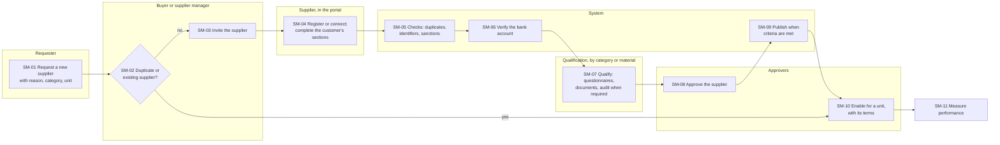
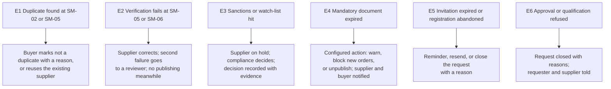
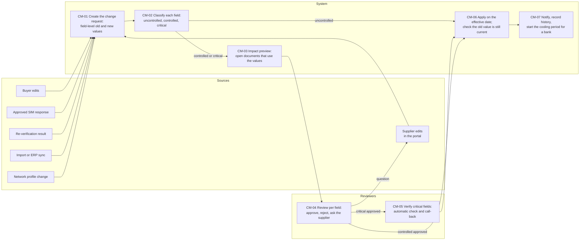
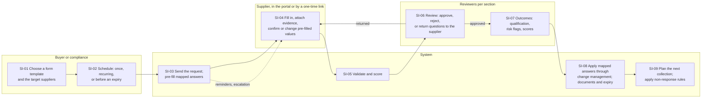

# Process reference pack: Supplier management

## 0. Document control

| Item | Value |
|---|---|
| Module | Supplier management (`SUP-`), with the parts it cannot be read without: the supplier master in the Business Foundation PRD (BF-101 to BF-108) and the supplier purchasing profile in the purchasing PRD (PUR-021 to PUR-024) |
| Suite | eProcurement Suite, on IronSaaS Foundation |
| Required by | PM-001 (the pack), PM-002 (external practitioner review), PM-003 (research log, living documentation) |
| Version | 0.3, for the external practitioner's review |
| Date | 2026-10-21 |
| Place in the repository | `docs/prd/suites/procurement/process-reference/supplier-management.md` |
| Status | The owner accepted every gap of section 7 on 2026-10-21 and asked for two areas to be designed apart: supplier information change management (section 8.2) and periodic supplier information collection, SIM (section 8.3). Section 9 is the brief for the practitioner. |

Change log: 0.3, 2026-10-21, in the repository (task SUP-gaps): section 2 gains a row for every requirement the decisions of section 8 made, in Supplier management and the documents beside it, and marks the four requirements they retired; the maps of sections 3.1, 3.3, 3.4 and 3.5 are BPMN 2.0 files in `supplier-management/` beside this pack (ADR-0045); nothing else changed. 0.2, 2026-10-21, all gaps accepted; section 8 holds the design of the gaps and of the two areas, the kernel requirements they need (TF-247 governed changes among them) and the domain model decisions; maps 3.4 and 3.5 added. 0.1, 2026-10-21, first draft in the design session.

## 1. Scope

Supplier management covers a supplier's life with one customer tenant: someone asks for a new supplier, the supplier is invited and registers, its identity and bank account are verified, it is qualified for what it will supply, it is approved, published and enabled for the units that will buy from it, its data and documents stay current, its performance is measured, and one day it is put on hold, deactivated or merged.

Out of scope here: the supplier's single profile across customers (the Supplier Network, TF-230 to TF-239, and the supplier portal surface, SPX); sourcing events that select a supplier for a purchase (the Sourcing product); contracts (the Contracts product), except where a quality agreement links to a qualification.

## 2. APQC PCF mapping

The backbone is APQC's Process Classification Framework, cross-industry version 8.0, category 4.2 "Procure materials and services". The elements used here:

| PCF element | Name (APQC) | Used for |
|---|---|---|
| 4.2.3.1 (10288) | Select suppliers | Choosing which suppliers a unit may buy from; preferred status |
| 4.2.3.2 (10289) | Certify and validate suppliers | Verification, qualification, approval |
| 4.2.5.1 (10299) | Monitor/Manage supplier information | The supplier master, changes, documents, status; APQC links it to the vendor master file (PCF 10869, finance) |
| 4.2.5.2 (10300) | Prepare/Analyze procurement and supplier performance | Indicators and reports |
| 4.2.5.4 (10302) | Monitor quality of product delivered | Rejection rates; regulated requalification |
| 4.2.1.7 (21616) | Collaborate with suppliers to align with long term business goals (includes managing risk) | Risk flags and risk monitoring |

Every requirement maps to a PCF element and to a step of the maps in section 3 (PM-001 AC2):

| Requirement | PCF | Map step |
|---|---|---|
| SUP-001 Supplier invitation | 4.2.3.2 | SM-03 |
| SUP-002 Supplier self-registration | 4.2.5.1 | SM-04 |
| SUP-003 Duplicate supplier detection | 4.2.5.1 | SM-02, SM-05 |
| SUP-004 Supplier approval and publishing | 4.2.3.2 | SM-08, SM-09 |
| SUP-005 Supplier onboarding configuration | 4.2.5.1 | Configuration (no step) |
| SUP-006 Organisation approval of an enablement | 4.2.3.1 | SM-10 |
| SUP-021 Supplier status control | 4.2.5.1 | V7 |
| SUP-022 Supplier change approval (retired 2026-10-21; replaced by SUP-201 to SUP-204 and SUP-206 to SUP-211) | 4.2.5.1 | V5 |
| SUP-023 Supplier bank account verification (retired 2026-10-21; replaced by SUP-162 to SUP-164 and SUP-205) | 4.2.5.1 | SM-06, V5 |
| SUP-024 Supplier merge | 4.2.5.1 | V8 |
| SUP-041 Supplier documents and compliance expiry | 4.2.3.2 | V6 |
| SUP-042 Supplier questionnaires (retired 2026-10-21; replaced by SUP-181 and SUP-221 to SUP-231) | 4.2.3.2 | SM-07, V6 |
| SUP-043 Supplier risk flags | 4.2.1.7 | E3, V6 |
| SUP-061 Supplier 360 view and lists | 4.2.5.1 | All steps (read) |
| SUP-062 Supplier performance indicators | 4.2.5.2, 4.2.5.4 | SM-11 |
| SUP-063 Supplier reports | 4.2.5.2 | SM-11 |
| SUP-101 Company data in the portal | 4.2.5.1 | SM-04, V5 |
| SUP-102 Questionnaires and documents in the portal (retired 2026-10-21; replaced by SUP-225, SPX-008 and SPX-029) | 4.2.3.2 | SM-07, V6 |
| SUP-121 Notification keys | supporting | All steps |
| BF-101 to BF-108 Supplier master, addresses, contacts, sites, bank accounts, defaults, categories, enablement | 4.2.5.1, PCF 10869 | SM-04 to SM-10 |
| PUR-021 to PUR-024 Supplier purchasing profile | 4.2.3.1 | SM-10 |

The requirements written from the decisions of section 8 on 2026-10-21 (task SUP-gaps), in Supplier management and in the documents beside it. "Supporting" marks a kernel mechanism the steps rely on; "no step" records an exclusion (PM-001 AC2): a requirement of a later product that these maps do not draw.

| Requirement | PCF | Map step |
|---|---|---|
| SUP-141 Supplier request | 4.2.3.1 | SM-01, SM-02 |
| SUP-142 Supplier request approval | 4.2.3.1 | SM-02, SM-03, E5, E6 |
| SUP-007 Supplier risk tier | 4.2.1.7 | SM-05, V6 |
| SUP-161 Identifier re-verification | 4.2.3.2 | SM-05, V6, C4 |
| SUP-162 Automated bank account verification | 4.2.3.2 | SM-06, CM-05 |
| SUP-163 Bank account call-back | 4.2.3.2 | SM-06, CM-05 |
| SUP-164 Cooling period and the payment check | 4.2.5.1 | CM-07 |
| SUP-165 Sanctions and watch-list screening | 4.2.1.7 | SM-05, V6, E3 |
| SUP-181 Qualification by scope | 4.2.3.2 | SM-07, V6 |
| SUP-182 Quality-relevant items and categories | 4.2.5.4 | SM-07 (V4) |
| SUP-183 Regulated qualification: the approved supplier list | 4.2.3.2, 4.2.5.4 | SM-07, SM-09 (V4) |
| SUP-184 Supplier audits and findings | 4.2.5.4 | SM-07 (V4), V6 |
| SUP-025 Offboarding | 4.2.5.1 | V7 |
| SUP-201 Change requests for every change | 4.2.5.1 | CM-01, C1 to C6 |
| SUP-202 Field classes of the supplier record | 4.2.5.1 | CM-02 |
| SUP-203 Decisions per field | 4.2.5.1 | CM-04 |
| SUP-204 Routing and segregation | 4.2.5.1 | CM-04 |
| SUP-205 Bank account changes | 4.2.5.1 | CM-05, CM-07 |
| SUP-206 Effective dates | 4.2.5.1 | CM-06 |
| SUP-207 Concurrency and one pending change per field | 4.2.5.1 | CM-06 |
| SUP-208 Impact preview | 4.2.5.1 | CM-03 |
| SUP-209 Notifications of changes | 4.2.5.1 | CM-07 |
| SUP-210 Signatures and history of changes | 4.2.5.1 | CM-04, CM-07 |
| SUP-211 Change measures | 4.2.5.2 | CM-01 to CM-07 |
| SUP-044 Supplier contact data protection | 4.2.5.1 | SM-04, V7 |
| SUP-221 Information request templates | 4.2.5.1 | SI-01 |
| SUP-222 Information requests and campaigns | 4.2.5.1 | SI-01, SI-03 |
| SUP-223 Schedules and triggers | 4.2.5.1 | SI-02, SI-09 |
| SUP-224 Due dates, reminders, escalation and non-response | 4.2.5.1 | SI-03, SI-09 |
| SUP-225 Responding to an information request | 4.2.5.1 | SI-04, SI-05 |
| SUP-226 Review per section | 4.2.3.2 | SI-06 |
| SUP-227 Applying approved answers through change management | 4.2.5.1 | SI-08, C3 |
| SUP-228 Documents from responses | 4.2.3.2 | SI-08 |
| SUP-229 Outcomes of a response | 4.2.3.2 | SI-07 |
| SUP-230 The response record and its versions | 4.2.5.1 | SI-08 |
| SUP-231 Tracking requests and campaigns | 4.2.5.2 | SI-03 to SI-09 |
| SUP-064 Onboarding measures | 4.2.5.2 | SM-01 to SM-11, CM-01 to CM-07, SI-01 to SI-09 |
| BF-104 Supplier sites, with their purposes | 4.2.5.1, PCF 10869 | SM-04, SM-07 (V4) |
| BF-204 Country accelerator packs: India's Udyam classification, GSTIN and PAN status checks, MSME rules | 4.2.5.1, PCF 10869 | SM-05, V6 |
| PUR-026 Supplier segments | 4.2.3.1 | SM-10, V6 |
| ORD-010 Approved supplier, site and material for quality-relevant lines | 4.2.3.2 | SM-09 (V4) |
| ORD-011 Open orders take a supplier change | 4.2.5.1 | CM-03, CM-06 |
| CON-007 Quality agreements | 4.2.3.2 | SM-07 (V4) |
| RCV-029 Day of acceptance | supporting (accounts payable, outside 4.2) | no step: receiving, which these maps do not draw (G7) |
| INV-011 Payment terms of micro and small suppliers (India) | supporting (accounts payable, outside 4.2) | no step: invoicing, which these maps do not draw (G7) |
| INV-046 Bank account check at payment release | 4.2.5.1 | CM-07 (the cooling period at payment) |
| INV-086 Ageing of what is owed to micro and small suppliers (India) | supporting (accounts payable, outside 4.2) | no step: invoicing (G7) |
| INV-087 Data for MSME Form 1 (India) | supporting (accounts payable, outside 4.2) | no step: invoicing (G7) |
| SPX-008 Answering without a portal account | 4.2.5.1 | SI-04 |
| SPX-029 Information requests in the portal | 4.2.5.1 | SI-04 |
| SPX-030 The supplier's change requests and their outcome | 4.2.5.1 | CM-04, C2 |
| TF-206 Connector configuration: identity and tax status, bank account, sanctions | supporting | SM-05, SM-06, CM-05, C4 |
| TF-242 Forms engine, extended | supporting | SI-01 to SI-06 |
| TF-245 Mapping form answers to records | supporting | SI-03, SI-08 |
| TF-246 One-time verified access for external respondents | supporting | SI-04 |
| TF-247 Governed changes to records | supporting | CM-01 to CM-07 |

## 3. Process maps

The maps are drawn here in Mermaid for review; each lane is a role. Since their acceptance they are also kept as BPMN 2.0 files beside this pack, so any BPMN tool opens them (PM-001 names BPMN): `supplier-management/main-flow.bpmn` (3.1), `exceptions.bpmn` (3.3), `change-management.bpmn` (3.4) and `information-collection.bpmn` (3.5), each checked against the BPMN 2.0 schema by `make prd-check` (ADR-0045). Step identifiers (SM-01 and so on) are stable and are cited by the requirements.

### 3.1 Main flow: a new supplier, from request to first order

### 3.2 Variants

| Variant | Where it differs from the main flow |
|---|---|
| V1 Buyer-created supplier | A low-risk or one-time supplier is created by a buyer without a supplier registration; identifiers and bank are still verified (SM-05, SM-06); the supplier may be invited to the portal later. Risk tier decides whether V1 is allowed (gap G12). |
| V2 Supplier-initiated registration | A supplier finds the tenant through the network and registers without an invitation; SM-01 and SM-03 are replaced by an internal review of the unsolicited registration. |
| V3 Supplier already in the network | SM-04 is a connection, not a registration; the network profile pre-fills the sections, and the tenant's own verification still runs (SUP-101). |
| V4 Regulated material | For a material or service that affects product quality, SM-07 includes the quality unit's qualification of the supplier and its manufacturing site for that material, with an electronic signature; SM-09 publishes the supplier only for qualified combinations (gap G3). |
| V5 Change to an approved supplier | Controlled fields go through change approval (SUP-022); a bank change always goes through verification (SUP-023) and a cooling period before the first payment to the new account (gap G5). |
| V6 Periodic review | Document expiry (SUP-041), identifier re-verification (gap G4), requalification by risk and category (gaps G2, G3), and risk flags (SUP-043). |
| V7 Hold, deactivation and offboarding | Status control with reasons (SUP-021), then an offboarding checklist: open documents, portal access, retention class (gap G8). |
| V8 Merge of a duplicate | SUP-024, with a preview of what moves. |

### 3.3 Exceptions

### 3.4 Supplier information change management

Every change to an approved supplier becomes a change request, whatever its source. One pipeline classifies, routes, verifies and applies it.

### 3.5 Periodic supplier information collection (SIM)

## 4. Standards mapping

| Standard or rule | What it gives the supplier master and the process | Where it lands |
|---|---|---|
| UBL 2.1 `Party` (party identification, legal entity, tax scheme, contact) and Peppol participant identifiers | Field names and structure of a supplier's identity, so orders and invoices exchanged later need no translation | BF-101 to BF-104; PM-021 |
| ISO 17442 (LEI), D-U-N-S, GS1 GLN | Optional global identifiers for legal entities and locations, useful for matching and enrichment | BF-101, BF-104, BF-205 |
| ISO 13616 (IBAN), ISO 9362 (BIC); national formats (for India, IFSC) | Bank account formats and their validation | BF-105, SUP-023 |
| ISO 3166 countries, ISO 4217 currencies | Reference data | BF-205 |
| India: GSTIN (with the PAN inside it), PAN, Udyam registration, the GST registration status | Tax identity, input-tax-credit safety, MSME classification | BF-204 India pack; gaps G4, G7 |
| India: MSMED Act section 15 (payment within the agreed term, at most 45 days from acceptance, 15 days without a written agreement), section 22 and the half-yearly MSME Form 1 | The supplier's micro, small or medium classification drives payment terms and reporting | Gap G7; Invoicing and Receiving depend on it |
| India: the Income-tax Act's rule that a late payment to a micro or small enterprise is deductible only when paid (section 43B(h) of the 1961 Act, carried into the Income-tax Act 2025) | The buyer's tax cost of paying late; the classification must be right | Gap G7 |
| EU GMP Chapter 5 (5.26: starting materials only from approved suppliers), Chapter 7 (outsourced activities and their written agreements), Annex 16 (the Qualified Person's oversight of suppliers); ICH Q7, Q9 and Q10 | For regulated customers: qualification by supplier, site and material, quality agreements, risk-based requalification, the quality unit's approval | Gap G3 |
| 21 CFR Part 11 and EU Annex 11 | The quality unit's approval is an electronic signature with its manifestation and audit trail | TF-063, TF-219; gap G3 |
| ISO 9001:2015 clause 8.4 (control of externally provided processes, products and services) | Evaluation, selection, monitoring and re-evaluation of suppliers for any certified customer, regulated or not | Gaps G2, G9 |
| DPDP Act 2023 (India), GDPR (EU) | Supplier contacts and portal users are personal data: purpose, retention, rights | Gap G10; TF-196 to TF-198 |

## 5. Benchmark indicators

Each indicator states its definition, its reference, and a first target. The targets are proposals for the practitioner to challenge (PM-022).

| Indicator | Definition | Reference value | Proposed target | Requirement |
|---|---|---|---|---|
| Supplier setup time | Calendar days from an approved record entering setup to the supplier being active in the procurement system | APQC measure 106476: top performers 2 days or less, bottom performers 4 days or more | Under 1 day (it is automatic once approved) | Gap G11 |
| Onboarding cycle time, low risk | Calendar days from a complete request (SM-01) to transaction-ready (SM-10), median and 90th percentile, split into supplier waiting and internal waiting | Hackett Group: median 12.8 days for a low-risk supplier; HICX 2021: most large companies 15 to 28 days; Graphite 2026: average 18.8 days | Median 7 days | Gap G11 |
| Onboarding cycle time, high risk | As above, for high-risk or regulated suppliers | Hackett Group: median 20 days with a prior risk assessment, 26 without; Graphite 2026 for pharma: 28.5 days | Median 20 days | Gap G11 |
| First-pass completeness | Share of registrations approved without a request for more information | Not published consistently; practitioners name it a key measure | 70 percent | Gap G11 |
| Self-service share | Share of suppliers onboarded through the portal (main flow or V2, V3) rather than V1 | Not published consistently | 80 percent | SUP-063 |
| Verified bank before first payment | Share of first payments to accounts verified before payment | Best practice: always | 100 percent | SUP-023, gap G5 |
| Duplicate rate | Share of active suppliers later merged or marked duplicate | Benchmark reports name duplicates a top obstacle | Under 1 percent | SUP-003 |
| Valid mandatory documents | Share of active suppliers whose mandatory documents are all valid today | None found | 98 percent | SUP-041 |
| Requalification on time | Share of requalifications completed before they fall due | Regulated practice: periodic, risk-based (often every 2 to 3 years) | 95 percent | Gaps G2, G3 |
| Strategic supplier share | Strategic suppliers as a share of active suppliers | APQC measure 103199: median 20.0 percent (2,159 organisations) | Reported, no target | Gap G9 |
| MSE classification coverage (India) | Share of Indian active suppliers with a verified Udyam classification or a recorded "not registered" | Practice in the sources: capture before the first purchase | 100 percent | Gap G7 |

## 6. Competitive review

Sources differ in strength: SAP's own service description and course outline are primary; most other vendors' features come from third-party lists, marked "secondary", for the practitioner to confirm.

| Capability | SAP Ariba Supplier Lifecycle and Performance | Coupa | Ivalua, JAGGAER, GEP, Zycus, Oracle (secondary) | IronSaaS today (PRDs) |
|---|---|---|---|---|
| Internal request for a new supplier, approved before registration | Yes: registration starts only after the request is approved | Yes, through its onboarding forms | Common | **No**: starts at the buyer's invitation (gap G1) |
| Registration in a supplier network, free for suppliers | SAP Business Network | Coupa Supplier Portal, free for suppliers | Portals in each | Yes (SUP-002, SPX, TF-230 to TF-239) |
| Modular questionnaires, targeted by commodity and region | Yes | Yes (supplier information forms) | Yes | Partly: questionnaires on the forms engine (SUP-042, TF-242), not targeted |
| Qualification and disqualification per category, region and unit; preferred status tied to qualification | Yes | Partly | Ivalua and Oracle name qualification workflows | **Partly**: preferred status per category (PUR-022), no qualification matrix (gap G2) |
| Certificate and document management with expiry | Yes | Yes | Yes | Yes (SUP-041) |
| Bank account verification | Process and partners | Through marketplace partners that verify at onboarding and again at invoice approval | Partners | **Partly**: a manual call-back checklist (SUP-023); no automated check, no re-check at payment (gap G5) |
| Continuous risk monitoring with external signals | Yes | Coupa Risk Assess | JAGGAER names an AI layer for risk monitoring | **Partly**: manual risk flags (SUP-043); no screening or feeds (gaps G4, G6) |
| Performance scorecards | Yes | Yes | Yes | Yes (SUP-062) |
| 360 profile | Yes, with ERP data and questionnaire answers | Yes | Yes | Yes (SUP-061) |
| Supplier data APIs and ERP sync | Yes | Yes | Yes | Kernel import and export (TF-205, TF-206), BF-206 |
| Regulated (GxP) qualification by site and material, quality unit approval with e-signature | Not a native strength of procurement suites; quality systems do this | Same | Same | **No** (gap G3), and a clear chance to stand out for regulated customers |
| India specifics (GSTIN status, PAN, Udyam, penny-drop bank check) | Through partners and localisation | Supplier forms collect PAN | Varies | **Partly**: the India pack (BF-204) names GST; Udyam and checks are not written (gaps G4, G7) |

## 7. Gaps found

All thirteen gaps were accepted by the owner on 2026-10-21. Section 8.1 says how each is closed; each becomes requirements with acceptance criteria in the PRD named.

| Gap | What is missing | Proposal | Where |
|---|---|---|---|
| G1 Internal supplier request | Anyone may need a new supplier, but only buyers can start one | A request by any employee: supplier name, reason, category, unit, expected spend; approved before the invitation; duplicates shown at once | SUP, new requirement before SUP-001 |
| G2 Qualification matrix | One approval for all purposes | Qualification status per supplier and category, region or unit (pending, qualified, conditionally qualified, disqualified, requalification due); preferred status only for qualified combinations; requalification by risk | SUP, extends SUP-042; PUR-022 depends on it |
| G3 Regulated qualification | No supplier-site-material approval, no quality unit sign-off | For items marked as quality-relevant: an approved supplier list per supplier, manufacturing site and material; the quality unit approves with an electronic signature; a quality agreement linked from Contracts; audits recorded with findings and their actions; requalification every period by risk; an order for such an item only to an approved combination. Offered as a licensed feature of Supplier management (TF-046) | SUP, new area; ORD and CON depend on it |
| G4 Re-verification of identifiers | Identifiers are checked once, if at all | Scheduled re-checks of tax registration status, PAN status, Udyam classification and sanctions, through connectors; a change raises a task and, by rule, a hold | SUP, extends SUP-041; India pack |
| G5 Bank verification by service and at payment | Only a manual checklist | An automated check where the country allows (for India, a penny-drop or NPCI name match; elsewhere, IBAN and name checks through a connector) beside the call-back; a cooling period and a re-check at payment release when the account changed recently | SUP-023; INV payment release |
| G6 Sanctions and watch-list screening | None | Screening at registration and on a schedule, through a connector; a hit puts the supplier on hold until compliance decides, with evidence kept | SUP, new requirement |
| G7 MSME classification (India) | Not captured | Udyam number, enterprise type (micro, small, medium, or trader) and verification date on the supplier; payment terms for micro and small suppliers capped as the law requires; an ageing report and the data for MSME Form 1 | BF-204 India pack; SUP; INV and RCV (the acceptance date starts the clock) |
| G8 Offboarding | Deactivation only | An offboarding checklist: open documents, portal access removed, retention class applied, reason, and a clean path back if re-onboarded | SUP-021 |
| G9 Segmentation | No segment | A segment per supplier (strategic, preferred, approved, transactional), set by rule or by hand, used in lists, reviews and the strategic share | PUR, extends PUR-022 |
| G10 Contact data protection | Not stated for suppliers | Purpose and retention for supplier contacts and portal users; access and erasure requests that keep what the law requires for audit | SUP, on TF-196 to TF-198 |
| G11 Onboarding measures | Stage times not kept | Timestamps for every step, split into supplier waiting and internal waiting; the indicators of section 5 computed | SUP-063 |
| G12 Risk-tiered onboarding | Same steps for every supplier | Requirements (sections, documents, questionnaires, approvals) chosen by risk tier, category and country; V1 allowed only for low tiers | SUP-005 |
| G13 Response without a portal account | Every supplier must register in the network | Decide whether a light path exists (a secure one-time form) for suppliers that will never use the portal | Decision for the owner |

## 8. Decisions and design

### 8.1 How each gap is closed

| Gap | Decision | Where |
|---|---|---|
| G1 Internal supplier request | Any employee may request a new supplier (name, reason, category, unit, expected spend, urgency); the request is approved before an invitation is sent; duplicates and existing suppliers are shown while typing; an approved request becomes the invitation (SM-01 to SM-03). | SUP |
| G2 Qualification matrix | Qualification status per supplier and scope (category, region or unit): pending, qualified, conditionally qualified (with conditions and an end date), disqualified, requalification due. Preferred status (PUR-022) only for qualified scopes. Requalification is scheduled by risk tier, and run as a SIM collection (8.3). | SUP; PUR-022 |
| G3 Regulated qualification | A licensed feature of Supplier management for regulated tenants (TF-046): items and categories marked quality-relevant; an approved supplier list per supplier, manufacturing site and material; the quality unit's approval as an electronic signature (TF-063); a quality agreement linked from Contracts; audits with findings and their corrective actions; requalification by risk; an order line for a quality-relevant item only to an approved combination, checked at order submission. | SUP; ORD; CON |
| G4 Re-verification | Scheduled re-checks through connectors (TF-206): tax registration status, PAN status, Udyam classification, sanctions. A changed result creates a change request from the source "re-verification" (8.2) and, by rule, a hold. | SUP; BF-204 |
| G5 Bank verification | An automated check where the country allows it (India: penny-drop or NPCI name match; elsewhere IBAN, BIC and name checks through a connector), plus the call-back checklist for critical risk tiers. A cooling period (default 3 business days) before the first payment to a new account, and a re-check at payment release for accounts changed within the period. | SUP-023; INV payment release |
| G6 Sanctions screening | At registration and on a schedule, through a connector. A potential match puts the supplier on hold; compliance decides with the evidence kept; a cleared false positive is not raised again for the same list entry. | SUP |
| G7 MSME classification (India) | Udyam number, enterprise type (micro, small, medium, trader), verification date. Payment terms for micro and small suppliers are capped as the law requires, counted from acceptance; an ageing report by 15 and 45 days; the data for the half-yearly MSME Form 1. | BF-204; SUP; INV; RCV |
| G8 Offboarding | A checklist before deactivation: open orders, receipts and invoices; portal users removed; retention class applied; reason recorded. Re-onboarding reopens the record through a request (G1), with the history kept. | SUP-021 |
| G9 Segmentation | A segment per supplier (strategic, preferred, approved, transactional), set by rule (spend, category, risk) or by hand with a reason; used in lists, reviews and the strategic share. | PUR |
| G10 Contact data protection | Purpose and retention for supplier contacts and portal users; access and erasure requests that keep what audit and law require. | SUP; TF-196 to TF-198 |
| G11 Onboarding measures | A timestamp for every step of every map, split into supplier waiting and internal waiting; the indicators of section 5 computed. | SUP-063 |
| G12 Risk-tiered onboarding | Each supplier gets a risk tier (from category, country, spend, and screening results). Required sections, documents, forms, checks and approvals are chosen by tier, category and country. A buyer-created supplier (V1) is allowed only for the lowest tier. | SUP-005 |
| G13 Response without a portal account | A one-time verified link: sent to a known contact, opened with a code sent to that email, limited to one invitation or one information request, expiring, with no other access. A change to a critical field made this way is still verified out-of-band. The supplier is invited to join the network afterwards. | Kernel (new TF requirement); SPX; SUP |

The targets of section 5 are accepted as proposed. Providers for verification and screening are chosen per country when the connectors are built; the requirements name the checks, not the providers.

### 8.2 Supplier information change management (design)

**Purpose.** An approved supplier's data changes often: a new address, a new contact, a renewed certificate, a new bank account, a changed legal name after a merger. Each change must be quick when it is harmless and controlled when it is risky, and every change must be traceable.

**Built on a kernel mechanism.** Governed changes are not supplier-specific: items, legal entities, people, and the records of later suites need them too. So the kernel provides governed changes to records (TF-247): change requests, field classes declared by each module, per-field decisions, effective dates, concurrency and history. Supplier management is its first user and adds, through hooks, only what is supplier-specific: bank verification, the cooling period and the announcement to the contacts known before a change (ADR-0043, decision 8).

**One pipeline for every source.** A change to an approved supplier is never written straight to the record. It becomes a **change request**: the supplier, its source, who asked, a reason, evidence attached, an effective date, and a list of field-level changes, each with its old value and its new value. The sources are: a buyer's edit; the supplier's edit in the portal; an approved SIM response (8.3); a re-verification result (G4); an import or ERP sync (BF-206); and a change to the supplier's network profile, offered to each connected customer (SUP-101).

**Field classes.** Every field and section of the supplier record (BF-101 to BF-108, PUR-021 to PUR-024) has a class, set per tenant with safe defaults:

| Class | Default fields | What happens |
|---|---|---|
| Uncontrolled | Descriptive fields: website, description, logo, trade name's display form | Applied at once, recorded in history, the buyer owner told |
| Controlled | Addresses (other than remit-to), contacts (other than those that receive orders or payments), sites, categories, documents, diversity and classification attributes, per-unit terms | Approval by the configured approvers before it applies |
| Critical | Bank accounts, legal name, tax identifiers, remit-to address, the contacts that receive orders or payment advice, Udyam classification | Approval, then verification (G5 for banks), then application; a bank change starts the cooling period |

**Rules.**

1. **Per-field decisions.** A reviewer approves or rejects each field change, with a reason for a rejection, or returns a question to the supplier. A change request may end partly applied; the supplier sees which changes were applied and why the others were not.
2. **Routing** uses the approval configurations (BF-141) by field class, supplier risk tier and unit; per-unit terms go to that unit's approvers.
3. **Segregation.** Nobody approves a change they requested, and nobody who changed a bank account may release a payment to it within the cooling period (TF-036).
4. **Effective dates.** A change may apply now or on a future date (a move to a new address next month). The record keeps every version; a document shows the values valid on its own date (an order keeps the address it was issued with).
5. **Concurrency.** When a change applies, its old value must still be the current value. If another change came first, the request stops for review instead of overwriting.
6. **One request per field at a time.** A second pending change to the same field waits for the first.
7. **Impact preview.** Before approval, reviewers see the open documents that use the changed values (through BF-207), and decide whether open orders take the new values. Payments always use the account valid and verified on the payment date.
8. **Notifications.** The supplier's primary contact and the buyer owner are told about every applied critical change. A bank change is also announced to the contacts known **before** the change, through a channel the change itself did not touch.
9. **Signatures and audit.** Approvals of critical changes are electronic signatures for tenants with Part 11 on (TF-063, TF-219); every applied change is in the field-level history (TF-062).
10. **Measures.** Pending requests by age and source, rejection rates, cycle time per class, and changes made outside business hours flagged for review.

**What replaces what.** SUP-022 (change approval) and SUP-023 (bank verification) are rewritten into this area; SUP-101's offer of network profile changes becomes the source "network profile change".

### 8.3 Periodic supplier information collection, SIM (design)

**Purpose.** Buyers, compliance and quality teams regularly collect information from suppliers: licences and their validity, certifications (ISO 9001, GMP, environmental), financial statements, insurance, tax declarations, sustainability and diversity data, policy acknowledgements, and qualification questionnaires. The supplier fills in a predefined form in the portal; the buyer's reviewers approve it; and the approved information updates the supplier record automatically.

**Built on the forms engine (TF-242).** A SIM form template has sections, typed questions, attachments with issue and expiry dates, validation, conditional questions, scores and weights, and versions. Two additions make SIM work, and both are kernel requirements:

- **Mapping answers to records.** A question may map to a field of a record that a module declares mappable (the supplier record, a supplier document type, a certification, a qualification scope, a custom field). Mapped answers are pre-filled with the current value; the supplier confirms or changes it.
- **Section reviewers.** Each section may name its own reviewers (finance for financial documents, quality for certificates), and may be approved or returned on its own.

**Collection requests and campaigns.**

1. A buyer sends a form to one supplier, or runs a **campaign** to a target set: by category, country, segment (G9), risk tier (G12), qualification scope (G2), unit, or visibility tags.
2. A schedule: once, recurring (yearly, quarterly), or triggered by an event: a document about to expire (SUP-041), a requalification falling due (G2, G3), a new category added, a change in risk tier.
3. A due date, reminders, and escalation to the buyer owner. Non-response rules by template: warn, block new orders, unpublish, or put on hold, as SUP-041's expiry actions do.
4. The supplier answers in the portal, or through the one-time verified link (G13). Drafts are saved; the form shows what is still missing.

**Review and application.**

1. The response is validated and scored on submission.
2. Reviewers approve, reject or return each section; a returned section goes back to the supplier with comments per question, and the rest waits.
3. **On approval, the system applies the mapped answers automatically**, by creating a change request from the source "approved SIM response" (8.2). Uncontrolled and controlled fields apply at once, since the review already approved them. Critical fields still go through verification (a bank account from a form is verified like any other).
4. Attached documents become supplier documents with their expiry dates (SUP-041), so the next expiry triggers the next collection.
5. Outcomes by rule: qualification status per scope (G2), regulated qualification (G3, with the quality unit's signature), risk flags (SUP-043), and the supplier's scores.
6. Unmapped answers are kept as the response record, versioned, so the next response can be compared with this one.

**Tracking.** A campaign shows sent, opened, in progress, submitted, in review, returned, approved and overdue, per supplier and in total. A supplier's 360 view (SUP-061) shows every response with its versions and differences.

**What replaces what.** SUP-042 (questionnaires) and SUP-102 (questionnaires and documents in the portal) are rewritten into this area.

### 8.4 New kernel requirements these need

| Requirement | What it adds |
|---|---|
| TF-242 Forms engine, extended | Attachments with typed metadata (issue and expiry dates); section reviewers and per-section decisions; pre-fill; versions of responses with comparison |
| TF-245 Mapping form answers to records (new) | Modules declare mappable fields; a mapped answer becomes a change proposal handed to the owning module, never a direct write |
| TF-246 One-time verified access for external respondents (new) | The link of G13: known contact, emailed code, one purpose, expiry, rate limits, audit |
| TF-206 Connectors | Verification and screening connectors named as kinds: identity and tax status, bank account, sanctions |
| TF-247 Governed changes to records (new) | Change requests with field-level old and new values and their sources; field classes declared per entity by its module; per-field decisions; routing through the workflow engine; effective dates applied by a job; the concurrency check; one pending change per field; hooks for a module's own verification and notifications; the impact preview through the module's extension point. Built in S5, after the workflow engine |

### 8.5 Domain model decisions

These choices are made now because they are expensive to change later. The entities, relationships and rules go into each PRD's domain model; tables and columns are decided in the slice that builds them.

1. **Governed changes are a kernel mechanism** (TF-247), with Supplier management as its first user (8.2).
2. **No version tables.** A record holds its current values. A future-dated change waits as an approved change request and applies on its date. History comes from the field-level change history (TF-062).
3. **Documents copy what they need when issued.** An order copies the supplier's address and terms at issue and keeps them. A payment always uses the bank account valid and verified on the payment date.
4. **One qualification entity with a scope kind:** category, region, unit, or site and material. The regulated approved-supplier list is this entity with the scope "site and material".
5. **One supplier site entity with purposes:** ordering, remittance, manufacturing. Regulated qualification refers to manufacturing sites.
6. **Forms in the kernel, requests in the product.** Templates, responses, sections and their versions belong to the forms engine (TF-242, TF-245). Information requests and campaigns, which target suppliers, belong to Supplier management.

## 9. Brief for the external practitioner (PM-002)

**Who:** at least one person with recent hands-on experience of a leading suite's supplier management (SAP Ariba Supplier Lifecycle and Performance, or Coupa Supplier Information Management), and, for gap G3, one person from a pharmaceutical quality unit who runs supplier qualification.

**What to send:** this pack, the supplier management PRD, BF-101 to BF-108 and PUR-021 to PUR-024.

**What to ask:**

1. Which steps of the maps would your organisation do differently, and why?
2. Which gap would you rank first, and is any gap missing?
3. Are the targets of section 5 realistic for your organisation?
4. (Quality unit) Does G3 match how you qualify suppliers today, and what evidence would an inspector ask the system to show?
5. What made supplier onboarding slow or unsafe in the last system you used?

Findings are recorded with their disposition (accepted, deferred, rejected with a reason) before the first slice of Supplier management starts (PM-002).

## 10. Research log

All sources read on 2026-10-21. "Primary" means the organisation that owns the standard, law or product; "secondary" means a report about it.

| Source | Kind | Finding used |
|---|---|---|
| APQC, measure "Strategic suppliers as a percentage of all active suppliers", https://www.apqc.org/resources/benchmarking/open-standards-benchmarking/measures/strategic-suppliers-percentage-all | Primary | The PCF 8.0 hierarchy of 4.2 with element names and identifiers; median 20.0 percent over 2,159 organisations |
| APQC, measure "Average cycle time in days to set up a supplier in the procurement system", https://www.apqc.org/resources/benchmarking/open-standards-benchmarking/measures/average-cycle-time-days-set-supplier | Primary | Definition: calendar days, scope 4.2.5.1 |
| APQC procurement measure list, https://www.apqc.org/sites/default/files/osb/311%20-%20Procurement%20Measure%20List.pdf | Primary | Measure identifier 106476 for supplier setup time |
| Supply and Demand Chain Executive, article by APQC's research staff, https://www.sdcexec.com/sourcing-procurement/article/21172099 | Secondary | Supplier setup: top performers 2 days or less, bottom performers 4 days or more |
| Stealth Agents research pages citing the Hackett Group, HICX (2021) and Procurement Leaders (2023), https://stealthagents.com/research/startup-vendor-management-administrative-burden-statistics-2026 and https://stealthagents.com/research/vendor-onboarding-cycle-time-statistics-2026 | Secondary, citing primary studies | Hackett medians 12.8, 20 and 26 days by risk; HICX distribution of 15 to 28 and 29 to 60 days. To be confirmed against the original reports |
| Graphite Connect, 2026 Supplier Data Benchmark, https://www.graphiteconnect.com/2026-supplier-data-report, and its pharma edition, https://www.graphiteconnect.com/whitepapers/2026-state-of-pharma-supplier-data | Vendor research | Average onboarding 18.8 days; pharma 28.5 days |
| FBI IC3 2025 figures as reported by cloudspress.com and gblock.app; IC3 2024 report as reported by Nacha, https://www.nacha.org/news/fbis-ic3-finds-almost-85-billion-lost-business-email-compromise-last-three-years | Secondary, citing primary | Business email compromise: 24,768 complaints and about 3.0 billion US dollars of reported losses in 2025; vendor bank changes are a typical method; out-of-band verification recommended |
| iPleaders, taxguru.in and law.asia articles on the MSMED Act and section 43B(h), for example https://blog.ipleaders.in/?p=130194 | Secondary | Section 15 terms (agreed term at most 45 days; 15 days without agreement); 43B(h) from assessment year 2024-25, carried into the Income-tax Act 2025; MSME Form 1; the MSMED Amendment Act 2026. To be confirmed by a practitioner in India |
| India verification providers' public documentation (HyperVerge, Pazy, Infyner), for example https://documentation.hyperverge.co/api-reference/india_api/vendor_validation_api | Secondary | Typical checks: PAN with NSDL, GSTIN status, the PAN inside the GSTIN, Udyam lookup, penny-drop bank check |
| SAP Ariba Supplier Lifecycle and Performance, G-Cloud service description, https://assets.applytosupply.digitalmarketplace.service.gov.uk/g-cloud-15/documents/702210/236968645765193-service-definition-document-2026-01-28-2019.pdf, and SAP Learning, https://learning.sap.com/courses/sap-ariba-supplier-management-supplier-lifecycle-management | Primary (vendor) | Request before registration; modular questionnaires by commodity and region; qualification and disqualification; preferred status tied to qualification; certificates; 360 profile |
| Customer guides for Coupa (BCG, BlackRock, Worley) and Coupa marketplace partners (Trustpair, Eftsure, Sis ID) | Secondary | Free supplier portal; supplier information forms; risk assessment; bank verification by partners at onboarding and at invoice approval |
| Procurement Magazine and other 2026 lists of supplier lifecycle tools | Secondary, weak | Capability themes of Ivalua, JAGGAER, GEP, Zycus and Oracle; to be confirmed |
| GMP-compliance.org (ECA Academy) and a review of pharmaceutical supplier qualification, https://www.gmp-compliance.org/gmp-news/why-supplier-qualification-is-more-than-just-an-audit | Secondary | EU GMP 5.26, Chapter 7 and Annex 16; ICH Q10 on assessing contract acceptors; quality agreements; risk-based requalification |
| The team's knowledge, not yet checked against a source in this log | Knowledge | UBL 2.1 `Party`, ISO 17442, ISO 13616, ISO 9362, ISO 9001 clause 8.4, DPDP Act 2023. To be cited at the next revision |
