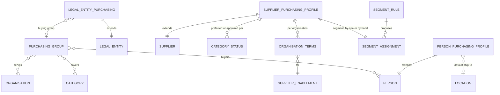

# eProcurement Suite: Purchasing PRD

## 0. Document control

| Item | Value |
|---|---|
| Document title | Purchasing: the eProcurement Suite's shared master, Product Requirements Document |
| Layer | Suite (ADR-0043): the shared master of the eProcurement Suite, on IronSaaS Foundation, before the suite's products; the module is proposed in section 9 |
| Identifier prefix | `PUR-`, in blocks of twenty per area (ADR-0041); the table is `purchasing-requirements.csv` |
| Version | 1.1 (SUP-gaps, 2026-10-21: supplier segments, and preferred status only for qualified categories) |
| Date | 2026-10-21 |
| Status | Accepted at the design session's review of L2, 2026-10-20, which decided what moved here; the permission names in section 9 are proposed. The changes of 1.1 (SUP-gaps) were accepted at the design session's review of 2026-10-21, their decisions marked "decided 2026-10-21" in their notes. |
| Inputs | The Business Foundation PRD (`../../foundation/business-foundation-PRD.md`), the requirements that moved from it, ADR-0043's decision 8, the map (`../../requirements-map.md`). |
| Dependency | The supplier record, people, categories, locations, legal entities and the approval configurations are the Business PRD's; every mechanism is a kernel capability cited by its TF identifier. The suite's products read this master through its Contracts; it never reads a product. |
| Tags | `[Carried]` behaviour from the current product that stays. `[New]` not in the current product, standard practice. A requirement moved from another document says what it was at the start of its notes, with every identifier it had. |

Change log: 1.1, 2026-10-21: SUP-gaps, from the supplier management pack (`process-reference/supplier-management.md`): PUR-026 gives each supplier a segment (gap G9), PUR-022 allows a preferred or approved status only for a qualified category where the tenant requires qualification (gap G2), and section 8.5 declares the two extension points Supplier management implements; no requirement retired. 1.0, 2026-10-20: written at the review of L2 (ADR-0043): the masters and content only the eProcurement Suite's products share moved here from the Business PRD, each keeping its old identifiers in its notes and in the column `was`.

## 1. Vision and goals

### 1.1 Vision

IronSaaS Foundation holds the masters every suite needs: the supplier record, people, categories, locations, legal entities. What only buying needs, who buys what for whom, how a supplier's documents are matched and reach it, which suppliers are preferred, where a person's orders are delivered, and the starter content a tenant goes live with, belongs to the eProcurement Suite. This master holds it once, for all of the suite's products, as one-to-one extensions of the Foundation's records rather than as second copies of them.

### 1.2 Goals

| # | Goal |
|---|---|
| 1 | A request line reaches the right buyer without anyone routing it by hand. |
| 2 | Every order line knows its match level from one order of precedence. |
| 3 | A tenant that buys the suite goes live with starter approvals and a readiness list of its own; a tenant without it sees neither. |

## 2. Scope

### 2.1 What this master holds

| Area | Holds | Section |
|---|---|---|
| Purchasing groups | Buyers, the categories they cover and the units they serve; a legal entity's buying group | 5.1 |
| Supplier purchasing profile | One per supplier: match levels, channels, preferred status per category (only for qualified categories where qualification is required), and per organisation its match levels and preferred flag; its segment; the defaults of a new supplier; a legal entity's default match levels and the order they apply in | 5.2 |
| Person's purchasing profile | A person's default ship-to location | 5.3 |
| Approval starter set | The suite's starter approval configurations | 5.4 |
| Readiness | The suite's items in the tenant's and a new organisation's readiness checklists | 5.5 |

### 2.2 What it does not hold

The supplier record and its enablement per organisation (BF-101 to BF-108), people (BF-021), categories (BF-042), locations (BF-081 to BF-083) and the approval configurations themselves (BF-141) are the Foundation's. Requests, orders, receipts and invoices are the suite's products.

## 3. Personas

| Persona | What they do here |
|---|---|
| Procurement administrator | Sets up purchasing groups, a legal entity's buying group and match levels, and the defaults of a new supplier's profile |
| Buyer | Belongs to purchasing groups; sees a supplier's profile beside its record |
| Requester | Has a default ship-to location |
| Tenant administrator | Activates the starter approvals and follows the readiness list |

## 4. Domain model

`PERSON`, `SUPPLIER`, `SUPPLIER_ENABLEMENT`, `CATEGORY`, `LOCATION`, `ORGANISATION` and `LEGAL_ENTITY` are the Foundation's, drawn for context. Each profile is one-to-one with the record it extends and has no life of its own.

Decided 2026-10-21 with the supplier management pack's section 8.5:

- **Segments are the suite's** (PUR-026): one segment per supplier profile, its reason (a rule or a person's), and the rules that propose it. A supplier's risk tier and qualifications are Supplier management's; this master asks for them through the extension points it declares (section 8.5) and holds none of them.
- **A category status follows qualification** (PUR-022): the status is this master's, the qualification behind it is the product's.

## 5. Requirements

### 5.1 Purchasing groups (PUR-001 to PUR-020)

#### PUR-001 Purchasing groups
*Priority:* **Should** · *Tag:* `[New]` · *Area:* Purchasing groups

**Requirement:** Purchasing groups shall be a master of the eProcurement Suite, not a unit kind: a group of buyers (people of BF-021), the categories it covers (BF-042) and the units it serves; a group serves several units and owns no records. A legal entity may name one purchasing group as its buying group, which serves the lines of its units that no other group's categories cover. The suite's products use a group to assign the buyer of a request line by the line's category and unit, to filter a buyer's work queue, and to report spend by group; a purchasing group gives no access and takes no part in approvals.

**Why:** Buyers are organised by what they buy and for whom, across units. A unit kind would put a group at one place in the tree and make it an owner of records, and a purchasing group is neither. Only the eProcurement Suite assigns buyers, so the master is the suite's (ADR-0043).

**Acceptance criteria:**

- AC1 Given a purchasing group covering the category IT hardware and serving units A and B, When it is opened, Then its buyers, categories and units are listed.
- AC2 Given a line of the category IT hardware in unit A, When a product asks which purchasing group serves it, Then the group and its buyers are named.
- AC3 Given a legal entity whose buying group is G, and a line of one of its units whose category no group covers, When a product asks which purchasing group serves it, Then G and its buyers are named.
- AC4 Given a buyer of a purchasing group, When they open a request of a unit their roles do not reach, Then it is refused, because the group grants no access. (error case)
- AC5 Given a purchasing group, When someone tries to make it the owning organisation of a record, Then it is refused, because a purchasing group is no unit. (error case)

*Depends on:* BF-001, BF-021, BF-042, TF-034

**Notes:** Was BF-007, FF-002 and BF-061: BF-007 whole, with the buying group of BF-061's chart of accounts merged in as a legal entity's buying group. Moved at the review of L2, 2026-10-20 (ADR-0043). BF-007 was decided 2026-10-20: a purchasing group assigns the buyer, filters the work queue and reports spend; it is not access and not approvals.

### 5.2 Supplier purchasing profile (PUR-021 to PUR-040)

#### PUR-021 Supplier purchasing profile
*Priority:* **Must** · *Tag:* `[Carried]` · *Area:* Supplier purchasing profile

**Requirement:** Every supplier of the Business supplier master (BF-101) shall have one purchasing profile, a one-to-one extension the eProcurement Suite owns: its match levels for products and for services (none, two-way or three-way), the channels its documents may reach it by (email, the supplier portal, internal only), its preferred or approved status per category (PUR-022) and its terms per organisation (PUR-023). The profile is made the first time the suite reads or writes the supplier, with the defaults the tenant set (PUR-024 for the match levels), and it has no life apart from its supplier.

**Why:** The supplier record is the Foundation's, because any suite that pays a vendor needs it; how documents are matched and reach the supplier is buying's (ADR-0043). One profile per supplier keeps the two apart without a second list of suppliers.

**Acceptance criteria:**

- AC1 Given a supplier the suite has never read, When a buyer opens it, Then its purchasing profile exists with the tenant's defaults and is shown beside the supplier record.
- AC2 Given a supplier with the match level two-way for services and the channel email, When an order is issued to it, Then the order's service lines are matched two-way and it goes by email.
- AC3 Given a match level that is not none, two-way or three-way, or a channel the tenant has not enabled, When saved, Then it is refused naming the field. (error case)
- AC4 Given a second purchasing profile for the same supplier, When saved, Then it is refused. (error case)

*Depends on:* BF-101, BF-042

**Notes:** Was FF-022 and BF-101, the match levels of its commercial defaults and its portal settings (the allowed channels), and its preferred flag, which is now per category (PUR-022). Moved at the review of L2, 2026-10-20 (ADR-0043).

#### PUR-022 Preferred status per category and supplier suggestions
*Priority:* **Should** · *Tag:* `[New]` · *Area:* Supplier purchasing profile

**Requirement:** A supplier's purchasing profile shall hold its preferred or approved status for each category it serves (BF-107), and the suite's supplier suggestions on request and order lines shall use them: the preferred suppliers of the line's category first, then the approved ones, never a supplier on hold. Where the tenant requires qualification for a category, a supplier may be preferred or approved for it only while it is qualified for it: this master asks through an extension point it declares, the qualification of a supplier for a scope, which answers qualified, not qualified, or not required; and when the product that qualifies suppliers reports that a qualification ended (disqualified, or its requalification lapsed), the status for that category is withdrawn and the buyer owner is told.

**Why:** Guide buyers to the right suppliers. A preferred supplier that is not qualified for what it supplies sends buyers to the wrong place with the system's blessing; preferred status follows qualification in the leading suites and in ISO 9001's control of external providers (clause 8.4).

**Acceptance criteria:**

- AC1 Given a line of category X, When suppliers are suggested, Then the preferred suppliers for X appear first.
- AC2 Given a supplier that no longer serves category X (BF-107), When suppliers are suggested for X, Then it does not appear, and its status for X is gone.
- AC3 Given a supplier on hold, When suppliers are suggested, Then it is excluded.
- AC4 Given a preferred status for a category the supplier does not serve, When saved, Then it is refused naming the category. (error case)
- AC5 Given category X requires qualification and a supplier whose qualification for X is pending, When a buyer sets it preferred for X, Then it is refused naming the qualification. (error case)
- AC6 Given a supplier preferred for X, When the qualifying product reports that its qualification for X ended, Then its status for X is withdrawn and the buyer owner is told.
- AC7 Given no product that answers the qualification extension point, When a status is set, Then the answer is not required and today's rule applies.

*Depends on:* PUR-021, BF-107, BF-042

**Notes:** Was FF-038 and BF-107, the preferred status and the suggestions; the categories a supplier serves stay BF-107's. Moved at the review of L2, 2026-10-20 (ADR-0043). Changed 2026-10-21 (SUP-gaps, gap G2 of the supplier management pack): preferred status only for qualified scopes. This master sits below the suite's products and never depends on one (ADR-0043), so it declares the extension point (section 8.5) and Supplier management implements it (SUP-181), and reports an ended qualification through this master's Contracts. Decided 2026-10-21 at the review: a category the tenant has not marked as requiring qualification keeps today's rule, and so does a tenant without Supplier management.

#### PUR-023 Purchasing terms per organisation
*Priority:* **Must** · *Tag:* `[New]` · *Area:* Supplier purchasing profile

**Requirement:** For each organisation in which a supplier is enabled (BF-108), its purchasing profile shall hold that organisation's match levels and preferred flag, which come before the supplier's own for documents of the organisation; the enablement and its other terms stay the Business PRD's.

**Why:** One registration for the supplier, separate control for each unit.

**Acceptance criteria:**

- AC1 Given a supplier two-way for products with organisation A's terms three-way, When an order of A is approved, Then its product lines take three-way.
- AC2 Given a supplier preferred in organisation A only, When suppliers are suggested for a line of organisation B, Then it is not shown as preferred.
- AC3 Given a supplier not enabled in organisation B, When B's purchasing terms are saved for it, Then it is refused naming the missing enablement. (error case)

*Depends on:* PUR-021, BF-108

**Notes:** Was FF-182 and BF-108, the match levels and the preferred flag of an organisation's terms. Moved at the review of L2, 2026-10-20 (ADR-0043).

#### PUR-024 Defaults of a new supplier's purchasing profile
*Priority:* **Should** · *Tag:* `[Carried]` · *Area:* Supplier purchasing profile

**Requirement:** Procurement administrators shall set the match levels a new supplier's purchasing profile starts with, applied when the profile is made and editable per supplier. The other defaults of a new supplier stay with their owners: payment terms and currency with the supplier master (BF-106), the sections and documents it must complete with Supplier management, its channels with the supplier portal.

**Why:** Consistency and speed.

**Acceptance criteria:**

- AC1 Given defaults set, When a supplier's profile is made, Then its match levels are pre-filled.
- AC2 Given a default changed, When existing suppliers are viewed, Then their values are unchanged.
- AC3 Given a user without the purchasing configuration permission, When saving the defaults, Then it is refused. (error case)

*Depends on:* PUR-021, TF-057

**Notes:** Was FF-035 and BF-106, the match levels of a new supplier. Moved at the review of L2, 2026-10-20 (ADR-0043).

#### PUR-025 A legal entity's match levels, and the order they apply in
*Priority:* **Must** · *Tag:* `[Carried]` · *Area:* Supplier purchasing profile

**Requirement:** Procurement administrators shall set each legal entity's default match levels for products and for services. A document line takes its match level from the supplier's terms in the line's organisation (PUR-023), else from the supplier's purchasing profile (PUR-021), else from its legal entity's default; the products that stamp lines read them in this order.

**Why:** Predictable matching, from one order of precedence.

**Acceptance criteria:**

- AC1 Given a supplier two-way and its legal entity three-way for products, When a product line's match level is resolved, Then it is two-way.
- AC2 Given a supplier without a match level and its legal entity three-way for products, When a product line's match level is resolved, Then it is three-way.
- AC3 Given a match level that is not none, two-way or three-way, When saved for a legal entity, Then it is refused naming the field. (error case)

*Depends on:* PUR-021, PUR-023, BF-001

**Notes:** Was FF-002 and BF-061, the default match levels for products and services of a legal entity's chart of accounts, which the purchasing master now holds for the legal entity. Moved at the review of L2, 2026-10-20, with the other match levels (ADR-0043).

#### PUR-026 Supplier segments
*Priority:* **Should** · *Tag:* `[New]` · *Area:* Supplier purchasing profile

**Requirement:** A supplier's purchasing profile shall hold one segment: strategic, preferred, approved or transactional. The tenant's segment rules set it each night from the supplier's spend over the last twelve months (by bands), its categories and its risk tier, the first matching rule winning; a permitted user may set it by hand with a reason, and a segment set by hand stays until it is changed by hand, with the rules' proposal shown beside it. A new supplier starts as transactional. Lists, reviews and reports filter by segment, and the segment report shows the strategic share: strategic suppliers as a share of active suppliers. The facts only a product holds, a supplier's risk tier and its spend, come through an extension point this master declares, the supplier facts for segment rules, which Supplier management implements.

**Why:** Not every supplier deserves the same attention: a segment tells buyers and reviewers where to spend their time, and the strategic share is a benchmark of its own (APQC measure 103199, median 20 percent). The segment is buying's, not the Foundation's (ADR-0043, decision 8).

**Acceptance criteria:**

- AC1 Given a rule that a supplier with more than 1,000,000 of spend in twelve months is strategic, and a supplier with 1,200,000, When the rules run, Then its segment is strategic, with the rule named as its reason.
- AC2 Given a segment set by hand with a reason, When the rules run and propose another, Then the segment stays and the rules' proposal is shown beside it.
- AC3 Given 40 strategic suppliers among 200 active ones, When the segment report runs, Then the strategic share is 20 percent.
- AC4 Given a segment set by hand without a reason, When saved, Then it is refused. (error case)
- AC5 Given a rule on the risk tier and no product that answers the supplier facts, When the rules run, Then that rule is skipped and reported as unavailable, and no segment changes because of it. (error case)

*Depends on:* PUR-021, BF-107, TF-057, TF-120

**Notes:** New 2026-10-21 (SUP-gaps, gap G9 of the supplier management pack). The risk tier is Supplier management's (SUP-007), and so is the twelve-month spend it keeps from the order events it already hears (SUP-062); this master asks for both through the extension point of section 8.5 and never depends on a product (ADR-0043). Decided 2026-10-21 at the review: rules run nightly, the first matching rule wins, a segment set by hand wins over the rules until changed by hand, and a new supplier starts as transactional.

### 5.3 Person's purchasing profile (PUR-041 to PUR-060)

#### PUR-041 A person's purchasing profile
*Priority:* **Should** · *Tag:* `[New]` · *Area:* Person's purchasing profile

**Requirement:** Each person of the people master (BF-021) may have a purchasing profile holding their default ship-to location (BF-081), offered first on the documents they raise in the eProcurement Suite; the person's default account string stays on the person (BF-021).

**Why:** Requesters have things delivered to the same place again and again. The ship-to is buying's; the person is the Foundation's (ADR-0043).

**Acceptance criteria:**

- AC1 Given a person whose default ship-to is L, When they start a request, Then L is offered first.
- AC2 Given an inactive ship-to location, When it is saved as a person's default, Then it is refused naming the location. (error case)
- AC3 Given a person's default ship-to deactivated later, When they start a request, Then no default is offered and the line asks for one.

*Depends on:* BF-021, BF-081

**Notes:** Was BF-021, the default ship-to location. Moved at the review of L2, 2026-10-20 (ADR-0043).

### 5.4 Approval starter set (PUR-061 to PUR-080)

#### PUR-061 The eProcurement Suite's approval starter set
*Priority:* **Should** · *Tag:* `[New]` · *Area:* Approval starter set

**Requirement:** The eProcurement Suite shall bring a starter set of approval configurations for the document types its products register (manager chain by amount bands, budget owner for requests, finance for invoices above a threshold, procurement head for suppliers), on the approval configurations of BF-141, seeded as inactive examples that administrators can activate and edit; a tenant without the suite (TF-244) has none of them.

**Why:** Faster go-live. A starter set is a suite's content, and the configuration that holds it is the Foundation's mechanism (ADR-0043).

**Acceptance criteria:**

- AC1 Given a new tenant with the suite, When the console opens, Then the starter configurations exist inactive.
- AC2 Given activation, When a document is submitted, Then the configuration applies.
- AC3 Given an edit, When saved, Then it is versioned by the kernel workflow.
- AC4 Given a starter configuration edited to reference an unknown field, When saved, Then it is refused. (error case)
- AC5 Given a tenant without the suite, When the console opens, Then none of the suite's starter configurations exist.

*Depends on:* BF-141, TF-090, TF-095, TF-244

**Notes:** Was FF-174 and BF-201. Moved at the review of L2, 2026-10-20 (ADR-0043): a starter set is a suite's content; BF-141 keeps the mechanism.

### 5.5 Readiness (PUR-081 to PUR-100)

#### PUR-081 The eProcurement Suite's readiness items
*Priority:* **Should** · *Tag:* `[New]` · *Area:* Readiness

**Requirement:** The eProcurement Suite shall contribute its items to the tenant readiness view (BF-202) and to a new organisation's checklist (BF-203): approved suppliers enabled in the organisations that buy, items or catalogues, purchasing groups covering the categories in use, match levels set for the legal entities or their suppliers, and the suite's starter approval configurations activated or replaced, each with a link to where it is fixed.

**Why:** Goal 3 of the Business PRD (a first request within one day) is the suite's goal; its checklist items are its content (ADR-0043).

**Acceptance criteria:**

- AC1 Given no purchasing group, When the readiness view loads, Then the item is listed with a link to the purchasing groups.
- AC2 Given every item of the suite complete, When the view loads, Then the suite's part shows ready.
- AC3 Given a tenant without the suite (TF-244), When the view loads, Then none of the suite's items are listed.
- AC4 Given the suite's module switched off for the tenant, When the view loads, Then its items show as unavailable, never as ready. (error case)

*Depends on:* BF-202, BF-203, TF-223, TF-244

**Notes:** Was FF-175, BF-202, FF-188 and BF-203: the suppliers and items of BF-202's checklist and the enabled suppliers of BF-203's, now the suite's contribution with its own items. Moved at the review of L2, 2026-10-20 (ADR-0043).

## 6. Rules

| Rule | Statement |
|---|---|
| One profile per record | A supplier has one purchasing profile and a person at most one; each follows its record and has no life of its own. |
| Match level order | The supplier's terms in the line's organisation, else the supplier's profile, else the legal entity's default (PUR-025). A product stamps the result on the line, and the stamp never changes. |
| No access from a group | A purchasing group assigns and filters; it never grants access and never approves (PUR-001). |
| Preferred needs qualified | Where the tenant requires qualification for a category, a supplier is preferred or approved for it only while qualified for it (PUR-022). |
| A segment by hand wins | A segment set by hand, with its reason, stays until it is changed by hand; the rules propose beside it (PUR-026). |

## 7. Data and integration

- Search (TF-204): purchasing groups by name. Suppliers and people are found in the Foundation's search; their profiles are shown beside them.
- Exports (TF-203): purchasing groups with their buyers, categories and units; the profiles with their supplier's number.
- Imports (TF-205): purchasing groups and the supplier profiles' match levels, by the supplier's number.

## 8. Dependencies

### 8.1 Its place in the suite

The eProcurement Suite's shared master, before its products (ADR-0043): Supplier management, Contracts, Catalogue, Requests, Orders, Receiving and Invoicing read it through its Contracts, and it reads none of them; where it must hear from one, it asks through an extension point it declares (section 8.5).

### 8.2 What it uses

- Kernel: TF-034 (the unit tree), TF-057 (settings), TF-090 and TF-095 (the workflow engine and its versions), TF-223 (readiness), TF-244 (suites per tenant).
- Business: BF-001 (legal entities), BF-021 (people), BF-042 (categories), BF-081 (locations), BF-101, BF-107 and BF-108 (the supplier record, its categories and its enablement), BF-141 (approval configurations), BF-202 and BF-203 (readiness).

### 8.3 Events

- Publishes: purchasing group changed, so a product can reassign open lines.
- Subscribes: none.

### 8.4 Extension points it implements

- BF-207: purchasing groups use people, categories and units; the profiles use suppliers, enablements and locations.

### 8.5 Extension points it declares

This master sits below the suite's products and never depends on one (ADR-0043). Where it must hear from one, it declares an extension point in its Contracts and the product implements it, as the Business layer does (ADR-0042, decision 2). Declared 2026-10-21 (SUP-gaps):

| Extension point | Requirement | Who implements it |
|---|---|---|
| The qualification of a supplier for a scope: qualified, not qualified, or not required | PUR-022 | Supplier management (SUP-181) |
| The supplier facts for segment rules: the risk tier and the spend of the last twelve months | PUR-026 | Supplier management (SUP-007, from the order events it hears) |

A product calls this master's Contracts to report what follows from its own decisions, such as an ended qualification withdrawing a preferred status (PUR-022 AC6).

## 9. Layer, module, schema and permissions

The module is `Iron.Suites.Procurement.Purchasing` (schema `procurement_purchasing`), its shell module `shell/src/modules/suites/procurement/purchasing/`, licensed as a module of the eProcurement Suite's plan (ADR-0034, TF-244).

Permissions, proposed at the review of L2: `purchasing.groups.{read,manage}` (it was `organisations.purchasing_groups.{read,manage}` in the Business PRD's section 9, never built), `purchasing.profiles.{read,manage}`, `purchasing.segments.manage` (setting a segment by hand, proposed 2026-10-21), `purchasing.configuration.manage` (the defaults of a new supplier, a legal entity's match levels and the segment rules).

## 10. Configuration

The match levels a new supplier starts with (PUR-024), each legal entity's default match levels (PUR-025), the segment rules and their order (PUR-026), and the categories that require qualification before a preferred status, which Supplier management's qualification settings hold and this master reads through its extension point (PUR-022); each of this master's is a kernel setting (TF-057) declared by this module.

## 11. Slices

The slice is PR0 in the technical PRD's section 7.2, after the business slices and before the suite's first product. Where the moved requirements sat in the archived PRD's build plan (its section 9):

| Slice of the archived plan | Its outcome | This document's requirements from it |
|---|---|---|
| P1 | Masters, organisations and first request | PUR-001 and PUR-025 (from FF-002), PUR-023 (from FF-182), PUR-081 (from FF-175) |
| P2 | Suppliers and orders | PUR-021 (from FF-022), PUR-024 (from FF-035), PUR-061 (from FF-174), PUR-081 (from FF-188) |
| P6 | Completeness | PUR-022 (from FF-038) |

PUR-041 holds a part of BF-021, which was new at the split. PUR-026 is new with SUP-gaps (2026-10-21) and comes in PR0 with the rest of the profile; its rules on the risk tier and spend work once Supplier management answers the extension point (PR1).

## 12. Decisions and open points

### 12.1 Decisions

Decided at the review of L2, 2026-10-20 (ADR-0043, decision 8): the Foundation holds mechanisms and generic masters, and a suite brings its own content, even when the screen that edits it is in the Foundation. What moved here, and where each remaining part went, is in the map's section "Moved after the split".

Decided at the review of SUP-gaps, 2026-10-21: a category that does not require qualification, and a tenant without Supplier management, keep today's rule for preferred status (PUR-022); segment rules run nightly, the first matching rule wins, a segment set by hand wins until changed by hand, and a new supplier starts as transactional (PUR-026).

### 12.2 Open points

| Question | Default used |
|---|---|
| The permission names of section 9 | As proposed, until the slice that builds the module |

## 13. Glossary

| Term | Meaning |
|---|---|
| Buying group | The purchasing group a legal entity names for the lines no other group's categories cover |
| Match level | How a line is matched before payment: none, two-way (order and invoice) or three-way (order, receipt and invoice) |
| Purchasing group | A group of buyers, the categories it covers and the units it serves; a master of the eProcurement Suite, not a unit kind |
| Purchasing profile | The one-to-one extension of a supplier or a person that holds what only buying needs |
| Segment | How much attention a supplier gets: strategic, preferred, approved or transactional, set by the tenant's rules or by hand with a reason |
| Strategic share | Strategic suppliers as a share of active suppliers |
