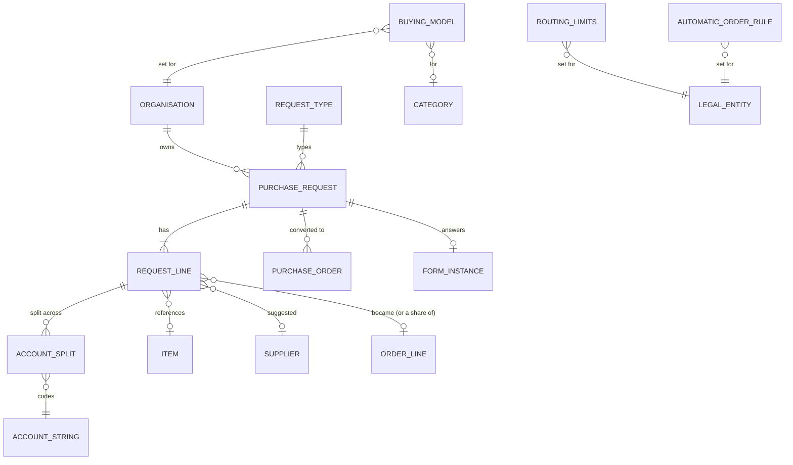
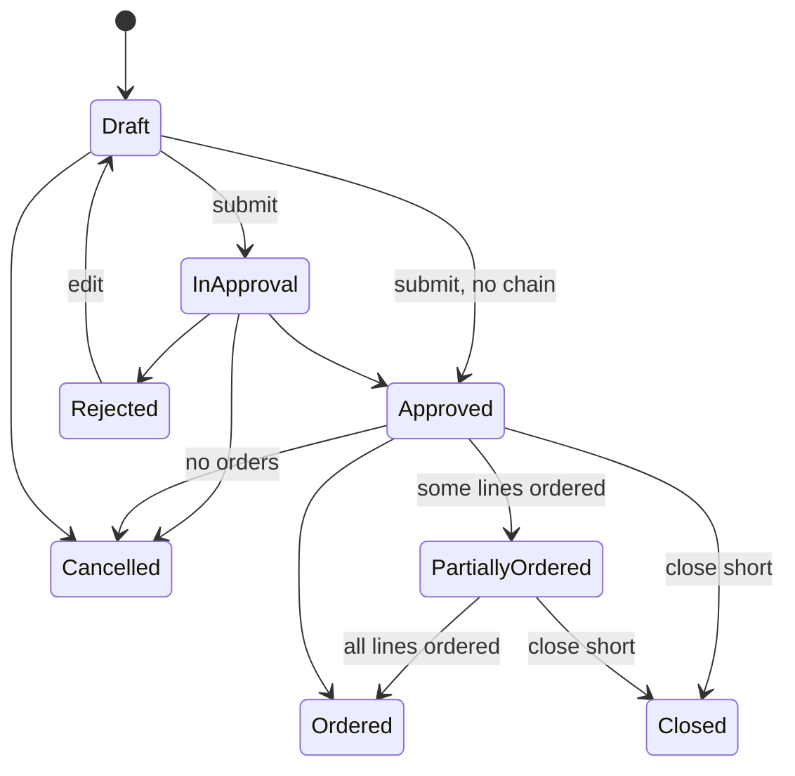

# eProcurement Suite: Requests and Intake PRD

## 0. Document control

| Item | Value |
|---|---|
| Document title | Requests and Intake: one front door for every purchase need, controlled demand with budget, and the buying model, Product Requirements Document |
| Layer | Suite (ADR-0043): a product of the eProcurement Suite, on IronSaaS Foundation, module 3 of its module list (`README.md`, ADR-0058); the module is proposed in section 13 |
| Identifier prefix | `REQ-`, in blocks of twenty per area (ADR-0041); the table is `requests-requirements.csv` |
| Version | 1.4 (EPS-modules, 2026-10-30: intake, the buying model, routing and automatic orders, consolidation) |
| Date | 2026-10-30 |
| Status | Accepted at the design session's review of 2026-10-20, its decisions written into the requirements and marked "decided 2026-10-20" in their notes. The changes of 1.4 (EPS-modules) were accepted at the design session's review of 2026-10-30, their decisions marked "decided 2026-10-30" in their notes. |
| Inputs | The Functional Foundation PRD for procure-to-pay, version 1.2 (archived as `../../archive/functional-foundation-p2p-PRD-v1.md`), the map (`../../requirements-map.md`), ADR-0029 and ADR-0041. |
| Dependency | Legal entities, finance masters, budgets, items, units, locations and suppliers are the Business PRD's; orders are the Orders product's; every mechanism is a kernel capability cited by its TF identifier. |
| Tags | `[Carried]` behaviour from the current product that stays. `[Improved]` carried but changed to close a defect or gap. `[New]` not in the current product, standard practice. `[Decision]` needs the owner's confirmation; the question is in its notes. `[Later]` recorded, not in version 1. A requirement moved from the archived PRD says what it was at the start of its notes. |

Change log: 1.4, 2026-10-30: EPS-modules, the owner's decisions of 2026-10-29 (ADR-0058): the product is Requests and Intake, module 3 of the suite's module list; intake by request type with reviews before ordering (REQ-101, REQ-102); the buying model as configuration, desktop buying, central buying or the mix, with requests on behalf and demand imported in bulk (REQ-121 to REQ-123); routing rules and automatic orders (REQ-141, REQ-142); consolidation across requests by a buyer and over a window, and each requester following their own line (REQ-161 to REQ-163); REQ-081 declares the key "request recorded on your behalf"; sections 1 to 5, 8, 9 and 12 to 17 follow; no requirement retired. At the design session's review the same day, every default was decided as proposed, to be reviewed again in the Requests process reference pack, with two changes: a line needed before the next consolidation window closes becomes an order at once (REQ-162); the unit decides who may request, the category and the value decide how a line is fulfilled, and the more controlled setting wins when two disagree (REQ-121, REQ-122, REQ-141, REQ-142), so REQ-121's error case moved to REQ-122 as its AC5, REQ-121 gained the criteria of the rule, and REQ-142 gained AC5, the sourcing limit winning over an automatic order. 1.3, 2026-10-21, at SUP-gaps' review: REQ-081, the notification keys, no longer depends on REQ-023, which raises its line assigned key in a later slice; REQ-023 depends on REQ-081 instead, so that no requirement depends on one of a later slice (`make prd-check`); no requirement's words changed. 1.2, 2026-10-20: the review of L2 (ADR-0043, decision 8): REQ-001's ship-to defaults from the purchasing master (PUR-041), REQ-023 takes its buyer from PUR-001, and REQ-081 declares the product's notification keys (from BF-164); no other requirement changed. 1.1, 2026-10-20: moved to `docs/prd/suites/procurement/` as a product of the eProcurement Suite on IronSaaS Foundation (ADR-0043); its module's names follow the Suite layer; no requirement changed. 1.0, 2026-10-20: accepted at the review; its decisions are written into the requirements, and the proposals of the split's sections stand. 0.2 DRAFT, 2026-10-20: the design session's answers at the checkpoint and the split's sections (supplier views, records and signatures, visibility tags, search and exports, dependencies by ADR-0042, module and permissions). 0.1 SKELETON, 2026-10-20: the split (ADR-0041). Purchase requests moved here from the Functional Foundation PRD 1.2, their words unchanged except for names that changed. Ship-to locations went to the Business PRD.

## 1. Vision and goals

### 1.1 Vision

Controlled demand: every purchase need comes through one front door, where its type asks the right questions; it becomes a request with its lines coded to account strings and checked against budget, reviewed and approved by the right people, and converted into orders without re-keying: automatically where the supplier and price are agreed, by a buyer who consolidates many requests where they are not. Whether people buy for themselves or a buying desk buys for them is the tenant's choice, per legal entity, unit and category.

### 1.2 Goals (outcomes)

Goal 1 of the archived PRD, in its words, shared with the Orders product:

1. Every purchase goes through a request, an approval and an order; no spend outside the system for in-scope categories.

## 2. Scope

### 2.1 In scope

Requests with lines and lots, account splits, line currencies, submission validations, the budget check, approval, cancellation, totals, conversion into orders, partial ordering and close-short, copy and templates, lists and visibility, and the requests' reports. Since 2026-10-30: intake by request type with reviews before ordering; the buying model, desktop, central or mixed, with requests on behalf and demand imported in bulk; routing rules and automatic orders; consolidation across requests by a buyer and over a window.

### 2.2 Out of scope in version 1 (`[Later]`)

Recurring requests (decision F-12: templates yes, recurring requests later).

## 3. Personas

| Persona | Goals in this product | Surface |
|---|---|---|
| Requester | Raise a request from catalogue or free text through the front door, see budget, follow approval and their own line to delivery | Enterprise app |
| Buyer (the buying desk) | Convert and consolidate requests into orders, record requests on behalf, import demand | Enterprise app |
| Approver (manager, budget owner, finance, legal) | Approve requests with context, within SLA, or delegate | Enterprise app, email links |
| Reviewer (legal, security or IT, finance, procurement) | Review the requests their type, value and answers send them, before ordering | Enterprise app, email links |
| Procurement administrator | Set the request types, the buying model, the routing limits, the automatic order rules and the consolidation window | Enterprise app |

## 4. Domain model

`ORGANISATION` is the kernel's unit; `FORM_INSTANCE` the kernel's forms engine's (TF-242); `ACCOUNT_STRING`, `ITEM`, `SUPPLIER`, `CATEGORY` and `LEGAL_ENTITY` are Business masters; `PURCHASE_ORDER` and `ORDER_LINE` are the Orders product's. They are drawn for context. Since 2026-10-30 a request has a type and its form's answers, and a line keeps the order line it became, or its share of one (REQ-163); the buying model, the routing limits and the automatic order rules are this product's configuration (section 14).

## 5. Processes

### 5.1 Request to order (the request's part)

From the archived PRD's section 5.2: create request (header, lines, lots, splits) → submit (validations, budget check, hook) → approval chain → approved → buyer reviews and converts to one order per supplier (lines without supplier are sourced or assigned first). The order's part of the process is the Orders product's section 5.

### 5.2 Intake, the buying model and routing (since 2026-10-30)

The owner's decisions of 2026-10-29 (ADR-0058): the requester chooses a request type at the front door and answers its form (REQ-101), or, under central buying, the buying desk records the need on their behalf or imports it (REQ-122, REQ-123) → submit → the approval, with the reviews the type, value and answers call for (REQ-007, REQ-102) → approved → each line routed (REQ-141): a catalogue or contract line within the automatic order rules is published for an automatic order (REQ-142), collected over the consolidation window where one is set (REQ-162), and Orders makes the order; any other line goes to its buyer's queue, marked or flagged by the limits, where the buyer orders lines of many requests together (REQ-161) → each requester follows their own line (REQ-163). The unit decides who may raise the request (REQ-122); the category and the value decide how each line is fulfilled, the more controlled setting winning when two disagree (REQ-121).

## 6. Requirements

Each requirement has an identifier, a priority (Must, Should, Could), a tag, the requirement statement in business terms, the reason, acceptance criteria that a tester can run (including at least one error case), dependencies and notes.

### 6.1 Requests (REQ-001 to REQ-020)

#### REQ-001 Create and edit a request
*Priority:* **Must** · *Tag:* `[Carried]` · *Area:* Requests

**Requirement:** Requesters shall create requests (title, legal entity, currency, chart of account, requested for, organisation unit, project, need-by date, fiscal period, ship-to location, notes, custom fields, attachments) as Draft and edit them in Draft or Rejected; editing in other states is refused. The ship-to location defaults from the requester's purchasing profile (PUR-041).

**Why:** Entry document.

**Acceptance criteria:**

- AC1 Given mandatory header fields, When saved, Then a Draft exists without a number.
- AC2 Given a request in approval, When edited, Then it is refused with the state named. (error case)
- AC3 Given a rejected request edited and resubmitted, When processed, Then a new approval chain is built.

*Depends on:* BF-001, BF-061, BF-070, PUR-041

**Notes:** Was FF-050. The default ship-to comes from the eProcurement Suite's purchasing master since the review of L2 (ADR-0043).

#### REQ-002 Request lines and lots
*Priority:* **Must** · *Tag:* `[Carried]` · *Area:* Requests

**Requirement:** Lines (item or free text, type product or service, quantity or amount basis, quantity, unit, unit price, currency, supplier suggestion, category, need-by, ship-to, custom fields) and lots with child lines, numbered per request, with a duplicate rule on item plus supplier plus account coding plus ship-to.

**Why:** Line detail for ordering.

**Acceptance criteria:**

- AC1 Given a complete line, When saved, Then it gets the next line number and the request total updates.
- AC2 Given a duplicate line, When saved, Then it is refused with the duplicate named. (error case)
- AC3 Given a lot, When child lines are added, Then the lot total equals the sum of children.

*Depends on:* REQ-001, BF-041, BF-043

**Notes:** Was FF-051.

#### REQ-003 Account splits on lines
*Priority:* **Must** · *Tag:* `[Carried]` · *Area:* Requests

**Requirement:** Each line shall be split across account strings with budget period and percent per the account split rule; a default split from the requester's organisation unit shall be proposed.

**Why:** Accounting on every line.

**Acceptance criteria:**

- AC1 Given splits of 60 and 40 percent, When submitted, Then validation passes.
- AC2 Given splits totalling 90 percent, When submitted, Then "Allocations for line N total 90 percent; they must total 100" is shown. (error case)
- AC3 Given a default split configured, When a line is created, Then it is pre-filled and editable.

*Depends on:* REQ-002, BF-062, BF-063

**Notes:** Was FF-052.

#### REQ-004 Line currencies and conversion
*Priority:* **Should** · *Tag:* `[Carried]` · *Area:* Requests

**Requirement:** When multi-currency lines are allowed, lines may be in allowed currencies and are converted to the header currency with the rate valid on the request date; the request shows both amounts.

**Why:** Imports and foreign suppliers.

**Acceptance criteria:**

- AC1 Given a line in USD and header in INR, When saved, Then the converted amount uses the valid rate.
- AC2 Given no rate, When saved, Then it is refused naming the pair and date. (error case)
- AC3 Given multi-currency off, When editing, Then only the header currency is offered.

*Depends on:* BF-070, REQ-002

**Notes:** Was FF-053.

#### REQ-005 Submission validations
*Priority:* **Must** · *Tag:* `[Improved]` · *Area:* Requests

**Requirement:** On submit the system shall validate header mandatory fields, at least one line, mandatory line fields, splits totalling 100 percent, supplier status (published, not on hold, no critical flag, no blocking expired document), item status, budget period open, and run hook points; it shall then allocate the number and start the approval chain (or approve directly when no configuration applies).

**Why:** Clean documents reach approvers.

**Acceptance criteria:**

- AC1 Given a complete request, When submitted, Then it is numbered and In Approval (or Approved).
- AC2 Given a supplier on hold on a line, When submitted, Then it is refused naming the line and supplier. (error case)
- AC3 Given a hook that blocks, When submitted, Then the message is shown and the request stays Draft.

*Depends on:* REQ-001, REQ-003, SUP-004, TF-090, TF-202

**Notes:** Was FF-054.

#### REQ-006 Budget check at submission
*Priority:* **Must** · *Tag:* `[Improved]` · *Area:* Requests

**Requirement:** Submission shall apply the budget availability check with reservation (BF-065) when request budget validation is on, blocking or warning as configured, and show approvers the budget status per split.

**Why:** Spend control at the source.

**Acceptance criteria:**

- AC1 Given blocking on and budget short, When submitted, Then it is refused with the shortfall per account string. (error case)
- AC2 Given warning on, When submitted, Then it proceeds and the approval screen shows the shortfall.
- AC3 Given validation off, When submitted, Then no budget check runs and no reservation is made. (edge)

*Depends on:* REQ-005, BF-065

**Notes:** Was FF-055. AC1 is marked as the error case it is (ADR-0041).

#### REQ-007 Approval of requests
*Priority:* **Must** · *Tag:* `[Carried]` · *Area:* Requests

**Requirement:** Requests shall use the kernel workflow with the request document type, conditions on header, line and split fields (amount, category, legal entity, supplier, account string, custom fields), dynamic approvers (manager chain, budget owner, account string owner, category group) and the standard actions; approvers shall see lines, splits, budget status and attachments in the approval view.

**Why:** Core governance.

**Acceptance criteria:**

- AC1 Given a configuration on amount above 10,000 with manager chain, When submitted, Then the requester's manager is an approver.
- AC2 Given a rejection, When done, Then the requester is notified and may edit.
- AC3 Given an approver who is also the requester and self-approval is disallowed, When they try, Then it is refused. (error case)

*Depends on:* REQ-005, TF-090, TF-091

**Notes:** Was FF-056.

#### REQ-008 Cancel a request
*Priority:* **Must** · *Tag:* `[Carried]` · *Area:* Requests

**Requirement:** The requester or a permitted user shall cancel a request in Draft, In Approval or Approved without orders, with a reason, releasing budget reservations and notifying pending approvers.

**Why:** Needs change.

**Acceptance criteria:**

- AC1 Given an Approved request without orders, When cancelled, Then it is Cancelled and reservations released.
- AC2 Given a request with an order, When cancelled, Then it is refused; close-short is offered instead. (error case)
- AC3 Given cancellation, When audited, Then the reason is recorded.

*Depends on:* REQ-001, BF-066

**Notes:** Was FF-057.

#### REQ-009 Request totals and summary
*Priority:* **Should** · *Tag:* `[Carried]` · *Area:* Requests

**Requirement:** Requests shall show line totals, converted totals in header currency, tax estimate when codes are set, budget status per split, linked orders and a summary panel for approvers.

**Why:** Context for decisions.

**Acceptance criteria:**

- AC1 Given lines in two currencies, When viewed, Then the total is in header currency with the rates used.
- AC2 Given linked orders, When viewed, Then order numbers and statuses are listed.
- AC3 Given no rate for a line, When totals compute, Then the total shows as unavailable with the reason instead of a wrong number. (error case)

*Depends on:* REQ-004

**Notes:** Was FF-063.

### 6.2 Ordering (REQ-021 to REQ-040)

#### REQ-021 Convert a request to orders
*Priority:* **Must** · *Tag:* `[Improved]` · *Area:* Ordering

**Requirement:** A buyer shall convert an Approved request into one draft order per supplier (default) with the option to split or merge lines across orders before submission; lines without supplier must be assigned a supplier first; converted lines are linked and the request becomes Partially Ordered or Ordered.

**Why:** No re-keying.

**Acceptance criteria:**

- AC1 Given approved lines for two suppliers, When converted, Then two draft orders exist and the request is Ordered.
- AC2 Given a line without supplier, When converted, Then it is refused naming the line. (error case)
- AC3 Given only some lines converted, When saved, Then the request is Partially Ordered with remaining quantities visible.

*Depends on:* REQ-007

**Notes:** Was FF-058. The buyer converts on Orders' screen, which reads the approved lines through this product's Contracts and marks them converted, so the request becomes Partially Ordered or Ordered at once (ADR-0042). Decision F-01 confirmed.

#### REQ-022 Partial ordering and close-short
*Priority:* **Should** · *Tag:* `[New]` · *Area:* Ordering

**Requirement:** Remaining quantities on request lines shall be orderable later; a buyer or requester shall close a request or line short with a reason, releasing remaining budget reservation.

**Why:** Demand changes.

**Acceptance criteria:**

- AC1 Given a line of 10 with 6 ordered, When viewed, Then 4 remains orderable.
- AC2 Given close-short, When applied, Then the remaining 4 is released and the line is Closed.
- AC3 Given a closed line, When conversion is attempted, Then it is refused. (error case)

*Depends on:* REQ-021, BF-066

**Notes:** Was FF-059.

#### REQ-023 Buyer and work queue from the purchasing group
*Priority:* **Should** · *Tag:* `[New]` · *Area:* Ordering

**Requirement:** A request line's buyer shall be a buyer of the purchasing group that serves the line's category and unit (PUR-001), and a buyer's work queue of approved lines to order shall show the lines of the groups they belong to, filterable by group.

**Why:** Buyers work by what they buy and for whom; the purchasing group says which buyer a line goes to.

**Acceptance criteria:**

- AC1 Given a purchasing group covering IT hardware for unit A, When a request line of IT hardware in unit A is approved, Then a buyer of that group is its buyer.
- AC2 Given a buyer of two purchasing groups, When they open their work queue, Then it shows the approved lines of both groups and can be filtered by group.
- AC3 Given a line whose category and unit no purchasing group serves, When it is approved, Then it has no buyer and the queue shows it as unassigned. (error case)

*Depends on:* REQ-007, REQ-081, PUR-001

**Notes:** New at the review of the PRD split, 2026-10-20: purchasing groups assign the buyer and filter the work queue (PUR-001, BF-007 until the review of L2 moved it to the eProcurement Suite's purchasing master). They give no access, so a buyer still needs a role over the line's unit to open it.

### 6.3 Templates and lists (REQ-041 to REQ-060)

#### REQ-041 Copy and templates
*Priority:* **Could** · *Tag:* `[Carried]` · *Area:* Templates and lists

**Requirement:** Users shall copy a request into a new draft and save requests as personal or shared templates; templates pre-fill header and lines without numbers.

**Why:** Repeat buying.

**Acceptance criteria:**

- AC1 Given a copy, When created, Then lines and splits are copied as a new Draft.
- AC2 Given a template used, When created, Then the request is Draft with template lines.
- AC3 Given a template with an inactive item, When used, Then the line is flagged for review. (edge)
- AC4 Given a template shared by a user without the share permission, When saved, Then it is refused. (error case)

*Depends on:* REQ-001

**Notes:** Was FF-060. Decision F-12 confirmed.

#### REQ-042 Request lists and visibility
*Priority:* **Must** · *Tag:* `[Carried]` · *Area:* Templates and lists

**Requirement:** Lists of requests with filters (status, requester, unit, period, supplier, amount) shall respect visibility: requesters see their own and those requested for them, buyers see their units, approvers see those they act on, administrators see all.

**Why:** Need to know.

**Acceptance criteria:**

- AC1 Given a requester, When listing, Then only their requests appear.
- AC2 Given a buyer scoped to unit A, When listing, Then requests of unit A and children appear.
- AC3 Given a user without any request permission, When opening, Then it is refused. (error case)

*Depends on:* REQ-001, TF-033, TF-035

**Notes:** Was FF-061.

### 6.4 Reports (REQ-061 to REQ-080)

#### REQ-061 Operational reports
*Priority:* **Must** · *Tag:* `[Carried]` · *Area:* Reports

**Requirement:** The reports in section 11.3 shall be available as grids with filters, saved views and export, respecting permissions and visibility.

**Why:** Run the operation.

**Acceptance criteria:**

- AC1 Given a user without the reports permission, When opening, Then it is refused. (error case)
- AC2 Given export, When run, Then the file matches the grid.

*Depends on:* TF-171, TF-203

**Notes:** Was FF-160, the request reports; the others are ORD-081, RCV-101, INV-084 and CAT-041. Placed by the test: each product owns its reports.

### 6.5 Notifications (REQ-081 to REQ-100)

#### REQ-081 Notification keys of Requests
*Priority:* **Should** · *Tag:* `[New]` · *Area:* Notifications

**Requirement:** Requests shall declare its notification keys on the business layer's notification templates (BF-164), each with the event that raises it, the placeholders it offers, its default audience and an English starter template: request approved and request rejected (the requester, REQ-007), request cancelled (the requester, REQ-008), line assigned (the buyer, REQ-023) and request recorded on your behalf (the person it is for, REQ-122).

**Why:** The product knows what happens to its documents; the tenant decides, in its own words, who hears of it (BF-164). A suite's keys and starter templates are the suite's content (ADR-0043).

**Acceptance criteria:**

- AC1 Given a tenant with the eProcurement Suite, When it is provisioned, Then each key of Requests exists with its English starter template and its default audience.
- AC2 Given a request rejected (REQ-007), When the rejection is saved, Then the requester is told in the key's template.
- AC3 Given a starter template that names a placeholder its key does not offer, When the module's declarations are checked at start, Then the start fails naming the key and the placeholder. (error case)

*Depends on:* BF-164, REQ-007, REQ-008

**Notes:** Was BF-164, the keys and starter templates of Requests. Moved at the review of L2, 2026-10-20 (ADR-0043): each product declares its keys and starter templates; BF-164 keeps the mechanism. Changed 2026-10-21 at SUP-gaps' review: the requirements that raise its keys in a later slice (REQ-023, with Orders) depend on this declaration, not the reverse, so no requirement depends on one of a later slice (`make prd-check`). Changed 2026-10-30 (EPS-modules): the key "request recorded on your behalf" (REQ-122).

### 6.6 Intake (REQ-101 to REQ-120)

Intake is one front door for any purchase need (the owner's decision of 2026-10-29, ADR-0058): the requester says what they need, the request type asks the right questions, and the reviews the type and the value call for run before anything is ordered. This area and the three after it were added after the notifications, so their blocks follow.

#### REQ-101 Request types: one front door for every purchase need
*Priority:* **Must** · *Tag:* `[New]` · *Area:* Intake

**Requirement:** Every purchase need shall start at one front door, where the requester first chooses what they need, its request type: a catalogue item, free-text goods, services, software, or contractors, the five types the eProcurement Suite brings. The type decides the questions the requester answers, a form of the forms engine (TF-242) attached to the request; the line fields that are required (a service line by amount and period, a software line with its number of users and its term); and the reviews that may apply (REQ-102). A catalogue item request takes its lines from the catalogue's cart where Catalogue is licensed (CAT-021); the other types have free-text lines guided by their questions. A tenant may deactivate a type, change its questions, and add types of its own, each based on one of the five.

**Why:** A requester should not have to know which process applies to what they buy: software needs a security review, a contractor legal and onboarding checks, a catalogue item none. One front door that asks the right questions for the type routes every need, and it is what the leading suites now sell as intake.

**Acceptance criteria:**

- AC1 Given the five request types active, When a requester starts a request, Then they choose its type first, and the questions of that type's form are shown.
- AC2 Given a software request whose form asks whether the software will hold personal data, When the requester answers yes, leaves the question on the kinds of data empty and submits, Then it is refused naming the question. (error case)
- AC3 Given a request type the tenant deactivated, When a requester starts a request of that type through a saved link or the API, Then it is refused naming the type. (error case)
- AC4 Given a tenant's own type based on services, When a line is added to a request of that type, Then it is a service line by amount and period.

*Depends on:* REQ-001, REQ-002, TF-242

**Notes:** New 2026-10-30 (EPS-modules), the owner's decision of 2026-10-29 (ADR-0058): intake as one front door for any purchase need, by request type. The five types and their forms are the suite's content (ADR-0043, decision 8). Decided 2026-10-30 at the review, as proposed, to be reviewed again in the Requests process reference pack (PM-001): a tenant's own types are each based on one of the five, so that the line fields and the routing that follow from a type stay known; the type is chosen once, and a different type means a new request, since the form and the reviews depend on it.

#### REQ-102 Reviews by type and value before ordering
*Priority:* **Must** · *Tag:* `[New]` · *Area:* Intake

**Requirement:** A submitted request shall go through the reviews its type, its value and its form's answers call for, before any of its lines can be ordered: legal (for example when the supplier asks for its own terms to be signed), security or IT (software, and services that touch the tenant's data or systems), finance (above a value the tenant sets, or a line without budget), and procurement (above a value the tenant sets, or a supplier not yet approved). Each review is a step of the request's approval on the kernel's workflow (REQ-007, TF-090), configured per request type with conditions on the amount, the category and the form's answers, its reviewers resolved like any approver (TF-091); reviews that do not wait for each other run at the same time. A reviewer sees the request, its form and its lines, and approves, rejects with a reason, or returns the request with questions; the request is approved only when every review that applies has approved. The suite's approval starter set (PUR-061) holds one inactive example per request type.

**Why:** Legal, security and finance reviews that happen after the order is placed come too late, and reviews that every request goes through waste everyone's time. Routing them by type, value and answers, before ordering, asks each team only about what it must see.

**Acceptance criteria:**

- AC1 Given a configuration that sends software to security or IT, When a software request is submitted, Then the security or IT review is a step of its approval, and the request is not approved until that review approves.
- AC2 Given a services request of 60,000 whose form says the supplier asks for its own terms, and a configuration with legal on that answer and finance above 50,000, When it is submitted, Then the legal and the finance reviews run at the same time, and the request is approved only when both have approved.
- AC3 Given a review that rejects with a reason, When the rejection is saved, Then the request is Rejected and the requester sees the reviewer's reason.
- AC4 Given a configuration whose legal review resolves no reviewer for the request's unit, When the request is submitted, Then it is refused naming the review and the missing reviewer, and the request stays Draft. (error case)

*Depends on:* REQ-101, REQ-007, PUR-061, TF-090, TF-091

**Notes:** New 2026-10-30 (EPS-modules), the owner's decision of 2026-10-29 (ADR-0058): reviews routed by type and value to legal, security or IT, finance and procurement, before ordering. Decided 2026-10-30 at the review, as proposed, to be reviewed again in the Requests process reference pack (PM-001): the starter examples, inactive until an administrator activates them (PUR-061): software, security or IT always, and legal when the form says terms must be signed; services and contractors, legal when terms must be signed, and procurement above 10,000 in the legal entity's currency; free-text goods, procurement above 10,000; any type, finance above 50,000 or with a line without budget; catalogue items, nothing beyond the approval REQ-007 runs. The values are examples an administrator changes before activating them.

### 6.7 Buying model (REQ-121 to REQ-140)

The buying model is configuration (the owner's decision of 2026-10-29, ADR-0058): desktop buying, central buying, or the mix, per legal entity, unit and category. At the review (2026-10-30): the unit decides who may request; the category and the value decide how a line is fulfilled; and when two settings disagree about a line's fulfilment, the more controlled one wins.

#### REQ-121 The buying model as configuration
*Priority:* **Must** · *Tag:* `[New]` · *Area:* Buying model

**Requirement:** The tenant shall set its buying model as configuration, in two parts. Who may raise requests is the unit's: everyone who holds the permission, or only nominated people (REQ-122). How a line is fulfilled is the category's and the value's: desktop fulfilment, where a catalogue or contract line is ordered automatically where the rules allow (REQ-142) and any other approved line goes to the buyers, who consolidate it into orders (REQ-161); or central fulfilment, where every approved line goes to the buyers' work queue. Fulfilment is set for one category or for all, at a legal entity (for all its units) or at a unit (for it and the units below it); the value decides through the automatic order rules' limits (REQ-142) and the routing limits (REQ-141). The mix is any combination of these settings. When two settings that apply to a line disagree about its fulfilment, the more controlled one wins: central over desktop, and the buyer's queue over an automatic order. The default, for a tenant that sets nothing, is desktop buying with consolidation at the buying desk: everyone may request, and fulfilment is desktop. A request shows each line's fulfilment and the setting it came from.

**Why:** Groups buy differently in different places: a head office buys IT centrally while its plants let people order their own supplies, and a category such as IT may be bought centrally everywhere. A model in configuration, rather than a fork in the product, lets one tenant run all of them; and a control set anywhere above a line is never undone by a looser setting nearer to it.

**Acceptance criteria:**

- AC1 Given a tenant that has set no buying model, When a request line is added, Then everyone with the permission may raise the request, and the line's fulfilment is desktop.
- AC2 Given the category IT hardware set to central fulfilment at legal entity L and to desktop at its unit U, When a line of IT hardware is added to a request of U, Then its fulfilment is central, from the category's setting at L.
- AC3 Given unit U set to central fulfilment for all categories and the category office supplies set to desktop at legal entity L, When a line of office supplies is added to a request of U, Then its fulfilment is central, from unit U's setting.
- AC4 Given a fulfilment setting for a category that is no longer active, When it is saved, Then it is refused naming the category. (error case)

*Depends on:* REQ-001, BF-001, BF-042, TF-034

**Notes:** New 2026-10-30 (EPS-modules), the owner's decision of 2026-10-29 (ADR-0058): desktop buying, central buying or the mix, as configuration per legal entity, unit and category, desktop buying with consolidation at the buying desk by default. Decided 2026-10-30 at the review, to be reviewed again in the Requests process reference pack (PM-001): the unit decides who may request; the category and the value decide how a line is fulfilled; when two settings disagree about fulfilment, the more controlled one wins, central over desktop and the buyer's queue over an automatic order. This replaced the proposed order of precedence (a category's model before a unit's, the nearest unit winning), and under central fulfilment no line is ordered automatically. The refusal of a unit nobody could request for moved to REQ-122, with who may request.

#### REQ-122 Who may request, and requests on behalf
*Priority:* **Must** · *Tag:* `[New]` · *Area:* Buying model

**Requirement:** The unit shall decide who may raise requests for it: everyone who holds the permission to create requests, or only its nominated requesters and the buyers of the purchasing groups that serve it (PUR-001). A unit without a setting takes the nearest unit's above it, then its legal entity's; the default is everyone. A buyer shall record a request that arrived outside the system, by email, telephone or on paper, on behalf of the person or unit that needs it, with the original attached as evidence (TF-160); the request names the person or unit it is for and the buyer who recorded it, follows the same validations and approvals as if that person had raised it, and its person is told that it was recorded (REQ-081).

**Why:** Central buying means a buying desk that buys for others, and much of its demand still arrives by email and telephone; recording it on behalf, with the evidence, puts that demand under the same control as the rest.

**Acceptance criteria:**

- AC1 Given unit U where only nominated people may request, When a person who is neither nominated nor a buyer serving U starts a request for U, Then it is refused, and the message names the buying desk to send the need to. (error case)
- AC2 Given an email from a person of U asking for 20 chairs, When a buyer records the request on behalf of that person with the email attached, Then the request is for that person, names the buyer as who recorded it, and its approval resolves that person's manager, not the buyer's.
- AC3 Given a request recorded on behalf with neither an original attached nor a note of a call, When it is submitted, Then it is refused naming the missing evidence. (error case)
- AC4 Given a request recorded on behalf of a person, When it is saved, Then that person is told in the key "request recorded on your behalf" and finds it among their requests (REQ-042).
- AC5 Given unit U set so that only nominated people may request, with no nominated requester and no buyer of a purchasing group serving U, When the setting is saved, Then it is refused naming the unit, since nobody could raise its requests. (error case)

*Depends on:* REQ-121, REQ-001, REQ-042, REQ-081, PUR-001, TF-034, TF-160

**Notes:** New 2026-10-30 (EPS-modules), the owner's decision of 2026-10-29 (ADR-0058): central buying, who may request, and requests recorded on behalf with the original as evidence. Changed at the review the same day: the unit decides who may request (REQ-121), so the setting is the unit's, the nearest unit's above it or its legal entity's, and AC5 came from REQ-121. Decided 2026-10-30 at the review, as proposed, to be reviewed again in the Requests process reference pack (PM-001): the original is required, and a need given by telephone or in person is recorded with a note naming who asked and when in its place; recording on behalf takes the permission `requests.requests.record_on_behalf`, which the buyers' role holds.

#### REQ-123 Demand imported in bulk
*Priority:* **Should** · *Tag:* `[New]` · *Area:* Buying model

**Requirement:** A buyer shall import demand in bulk through the kernel's import (TF-205): a file of request lines, each naming the person or unit it is for, the item or its description, the quantity and unit, the need-by date, the ship-to and the account split. Each row is validated as a line entered by hand is (REQ-002, REQ-003); the valid rows become requests on behalf (REQ-122), one per person or unit and legal entity, each recorded as the buyer's with the file attached as its evidence. They are created in Draft, and the buyer submits them, together or one by one; from then on they are approved, routed and consolidated like any other request.

**Why:** Central buying often collects demand in a spreadsheet, a season's uniforms or a year's stationery; importing it keeps the buyer from typing hundreds of lines, and keeps each line's requester, split and evidence.

**Acceptance criteria:**

- AC1 Given a file of 300 rows for 12 units of one legal entity, When it is imported, Then 12 draft requests on behalf exist, one per unit, each with the file attached.
- AC2 Given a file with 3 rows whose splits total 90 percent, When it is previewed, Then those rows are listed with the reason and the others can proceed. (error case)
- AC3 Given a person without the permission to record requests on behalf, When they import demand, Then it is refused. (error case)

*Depends on:* REQ-122, REQ-002, REQ-003, TF-205

**Notes:** New 2026-10-30 (EPS-modules), the owner's decision of 2026-10-29 (ADR-0058): demand imported in bulk through the kernel's import, and consolidated like any other. Decided 2026-10-30 at the review, as proposed, to be reviewed again in the Requests process reference pack (PM-001): one request per person or unit and legal entity, created in Draft for the buyer to submit, so that a large file is checked before anyone's approval starts. A demand that recurs is the recurring request section 2.2 leaves for later.

### 6.8 Routing and automatic orders (REQ-141 to REQ-160)

What happens to an approved line (the owner's decision of 2026-10-29, ADR-0058): catalogue and contract lines to automatic orders, other lines to the buyer's queue, and large ones to sourcing first.

#### REQ-141 Routing rules for approved lines
*Priority:* **Must** · *Tag:* `[New]` · *Area:* Routing and automatic orders

**Requirement:** When a request is approved, each of its lines shall be routed by the tenant's routing rules, and the line shows its route and why: a line from a catalogue or contract item, with its supplier and price known, to an automatic order where its fulfilment is desktop and the automatic order rules allow it (REQ-121, REQ-142); any other line, to the work queue of its buyer (REQ-023); and a line above the sourcing limit, to sourcing first, a catalogue or contract line too, since the buyer's queue wins over an automatic order (REQ-121). Two limits are set per legal entity in its currency, and may be set per category: lines up to the first go to the buyer's queue as they are; lines between the two go to it marked "quotations advised"; lines above the second, the sourcing limit, must be sourced first. With Sourcing (wave 2) such a line becomes a sourcing need; until then it goes to its buyer's queue flagged "source first", naming the limit, and an order made from it keeps the buyer's reason for not sourcing it (ORD-161). A line without a supplier always goes to the buyer's queue.

**Why:** A buyer's time belongs where a buyer is needed. Lines whose supplier and price are agreed need none; small free-text lines need an order; large ones need competition before a supplier is chosen.

**Acceptance criteria:**

- AC1 Given limits of 10,000 and 100,000 at legal entity L, When a request of L with free-text lines of 4,000, 40,000 and 400,000 is approved, Then the first goes to its buyer's queue, the second to the queue marked "quotations advised", and the third to the queue flagged "source first" naming the limit.
- AC2 Given a tenant that has set no limits, When a request is approved, Then every line not ordered automatically goes to its buyer's queue without a mark.
- AC3 Given the category IT hardware with a sourcing limit of 50,000 of its own at L, When a line of IT hardware for 60,000 is approved, Then it is flagged "source first" naming the category's limit.
- AC4 Given a sourcing limit lower than the first limit, When it is saved, Then it is refused naming both limits. (error case)

*Depends on:* REQ-007, REQ-023, REQ-121, BF-001, BF-042

**Notes:** New 2026-10-30 (EPS-modules), the owner's decision of 2026-10-29 (ADR-0058): catalogue and contract lines to automatic orders, other lines below a limit to the buyer's queue, lines above a higher limit sourced first, flagged to the buyer until Sourcing exists. Decided 2026-10-30 at the review, as proposed, to be reviewed again in the Requests process reference pack (PM-001), with the review's rule that the buyer's queue wins over an automatic order (REQ-121): between the two limits a line goes to the buyer's queue marked "quotations advised", a mark for the buyer and the reports that does not block the order; no limit is set until the tenant sets one; a category's limit comes before its legal entity's. A line routed to sourcing is Sourcing's to handle once that module's PRD is written; this requirement routes it and depends on nothing of Sourcing's.

#### REQ-142 Automatic orders
*Priority:* **Must** · *Tag:* `[New]` · *Area:* Routing and automatic orders

**Requirement:** An approved request line shall become an order without a buyer when the automatic order rules of its legal entity allow it: the line comes from a catalogue item or a contract item (CAT-021, CAT-022), so its supplier and price are known; its category is one the rules enable; its amount is within the rules' limit for that category; and its supplier is one the rules enable for automatic orders and is enabled in the line's organisation (BF-108). Requests then publishes the line as ready for an automatic order, an event Orders handles (ORD-162); a line that fails a rule goes to its buyer's queue naming the rule. Automatic orders apply only where the line's fulfilment is desktop (REQ-121): when any setting that applies to the line sends it to the buyer's queue, a central fulfilment or a sourcing limit it exceeds (REQ-141), the buyer's queue wins.

**Why:** Under desktop buying most lines are catalogue and contract items whose supplier and price are already agreed; ordering them without a buyer is what makes desktop buying fast, and the rules keep it to what the tenant trusts.

**Acceptance criteria:**

- AC1 Given a rule at legal entity L enabling office supplies up to 2,000 and supplier S, and an approved catalogue line of office supplies for 300 from S, When the request is approved, Then the line is published as ready for an automatic order and no buyer is assigned to it.
- AC2 Given the same rule and an approved catalogue line of office supplies for 2,500 from S, When the request is approved, Then the line goes to its buyer's queue naming the limit it exceeded.
- AC3 Given an approved free-text line with a suggested supplier and price, When the request is approved, Then it is not ordered automatically and goes to its buyer's queue.
- AC4 Given the category office supplies set to central fulfilment at legal entity L, When an approved catalogue line of office supplies within the rules is routed, Then it goes to its buyer's queue naming the central setting.
- AC5 Given a rule enabling office supplies up to 50,000, a sourcing limit of 20,000 at legal entity L, and an approved catalogue line of office supplies for 30,000, When it is routed, Then it goes to its buyer's queue flagged "source first", the buyer's queue winning over the automatic order.
- AC6 Given a rule that enables a supplier enabled in no organisation of its legal entity, When the rule is saved, Then it is refused naming the supplier. (error case)

*Depends on:* REQ-141, REQ-121, CAT-021, CAT-022, BF-108

**Notes:** New 2026-10-30 (EPS-modules), the owner's decision of 2026-10-29 (ADR-0058): an approved line from a catalogue or a contract, with a known supplier and price, becomes an order without a buyer, by rules on the category, an amount limit and the suppliers enabled. An automatic conversion is an event (ADR-0042, decision 4). Decided 2026-10-30 at the review, to be reviewed again in the Requests process reference pack (PM-001): the suppliers enabled for automatic orders are named in these rules rather than on the supplier's purchasing profile, so the purchasing master is unchanged; a legal entity without rules has no automatic orders; and, by the review's rule that the more controlled setting wins (REQ-121), no line whose fulfilment is central is ordered automatically, which replaced the proposed option of allowing automatic orders under central buying.

### 6.9 Consolidation (REQ-161 to REQ-180)

Lines of many requests become fewer orders (the owner's decision of 2026-10-29, ADR-0058), by a buyer or by a window, and each requester still follows their own line.

#### REQ-161 Consolidation across requests by a buyer
*Priority:* **Must** · *Tag:* `[New]` · *Area:* Consolidation

**Requirement:** A buyer's work queue (REQ-023) shall offer the approved lines of many requests together, grouped by supplier, legal entity, currency and payment terms, and let the buyer select lines from any number of requests and order them in one step: Orders' screen reads the selected lines through this product's Contracts and makes one order per group (ORD-161), and each line is marked converted, linked to its order line, at once, so that each request becomes Partially Ordered or Ordered as REQ-021 says. Each line keeps its own account split, ship-to and need-by date on its order line.

**Why:** Ten requests for one supplier in a week should reach it as one order, not ten: fewer orders and invoices, and better prices. The default buying model consolidates at the buying desk.

**Acceptance criteria:**

- AC1 Given approved lines of three requests for supplier S at legal entity L, in one currency and on the same terms, When the buyer selects them and orders them, Then one draft order to S holds the three lines, each linked to its request line, and each request is Ordered or Partially Ordered.
- AC2 Given selected lines for supplier S from two legal entities, When they are ordered together, Then two orders are made, one per legal entity.
- AC3 Given a selected line that another buyer ordered a moment before, When the buyer orders the selection, Then it is refused naming that line, and nothing of the selection is ordered. (error case)

*Depends on:* REQ-021, REQ-023, TF-083

**Notes:** New 2026-10-30 (EPS-modules), the owner's decision of 2026-10-29 (ADR-0058): a buyer selects approved lines from many requests in the work queue and creates one order per supplier. An order has one legal entity, currency and set of payment terms, so a group is one supplier with one of each; decision F-01 (the buyer may split or merge before submitting) holds. The buyer converts on Orders' screen, a call into this product (ADR-0042, decision 4).

#### REQ-162 Automatic consolidation over a window
*Priority:* **Should** · *Tag:* `[New]` · *Area:* Consolidation

**Requirement:** Lines ready for automatic orders (REQ-142) shall be collected over a window the tenant sets per legal entity and, when the window closes, published together in groups that share supplier, legal entity, currency and payment terms, so that Orders makes one order per group (ORD-163) rather than one per request. The window is a schedule of closing times in the legal entity's time zone on its working days (TF-099), or none, when each line is published at once. A line whose need-by date falls before the next window closes becomes an order at once: it is published alone, as soon as its request is approved, and Orders makes its order then (ORD-162). A line cancelled while it waits (REQ-008) is not published.

**Why:** Desktop buying makes many small automatic orders; collecting a day's lines turns a supplier's twenty orders into one, as a buyer consolidating by hand would, without a buyer.

**Acceptance criteria:**

- AC1 Given a daily window closing at 16:00 and three requests approved at 09:00, 11:00 and 15:00 with automatic lines for supplier S at legal entity L, in euros on net 30 days, When the window closes, Then the three lines are published as one group, and none was published before.
- AC2 Given automatic lines for S on two different payment terms, When the window closes, Then they are published as two groups.
- AC3 Given a window closing on Fridays and an automatic line approved on Tuesday with a need-by date of Thursday, When the request is approved, Then the line is published at once, alone, to become an order then rather than at Friday's close.
- AC4 Given a window schedule with no closing time, When it is saved, Then it is refused naming the schedule. (error case)

*Depends on:* REQ-142, REQ-008, TF-099, TF-120

**Notes:** New 2026-10-30 (EPS-modules), the owner's decision of 2026-10-29 (ADR-0058): automatic consolidation collects lines that share supplier, legal entity, currency and terms over a window the tenant sets. Decided 2026-10-30 at the review, as proposed, to be reviewed again in the Requests process reference pack (PM-001), with the review's words for a line needed before the next window closes: it becomes an order at once. The window is on, daily, closing at 16:00 in the legal entity's time zone on its working days, so a day's lines for a supplier reach it as one order that afternoon; "none" publishes each line at once. The outbox (TF-085) publishes each group once.

#### REQ-163 Each requester follows their own line
*Priority:* **Must** · *Tag:* `[New]` · *Area:* Consolidation

**Requirement:** A request line ordered by any path, a buyer's conversion (REQ-021), a consolidation (REQ-161, REQ-162) or an automatic order (REQ-142), shall keep the order line it became, which Orders writes through this product's Contracts when it marks the line converted, and its requester shall open that order line from their request to follow the order, its receipts and its delivery. Where identical lines became one order line (ORD-164), the request line names its own share, with its quantity and account split. A requester sees their own line and share through it, and never another requester's request.

**Why:** Consolidation must not cost the requester their view: whoever asked for something follows it to delivery, however many other requests share its order.

**Acceptance criteria:**

- AC1 Given a request line ordered in one order with lines of two other requests, When its requester opens their request, Then the line shows its order number and order line, and opens it.
- AC2 Given identical lines of requesters A and B made one order line of 30, A's share 10, When A opens their request, Then the line shows the order line and A's share of 10 with A's account split.
- AC3 Given the same order line, When A asks for B's request by its identifier, Then it is refused, as REQ-042 refuses it. (error case)

*Depends on:* REQ-021, REQ-042

**Notes:** New 2026-10-30 (EPS-modules), the owner's decision of 2026-10-29 (ADR-0058): each order line keeps its link to its request line, so every requester follows their own order, receipt and delivery. The order's status, receipts and delivery are Orders' to show (ORD-061) and to tell each requester of (ORD-009); this product keeps the link and the share and hears nothing from Orders (ADR-0042).

## 7. Supplier views

Suppliers do not see requests; they see the orders made from them (ORD-101). This product has no supplier view.

## 8. Rules and state machines

### 8.1 Key rules

The account split and budget rules this product applies are the Business PRD's (its section 7.1). Since 2026-10-30:

| Rule | Statement |
|---|---|
| The buying model that applies | The unit decides who may request: its setting, the nearest unit's above it, its legal entity's, then everyone (REQ-122). The category and the value decide how a line is fulfilled; when two settings disagree, the more controlled one wins: central over desktop, the buyer's queue over an automatic order (REQ-121). |
| Routing | Catalogue and contract lines within the rules to automatic orders; other lines to the buyer's queue, marked "quotations advised" between the two limits and flagged "source first" above the sourcing limit (REQ-141, REQ-142). |
| Reviews before ordering | A request is approved only when every review its type, value and answers call for has approved (REQ-102). |
| One group, one order | Lines consolidated by a buyer or a window are grouped by supplier, legal entity, currency and payment terms (REQ-161, REQ-162). |

### 8.2 State machines

#### Purchase request

## 9. Records and signatures (Part 11)

Records approved, acknowledged or signed carry an electronic signature (TF-063) with signer, time, meaning and record version, shown and printed as TF-219 asks; a tenant may require re-authentication at signing for the record types it selects. The table names this product's; the mechanism is the kernel's and is not repeated here.

| Record | Electronic signature (TF-063) | Audit-trail review (TF-219) |
|---|---|---|
| Request approval (REQ-007) | Each approval decision, meaning approved or rejected | Yes: approvals that went ahead with a budget shortfall in warning mode (REQ-006 AC2) |
| Cancellation and close-short (REQ-008, REQ-022) | Not signed; audited with the reason | Yes |
| Shared templates (REQ-041) | Not signed | No |
| Reviews (REQ-102) | Each review decision, meaning approved or rejected, as an approval step | Yes: requests approved after a review returned them with questions |
| Requests recorded on behalf and imported (REQ-122, REQ-123) | Not signed; the evidence attached, and who recorded it audited | Yes: requests recorded on behalf |
| The buying model, routing limits, automatic order rules and consolidation window (REQ-121, REQ-141, REQ-142, REQ-162) | Not signed; every change audited with before and after | Yes: changes to the automatic order rules |

Retention: this product's records are business documents and follow TF-066's default, 7 years after closure, which a tenant may change within the operator's limits; legal holds stop their deletion.

## 10. Visibility tags

A request takes the tags of its project (BF-075) when it has one; otherwise it starts without tags, and its requester may add the tags they hold (TF-241, rules 5 and 6). Decided 2026-10-20.

## 11. Data, integration and reports

### 11.1 Data notes

From the archived PRD's section 8.1: request lines follow the kernel's partitioning conventions (TF-226) from the first migration; every request has a public number from the kernel's numbering (TF-166), standard columns, version, soft delete only before submission, custom fields (TF-200), attachments (TF-160), tracked change history (TF-062).

### 11.2 Integrations

None in the archived PRD's table is this product's.

### 11.3 Reports

From the archived PRD's section 8.4: open requests. The request's cycle times are the Orders product's (ORD-082).

### 11.4 Search, exports and analytics feed

- Search (TF-204): requests by number, requester, supplier, item and free text.
- Exports (TF-203, TF-205, TF-206): approved requests with their approval decisions and signatures, for auditors (TF-064).
- Analytics feed (TF-089, TF-203): the daily snapshot of requests, their lines and splits.

These are what the archived FF-164 to FF-166 asked of this product; the mechanisms are the kernel's.

## 12. Dependencies

### 12.1 Its place in the process order

Fourth (ADR-0042): it calls Supplier management, Contracts and Catalogue, and hears from no later product: Orders reads and marks converted lines through this product's Contracts, and makes the automatic and consolidated orders this product publishes as events.

### 12.2 What it uses

- Kernel, cited by its requirements: TF-033 (scoped assignments), TF-034 (the unit tree, for the buying model), TF-035 (record policies), TF-083 (optimistic concurrency, for consolidation), TF-090 and TF-091 (approvals and resolvers, for the reviews too), TF-099 (the business calendar, for the consolidation window), TF-120 (jobs), TF-160 (files, for the evidence of a request on behalf), TF-171 (the grid), TF-202 (hooks), TF-203 (saved views and exports), TF-205 (imports), TF-242 (the forms engine, for the request types' questions). Through its sections: TF-063 and TF-219, TF-085 (the outbox), TF-166 (numbering), TF-241, TF-243.
- Business: BF-001 (legal entities), BF-041 and BF-043 (items, units), BF-042 (categories, for the buying model and the limits), BF-061 to BF-066 (charts, account strings, budget periods, budget check and consumption), BF-070 (rates), BF-108 (enablement, for the suppliers of automatic orders); and through their use on lines, BF-075 (projects), BF-081 and BF-083 (locations), BF-143 (approvers from the delegation of authority), BF-163 (number series).
- The suite's purchasing master (ADR-0043): PUR-001 (the buyer from the purchasing group, and the buyers who may request where a unit allows only nominated people), PUR-022 (supplier suggestions), PUR-041 (the requester's ship-to), PUR-061 (the starter examples of the reviews).
- Earlier products: Supplier management (REQ-005 on SUP-004, a line's supplier published, not on hold, without a critical flag or a blocking expired document); Contracts (a contract item's price and reference on a line, CAT-022); Catalogue (the cart it converts, read through Catalogue's Contracts, and the catalogue and contract items that may be ordered automatically, REQ-142 on CAT-021 and CAT-022).

### 12.3 Events

- Publishes: request approved, cancelled and closed short; since 2026-10-30, line ready for an automatic order (REQ-142) and a consolidation group closed (REQ-162), which Orders handles (ORD-162, ORD-163), the automatic conversions of ADR-0042's decision 4.
- Subscribes: none. A requester turns a cart into a request on this product's screen, reading the cart through Catalogue's Contracts (CAT-021); a buyer converts approved lines, of one request or many, on Orders' screen, which reads and marks them through this product's Contracts (REQ-021, REQ-022, REQ-161); Orders marks the lines it orders automatically the same way, writing each line's order line or share (REQ-163).

### 12.4 Extension points it implements

- BF-207: request lines use items, suppliers, account strings, locations and projects.

## 13. Layer, module, schema and permissions

The module is `Iron.Suites.Procurement.Requests` (schema `procurement_requests`), its shell module `shell/src/modules/suites/procurement/requests/`, licensed as a module (ADR-0034).

Permissions, decided 2026-10-20: `requests.requests.{read,read_all,create,update,submit,cancel,convert,close}`, `requests.templates.share`, `requests.reports.read`. `read` covers a person's own requests and those requested for them through the record policy; `read_all` every request in the person's scope, as the archived PRD's `read_own` and `read_all` did.

The product is named Requests and Intake since the owner's module list of 2026-10-29 (ADR-0058); its module keeps the name `Iron.Suites.Procurement.Requests`, its prefix `REQ-` and its permissions `requests.*`. Proposed with EPS-modules, decided when the slice that builds them starts: `requests.requests.record_on_behalf` (REQ-122, REQ-123), `requests.types.manage` (REQ-101), `requests.configuration.manage` (the buying model, the routing limits, the automatic order rules and the consolidation window).

## 14. Configuration

From the archived PRD's section 8.5: multi-currency on lines. Budget validation and blocking per document type are the Business PRD's document type settings (BF-161).

Since 2026-10-30, this product's own configuration, each change audited: the request types and their forms (REQ-101); the reviews per type, as approval configurations (REQ-102, BF-141); the buying model: who may request per legal entity and unit (REQ-122), and the fulfilment per category, or for all categories, at a legal entity or a unit (REQ-121); the two routing limits per legal entity and category (REQ-141); the automatic order rules per legal entity, with their categories, limits and suppliers (REQ-142); the consolidation window per legal entity (REQ-162).

## 15. Slices

Where the moved requirements sat in the archived PRD's build plan (its section 9). The product slices are in the technical PRD's section 7.

| Slice of the archived plan | Its outcome | This document's requirements from it |
|---|---|---|
| P1 | Masters, organisations and first request | REQ-001, REQ-002, REQ-003, REQ-004, REQ-005, REQ-006, REQ-007, REQ-008, REQ-009, REQ-042 |
| P4 | Invoicing and matching | REQ-061 |
| P5 | Catalogue, contracts, change orders | REQ-021, REQ-022, REQ-041 |

REQ-101, REQ-102, REQ-121 to REQ-123, REQ-141, REQ-142 and REQ-161 to REQ-163 are new with EPS-modules (2026-10-30) and were never in the archived plan. The technical PRD's section 7.2 places intake and the buying model with Requests (PR2); routing and the buyer's consolidation with Orders (PR3); each requester following their own line with Receiving (PR4), beside the shares of ORD-164; and automatic orders and automatic consolidation with Contracts and catalogue (PR6), since only catalogue and contract lines are ordered automatically.

## 16. Decisions and open points

### 16.1 Decisions

Confirmed on 2026-10-17, from the archived PRD's section 10.1:

| ID | Decision | Where applied |
|---|---|---|
| F-01 | One order per supplier on conversion; buyer can split or merge before submit | REQ-021 |
| F-12 | Request templates yes; recurring requests later | REQ-041 |

Decided by the owner on 2026-10-29 (ADR-0058): the product is Requests and Intake; intake is one front door for any purchase need, with reviews routed by type and value before ordering; the buying model is configuration per legal entity, unit and category, desktop buying with consolidation at the buying desk by default; automatic orders by rules; consolidation across requests by a buyer and over a window, each requester following their own line; central buying with requests on behalf and demand imported in bulk; routing rules with a limit for the buyer's queue and a higher one for sourcing. The defaults proposed with them (REQ-101, REQ-102, REQ-121 to REQ-123, REQ-141, REQ-142, REQ-162) were decided at the design session's review of 2026-10-30, each marked "decided 2026-10-30" in its notes and to be reviewed again in the Requests process reference pack (PM-001), with two changes: a line needed before the next consolidation window closes becomes an order at once (REQ-162); and the unit decides who may request, the category and the value decide how a line is fulfilled, and when two settings disagree about fulfilment the more controlled one wins, central over desktop and the buyer's queue over an automatic order (REQ-121, REQ-122, REQ-141, REQ-142).

### 16.2 Open points

Decided at the PRD split's checkpoint, on 2026-10-20: Products depend on each other in the process order, Supplier management, Contracts, Catalogue, Requests, Orders, Receiving, Invoicing: a later product calls an earlier one through its Contracts, and an earlier one hears from a later one only through events (ADR-0042). A buyer converts a request into orders on Orders' screen, which reads the request's lines and splits and marks them converted through this product's Contracts (REQ-021, ORD-001). Corrected at the review of 2026-10-20: a person's conversion is a call from the later product's screen, and only automatic conversions are events.

## 17. Glossary

| Term | Meaning |
|---|---|
| Automatic order | An order made from an approved catalogue or contract line without a buyer, by the tenant's rules (REQ-142) |
| Buying model | Desktop buying, central buying or the mix: who may request, set by the unit, and how a line is fulfilled, set by the category and the value, the more controlled setting winning (REQ-121, REQ-122) |
| Central buying | A buying desk buys for everyone: every approved line goes to the buyers, a unit may let only nominated people request, and the desk records the rest on behalf (REQ-121, REQ-122) |
| Close short | Closing an order or request line with remaining quantity not expected, releasing budget |
| Consolidation window | The schedule at whose close the lines ready for automatic orders are grouped into orders (REQ-162) |
| Desktop buying | Everyone who may request raises their own requests, and agreed items are ordered automatically (REQ-121) |
| Intake | The one front door for every purchase need, by request type, with its reviews before ordering (REQ-101, REQ-102) |
| Request type | What the requester needs: a catalogue item, free-text goods, services, software or contractors, or a tenant's own type based on one of them (REQ-101) |
