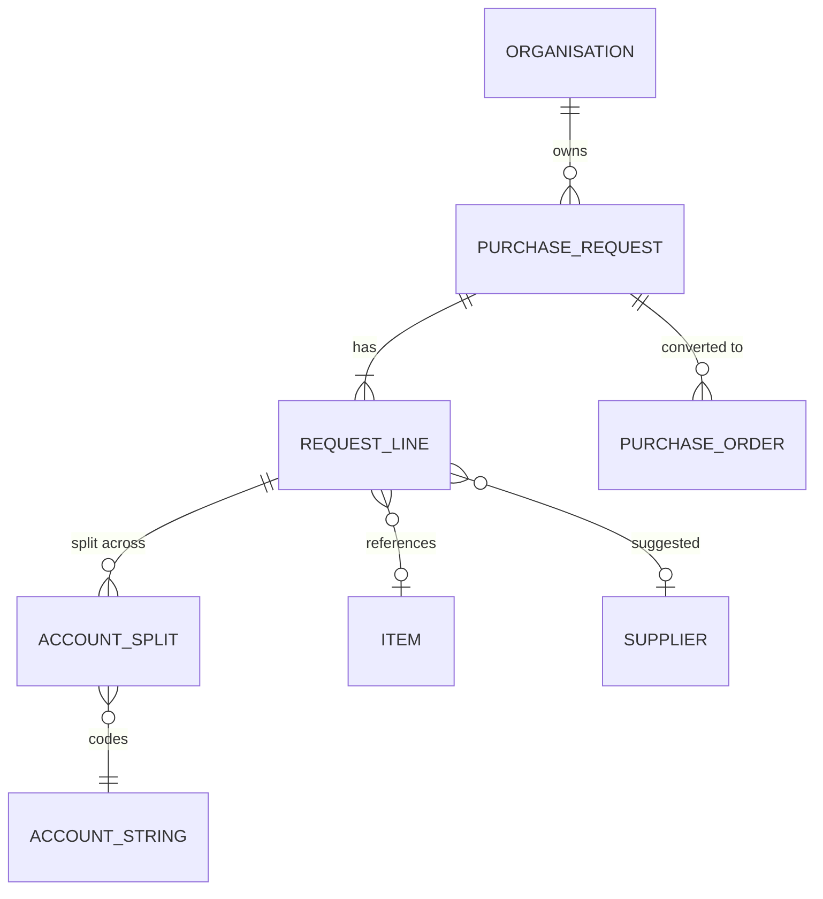
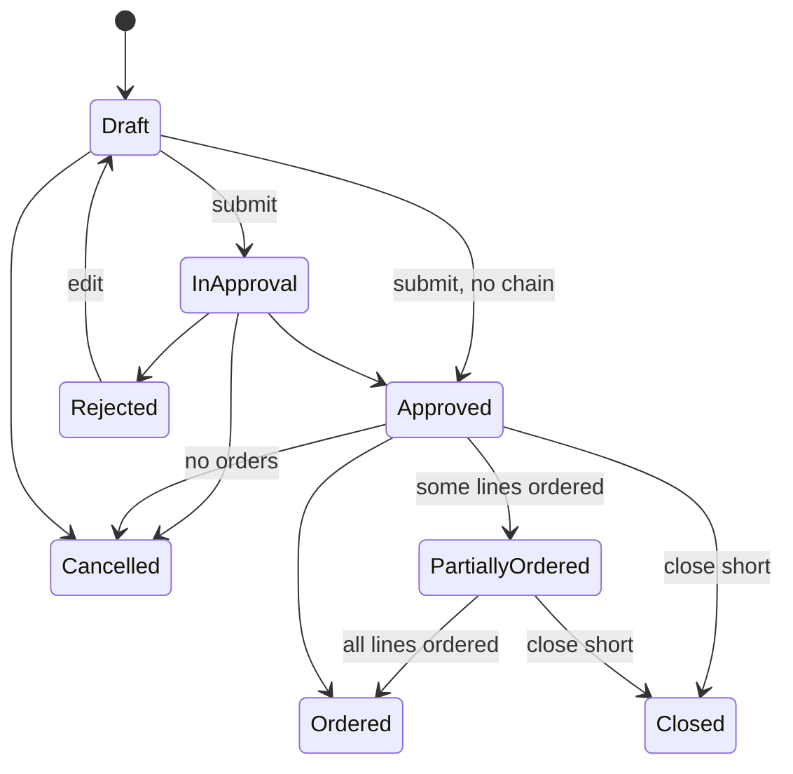

# eProcurement Suite: Purchase requests PRD

## 0. Document control

| Item | Value |
|---|---|
| Document title | Purchase requests: controlled demand with budget, Product Requirements Document |
| Layer | Suite (ADR-0043): a product of the eProcurement Suite, on IronSaaS Foundation; the module is proposed in section 13 |
| Identifier prefix | `REQ-`, in blocks of twenty per area (ADR-0041); the table is `requests-requirements.csv` |
| Version | 1.3 (SUP-gaps' review, 2026-10-21: no dependency on a later slice) |
| Date | 2026-10-21 |
| Status | Accepted at the design session's review of 2026-10-20, its decisions written into the requirements and marked "decided 2026-10-20" in their notes. |
| Inputs | The Functional Foundation PRD for procure-to-pay, version 1.2 (archived as `../../archive/functional-foundation-p2p-PRD-v1.md`), the map (`../../requirements-map.md`), ADR-0029 and ADR-0041. |
| Dependency | Legal entities, finance masters, budgets, items, units, locations and suppliers are the Business PRD's; orders are the Orders product's; every mechanism is a kernel capability cited by its TF identifier. |
| Tags | `[Carried]` behaviour from the current product that stays. `[Improved]` carried but changed to close a defect or gap. `[New]` not in the current product, standard practice. `[Decision]` needs the owner's confirmation; the question is in its notes. `[Later]` recorded, not in version 1. A requirement moved from the archived PRD says what it was at the start of its notes. |

Change log: 1.3, 2026-10-21, at SUP-gaps' review: REQ-081, the notification keys, no longer depends on REQ-023, which raises its line assigned key in a later slice; REQ-023 depends on REQ-081 instead, so that no requirement depends on one of a later slice (`make prd-check`); no requirement's words changed. 1.2, 2026-10-20: the review of L2 (ADR-0043, decision 8): REQ-001's ship-to defaults from the purchasing master (PUR-041), REQ-023 takes its buyer from PUR-001, and REQ-081 declares the product's notification keys (from BF-164); no other requirement changed. 1.1, 2026-10-20: moved to `docs/prd/suites/procurement/` as a product of the eProcurement Suite on IronSaaS Foundation (ADR-0043); its module's names follow the Suite layer; no requirement changed. 1.0, 2026-10-20: accepted at the review; its decisions are written into the requirements, and the proposals of the split's sections stand. 0.2 DRAFT, 2026-10-20: the design session's answers at the checkpoint and the split's sections (supplier views, records and signatures, visibility tags, search and exports, dependencies by ADR-0042, module and permissions). 0.1 SKELETON, 2026-10-20: the split (ADR-0041). Purchase requests moved here from the Functional Foundation PRD 1.2, their words unchanged except for names that changed. Ship-to locations went to the Business PRD.

## 1. Vision and goals

### 1.1 Vision

Controlled demand: every purchase starts as a request with its lines coded to account strings and checked against budget, approved by the right people, and converted into orders without re-keying.

### 1.2 Goals (outcomes)

Goal 1 of the archived PRD, in its words, shared with the Orders product:

1. Every purchase goes through a request, an approval and an order; no spend outside the system for in-scope categories.

## 2. Scope

### 2.1 In scope

Requests with lines and lots, account splits, line currencies, submission validations, the budget check, approval, cancellation, totals, conversion into orders, partial ordering and close-short, copy and templates, lists and visibility, and the requests' reports.

### 2.2 Out of scope in version 1 (`[Later]`)

Recurring requests (decision F-12: templates yes, recurring requests later).

## 3. Personas

| Persona | Goals in this product | Surface |
|---|---|---|
| Requester | Raise a request from catalogue or free text, see budget, follow approval | Enterprise app |
| Buyer | Convert requests to orders | Enterprise app |
| Approver (manager, budget owner, finance, legal) | Approve requests with context, within SLA, or delegate | Enterprise app, email links |

## 4. Domain model

`ORGANISATION` is the kernel's unit; `ACCOUNT_STRING`, `ITEM` and `SUPPLIER` are Business masters; `PURCHASE_ORDER` is the Orders product's. They are drawn for context.

## 5. Processes

### 5.1 Request to order (the request's part)

From the archived PRD's section 5.2: create request (header, lines, lots, splits) → submit (validations, budget check, hook) → approval chain → approved → buyer reviews and converts to one order per supplier (lines without supplier are sourced or assigned first). The order's part of the process is the Orders product's section 5.

## 6. Requirements

Each requirement has an identifier, a priority (Must, Should, Could), a tag, the requirement statement in business terms, the reason, acceptance criteria that a tester can run (including at least one error case), dependencies and notes.

### 6.1 Requests (REQ-001 to REQ-020)

#### REQ-001 Create and edit a request
*Priority:* **Must** · *Tag:* `[Carried]` · *Area:* Requests

**Requirement:** Requesters shall create requests (title, legal entity, currency, chart of account, requested for, organisation unit, project, need-by date, fiscal period, ship-to location, notes, custom fields, attachments) as Draft and edit them in Draft or Rejected; editing in other states is refused. The ship-to location defaults from the requester's purchasing profile (PUR-041).

**Why:** Entry document.

**Acceptance criteria:**

- AC1 Given mandatory header fields, When saved, Then a Draft exists without a number.
- AC2 Given a request in approval, When edited, Then it is refused with the state named. (error case)
- AC3 Given a rejected request edited and resubmitted, When processed, Then a new approval chain is built.

*Depends on:* BF-001, BF-061, BF-070, PUR-041

**Notes:** Was FF-050. The default ship-to comes from the eProcurement Suite's purchasing master since the review of L2 (ADR-0043).

#### REQ-002 Request lines and lots
*Priority:* **Must** · *Tag:* `[Carried]` · *Area:* Requests

**Requirement:** Lines (item or free text, type product or service, quantity or amount basis, quantity, unit, unit price, currency, supplier suggestion, category, need-by, ship-to, custom fields) and lots with child lines, numbered per request, with a duplicate rule on item plus supplier plus account coding plus ship-to.

**Why:** Line detail for ordering.

**Acceptance criteria:**

- AC1 Given a complete line, When saved, Then it gets the next line number and the request total updates.
- AC2 Given a duplicate line, When saved, Then it is refused with the duplicate named. (error case)
- AC3 Given a lot, When child lines are added, Then the lot total equals the sum of children.

*Depends on:* REQ-001, BF-041, BF-043

**Notes:** Was FF-051.

#### REQ-003 Account splits on lines
*Priority:* **Must** · *Tag:* `[Carried]` · *Area:* Requests

**Requirement:** Each line shall be split across account strings with budget period and percent per the account split rule; a default split from the requester's organisation unit shall be proposed.

**Why:** Accounting on every line.

**Acceptance criteria:**

- AC1 Given splits of 60 and 40 percent, When submitted, Then validation passes.
- AC2 Given splits totalling 90 percent, When submitted, Then "Allocations for line N total 90 percent; they must total 100" is shown. (error case)
- AC3 Given a default split configured, When a line is created, Then it is pre-filled and editable.

*Depends on:* REQ-002, BF-062, BF-063

**Notes:** Was FF-052.

#### REQ-004 Line currencies and conversion
*Priority:* **Should** · *Tag:* `[Carried]` · *Area:* Requests

**Requirement:** When multi-currency lines are allowed, lines may be in allowed currencies and are converted to the header currency with the rate valid on the request date; the request shows both amounts.

**Why:** Imports and foreign suppliers.

**Acceptance criteria:**

- AC1 Given a line in USD and header in INR, When saved, Then the converted amount uses the valid rate.
- AC2 Given no rate, When saved, Then it is refused naming the pair and date. (error case)
- AC3 Given multi-currency off, When editing, Then only the header currency is offered.

*Depends on:* BF-070, REQ-002

**Notes:** Was FF-053.

#### REQ-005 Submission validations
*Priority:* **Must** · *Tag:* `[Improved]` · *Area:* Requests

**Requirement:** On submit the system shall validate header mandatory fields, at least one line, mandatory line fields, splits totalling 100 percent, supplier status (published, not on hold, no critical flag, no blocking expired document), item status, budget period open, and run hook points; it shall then allocate the number and start the approval chain (or approve directly when no configuration applies).

**Why:** Clean documents reach approvers.

**Acceptance criteria:**

- AC1 Given a complete request, When submitted, Then it is numbered and In Approval (or Approved).
- AC2 Given a supplier on hold on a line, When submitted, Then it is refused naming the line and supplier. (error case)
- AC3 Given a hook that blocks, When submitted, Then the message is shown and the request stays Draft.

*Depends on:* REQ-001, REQ-003, SUP-004, TF-090, TF-202

**Notes:** Was FF-054.

#### REQ-006 Budget check at submission
*Priority:* **Must** · *Tag:* `[Improved]` · *Area:* Requests

**Requirement:** Submission shall apply the budget availability check with reservation (BF-065) when request budget validation is on, blocking or warning as configured, and show approvers the budget status per split.

**Why:** Spend control at the source.

**Acceptance criteria:**

- AC1 Given blocking on and budget short, When submitted, Then it is refused with the shortfall per account string. (error case)
- AC2 Given warning on, When submitted, Then it proceeds and the approval screen shows the shortfall.
- AC3 Given validation off, When submitted, Then no budget check runs and no reservation is made. (edge)

*Depends on:* REQ-005, BF-065

**Notes:** Was FF-055. AC1 is marked as the error case it is (ADR-0041).

#### REQ-007 Approval of requests
*Priority:* **Must** · *Tag:* `[Carried]` · *Area:* Requests

**Requirement:** Requests shall use the kernel workflow with the request document type, conditions on header, line and split fields (amount, category, legal entity, supplier, account string, custom fields), dynamic approvers (manager chain, budget owner, account string owner, category group) and the standard actions; approvers shall see lines, splits, budget status and attachments in the approval view.

**Why:** Core governance.

**Acceptance criteria:**

- AC1 Given a configuration on amount above 10,000 with manager chain, When submitted, Then the requester's manager is an approver.
- AC2 Given a rejection, When done, Then the requester is notified and may edit.
- AC3 Given an approver who is also the requester and self-approval is disallowed, When they try, Then it is refused. (error case)

*Depends on:* REQ-005, TF-090, TF-091

**Notes:** Was FF-056.

#### REQ-008 Cancel a request
*Priority:* **Must** · *Tag:* `[Carried]` · *Area:* Requests

**Requirement:** The requester or a permitted user shall cancel a request in Draft, In Approval or Approved without orders, with a reason, releasing budget reservations and notifying pending approvers.

**Why:** Needs change.

**Acceptance criteria:**

- AC1 Given an Approved request without orders, When cancelled, Then it is Cancelled and reservations released.
- AC2 Given a request with an order, When cancelled, Then it is refused; close-short is offered instead. (error case)
- AC3 Given cancellation, When audited, Then the reason is recorded.

*Depends on:* REQ-001, BF-066

**Notes:** Was FF-057.

#### REQ-009 Request totals and summary
*Priority:* **Should** · *Tag:* `[Carried]` · *Area:* Requests

**Requirement:** Requests shall show line totals, converted totals in header currency, tax estimate when codes are set, budget status per split, linked orders and a summary panel for approvers.

**Why:** Context for decisions.

**Acceptance criteria:**

- AC1 Given lines in two currencies, When viewed, Then the total is in header currency with the rates used.
- AC2 Given linked orders, When viewed, Then order numbers and statuses are listed.
- AC3 Given no rate for a line, When totals compute, Then the total shows as unavailable with the reason instead of a wrong number. (error case)

*Depends on:* REQ-004

**Notes:** Was FF-063.

### 6.2 Ordering (REQ-021 to REQ-040)

#### REQ-021 Convert a request to orders
*Priority:* **Must** · *Tag:* `[Improved]` · *Area:* Ordering

**Requirement:** A buyer shall convert an Approved request into one draft order per supplier (default) with the option to split or merge lines across orders before submission; lines without supplier must be assigned a supplier first; converted lines are linked and the request becomes Partially Ordered or Ordered.

**Why:** No re-keying.

**Acceptance criteria:**

- AC1 Given approved lines for two suppliers, When converted, Then two draft orders exist and the request is Ordered.
- AC2 Given a line without supplier, When converted, Then it is refused naming the line. (error case)
- AC3 Given only some lines converted, When saved, Then the request is Partially Ordered with remaining quantities visible.

*Depends on:* REQ-007

**Notes:** Was FF-058. The buyer converts on Orders' screen, which reads the approved lines through this product's Contracts and marks them converted, so the request becomes Partially Ordered or Ordered at once (ADR-0042). Decision F-01 confirmed.

#### REQ-022 Partial ordering and close-short
*Priority:* **Should** · *Tag:* `[New]` · *Area:* Ordering

**Requirement:** Remaining quantities on request lines shall be orderable later; a buyer or requester shall close a request or line short with a reason, releasing remaining budget reservation.

**Why:** Demand changes.

**Acceptance criteria:**

- AC1 Given a line of 10 with 6 ordered, When viewed, Then 4 remains orderable.
- AC2 Given close-short, When applied, Then the remaining 4 is released and the line is Closed.
- AC3 Given a closed line, When conversion is attempted, Then it is refused. (error case)

*Depends on:* REQ-021, BF-066

**Notes:** Was FF-059.

#### REQ-023 Buyer and work queue from the purchasing group
*Priority:* **Should** · *Tag:* `[New]` · *Area:* Ordering

**Requirement:** A request line's buyer shall be a buyer of the purchasing group that serves the line's category and unit (PUR-001), and a buyer's work queue of approved lines to order shall show the lines of the groups they belong to, filterable by group.

**Why:** Buyers work by what they buy and for whom; the purchasing group says which buyer a line goes to.

**Acceptance criteria:**

- AC1 Given a purchasing group covering IT hardware for unit A, When a request line of IT hardware in unit A is approved, Then a buyer of that group is its buyer.
- AC2 Given a buyer of two purchasing groups, When they open their work queue, Then it shows the approved lines of both groups and can be filtered by group.
- AC3 Given a line whose category and unit no purchasing group serves, When it is approved, Then it has no buyer and the queue shows it as unassigned. (error case)

*Depends on:* REQ-007, REQ-081, PUR-001

**Notes:** New at the review of the PRD split, 2026-10-20: purchasing groups assign the buyer and filter the work queue (PUR-001, BF-007 until the review of L2 moved it to the eProcurement Suite's purchasing master). They give no access, so a buyer still needs a role over the line's unit to open it.

### 6.3 Templates and lists (REQ-041 to REQ-060)

#### REQ-041 Copy and templates
*Priority:* **Could** · *Tag:* `[Carried]` · *Area:* Templates and lists

**Requirement:** Users shall copy a request into a new draft and save requests as personal or shared templates; templates pre-fill header and lines without numbers.

**Why:** Repeat buying.

**Acceptance criteria:**

- AC1 Given a copy, When created, Then lines and splits are copied as a new Draft.
- AC2 Given a template used, When created, Then the request is Draft with template lines.
- AC3 Given a template with an inactive item, When used, Then the line is flagged for review. (edge)
- AC4 Given a template shared by a user without the share permission, When saved, Then it is refused. (error case)

*Depends on:* REQ-001

**Notes:** Was FF-060. Decision F-12 confirmed.

#### REQ-042 Request lists and visibility
*Priority:* **Must** · *Tag:* `[Carried]` · *Area:* Templates and lists

**Requirement:** Lists of requests with filters (status, requester, unit, period, supplier, amount) shall respect visibility: requesters see their own and those requested for them, buyers see their units, approvers see those they act on, administrators see all.

**Why:** Need to know.

**Acceptance criteria:**

- AC1 Given a requester, When listing, Then only their requests appear.
- AC2 Given a buyer scoped to unit A, When listing, Then requests of unit A and children appear.
- AC3 Given a user without any request permission, When opening, Then it is refused. (error case)

*Depends on:* REQ-001, TF-033, TF-035

**Notes:** Was FF-061.

### 6.4 Reports (REQ-061 to REQ-080)

#### REQ-061 Operational reports
*Priority:* **Must** · *Tag:* `[Carried]` · *Area:* Reports

**Requirement:** The reports in section 11.3 shall be available as grids with filters, saved views and export, respecting permissions and visibility.

**Why:** Run the operation.

**Acceptance criteria:**

- AC1 Given a user without the reports permission, When opening, Then it is refused. (error case)
- AC2 Given export, When run, Then the file matches the grid.

*Depends on:* TF-171, TF-203

**Notes:** Was FF-160, the request reports; the others are ORD-081, RCV-101, INV-084 and CAT-041. Placed by the test: each product owns its reports.

### 6.5 Notifications (REQ-081 to REQ-100)

#### REQ-081 Notification keys of Requests
*Priority:* **Should** · *Tag:* `[New]` · *Area:* Notifications

**Requirement:** Requests shall declare its notification keys on the business layer's notification templates (BF-164), each with the event that raises it, the placeholders it offers, its default audience and an English starter template: request approved and request rejected (the requester, REQ-007), request cancelled (the requester, REQ-008) and line assigned (the buyer, REQ-023).

**Why:** The product knows what happens to its documents; the tenant decides, in its own words, who hears of it (BF-164). A suite's keys and starter templates are the suite's content (ADR-0043).

**Acceptance criteria:**

- AC1 Given a tenant with the eProcurement Suite, When it is provisioned, Then each key of Requests exists with its English starter template and its default audience.
- AC2 Given a request rejected (REQ-007), When the rejection is saved, Then the requester is told in the key's template.
- AC3 Given a starter template that names a placeholder its key does not offer, When the module's declarations are checked at start, Then the start fails naming the key and the placeholder. (error case)

*Depends on:* BF-164, REQ-007, REQ-008

**Notes:** Was BF-164, the keys and starter templates of Requests. Moved at the review of L2, 2026-10-20 (ADR-0043): each product declares its keys and starter templates; BF-164 keeps the mechanism. Changed 2026-10-21 at SUP-gaps' review: the requirements that raise its keys in a later slice (REQ-023, with Orders) depend on this declaration, not the reverse, so no requirement depends on one of a later slice (`make prd-check`).

## 7. Supplier views

Suppliers do not see requests; they see the orders made from them (ORD-101). This product has no supplier view.

## 8. Rules and state machines

### 8.1 Key rules

The account split and budget rules this product applies are the Business PRD's (its section 7.1).

### 8.2 State machines

#### Purchase request

## 9. Records and signatures (Part 11)

Records approved, acknowledged or signed carry an electronic signature (TF-063) with signer, time, meaning and record version, shown and printed as TF-219 asks; a tenant may require re-authentication at signing for the record types it selects. The table names this product's; the mechanism is the kernel's and is not repeated here.

| Record | Electronic signature (TF-063) | Audit-trail review (TF-219) |
|---|---|---|
| Request approval (REQ-007) | Each approval decision, meaning approved or rejected | Yes: approvals that went ahead with a budget shortfall in warning mode (REQ-006 AC2) |
| Cancellation and close-short (REQ-008, REQ-022) | Not signed; audited with the reason | Yes |
| Shared templates (REQ-041) | Not signed | No |

Retention: this product's records are business documents and follow TF-066's default, 7 years after closure, which a tenant may change within the operator's limits; legal holds stop their deletion.

## 10. Visibility tags

A request takes the tags of its project (BF-075) when it has one; otherwise it starts without tags, and its requester may add the tags they hold (TF-241, rules 5 and 6). Decided 2026-10-20.

## 11. Data, integration and reports

### 11.1 Data notes

From the archived PRD's section 8.1: request lines follow the kernel's partitioning conventions (TF-226) from the first migration; every request has a public number from the kernel's numbering (TF-166), standard columns, version, soft delete only before submission, custom fields (TF-200), attachments (TF-160), tracked change history (TF-062).

### 11.2 Integrations

None in the archived PRD's table is this product's.

### 11.3 Reports

From the archived PRD's section 8.4: open requests. The request's cycle times are the Orders product's (ORD-082).

### 11.4 Search, exports and analytics feed

- Search (TF-204): requests by number, requester, supplier, item and free text.
- Exports (TF-203, TF-205, TF-206): approved requests with their approval decisions and signatures, for auditors (TF-064).
- Analytics feed (TF-089, TF-203): the daily snapshot of requests, their lines and splits.

These are what the archived FF-164 to FF-166 asked of this product; the mechanisms are the kernel's.

## 12. Dependencies

### 12.1 Its place in the process order

Fourth (ADR-0042): it calls Supplier management, Contracts and Catalogue, and hears from no later product: Orders reads and marks converted lines through this product's Contracts.

### 12.2 What it uses

- Kernel, cited by its requirements: TF-033 (scoped assignments), TF-035 (record policies), TF-090 and TF-091 (approvals and resolvers), TF-171 (the grid), TF-202 (hooks), TF-203 (saved views and exports). Through its sections: TF-063 and TF-219, TF-166 (numbering), TF-241, TF-243.
- Business: BF-001 (legal entities), BF-041 and BF-043 (items, units), BF-061 to BF-066 (charts, account strings, budget periods, budget check and consumption), BF-070 (rates); and through their use on lines, BF-075 (projects), BF-081 and BF-083 (locations), BF-143 (approvers from the delegation of authority), BF-163 (number series).
- The suite's purchasing master (ADR-0043): PUR-001 (the buyer from the purchasing group), PUR-022 (supplier suggestions), PUR-041 (the requester's ship-to).
- Earlier products: Supplier management (REQ-005 on SUP-004, a line's supplier published, not on hold, without a critical flag or a blocking expired document); Contracts (a contract item's price and reference on a line, CAT-022); Catalogue (the cart it converts, read through Catalogue's Contracts).

### 12.3 Events

- Publishes: request approved, cancelled and closed short.
- Subscribes: none. A requester turns a cart into a request on this product's screen, reading the cart through Catalogue's Contracts (CAT-021); a buyer converts approved lines on Orders' screen, which reads and marks them through this product's Contracts (REQ-021, REQ-022).

### 12.4 Extension points it implements

- BF-207: request lines use items, suppliers, account strings, locations and projects.

## 13. Layer, module, schema and permissions

The module is `Iron.Suites.Procurement.Requests` (schema `procurement_requests`), its shell module `shell/src/modules/suites/procurement/requests/`, licensed as a module (ADR-0034).

Permissions, decided 2026-10-20: `requests.requests.{read,read_all,create,update,submit,cancel,convert,close}`, `requests.templates.share`, `requests.reports.read`. `read` covers a person's own requests and those requested for them through the record policy; `read_all` every request in the person's scope, as the archived PRD's `read_own` and `read_all` did.

## 14. Configuration

From the archived PRD's section 8.5: multi-currency on lines. Budget validation and blocking per document type are the Business PRD's document type settings (BF-161).

## 15. Slices

Where the moved requirements sat in the archived PRD's build plan (its section 9). The product slices are in the technical PRD's section 7.

| Slice of the archived plan | Its outcome | This document's requirements from it |
|---|---|---|
| P1 | Masters, organisations and first request | REQ-001, REQ-002, REQ-003, REQ-004, REQ-005, REQ-006, REQ-007, REQ-008, REQ-009, REQ-042 |
| P4 | Invoicing and matching | REQ-061 |
| P5 | Catalogue, contracts, change orders | REQ-021, REQ-022, REQ-041 |

## 16. Decisions and open points

### 16.1 Decisions

Confirmed on 2026-10-17, from the archived PRD's section 10.1:

| ID | Decision | Where applied |
|---|---|---|
| F-01 | One order per supplier on conversion; buyer can split or merge before submit | REQ-021 |
| F-12 | Request templates yes; recurring requests later | REQ-041 |

### 16.2 Open points

Decided at the PRD split's checkpoint, on 2026-10-20: Products depend on each other in the process order, Supplier management, Contracts, Catalogue, Requests, Orders, Receiving, Invoicing: a later product calls an earlier one through its Contracts, and an earlier one hears from a later one only through events (ADR-0042). A buyer converts a request into orders on Orders' screen, which reads the request's lines and splits and marks them converted through this product's Contracts (REQ-021, ORD-001). Corrected at the review of 2026-10-20: a person's conversion is a call from the later product's screen, and only automatic conversions are events.

## 17. Glossary

| Term | Meaning |
|---|---|
| Close short | Closing an order or request line with remaining quantity not expected, releasing budget |
