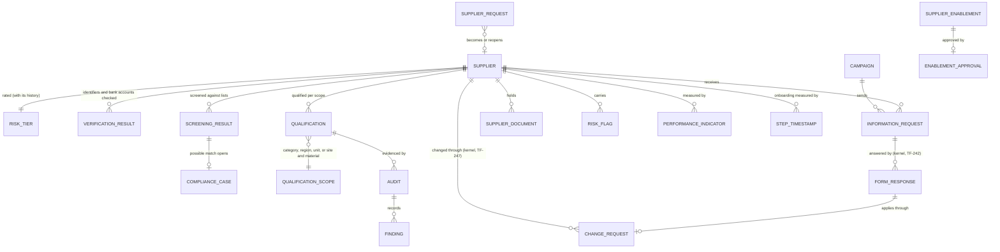
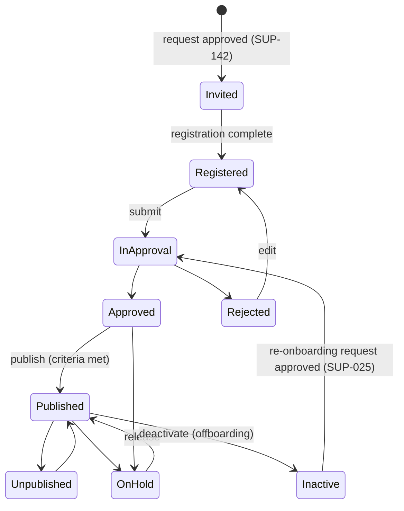
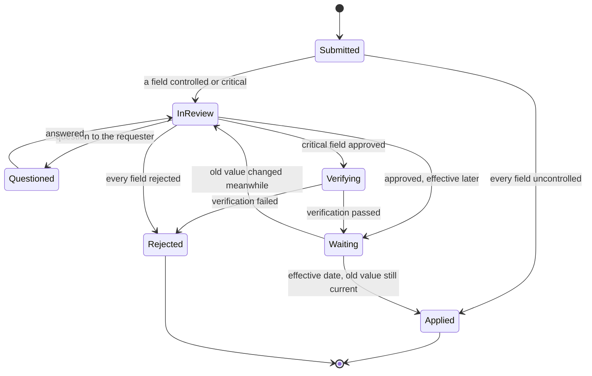
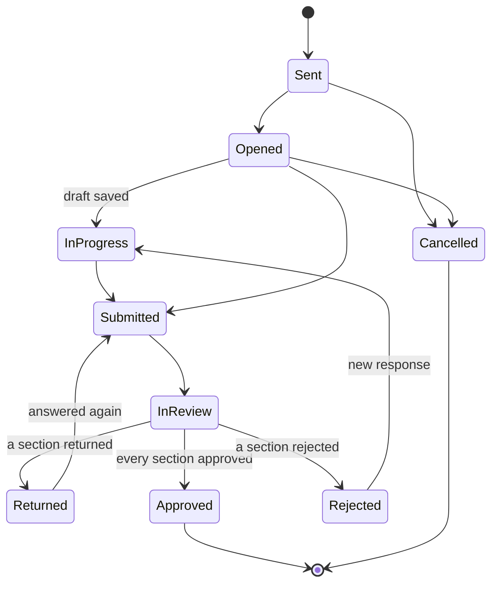
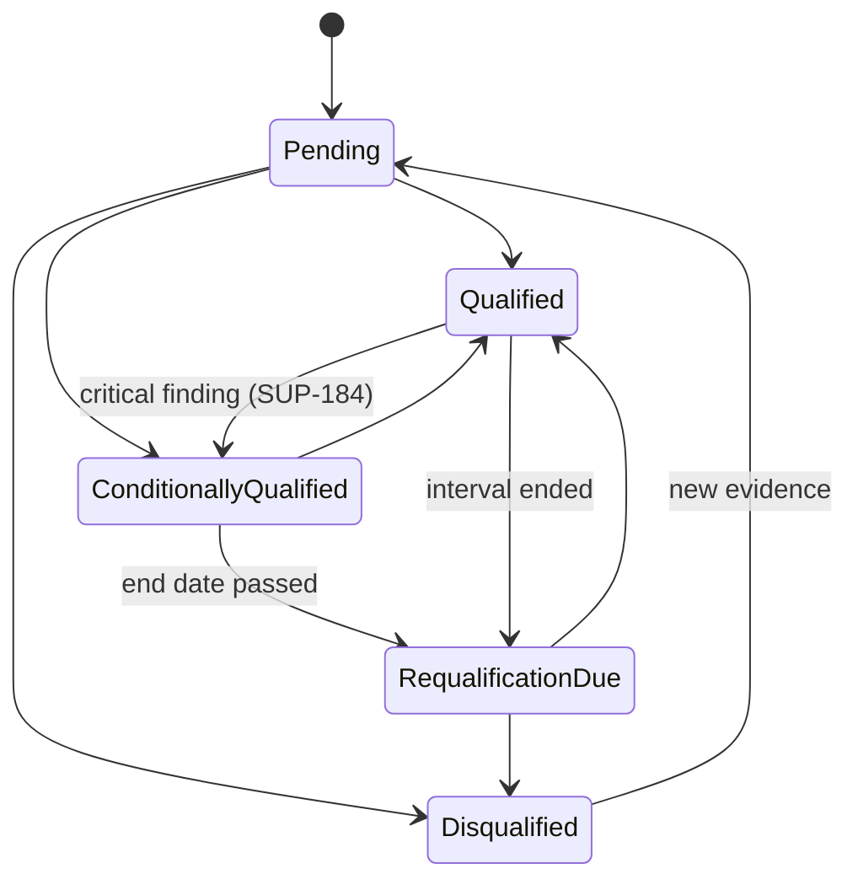

# eProcurement Suite: Supplier management PRD

## 0. Document control

| Item | Value |
|---|---|
| Document title | Supplier management: the supplier's life cycle with the tenant, Product Requirements Document |
| Layer | Suite (ADR-0043): a product of the eProcurement Suite, on IronSaaS Foundation; the module is proposed in section 13 |
| Identifier prefix | `SUP-`, in blocks of twenty per area (ADR-0041); the table is `supplier-management-requirements.csv` |
| Version | 1.3 (SUP-gaps, 2026-10-21: every gap of the process reference pack closed) |
| Date | 2026-10-21 |
| Status | Accepted at the design session's review of 2026-10-20, its decisions written into the requirements and marked "decided 2026-10-20" in their notes. The changes of 1.3 await the design session's review, and the pack's external practitioner review (PM-002) before the first slice. |
| Inputs | The Functional Foundation PRD for procure-to-pay, version 1.2 (archived as `../../archive/functional-foundation-p2p-PRD-v1.md`), the map (`../../requirements-map.md`), ADR-0029 and ADR-0041; since 1.3 the process reference pack, `process-reference/supplier-management.md` (PM-001), whose section 8 is the specification of the areas added and its section 2 the map of every requirement to a PCF element and a map step. |
| Dependency | The supplier record and its parts are the Business PRD's (BF-101 to BF-108); every mechanism is a kernel capability cited by its TF identifier. The supplier's own screens are served through the supplier portal surface (`supplier-portal-PRD.md`). |
| Tags | `[Carried]` behaviour from the current product that stays. `[Improved]` carried but changed to close a defect or gap. `[New]` not in the current product, standard practice. `[Decision]` needs the owner's confirmation; the question is in its notes. `[Later]` recorded, not in version 1. `[Retired]` replaced by the requirements its notes name, its identifier never reused. A requirement moved from the archived PRD says what it was at the start of its notes. |

Change log: 1.3, 2026-10-21: SUP-gaps, from the process reference pack (version 0.2, all thirteen gaps accepted). New areas: supplier requests (SUP-141, SUP-142), verification and screening (SUP-161 to SUP-165), qualification (SUP-181 to SUP-184), supplier information change management (SUP-201 to SUP-211) and periodic supplier information collection, SIM (SUP-221 to SUP-231); new SUP-007 (risk tier), SUP-025 (offboarding), SUP-044 (contact data protection) and SUP-064 (onboarding measures); SUP-001, SUP-004, SUP-005, SUP-021, SUP-061, SUP-063, SUP-101 and SUP-121 changed; SUP-022, SUP-023, SUP-042 and SUP-102 retired, each naming its successors. The areas stand in the process's order, so the sections are numbered anew. The domain model follows the pack's section 8.5. 1.2, 2026-10-20: the review of L2 (ADR-0043, decision 8): SUP-005 holds the sections and documents a new supplier must complete (from BF-106), its portal channels moved to the supplier portal (SPX-007), and SUP-121 declares the product's notification keys (from BF-164); no other requirement changed. 1.1, 2026-10-20: moved to `docs/prd/suites/procurement/` as a product of the eProcurement Suite on IronSaaS Foundation (ADR-0043); its module's names follow the Suite layer; no requirement changed. 1.0, 2026-10-20: accepted at the review; its decisions are written into the requirements, and the proposals of the split's sections stand. 0.2 DRAFT, 2026-10-20: the design session's answers at the checkpoint and the split's sections (supplier views, records and signatures, visibility tags, search and exports, dependencies by ADR-0042, module and permissions). 0.1 SKELETON, 2026-10-20: the split (ADR-0041). The supplier's life cycle moved here from the Functional Foundation PRD 1.2, its words unchanged except for names that changed.

## 1. Vision and goals

### 1.1 Vision

Only vetted suppliers receive orders. Anyone may ask for a new supplier; once the request is approved, the supplier is invited, registers once in the Supplier Network and completes the tenant's sections, its identity and bank account are verified, it is screened and qualified for what it will supply, as its risk tier asks, and it is approved, published and enabled for the units that buy from it. From then on, every change to it goes through one controlled pipeline, its information is collected again before it goes stale, and its performance is measured, until it is offboarded or comes back through a new request.

### 1.2 Goals (outcomes)

1. Only suppliers that are approved and published, with their mandatory documents valid, receive orders (SUP-004, SUP-041).
2. Every change to an approved supplier is a change request, and a critical field from any source, its bank accounts above all, takes effect only after approval and verification (SUP-201, SUP-202, SUP-205).
3. Each supplier's status, compliance, risks and performance are in one place (SUP-061, SUP-062).
4. A supplier's onboarding fits its risk, and its information stays current without a buyer chasing it (SUP-005, SUP-007, SUP-222, SUP-223).

The archived PRD's goal 3 (suppliers self-serve, onboarding included) is the supplier portal surface's goal 1.

### 1.3 Lessons from the current product

Improve, from the archived PRD's list: supplier ownership on every portal operation.

## 2. Scope

### 2.1 In scope

Supplier requests; onboarding (invitation, registration, duplicates, approval and publishing, onboarding configuration by risk tier, the risk tier); verification and screening (identifiers, bank accounts, sanctions); qualification (by scope, and, as a licensed feature, regulated qualification by site and material with audits); changes and status (status control, merge, offboarding); supplier information change management; compliance and risk (documents and expiry, risk flags, contact data protection); periodic supplier information collection; the relationship view, performance and the onboarding measures; and the binding of every supplier-facing operation to its supplier.

### 2.2 Out of scope in version 1 (`[Later]`)

From the archived PRD's list: supplier risk scoring from external data; multi-tier supplier collaboration. Screening and verification through connectors (section 6.3) check facts; they do not score a supplier's risk from external data, which stays later.

## 3. Personas

| Persona | Goals in this product | Surface |
|---|---|---|
| Requester (any employee) | Ask for a new supplier with a reason, and know whether one already exists | Enterprise app |
| Buyer | Qualify suppliers, resolve supplier queries, review supplier requests and changes, run information collection | Enterprise app |
| Compliance officer | Decide possible sanctions matches with evidence, run compliance collections | Enterprise app |
| Quality unit (regulated tenants) | Mark quality-relevant materials, approve supplier, site and material combinations with a signature, record audits and their findings | Enterprise app |
| Approver (manager, budget owner, finance, legal) | Approve suppliers with context, within SLA, or delegate | Enterprise app, email links |
| Procurement administrator | Suppliers configuration, approval configurations | Tenant console (kernel) and enterprise app |
| Supplier primary contact | Register once in the Supplier Network, accept customer connections, maintain one company profile, manage users and bank accounts | Supplier Network portal |

## 4. Domain model

`SUPPLIER` and `SUPPLIER_ENABLEMENT` are the Business masters (BF-101, BF-108), drawn for context; so are the supplier site and the item that a scope of site and material names (BF-104, BF-041). Change requests and form responses are the kernel's, drawn where this product uses them; approvals are the kernel's workflow chains (TF-090).

Decided 2026-10-21 with the process reference pack's section 8.5. Entities, relationships and rules only; the tables are the slice's.

- **Change requests are the kernel's** (TF-247). This product registers the supplier record, its purchasing profile and its own documents as governed, declares their field classes (SUP-202), and adds through hooks the bank verification, the cooling period and the announcement to the contacts known before a change. It holds no change table of its own.
- **No version tables.** The supplier record holds its current values; a change effective later waits as an approved change request; history is the field-level history (TF-062).
- **Documents copy what they need when issued.** An order keeps the address and terms it was issued with; a payment uses the bank account valid and verified on the payment date (SUP-164, SUP-206).
- **One qualification entity with a scope kind:** category, region, unit, or site and material. The regulated approved supplier list is this entity with the scope site and material (SUP-181, SUP-183). Audits and their findings are evidence of a qualification.
- **Information requests and campaigns are this product's; forms are the kernel's.** A campaign resolves its target into one information request per supplier; each request is a form instance (TF-242) whose responses, sections and versions are the forms engine's. A mapped answer reaches the supplier only as a change request (TF-245, SUP-227).
- **The risk tier is this product's** (SUP-007), with every change and its reason; the segment is the purchasing master's (PUR-026). Neither is the Foundation's (ADR-0043, decision 8).
- **Verification and screening results** are kept with their date, the provider's reference and their outcome; a screening result with a possible match opens one compliance case, and a cleared case is remembered against its list entry.

## 5. Processes

### 5.1 Supplier onboarding

From the archived PRD's section 5.1: invite (buyer, by email or network identifier) → network matches or creates the supplier organisation → supplier registers once or accepts the connection → customer-specific sections completed (per customer configuration) → duplicate check in the tenant → approval chain (supplier new) → enabled per organisation → published when mandatory documents and sections are complete → supplier available for requests and orders → profile changes offered by the network and accepted per customer rules; customer-side changes run the supplier change chain → documents expire and trigger actions → hold, end relationship or deactivate when needed (warned when open documents exist).

### 5.2 The process reference pack's maps

Since 2026-10-21 the processes are drawn in the process reference pack (`process-reference/supplier-management.md`, PM-001): the main flow from a request to the first order (its section 3.1, steps SM-01 to SM-11), the variants V1 to V8 (3.2), the exceptions E1 to E6 (3.3), supplier information change management (3.4, steps CM-01 to CM-07, sources C1 to C6) and periodic supplier information collection (3.5, steps SI-01 to SI-09). Each map is also a BPMN 2.0 file in `process-reference/supplier-management/` (ADR-0045). The requirements cite the steps; the pack's section 2 maps every requirement to its PCF element and its step.

## 6. Requirements

Each requirement has an identifier, a priority (Must, Should, Could), a tag, the requirement statement in business terms, the reason, acceptance criteria that a tester can run (including at least one error case), dependencies and notes.

### 6.1 Supplier requests (SUP-141 to SUP-160)

Anyone may need a new supplier; the request is approved before an invitation goes out (gap G1, map steps SM-01 to SM-03). The area was added on 2026-10-21 and takes the next free block; it stands first because the process starts here.

#### SUP-141 Supplier request
*Priority:* **Must** · *Tag:* `[New]` · *Area:* Supplier requests

**Requirement:** Any employee with the request permission shall ask for a new supplier: its name, country, a contact's email when known, the reason, the category, the unit that will buy, the expected spend over the next twelve months, and the urgency. While the name or a tax identifier is typed, existing suppliers and likely duplicates are shown with their status and the units they are enabled in (SUP-003); a supplier already enabled for the unit is offered instead of a request. A request also reopens a deactivated supplier (SUP-025).

**Why:** Requesters know they need a supplier long before a buyer does. A request with its reason, category and spend lets procurement decide whether a new supplier is needed at all, and starts onboarding with the facts it needs; the leading suites start here.

**Acceptance criteria:**

- AC1 Given a requester typing a name similar to an existing supplier, When the matches appear, Then each shows its status and the units it is enabled in.
- AC2 Given a match already enabled for the requester's unit, When the requester chooses it, Then no request is made and the requester is told the supplier can be used.
- AC3 Given a request without a reason or a category, When submitted, Then it is refused naming the field. (error case)
- AC4 Given a person without the request permission, When they submit a request, Then it is refused. (error case)

*Depends on:* SUP-003, BF-101, BF-042, BF-108, TF-034

**Notes:** New 2026-10-21 (SUP-gaps, gap G1 of the supplier management pack). Map steps SM-01 and SM-02.

#### SUP-142 Supplier request approval
*Priority:* **Must** · *Tag:* `[New]` `[Decision]` · *Area:* Supplier requests

**Requirement:** A supplier request shall run the supplier request approval configuration (BF-141), with its expected spend, category, unit, country and urgency as registered fields. A buyer or supplier manager reviews it for duplicates and existing suppliers (SM-02). An approved request becomes the invitation of a new supplier (SUP-001), or, when the reviewer finds the supplier already exists, its enablement for the unit (BF-108, SUP-006). A refused request is closed with its reasons and the requester is told (E6). An approved request whose invitation expires or whose registration is abandoned is reminded, resent, or closed with a reason (E5). Until the supplier side exists, a buyer creates the supplier from an approved request, within what its risk tier allows (SUP-005).

**Why:** Only a supplier someone needs, and that procurement agreed to, should start onboarding; the decision belongs before the supplier is asked to do any work.

**Acceptance criteria:**

- AC1 Given a request above the spend threshold of a configuration, When submitted, Then it is in approval with that configuration's approvers.
- AC2 Given a reviewer who finds that the supplier exists, When they mark the request so, Then the supplier's enablement for the unit starts and the requester is told.
- AC3 Given a request refused, When decided, Then it is closed with the reasons and the requester is told.
- AC4 Given a refusal without a reason, When saved, Then it is refused. (error case)
- AC5 Given an approved request whose invitation expired unanswered, When the buyer closes it, Then a reason is required, and the requester is told.

*Depends on:* SUP-141, SUP-006, BF-108, BF-141, TF-090

**Notes:** New 2026-10-21 (SUP-gaps, gap G1). Map steps SM-02 and SM-03, exceptions E5 and E6. The invitation itself is SUP-001's, which since 2026-10-21 starts from an approved request (SUP-001 AC5). Decision: a request is required before every invitation unless the tenant turns the setting off; a buyer may raise a request, which the configuration may approve at once; the owner confirms.

### 6.2 Onboarding (SUP-001 to SUP-020)

#### SUP-001 Supplier invitation
*Priority:* **Must** · *Tag:* `[Carried]` · *Area:* Onboarding

**Requirement:** A buyer with the invite permission shall invite a supplier (company name, country, primary contact email or network identifier, optional category and documents to sign), creating a supplier in Invited status in the tenant and a relationship invitation in the Supplier Network, which matches an existing network organisation by tax identifier or email domain or sends a time-limited registration link (72 hours, resendable); duplicates in the tenant shall be flagged before sending. Where the tenant requires a supplier request, which it does by default, an invitation starts only from an approved request (SUP-142) and carries the request's data.

**Why:** Start of onboarding.

**Acceptance criteria:**

- AC1 Given a new company and contact, When invited, Then the supplier exists as Invited and the email is sent.
- AC2 Given a company that matches an existing supplier by tax identifier or name similarity, When invited, Then a duplicate warning lists the matches and requires confirmation. (error case)
- AC3 Given an expired link, When resent, Then a new link is sent and the old one stops working.
- AC4 Given the supplier already exists in the network, When invited, Then the existing organisation receives a connection request instead of a registration link. (edge)
- AC5 Given a tenant that requires a supplier request, When a buyer invites a supplier without an approved request, Then it is refused naming the missing request. (error case)
- AC6 Given an approved request, When the buyer invites from it, Then the invitation is pre-filled with the request's name, country, contact and category, and links back to the request.

*Depends on:* TF-018, TF-232, SUP-142

**Notes:** Was FF-020. Changed 2026-10-21 (SUP-gaps, gap G1): an invitation starts from an approved supplier request where the tenant requires one (AC5, AC6).

#### SUP-002 Supplier self-registration
*Priority:* **Must** · *Tag:* `[Carried]` · *Area:* Onboarding

**Requirement:** A new supplier shall register once in the Supplier Network (credentials, MFA, terms, network profile: legal name, country, tax identifiers, one contact); an existing supplier shall accept the connection; then the customer-specific wizard with sections enabled per tenant (addresses, contacts, sites, bank accounts, tax and compliance, documents, questionnaires) pre-fills from the network profile, saves progress and submits when mandatory sections are complete.

**Why:** Supplier self-service.

**Acceptance criteria:**

- AC1 Given mandatory sections complete, When submitted, Then the supplier moves to Registered and the buyer is notified.
- AC2 Given a mandatory document missing, When submitted, Then the section and document are named and submission is refused. (error case)
- AC3 Given progress saved, When the contact returns, Then the wizard resumes where they left.

*Depends on:* SUP-001, SUP-005, TF-028, TF-164

**Notes:** Was FF-021. Since 2026-10-21 it depends on SUP-005, whose enabled sections it shows, and SUP-005 no longer on it, so the onboarding configuration can come before the supplier side (the technical PRD's section 7.2).

#### SUP-003 Duplicate supplier detection
*Priority:* **Should** · *Tag:* `[New]` · *Area:* Onboarding

**Requirement:** On create and on registration the system shall check exact matches (tax identifiers, registration numbers, email, phone, bank account) and fuzzy matches (name and address similarity above a configurable threshold) and show candidates; a buyer may mark a candidate as "not a duplicate" with a reason.

**Why:** Duplicate suppliers break spend analysis and payments.

**Acceptance criteria:**

- AC1 Given a name similar above the threshold, When saved, Then candidates are shown and confirmation required.
- AC2 Given an exact tax identifier match, When saved, Then it is refused. (error case)
- AC3 Given a candidate marked not duplicate, When saved again, Then it is not shown again for that pair.

*Depends on:* BF-101

**Notes:** Was FF-023.

#### SUP-004 Supplier approval and publishing
*Priority:* **Must** · *Tag:* `[Carried]` · *Area:* Onboarding

**Requirement:** New suppliers shall run the supplier-new approval configuration; approved suppliers shall be published only when publishing criteria are met (mandatory documents valid, required sections complete, at least one active contact, bank account verified when required, the information requests its risk tier requires approved, its identifiers verified and its sanctions screening clear); unpublishing shall remove the supplier from selection on new documents. With regulated qualification, a quality-relevant material is bought only through an approved combination of the supplier, its site and the material (SUP-183).

**Why:** Only vetted suppliers receive orders.

**Acceptance criteria:**

- AC1 Given criteria met, When published, Then the supplier can be selected on requests and orders.
- AC2 Given an expired mandatory document, When publishing, Then it is refused naming the document. (error case)
- AC3 Given unpublished, When a new request line is edited, Then the supplier is not offered and existing documents keep it.
- AC4 Given an information request its risk tier requires and that is not yet approved, When publishing, Then it is refused naming the request. (error case)
- AC5 Given a supplier on hold after a possible sanctions match, When publishing, Then it is refused naming the screening case. (error case)

*Depends on:* BF-101, TF-090, SUP-005, SUP-007, SUP-161, SUP-165, SUP-222

**Notes:** Was FF-024. Changed 2026-10-21 (SUP-gaps, gaps G4, G6 and G12): the publishing criteria take the information requests the risk tier requires, the identifier verification and the sanctions screening (AC4, AC5); a required information request replaces the required questionnaire of SUP-042, retired.

#### SUP-005 Supplier onboarding configuration
*Priority:* **Must** · *Tag:* `[Improved]` `[Decision]` · *Area:* Onboarding

**Requirement:** Settings for enabled registration sections and for what a new supplier must meet, chosen by its risk tier (SUP-007), its categories and its country: the sections, documents and information requests (SUP-222) it must complete, the checks it must pass (SUP-161 to SUP-165) and the approvals it needs; bank verification rules and duplicate thresholds. A supplier created by a buyer without a registration (variant V1) is allowed only in the lowest risk tier. The channels a new supplier starts with are the supplier portal's, its terms the supplier master's.

**Why:** Different onboarding per tenant, and per supplier: a low-risk supplier of office supplies should not wait for what a supplier of active ingredients must show, and a high-risk one must not get through on a low-risk path.

**Acceptance criteria:**

- AC1 Given a section disabled, When a supplier registers, Then it is not shown.
- AC2 Given the call-back required for a risk tier, When a bank account of a supplier of that tier is approved without the call-back recorded, Then it is refused. (error case)
- AC3 Given a threshold changed, When duplicate detection runs, Then the new threshold applies.
- AC4 Given a document set as required for new suppliers, When a supplier is invited, Then the document is listed among what it must complete.
- AC5 Given requirements set for risk tier high, category chemicals and country India, When a supplier of that tier, category and country is invited, Then exactly those sections, documents, information requests, checks and approvals are listed among what it must complete.
- AC6 Given a supplier of a risk tier above the lowest, When a buyer creates it without a registration, Then it is refused naming the tier. (error case)

*Depends on:* TF-057, SUP-007, SUP-163, SUP-222

**Notes:** Was FF-171, FF-035 and BF-106: FF-171 whole, with the sections and documents BF-106 set for a new supplier merged in at the review of L2, 2026-10-20 (ADR-0043). Its portal channels moved to the supplier portal (SPX-007); the supplier defaults it named are BF-106's and PUR-024's. Rewritten 2026-10-21 (SUP-gaps, gap G12): what a new supplier must meet is chosen by risk tier, category and country, and the buyer-created supplier is allowed only in the lowest tier (AC5, AC6); AC2 now names the call-back of SUP-163, which replaced SUP-023's checklist. Decision: when the requirements of several categories or countries apply, the supplier must meet all of them; the owner confirms. It comes with Supplier management in the tenant (PR1), and its registration sections reach the supplier with the registration wizard (SUP-002, PR8).

#### SUP-006 Organisation approval of an enablement
*Priority:* **Must** · *Tag:* `[New]` · *Area:* Onboarding

**Requirement:** Enabling a supplier in an organisation (BF-108) shall run an optional organisation approval.

**Why:** One registration for the supplier, separate control for each unit.

**Acceptance criteria:**

- AC1 Given organisation approval required in organisation A, When a supplier is enabled in A, Then the enablement takes effect when the approval completes.
- AC2 Given an enablement in organisation A still in approval, When a buyer of A creates an order for the supplier, Then it is refused naming the pending approval. (error case)

*Depends on:* BF-108, SUP-004, TF-090

**Notes:** Was FF-182, its optional organisation approval; the enablement is BF-108. AC1 and AC2 are written for the split from the requirement's own clauses.

#### SUP-007 Supplier risk tier
*Priority:* **Must** · *Tag:* `[New]` `[Decision]` · *Area:* Onboarding

**Requirement:** Each supplier shall have a risk tier, low, medium, high or critical, computed by the tenant's tier rules from its categories, its country, its spend over the last twelve months and its screening and verification results, the highest tier any rule gives winning; a permitted user may change it by hand with a reason. The tier decides what onboarding requires (SUP-005), the intervals of re-verification and requalification (SUP-161, SUP-181), whether a bank change needs the call-back (SUP-163), and how changes are routed (SUP-204). Every change of tier is recorded with its reason, and when the tier rises, what the new tier requires and the supplier lacks is raised and the buyer owner is told. The tier is computed at registration, after every screening or verification result, and each night for spend; it answers the purchasing master's supplier facts with the spend (PUR-026).

**Why:** The same checks for every supplier are too slow for the low-risk ones and too light for the risky ones; the leading suites and ISO 9001 (clause 8.4) set the extent of control by risk.

**Acceptance criteria:**

- AC1 Given a rule that category chemicals is high and a supplier in chemicals, When its tier is computed, Then it is high, with the rule named.
- AC2 Given two rules that give medium and high, When the tier is computed, Then it is high.
- AC3 Given a possible sanctions match or a failed verification recorded, When the result arrives, Then the tier is computed again at once.
- AC4 Given a tier changed by hand without a reason, When saved, Then it is refused. (error case)
- AC5 Given a supplier whose tier rises from medium to high, When it changes, Then the information requests and checks high requires and the supplier lacks are raised, and the buyer owner is told.

*Depends on:* BF-101, BF-107, TF-057, TF-120, ORD-006 (event)

**Notes:** New 2026-10-21 (SUP-gaps, gap G12 of the supplier management pack). Its spend comes from the order issued events, as the indicators' counts do (SUP-062, ADR-0042). The risk tier is the eProcurement Suite's, not the Foundation's (ADR-0043, decision 8). Decision: four tiers, low, medium, high and critical, with the highest rule winning, and the times it is computed; the owner confirms.

### 6.3 Verification and screening (SUP-161 to SUP-180)

A supplier's identifiers, bank accounts and sanctions status are checked through the kernel's verification and screening connectors (TF-206), at registration and again over time (gaps G4 to G6, map steps SM-05 and SM-06, exception E3). The providers are chosen per country when the connectors are built; these requirements name the checks.

#### SUP-161 Identifier re-verification
*Priority:* **Should** · *Tag:* `[New]` `[Decision]` · *Area:* Verification and screening

**Requirement:** A supplier's identifiers shall be verified through the identity and tax status connectors (TF-206) at registration and again on a schedule set by risk tier and country: for India, the GSTIN's registration status, the PAN's status and that the PAN is the one inside the GSTIN, and the Udyam classification (BF-204); elsewhere, the checks the country's connector offers. A result that differs from the record creates a change request from the source re-verification (SUP-201) for the fields it touches, and the tenant's rules decide whether the supplier goes on hold until a person decides. Each result is kept with its date, the provider's reference and its outcome.

**Why:** A tax registration valid at onboarding may be cancelled a year later; an Indian buyer that keeps paying GST to a supplier whose GSTIN is cancelled loses the input tax credit, and a changed MSME classification changes how fast the supplier must be paid.

**Acceptance criteria:**

- AC1 Given a supplier of tier high last verified three months ago, When the schedule runs, Then its identifiers are verified again and the result is kept with its date.
- AC2 Given a GSTIN found cancelled, When the result arrives, Then the supplier is put on hold with the result as the reason, a change request records the new status, and the buyer owner is told.
- AC3 Given a Udyam enterprise type found changed from micro to small, When the result arrives, Then a change request from the source re-verification proposes the new type, as a critical field (SUP-202).
- AC4 Given no connector for the supplier's country, When the schedule runs, Then the check is recorded as not available, and the buyer owner is told once. (error case)
- AC5 Given a provider that does not answer, When the check runs, Then it is retried, and after the last retry it is recorded as failed and listed for review, the supplier's status unchanged. (error case)

*Depends on:* TF-206, TF-120, BF-204, SUP-007, SUP-021, SUP-201

**Notes:** New 2026-10-21 (SUP-gaps, gap G4). Map steps SM-05 and V6, source C4 of the change management map. Its connectors come with the kernel's S7 (TF-206); until then the verification at registration is the buyer's, recorded by hand. Decision: identifiers are verified again every year for tiers low and medium and every quarter for high and critical, and a cancelled or suspended tax registration puts the supplier on hold; the owner confirms.

#### SUP-162 Automated bank account verification
*Priority:* **Must** · *Tag:* `[New]` · *Area:* Verification and screening

**Requirement:** A bank account added or changed shall be verified automatically where the country allows it: for India, a penny-drop or an NPCI name match; elsewhere, the IBAN's check digits and the BIC (ISO 13616, ISO 9362) and the holder's name through the bank account connector (TF-206). The result (whether the account exists, and whether the holder's name matched, matched in part, or did not) is kept with its date and the provider's reference. A name that does not match fails the verification; a partial match goes to a reviewer, who sees both names. The verification is a hook of the bank change (SUP-205): the account applies only after it passes.

**Why:** A manual check alone misses what a bank can confirm in seconds: that the account exists and belongs to the supplier. Bank account change fraud is the main payables risk, and business email compromise cost about 3 billion US dollars of reported losses in 2025.

**Acceptance criteria:**

- AC1 Given an Indian account whose penny-drop returns the supplier's legal name, When verified, Then the verification passes and the result is kept with the provider's reference.
- AC2 Given an IBAN with a wrong check digit, When entered, Then it is refused before any provider is asked. (error case)
- AC3 Given a holder's name that does not match, When verified, Then the verification fails, the account does not apply, and the change request records why. (error case)
- AC4 Given a partial name match, When verified, Then the change request waits for a reviewer's decision, with both names shown.

*Depends on:* TF-206, BF-105

**Notes:** New 2026-10-21 (SUP-gaps, gap G5); with SUP-163, SUP-164 and SUP-205 it replaces SUP-023, retired. Map steps SM-06 and CM-05. Its connectors come with the kernel's S7 (TF-206); until then every bank change needs the call-back (SUP-163).

#### SUP-163 Bank account call-back
*Priority:* **Must** · *Tag:* `[Improved]` `[Decision]` · *Area:* Verification and screening

**Requirement:** A bank account shall be verified out of band by a call-back where no automated check is available for its country, and, beside the automated check, for the risk tiers the tenant names: the approver calls the supplier at a number known before the change, never one given in it, records who confirmed, when and how, and attaches the evidence. A bank change that needs the call-back cannot be approved until it is recorded, and the approver is a second person, never the one who entered the change.

**Why:** Bank account change fraud is the main payables risk; a call to a number the fraudster supplied proves nothing, and an automated check cannot tell a supplier from a fraudster who controls the supplier's mailbox. Decision F-05 asked for a second approver and an out-of-band check.

**Acceptance criteria:**

- AC1 Given a bank change for a supplier of a tier that needs the call-back, When the approver opens it, Then the call-back checklist is shown with the numbers known before the change, and approval waits for it.
- AC2 Given a call-back recorded to a number that came with the change, When saved, Then it is refused naming the number. (error case)
- AC3 Given a bank change that needs the call-back, When it is approved without one recorded, Then it is refused. (error case)
- AC4 Given a country with no automated check, When a low-tier supplier's bank account changes, Then the call-back is required.
- AC5 Given the person who entered a bank change, When they approve it, Then it is refused. (error case)

*Depends on:* SUP-007, SUP-162, BF-103, BF-105

**Notes:** New in this area 2026-10-21 (SUP-gaps, gap G5): the checklist of SUP-023, retired, kept as the call-back. Map steps SM-06 and CM-05. Decision F-05 asked for the checklist on every bank change; gap G5 keeps it for the critical tiers beside an automated check. Decision: the call-back is required wherever no automated check is available, and beside one for the tier critical by default, which the tenant may widen; the owner confirms.

#### SUP-164 Cooling period and the payment check
*Priority:* **Must** · *Tag:* `[New]` `[Decision]` · *Area:* Verification and screening

**Requirement:** After a bank account is added or changed, a cooling period (3 business days by default, by the tenant's business calendar, TF-099) shall pass before the first payment to it. Supplier management answers, through its Contracts, whether an account may be paid on a date, and to whom: the account must be verified, valid on that date and out of its cooling period; for an account changed within the re-check window (30 days by default), the answer first runs the check again (the automated check, or the call-back where none is available); and the answer names the people who requested and approved the account's change, whom the releasing product refuses as the releaser within the cooling period (TF-036).

**Why:** A fraudulent bank change is often followed at once by a payment run. A few days' wait, and a fresh check of a recently changed account, give the supplier's real contacts, told of the change through the channels they had before it (SUP-205), the time to object.

**Acceptance criteria:**

- AC1 Given an account changed on a Monday and a cooling period of 3 business days, When asked whether it may be paid on Wednesday, Then the answer is no, naming the first day it may be.
- AC2 Given an account changed 10 days ago, When asked on the payment date, Then the account is checked again first, and the answer is yes only when the check passes.
- AC3 Given an account not verified, When asked, Then the answer is no, naming the verification it waits for. (error case)
- AC4 Given a re-check that fails, When it returns, Then the answer is no, the account goes back to unverified, and the buyer owner and finance are told. (error case)
- AC5 Given an account verified and changed 40 days ago, When asked, Then the answer is yes without a new check.

*Depends on:* SUP-162, SUP-163, BF-105, TF-036, TF-099

**Notes:** New 2026-10-21 (SUP-gaps, gap G5). Map step CM-07. Invoicing asks it at payment release (INV-046), since a later product calls an earlier one (ADR-0042). Decision: the pack asks for a re-check at payment release for accounts changed within the period, which would never fire if the cooling period blocked every payment in it; the proposed reading is a cooling period of 3 business days in which nothing is paid, and a re-check window of 30 days in which every release checks again; the owner confirms both lengths.

#### SUP-165 Sanctions and watch-list screening
*Priority:* **Must** · *Tag:* `[New]` `[Decision]` · *Area:* Verification and screening

**Requirement:** Suppliers shall be screened through the sanctions connector (TF-206), with their legal name, trade names and country, at registration (SM-05), on a schedule, and when the provider reports a change of a list. A possible match puts the supplier on hold (SUP-021) with the match as the reason and opens a compliance case; compliance decides, with the evidence kept (the list entry, the provider's answer, the decision, who decided and when): a true match keeps the supplier on hold or offboards it (SUP-025); a false positive is cleared with a reason, and is not raised again for the same list entry unless the entry changes.

**Why:** Paying a sanctioned party breaks the law wherever the tenant operates; screening only at onboarding misses the parties listed later.

**Acceptance criteria:**

- AC1 Given a new registration, When the checks run at SM-05, Then the supplier is screened before it can be approved.
- AC2 Given a possible match, When the result arrives, Then the supplier is on hold, compliance has a case with the list entry, and nothing can be ordered from it.
- AC3 Given a match cleared as a false positive, When the next screening returns the same list entry unchanged, Then no new case is opened and the clearance is cited.
- AC4 Given the same list entry changed by its list, When screened, Then a new case is opened.
- AC5 Given a person outside compliance, When they decide a case, Then it is refused. (error case)
- AC6 Given screening unavailable at registration, When the checks run, Then approval waits and the buyer owner is told; a supplier is not approved unscreened. (error case)

*Depends on:* TF-206, TF-120, SUP-021, SUP-025

**Notes:** New 2026-10-21 (SUP-gaps, gap G6). Map steps SM-05 and V6, exception E3. Its connector comes with the kernel's S7 (TF-206). Decision: screening runs monthly by default and on every list change the provider reports, and the names screened are the legal and trade names with the country; the owner confirms.

### 6.4 Qualification (SUP-181 to SUP-200)

A supplier is qualified for what it will supply, not once for everything (gap G2); for regulated tenants, a licensed feature qualifies it by manufacturing site and material, with the quality unit's signature (gap G3, variant V4). Map step SM-07.

#### SUP-181 Qualification by scope
*Priority:* **Should** · *Tag:* `[New]` `[Decision]` · *Area:* Qualification

**Requirement:** A supplier's qualification shall be held per scope: a category, a region, a unit, or, with regulated qualification, a manufacturing site and material (SUP-183). Each has a status: pending, qualified, conditionally qualified (with its conditions and an end date), disqualified (with a reason), or requalification due. The tenant names which scopes require qualification, and for each the evidence (information requests, documents, an audit when required) and its approvers. Requalification is scheduled by risk tier and runs as an information request (SUP-223); a conditional qualification past its end date becomes requalification due. Supplier management answers the purchasing master's question whether a supplier is qualified for a scope (PUR-022), and reports through the master's Contracts when a qualification ends.

**Why:** One approval for every purpose either over-checks a supplier of paper or under-checks a supplier of reagents. Qualification per category, region or unit, with preferred status only where qualified, is what the leading suites offer and what ISO 9001 (clause 8.4) asks.

**Acceptance criteria:**

- AC1 Given category laboratory chemicals requires qualification, When a supplier's evidence for it is approved, Then its status for that category is qualified, with the date and the approvers.
- AC2 Given a conditional qualification ending on 31 March, When the date passes, Then its status becomes requalification due and the buyer owner is told.
- AC3 Given a qualified scope whose requalification falls due, When the date comes, Then an information request for the requalification is sent and the status shows requalification due.
- AC4 Given a supplier disqualified for a category, When a buyer sets it preferred for that category, Then it is refused naming the qualification (PUR-022). (error case)
- AC5 Given a disqualification without a reason, When saved, Then it is refused. (error case)
- AC6 Given a scope that requires no qualification, When the purchasing master asks, Then the answer is not required.

*Depends on:* SUP-007, SUP-223, PUR-022, BF-042, TF-090

**Notes:** New 2026-10-21 (SUP-gaps, gap G2); SUP-042's qualification questionnaires, retired, are its evidence through supplier information collection. Map steps SM-07 and V6. It implements the purchasing master's extension point for qualification (PUR-022, the purchasing PRD's section 8.5). One qualification entity with a scope kind (the pack's section 8.5, decision 4). Decision: no scope requires qualification until the tenant names it, and requalification falls due every 3 years for tier low, 2 for medium and 1 for high and critical; the owner confirms.

#### SUP-182 Quality-relevant items and categories
*Priority:* **Should** · *Tag:* `[New]` · *Area:* Qualification

**Requirement:** With the licensed feature `supplier_management.gxp_qualification` (TF-046), the quality unit shall mark items and categories as quality-relevant: an item is quality-relevant when it is marked or its category is. A quality-relevant material is bought only from an approved combination of supplier, manufacturing site and material (SUP-183). Marking and unmarking are audited with who and why. Without the feature nothing is marked, and no rule of regulated qualification applies.

**Why:** In a regulated plant only some materials affect product quality (EU GMP chapter 5.26: starting materials only from approved suppliers); marking them tells every product which purchases the quality unit controls.

**Acceptance criteria:**

- AC1 Given the feature on, When the quality unit marks an item quality-relevant, Then the item shows it and the audit records who marked it and why.
- AC2 Given a category marked quality-relevant, When an item of that category is created, Then it is quality-relevant.
- AC3 Given the feature off, When the marking is asked for on the screen or through the API, Then it is refused with the not-entitled code. (error case)
- AC4 Given a person outside the quality unit, When they mark or unmark an item, Then it is refused. (error case)

*Depends on:* TF-046, TF-060, BF-041, BF-042

**Notes:** New 2026-10-21 (SUP-gaps, gap G3, variant V4). The marking is held by Supplier management for the items and categories of the Business masters, since it belongs to the licensed feature, not to every tenant's items.

#### SUP-183 Regulated qualification: the approved supplier list
*Priority:* **Should** · *Tag:* `[New]` `[Decision]` · *Area:* Qualification

**Requirement:** With the feature, the approved supplier list shall hold, for each supplier, manufacturing site (BF-104, purpose manufacturing) and quality-relevant material, a qualification of the scope site and material (SUP-181): its status, its evidence (information responses, documents, audits, SUP-184), the risk assessment that sets its requalification interval, and the quality agreement in force, which Contracts reports through its events (CON-007). The quality unit approves a combination with an electronic signature (TF-063, meaning approved, re-authentication required) and may approve it conditionally, with its conditions shown to buyers. Supplier management answers, through its Contracts, whether a supplier, site and material may be ordered.

**Why:** A regulated buyer must show an inspector that every starting material came from a supplier and site the quality unit approved for it, under a written agreement (EU GMP chapters 5 and 7, Annex 16; ICH Q7, Q9 and Q10). Procurement suites leave this to quality systems; holding it where orders are placed closes the gap between the two.

**Acceptance criteria:**

- AC1 Given evidence complete for a supplier, its site in Pune and material API-123, When the quality unit approves with re-authentication, Then the combination is approved, and the signature shows the signer's name, the time and the meaning.
- AC2 Given an approval without re-authentication, When attempted, Then it is refused. (error case)
- AC3 Given a tenant that requires a quality agreement and a combination without one in force, When approval is attempted, Then it is refused naming the missing agreement. (error case)
- AC4 Given a site that does not serve the manufacturing purpose, When it is chosen for a combination, Then it is refused. (error case)
- AC5 Given the combination of Pune and API-123 approved, When Orders asks whether that supplier may supply API-123 from Pune, Then the answer is yes; from its site in Mumbai, no, naming the missing approval.

*Depends on:* SUP-181, SUP-182, SUP-184, BF-104, TF-063, TF-219, CON-007 (event)

**Notes:** New 2026-10-21 (SUP-gaps, gap G3, variant V4). Map steps SM-07 and SM-09. The approved supplier list is the one qualification entity with the scope site and material (the pack's section 8.5, decision 4). Orders checks it at submission (ORD-010). Decision: a quality agreement in force is required before approval by default, which the tenant may turn off, and a conditional approval allows ordering with its conditions shown; the owner confirms.

#### SUP-184 Supplier audits and findings
*Priority:* **Should** · *Tag:* `[New]` `[Decision]` · *Area:* Qualification

**Requirement:** With the feature, audits of a supplier and its sites shall be recorded: type (on site, remote, or on paper), date, auditors, scope and outcome; each finding with its classification (critical, major or minor), the corrective and preventive action agreed, its owner, its due date, and its closure with evidence. A combination with an open critical finding cannot be approved, and an approved one that receives a critical finding becomes conditionally qualified until the quality unit decides.

**Why:** An audit is the strongest evidence of qualification, and its findings are the follow-up an inspector asks to see closed.

**Acceptance criteria:**

- AC1 Given an audit with two findings, When recorded, Then each finding has its classification, action, owner and due date.
- AC2 Given an open critical finding, When approval of its combination is attempted, Then it is refused naming the finding. (error case)
- AC3 Given an action past its due date, When the daily job runs, Then its owner and the quality unit are told.
- AC4 Given a finding closed without evidence, When saved, Then it is refused. (error case)

*Depends on:* SUP-182, TF-120, TF-160

**Notes:** New 2026-10-21 (SUP-gaps, gap G3). Map steps SM-07 and V6. Decision: a new critical finding turns an approved combination conditional at once, rather than leaving the decision to the quality unit alone; the owner confirms.

### 6.5 Changes and status (SUP-021 to SUP-040)

Since 2026-10-21 every change to an approved supplier goes through supplier information change management (section 6.6); SUP-022 and SUP-023 are retired into it, their identifiers kept and never reused.

#### SUP-021 Supplier status control
*Priority:* **Must** · *Tag:* `[Improved]` · *Area:* Changes and status

**Requirement:** Permitted users shall put a supplier on hold, release and deactivate it, with a mandatory reason; hold and deactivation shall warn when open orders, receipts in approval or submitted invoices exist and shall require a second confirmation; deactivation runs the offboarding checklist (SUP-025), and a deactivated supplier comes back only through a supplier request that reopens it (SUP-141); on hold or inactive suppliers shall not be selectable and their portal users shall see a status notice.

**Why:** Carried; adds guards and reasons.

**Acceptance criteria:**

- AC1 Given open orders, When deactivation is requested, Then the list of open documents is shown and confirmation is required.
- AC2 Given a supplier on hold, When a buyer creates an order for it, Then it is refused. (error case)
- AC3 Given a deactivated supplier needed again, When a buyer tries to reactivate it by changing its status, Then it is refused, naming the supplier request that reopens it. (error case)
- AC4 Given a supplier released from hold, When released, Then its previous published status is restored.

*Depends on:* SUP-004, SUP-025

**Notes:** Was FF-025. Changed 2026-10-21 (SUP-gaps, gap G8): deactivation runs the offboarding checklist, and reactivation became re-onboarding through a request (AC3); release from hold restores the published status, as reactivation did (AC4).

#### SUP-022 Supplier change approval
*Priority:* **Must** · *Tag:* `[Carried]` `[Retired]` · *Area:* Changes and status

**Requirement:** Changes to approved suppliers (by supplier or buyer) in controlled fields (legal name, tax identifiers, bank, addresses, contacts) shall run the supplier-change approval configuration; uncontrolled fields apply immediately; pending changes shall be visible side by side with current values.

**Why:** Control over master changes.

**Acceptance criteria:**

- AC1 Given a controlled field changed, When saved, Then the record keeps current values until approval and shows the pending change.
- AC2 Given rejection, When done, Then the change is discarded and the proposer notified.
- AC3 Given an uncontrolled field changed, When saved, Then it applies at once with history. (edge)
- AC4 Given a change to a controlled field by a user without permission, When saved, Then it is refused. (error case)

*Depends on:* BF-101, TF-090

**Notes:** Was FF-033. Retired 2026-10-21 (SUP-gaps): supplier information change management (the pack's section 8.2) rewrote it into an area of its own, with field classes, decisions per field, routing, segregation, effective dates, concurrency, the impact preview, notifications, signatures and measures, on the kernel's governed changes (TF-247). Replaced by SUP-201 to SUP-204 and SUP-206 to SUP-211.

#### SUP-023 Supplier bank account verification
*Priority:* **Must** · *Tag:* `[Improved]` `[Retired]` · *Area:* Changes and status

**Requirement:** Any addition or change of a supplier's bank account shall run an approval with a mandatory out-of-band verification checklist (call-back to a known number, document check) recorded by the approver; changes shall notify the supplier's primary contact and the buyer owner.

**Why:** Bank account change fraud is the main payables risk.

**Acceptance criteria:**

- AC1 Given a bank change by a supplier user, When submitted, Then the approver sees the checklist and cannot approve until it is completed.
- AC2 Given a change approved without the checklist, When attempted, Then it is refused. (error case)
- AC3 Given a change, When saved, Then the primary contact and the buyer owner are notified.

*Depends on:* BF-105, TF-090

**Notes:** Was FF-029, the verification; the account data is BF-105. Decision F-05 confirmed. Retired 2026-10-21 (SUP-gaps): a bank change became a critical change of supplier information change management, verified automatically where the country allows it and by call-back as required, with a cooling period before the first payment (gap G5, the pack's section 8.2). Replaced by SUP-162 to SUP-164 and SUP-205.

#### SUP-024 Supplier merge
*Priority:* **Could** · *Tag:* `[New]` · *Area:* Changes and status

**Requirement:** A permitted user shall merge a duplicate supplier into a surviving supplier, moving documents, contacts and portal users, with a preview and an audit of the merge; the merged supplier becomes inactive with a pointer to the survivor.

**Why:** Clean master data.

**Acceptance criteria:**

- AC1 Given a merge preview, When confirmed, Then all documents reference the survivor and the duplicate is inactive.
- AC2 Given a merge of suppliers with different tax identifiers, When attempted, Then a warning requires confirmation. (edge)
- AC3 Given a merge, When audited, Then the full list of moved records is recorded.
- AC4 Given a merge requested by a user without the merge permission, When attempted, Then it is refused. (error case)

*Depends on:* SUP-003

**Notes:** Was FF-037.

#### SUP-025 Offboarding
*Priority:* **Should** · *Tag:* `[New]` `[Decision]` · *Area:* Changes and status

**Requirement:** Before a supplier is deactivated, an offboarding checklist shall be completed: its open orders, receipts in approval and submitted invoices listed, each closed, cancelled or moved, or the deactivation confirmed with them open by a permitted user with a reason; its portal users' access to this tenant removed and its one-time links revoked (TF-246); its records given the retention class relationship ended, from which their retention period runs (TF-066); and the reason recorded. A deactivated supplier is re-onboarded only through a supplier request (SUP-141) that reopens the same record, with its history kept, and its checks and approvals run again by its risk tier.

**Why:** Deactivation alone leaves open documents, portal access and data behind. A clean end, and a clean way back that keeps the history, protects the tenant and the supplier both.

**Acceptance criteria:**

- AC1 Given a supplier with two open orders, When deactivation starts, Then the checklist lists both, and deactivation waits until each is closed, cancelled or moved, or a permitted user confirms with a reason.
- AC2 Given the checklist complete, When the supplier is deactivated, Then its portal users lose access to this tenant, its open links are revoked, and its records carry the retention class with the day's date.
- AC3 Given a deactivation without a reason, When confirmed, Then it is refused. (error case)
- AC4 Given a deactivated supplier, When a requester asks for it again and the request is approved, Then the same record reopens with its history, and it is published only after its checks and approvals run again.

*Depends on:* SUP-141, BF-103, TF-066, TF-246

**Notes:** New 2026-10-21 (SUP-gaps, gap G8). Map step V7, the open documents counted from the events of Orders, Receiving and Invoicing (section 12.3). Decision: a permitted user may deactivate with open documents and a reason, and the retention class is named relationship ended; the owner confirms.

### 6.6 Supplier information change management (SUP-201 to SUP-220)

An approved supplier's data changes often. Each change is quick when it is harmless and controlled when it is risky, and every change is traceable (the pack's section 8.2, map 3.4, steps CM-01 to CM-07). The mechanism is the kernel's governed changes (TF-247); this area adds what is a supplier's own. It replaces SUP-022 and SUP-023, and makes SUP-101's network profile changes one of its sources.

#### SUP-201 Change requests for every change
*Priority:* **Must** · *Tag:* `[New]` · *Area:* Supplier information change management

**Requirement:** A change to an approved supplier (its record, BF-101 to BF-108; its purchasing profile, PUR-021 to PUR-024; this product's documents) shall never be written straight to the record. It becomes a change request on the kernel's governed changes (TF-247): the supplier, its source, who asked, a reason, evidence, an effective date, and each field's old and new values. The sources are: a buyer's edit; the supplier's edit in the portal; an approved information response (SUP-227); a re-verification result (SUP-161); an import or ERP sync (BF-206); and a change to the supplier's network profile, offered to each connected customer (SUP-101). A supplier not yet approved changes its data within onboarding.

**Why:** One pipeline for every source, with its classes, approvals and verification, is the only way to be sure that no change, from a person, an import or a form, bypasses them.

**Acceptance criteria:**

- AC1 Given a buyer editing an approved supplier's address, When saved, Then a change request with the old and new address exists, and the record still holds the old one.
- AC2 Given an ERP sync that brings a new legal name, When it runs, Then a change request from the source ERP sync is made, not a direct update.
- AC3 Given a call to the API that writes a supplier field directly, When made, Then it is refused, naming the change request as the way. (error case)
- AC4 Given a buyer's change request without a reason, When submitted, Then it is refused. (error case)

*Depends on:* TF-247, BF-101, BF-206, PUR-021

**Notes:** New 2026-10-21 (SUP-gaps, the pack's section 8.2). Map step CM-01 and its sources C1 to C6. With SUP-202 to SUP-204 and SUP-206 to SUP-211 it replaces SUP-022, retired.

#### SUP-202 Field classes of the supplier record
*Priority:* **Must** · *Tag:* `[New]` `[Decision]` · *Area:* Supplier information change management

**Requirement:** Every field and section of the supplier record (BF-101 to BF-108, PUR-021 to PUR-024) shall have a class, set per tenant from these defaults. Uncontrolled: the descriptive fields (website, description, logo, the trade name's display form), applied at once, recorded, and the buyer owner told. Controlled: addresses other than the remit-to address, contacts other than those that receive orders or payment advice, sites, categories, documents, diversity and classification attributes, and the terms per unit; approved by the configured approvers before they apply. Critical: bank accounts, the legal name, tax identifiers, the remit-to address, the contacts that receive orders or payment advice, and the Udyam classification; approved, then verified, then applied, and a bank change starts the cooling period. A tenant may raise a field's class; a critical field stays critical.

**Why:** Each class matches its risk: a new logo needs no approver, a new bank account needs two people and a bank's confirmation.

**Acceptance criteria:**

- AC1 Given the defaults, When a supplier's website changes, Then it applies at once, is in the history, and the buyer owner is told.
- AC2 Given the defaults, When the contact who receives payment advice changes, Then the change is approved, then verified, then applied.
- AC3 Given a tenant that raises sites to critical, When a site changes, Then it is approved, verified and applied as a critical change.
- AC4 Given a tenant that lowers bank accounts to controlled, When the classes are saved, Then it is refused naming the field and its floor. (error case)

*Depends on:* SUP-201, TF-247

**Notes:** New 2026-10-21 (SUP-gaps, the pack's section 8.2). Map step CM-02. Decision: the critical fields' floor is critical, so no tenant can let a bank account change without verification, while a controlled field may be set uncontrolled; the owner confirms.

#### SUP-203 Decisions per field
*Priority:* **Must** · *Tag:* `[New]` · *Area:* Supplier information change management

**Requirement:** A reviewer shall approve or reject each field change, with a reason for each rejection, or return a question to the requester (the supplier, when the supplier asked). A change request may end partly applied; the requester sees which changes applied, which were rejected and why, and which wait.

**Why:** A supplier that sends a new address and a wrong phone number should not lose the address because of the phone; and it must know what the customer did with each.

**Acceptance criteria:**

- AC1 Given a request with an address and a phone change, When the address is approved and the phone rejected with a reason, Then the address applies, the phone does not, and the supplier sees both outcomes with the reason.
- AC2 Given a rejection without a reason, When saved, Then it is refused. (error case)
- AC3 Given a question returned to the supplier, When the supplier answers in the portal, Then the field goes back to the reviewer with the answer.

*Depends on:* SUP-201, TF-247

**Notes:** New 2026-10-21 (SUP-gaps, the pack's section 8.2, rule 1). Map step CM-04, and the question back to source C2.

#### SUP-204 Routing and segregation
*Priority:* **Must** · *Tag:* `[New]` · *Area:* Supplier information change management

**Requirement:** Change requests shall be routed through the approval configurations (BF-141) of the document type supplier change, with the field class, the supplier's risk tier (SUP-007) and the unit as registered fields; a change to one unit's terms goes to that unit's approvers. Nobody approves a change they requested, and nobody who requested or approved a bank account's change may release a payment to it within its cooling period (TF-036), which the payment check names (SUP-164).

**Why:** The approvers must fit the risk and the unit; and the person who changed a bank account is the last person who should pay into it.

**Acceptance criteria:**

- AC1 Given a configuration that sends critical changes of high-tier suppliers to finance, When such a change is submitted, Then finance's approvers receive it.
- AC2 Given a change to unit A's payment terms, When submitted, Then unit A's approvers receive it.
- AC3 Given a change requested by a person who is also a configured approver, When they approve it, Then it is refused naming the segregation rule. (error case)
- AC4 Given the approver of a bank change two days ago, When the payment check is asked for a release by them, Then the answer refuses them as the releaser, naming the rule. (error case)

*Depends on:* SUP-201, SUP-007, SUP-164, BF-141, TF-036, TF-090

**Notes:** New 2026-10-21 (SUP-gaps, the pack's section 8.2, rules 2 and 3). Map step CM-04.

#### SUP-205 Bank account changes
*Priority:* **Must** · *Tag:* `[Improved]` · *Area:* Supplier information change management

**Requirement:** A bank account added or changed, from any source, is a critical change: it is approved, then verified, by the automated check (SUP-162) and by the call-back where it is required (SUP-163), and only then applied; it starts the cooling period (SUP-164). Only the supplier's primary contact may propose one from the supplier's side. When it applies, the supplier's primary contact and the buyer owner are told, and the change is announced to the contacts known before the change, through channels the change did not touch: their email addresses and phone numbers from before it, never ones given in it.

**Why:** Bank account change fraud is the main payables risk; the announcement through old channels lets the real supplier say no before money moves.

**Acceptance criteria:**

- AC1 Given a primary contact adding a bank account in the portal, When submitted, Then a change request exists, and the account applies only after approval and verification.
- AC2 Given a verification that fails, When it returns, Then the account does not apply and the request records why. (error case)
- AC3 Given a bank change applied, When it applies, Then the contacts known before the change are told at the addresses they had before it, and the new account is in its cooling period.
- AC4 Given a bank change sent with a new email address for the primary contact, When the announcement goes out, Then it goes to the address from before the change.
- AC5 Given a contact who is not the primary contact, When they propose a bank change in the portal, Then it is refused. (error case)

*Depends on:* SUP-201, SUP-202, SUP-162, SUP-163, SUP-164, BF-103, BF-105, TF-150

**Notes:** New in this area 2026-10-21 (SUP-gaps, gap G5 and the pack's section 8.2, rule 8): with SUP-162 to SUP-164 it replaces SUP-023, retired, and keeps its notification of the primary contact and the buyer owner. Map steps CM-05 and CM-07.

#### SUP-206 Effective dates
*Priority:* **Should** · *Tag:* `[New]` `[Decision]` · *Area:* Supplier information change management

**Requirement:** A change may apply now or on a future date (a move to a new address next month); until then the record keeps its current value and the approved request waits. The record keeps its current values only; its field-level history shows each value with the dates it was valid (TF-062). Documents copy what they need when issued (an order keeps the address it was issued with), and a payment uses the bank account valid and verified on the payment date.

**Why:** Suppliers announce moves and new accounts ahead; the change should be decided when it is known and apply when it is true.

**Acceptance criteria:**

- AC1 Given an address change approved for 1 December, When an order is issued on 20 November, Then it carries the old address; one issued on 2 December carries the new one.
- AC2 Given a bank account change effective 1 December, When a payment is released on 25 November, Then it uses the old account.
- AC3 Given a supplier's address changed twice this year, When its history is opened, Then each value shows with the dates it was valid.
- AC4 Given a controlled or critical change with an effective date in the past, When submitted, Then it is refused. (error case)

*Depends on:* SUP-201, TF-062, TF-247

**Notes:** New 2026-10-21 (SUP-gaps, the pack's section 8.2, rule 4, and section 8.5, decisions 2 and 3). Map step CM-06. Decision: a controlled or critical change cannot be dated back, so a payment or an order is never made under a value that was not approved at the time; the owner confirms.

#### SUP-207 Concurrency and one pending change per field
*Priority:* **Must** · *Tag:* `[New]` · *Area:* Supplier information change management

**Requirement:** When a change applies, each field's old value must still be the current value; if another change came first, the field stops for review instead of overwriting. A field has at most one pending change: a second change to it waits until the first ends, and its requester is told why.

**Why:** Two people correcting the same phone number from different sources must not overwrite each other in silence.

**Acceptance criteria:**

- AC1 Given two requests that read the same phone number and the first applies, When the second comes to apply, Then it stops for review with both values shown. (error case)
- AC2 Given a pending change to the remit-to address, When a second change to it is submitted, Then it waits behind the first and the requester is told why.
- AC3 Given the first request rejected, When decided, Then the waiting second moves to review.

*Depends on:* SUP-201, TF-247

**Notes:** New 2026-10-21 (SUP-gaps, the pack's section 8.2, rules 5 and 6). Map step CM-06.

#### SUP-208 Impact preview
*Priority:* **Should** · *Tag:* `[New]` `[Decision]` · *Area:* Supplier information change management

**Requirement:** Before a controlled or critical change is approved, its reviewers shall see the open documents that use the values it changes, as every product answers through the business layer's use of master records (BF-207), and decide whether open orders take the new values; the change's event carries that decision, and Orders applies it (ORD-011). Payments always use the bank account valid and verified on the payment date.

**Why:** A reviewer who sees that forty open orders ship to the old address decides differently from one who does not.

**Acceptance criteria:**

- AC1 Given an address used by three open orders, When a reviewer opens the change, Then the three orders are listed.
- AC2 Given a reviewer who chooses that open orders take the new address, When the change applies, Then its event names the address and that choice.
- AC3 Given a product that does not answer the use of master records, When the preview is built, Then it names the product whose answer is missing, and the change can be approved only with a reason. (error case)

*Depends on:* SUP-201, BF-207

**Notes:** New 2026-10-21 (SUP-gaps, the pack's section 8.2, rule 7). Map step CM-03. Supplier management is the first product and never calls a later one (ADR-0042): the open documents come through BF-207, and the open orders take the new values through the event Orders hears. Decision: a missing answer does not block a change but needs the reviewer's reason; the owner confirms.

#### SUP-209 Notifications of changes
*Priority:* **Must** · *Tag:* `[New]` · *Area:* Supplier information change management

**Requirement:** The supplier's primary contact and the buyer owner shall be told about every applied critical change, with the old and new values masked where they are sensitive; a bank change is also announced to the contacts known before it (SUP-205); the requester is told each field's outcome (SUP-203); and an uncontrolled change tells the buyer owner.

**Why:** The people who would notice a wrong change must hear of it, and quickly.

**Acceptance criteria:**

- AC1 Given a legal name change applied, When it applies, Then the primary contact and the buyer owner are told, with the old and new names.
- AC2 Given a notification to the primary contact that cannot be delivered, When it fails, Then the buyer owner is told and the failure is shown on the change request. (error case)

*Depends on:* SUP-201, SUP-205, TF-150, TF-152

**Notes:** New 2026-10-21 (SUP-gaps, the pack's section 8.2, rule 8). Map step CM-07. Its notification keys are SUP-121's.

#### SUP-210 Signatures and history of changes
*Priority:* **Must** · *Tag:* `[New]` · *Area:* Supplier information change management

**Requirement:** For tenants with Part 11 controls on, the approval of a critical change is an electronic signature (TF-063, TF-219), meaning approved or rejected, with re-authentication for a bank change; every applied change is in the supplier's field-level history (TF-062) with its source, its request and its deciders, sensitive values masked.

**Why:** A bank or legal name change is the decision an auditor asks about first.

**Acceptance criteria:**

- AC1 Given Part 11 controls on, When a critical change is approved, Then the approval is a signature with the signer's name, the time and the meaning, linked to the request's version.
- AC2 Given a bank change approved without re-authentication, When attempted, Then it is refused. (error case)
- AC3 Given an applied change, When the supplier's history is opened, Then the field, the old and new values, the source and the request are shown, a bank account number masked.

*Depends on:* SUP-201, TF-062, TF-063, TF-219

**Notes:** New 2026-10-21 (SUP-gaps, the pack's section 8.2, rule 9). Map steps CM-04 and CM-07. Re-authentication for a bank change was decided on 2026-10-20 for SUP-023 (section 9) and stays.

#### SUP-211 Change measures
*Priority:* **Could** · *Tag:* `[New]` · *Area:* Supplier information change management

**Requirement:** The product shall report pending change requests by age and source, rejection rates per field class, cycle times per class, and the changes made outside the tenant's business hours (TF-099), each flagged for review on its request.

**Why:** A queue of old requests, a source rejected more than others, or a bank change at two in the morning each say something is wrong.

**Acceptance criteria:**

- AC1 Given twelve pending requests, When the report runs, Then they are listed by age band and source.
- AC2 Given a bank change submitted at 02:00, outside business hours, When submitted, Then it is flagged for review on its request and in the report.
- AC3 Given a user without the supplier report permission, When the report is asked for, Then it is refused. (error case)

*Depends on:* SUP-201, SUP-063, TF-099

**Notes:** New 2026-10-21 (SUP-gaps, the pack's section 8.2, rule 10). Map steps CM-01 to CM-07.

### 6.7 Compliance and risk (SUP-041 to SUP-060)

#### SUP-041 Supplier documents and compliance expiry
*Priority:* **Must** · *Tag:* `[Improved]` · *Area:* Compliance and risk

**Requirement:** Document types (name, issuer type, mandatory for publishing, expiry rule, expiry action: warn, block new orders, unpublish) shall be configured; supplier documents carry issue and expiry dates and attachments; a daily job shall apply expiry actions and notify the supplier and buyer 30, 14 and 1 days before expiry.

**Why:** Compliance at all times.

**Acceptance criteria:**

- AC1 Given a document expiring in 14 days, When the job runs, Then supplier and buyer are notified.
- AC2 Given an expired document with action "block new orders", When an order is created, Then it is refused naming the document. (error case)
- AC3 Given a renewed document uploaded, When saved, Then the block is lifted.

*Depends on:* BF-101, TF-120, TF-150

**Notes:** Was FF-030. Since 2026-10-21 (SUP-gaps) a document about to expire triggers an information request (SUP-223), and the documents of an approved response become supplier documents (SUP-228).

#### SUP-042 Supplier questionnaires
*Priority:* **Should** · *Tag:* `[Carried]` `[Retired]` · *Area:* Compliance and risk

**Requirement:** Buyers shall send questionnaires (kernel forms) to suppliers for qualification and periodic review; responses shall be scored by evaluators and stored on the supplier with dates; questionnaires may be required for publishing.

**Why:** Structured qualification.

**Acceptance criteria:**

- AC1 Given a required questionnaire unanswered, When publishing, Then it is refused. (error case)
- AC2 Given a response scored, When viewed on the supplier, Then score and date are shown.
- AC3 Given a questionnaire sent, When the supplier logs in, Then it appears in their portal with status. (edge)

*Depends on:* BF-101

**Notes:** Was FF-031. AC1 is marked as the error case it is (ADR-0041). Kernel forms are the kernel's forms engine, TF-242, a capability to be added. Retired 2026-10-21 (SUP-gaps): questionnaires became periodic supplier information collection, SIM, on the forms engine (the pack's section 8.3), and qualification a status per scope (gap G2). Replaced by SUP-181 and SUP-221 to SUP-231.

#### SUP-043 Supplier risk flags
*Priority:* **Could** · *Tag:* `[New]` · *Area:* Compliance and risk

**Requirement:** Buyers shall record risk flags on suppliers (type, severity, source, date, note) that show on supplier selection and may block new orders when severity is critical.

**Why:** Manual risk management before any external data source.

**Acceptance criteria:**

- AC1 Given a critical flag, When an order is created, Then it is refused with the flag shown. (error case)
- AC2 Given a medium flag, When a supplier is selected, Then a warning is shown.
- AC3 Given a flag cleared, When saved, Then the history keeps it with the clearing reason.

*Depends on:* BF-101

**Notes:** Was FF-039.

#### SUP-044 Supplier contact data protection
*Priority:* **Must** · *Tag:* `[New]` `[Decision]` · *Area:* Compliance and risk

**Requirement:** Supplier contacts and the supplier's portal users known to the tenant are personal data. Supplier management shall declare their fields in the kernel's data map (TF-196) with their purpose (managing the supplier relationship; receiving orders and payment advice) and their retention (until the relationship ends, then the period the tenant sets, 2 years by default); the lawful basis is the contract with the supplier, recorded in the data map (TF-197). An access request returns what the tenant holds about a contact across its supplier records. An erasure request anonymises the contact everywhere except where audit and law require the identity to stay (approvals, signatures, call-back records, the documents the contact sent), which keep it with access restricted to auditors. A contact who receives orders or payment advice cannot be erased while that role is theirs. A verification or screening provider that receives contacts' names is a sub-processor the tenant sees (TF-198).

**Why:** Under the DPDP Act 2023 and the GDPR a supplier's contacts have the same rights as anyone; the audit trail of a bank change must still show who confirmed it.

**Acceptance criteria:**

- AC1 Given a supplier contact, When the data map is opened, Then its fields show their purpose, retention and lawful basis.
- AC2 Given an access request for a person who is a contact of two suppliers, When it is answered, Then both suppliers' data about the person are in the export.
- AC3 Given an erasure request for a former contact, When executed, Then the contact's name, email and phone are anonymised on the supplier records, and the approvals and call-back records they took part in keep their identity, readable by auditors only.
- AC4 Given an erasure request for the contact who receives payment advice, When executed, Then it is refused until another contact takes that role. (error case)
- AC5 Given a relationship that ended longer ago than the retention period, When the retention job runs, Then its contacts' personal fields are anonymised.

*Depends on:* TF-196, TF-197, TF-198, BF-103, SUP-025

**Notes:** New 2026-10-21 (SUP-gaps, gap G10). Map steps SM-04 and V7. Decision: contacts are kept 2 years after the relationship ends by default, and the lawful basis is the contract, not consent; the owner confirms. Its privacy requests run on the kernel's (TF-196, S6).

### 6.8 Periodic supplier information collection, SIM (SUP-221 to SUP-240)

Buyers, compliance and quality teams collect information from suppliers again and again: licences, certifications, financial statements, insurance, tax declarations, sustainability and diversity data, policy acknowledgements, qualification questionnaires. The supplier fills in a form, the reviewers approve it, and the approved information updates the supplier through change management (the pack's section 8.3, map 3.5, steps SI-01 to SI-09). The forms are the kernel's (TF-242, TF-245); the requests and campaigns that send them are this product's. This area replaces SUP-042 and, with the supplier portal's SPX-029 and SPX-008, SUP-102.

#### SUP-221 Information request templates
*Priority:* **Should** · *Tag:* `[New]` · *Area:* Periodic supplier information collection

**Requirement:** An information request template is a form template of the forms engine (TF-242) with its purpose (licence, certification, financial statements, insurance, tax declaration, sustainability, diversity, policy acknowledgement, qualification questionnaire); its sections, each with its reviewers; its questions, each mapped where useful to a field Supplier management declares mappable (TF-245: the supplier record, a supplier document type, a certification, a qualification scope, a custom field); attachments with issue and expiry dates; scores and weights; its outcome rules (SUP-229); and its non-response rule (SUP-224). Templates are versioned, and a request keeps the version it was sent with.

**Why:** One template, built once, collects the same information from every supplier in the same shape, and knows which answers update which fields.

**Acceptance criteria:**

- AC1 Given a template with a question mapped to the expiry date of the supplier's insurance certificate, When saved, Then the mapping is listed with the field it updates.
- AC2 Given a question mapped to a field Supplier management does not declare mappable, When saved, Then it is refused naming the field. (error case)
- AC3 Given a template changed after requests were sent, When an open request is opened, Then it shows the version it was sent with.

*Depends on:* TF-242, TF-245, SUP-041

**Notes:** New 2026-10-21 (SUP-gaps, the pack's section 8.3). Map step SI-01. With SUP-222 to SUP-231 and SUP-181 it replaces SUP-042, retired.

#### SUP-222 Information requests and campaigns
*Priority:* **Should** · *Tag:* `[New]` · *Area:* Periodic supplier information collection

**Requirement:** A buyer, compliance or quality user shall send a template to one supplier, or run a campaign to a target set: by category, country, segment (PUR-026), risk tier (SUP-007), qualification scope (SUP-181), unit or visibility tags. The target is resolved when the campaign starts, and each supplier gets its own request; a supplier on hold or inactive gets none and is listed as left out with the reason.

**Why:** A yearly certificate collection from three hundred suppliers is one campaign, not three hundred emails.

**Acceptance criteria:**

- AC1 Given a campaign to tier high suppliers in India, When it starts, Then each matching active supplier gets one request and the campaign lists them.
- AC2 Given a supplier on hold in the target, When the campaign starts, Then it gets no request and is listed as left out, with the reason.
- AC3 Given a target that resolves to no supplier, When the campaign is started, Then it is refused naming the target. (error case)

*Depends on:* SUP-221, SUP-007, SUP-181, PUR-026, TF-241

**Notes:** New 2026-10-21 (SUP-gaps, the pack's section 8.3, point 1). Map steps SI-01 and SI-03.

#### SUP-223 Schedules and triggers
*Priority:* **Should** · *Tag:* `[New]` `[Decision]` · *Area:* Periodic supplier information collection

**Requirement:** A request or campaign runs once, recurs (yearly, quarterly or another interval), or is triggered by an event: a supplier document about to expire (SUP-041), its lead time 45 days by default; a requalification falling due (SUP-181, SUP-183); a category added to the supplier; or a change of its risk tier (SUP-007). A trigger does not send a second request while one of the same template is open for the supplier.

**Why:** The next collection is planned by the information's own life: a certificate's expiry, a qualification's term, a supplier's new risk.

**Acceptance criteria:**

- AC1 Given a yearly campaign started on 1 April, When the next 1 April comes, Then it runs again with its target resolved afresh.
- AC2 Given an insurance certificate expiring in 45 days and a template triggered by its expiry, When the daily job runs, Then a request is sent to the supplier naming the expiring document.
- AC3 Given an open request of the same template for the supplier, When a trigger fires again, Then no second request is sent. (error case)
- AC4 Given a supplier whose risk tier rises to high, When it changes, Then the requests that tier requires are sent.

*Depends on:* SUP-222, SUP-041, SUP-007, TF-120

**Notes:** New 2026-10-21 (SUP-gaps, the pack's section 8.3, point 2). Map steps SI-02 and SI-09. Decision: an expiry triggers a request 45 days before the expiry date by default; the owner confirms.

#### SUP-224 Due dates, reminders, escalation and non-response
*Priority:* **Should** · *Tag:* `[New]` `[Decision]` · *Area:* Periodic supplier information collection

**Requirement:** Each request shall have a due date. Reminders go to the supplier's contacts 7 days before it, on the day, and every 7 days after; a request overdue by the template's escalation days (14 by default) is escalated to the buyer owner; then the template's non-response rule applies: warn, block new orders, unpublish, or put the supplier on hold, as SUP-041's expiry actions do. The rule lifts when a response is approved.

**Why:** A request without consequences is answered last; the consequence a supplier faces should be the one the information is worth.

**Acceptance criteria:**

- AC1 Given a request due on 30 June, When 23 June comes, Then the supplier's contacts are reminded.
- AC2 Given a request overdue by 14 days, When the job runs, Then the buyer owner is told.
- AC3 Given a template whose non-response rule blocks new orders, When its request is overdue past the escalation, Then an order for the supplier is refused naming the request. (error case)
- AC4 Given the response approved, When decided, Then the block lifts.

*Depends on:* SUP-222, SUP-041, TF-120, TF-150

**Notes:** New 2026-10-21 (SUP-gaps, the pack's section 8.3, point 3). Map steps SI-03 and SI-09, and the reminders between SI-03 and SI-04. Decision: the reminder days and the escalation after 14 days are proposed defaults, set per template; the owner confirms.

#### SUP-225 Responding to an information request
*Priority:* **Should** · *Tag:* `[New]` · *Area:* Periodic supplier information collection

**Requirement:** The supplier shall answer in the portal (SPX-029) or through a one-time verified link sent to a known contact (TF-246, SPX-008). Drafts are saved; the form shows what is still missing; mapped answers come pre-filled with the current values and are confirmed or changed; attachments carry their issue and expiry dates. On submission the response is validated and scored.

**Why:** Suppliers answer more and faster when the form already knows what the customer knows, saves their work, and works without a portal account for those who answer once a year.

**Acceptance criteria:**

- AC1 Given a mapped question pre-filled with the current bank name, When the supplier confirms it unchanged, Then no change is proposed for it.
- AC2 Given a draft saved, When the contact returns, Then it resumes with what is still missing listed.
- AC3 Given a required attachment missing, When submitted, Then it is refused naming the question. (error case)
- AC4 Given a response submitted, When it is scored, Then its score is the template's weighted sum and is kept with the response.

*Depends on:* SUP-222, TF-242, TF-245, TF-246

**Notes:** New 2026-10-21 (SUP-gaps, the pack's section 8.3, point 4). Map steps SI-04 and SI-05. With TF-246 it works before the Supplier Network exists (S8); the portal's view of it is SPX-029, and with SPX-008 and SPX-029 it replaces SUP-102, retired.

#### SUP-226 Review per section
*Priority:* **Should** · *Tag:* `[New]` `[Decision]` · *Area:* Periodic supplier information collection

**Requirement:** Each section shall be reviewed by its reviewers (finance for financial documents, quality for certificates), who approve, reject or return it, with comments per question for a return. A returned section goes back to the supplier and the rest waits. A response is approved when every section is approved; a rejected section ends the response as rejected, with the reasons, and the request stays open for a new response until it is answered or cancelled.

**Why:** Each team decides what it knows; a supplier fixes only what was returned.

**Acceptance criteria:**

- AC1 Given a response with a financial and a quality section, When finance approves the first, Then the second still waits for quality.
- AC2 Given a section returned with a comment on one question, When the supplier opens the response, Then only that section can be edited and the comment shows beside the question.
- AC3 Given every section approved, When the last approval is recorded, Then the response is approved and its application starts (SUP-227).
- AC4 Given a person outside a section's reviewers, When they approve it, Then it is refused. (error case)

*Depends on:* SUP-225, TF-242

**Notes:** New 2026-10-21 (SUP-gaps, the pack's section 8.3, review point 2). Map step SI-06. Decision: a rejected section rejects the whole response and the request stays open for a new one; the owner confirms.

#### SUP-227 Applying approved answers through change management
*Priority:* **Must** · *Tag:* `[New]` · *Area:* Periodic supplier information collection

**Requirement:** When a response is approved, its changed mapped answers shall be applied automatically, by a change request from the source approved information response (SUP-201): uncontrolled and controlled fields apply at once, since the section's review approved them; critical fields still go through verification before they apply (a bank account from a form is verified like any other, SUP-205). The response links to its change request, and the change request to its response.

**Why:** A reviewer should not retype what a supplier wrote and a reviewer approved; and no form, however reviewed, may put an unverified bank account on a supplier.

**Acceptance criteria:**

- AC1 Given an approved response that changes the website and an address, When it is approved, Then one change request from the source approved information response applies both at once.
- AC2 Given an approved response with a new bank account, When it is approved, Then the account is verified and applies only when the verification passes.
- AC3 Given a mapped field that changed after the request was sent, When the change request comes to apply, Then that field stops for review instead of overwriting (SUP-207). (error case)

*Depends on:* SUP-226, SUP-201, SUP-205, SUP-207, TF-245

**Notes:** New 2026-10-21 (SUP-gaps, the pack's section 8.3, review point 3). Map step SI-08 and source C3 of the change management map. Change management is the only way a change reaches an approved supplier, and SIM applies through it.

#### SUP-228 Documents from responses
*Priority:* **Should** · *Tag:* `[New]` · *Area:* Periodic supplier information collection

**Requirement:** The attachments of an approved response shall become supplier documents (SUP-041) of their document type, with their issue and expiry dates, so the next expiry triggers the next collection (SUP-223).

**Why:** A certificate collected once must not be lost in a response; its expiry plans the next request.

**Acceptance criteria:**

- AC1 Given an approved response with an ISO 9001 certificate valid to 31 March 2027, When approved, Then the supplier holds the document with that expiry, and its next request is planned 45 days before it.
- AC2 Given a document that replaces an expired one, When applied, Then the expired document's block lifts (SUP-041).
- AC3 Given an attachment whose expiry date is before its issue date, When submitted, Then it is refused naming the question. (error case)

*Depends on:* SUP-227, SUP-041, SUP-223

**Notes:** New 2026-10-21 (SUP-gaps, the pack's section 8.3, review point 4). Map step SI-08.

#### SUP-229 Outcomes of a response
*Priority:* **Should** · *Tag:* `[New]` · *Area:* Periodic supplier information collection

**Requirement:** By its template's outcome rules, an approved response shall set its outcomes: the qualification status of a scope (SUP-181), the evidence of a regulated qualification for the quality unit's signature (SUP-183), risk flags (SUP-043), and the supplier's scores. Each outcome names the response it came from.

**Why:** A qualification questionnaire's purpose is the decision it supports; the system should take that decision as the template says, and show where it came from.

**Acceptance criteria:**

- AC1 Given a qualification questionnaire scored 82 with a pass mark of 70, When approved, Then the scope's qualification becomes qualified, naming the response.
- AC2 Given a score below the pass mark, When approved, Then the qualification becomes disqualified or conditional by the template's rule, and the buyer owner is told.
- AC3 Given an outcome rule for a regulated qualification, When the response is approved, Then the combination waits for the quality unit's signature and is not approved by the rule alone. (error case)

*Depends on:* SUP-226, SUP-181, SUP-183, SUP-043

**Notes:** New 2026-10-21 (SUP-gaps, the pack's section 8.3, review point 5). Map step SI-07.

#### SUP-230 The response record and its versions
*Priority:* **Could** · *Tag:* `[New]` · *Area:* Periodic supplier information collection

**Requirement:** The answers that map to no field shall be kept as the response record, versioned: each response to a recurring request is a version, and the supplier's 360 view (SUP-061) shows every response with its versions and the differences from the one before.

**Why:** Sustainability or financial answers matter as a trend; this year's answer means more beside last year's.

**Acceptance criteria:**

- AC1 Given this year's and last year's sustainability responses, When compared, Then the changed answers are shown with both values.
- AC2 Given an approved response, When anyone edits it, Then it is refused; a correction is a new version. (error case)

*Depends on:* SUP-225, TF-242

**Notes:** New 2026-10-21 (SUP-gaps, the pack's section 8.3, review point 6). Map step SI-08.

#### SUP-231 Tracking requests and campaigns
*Priority:* **Should** · *Tag:* `[New]` · *Area:* Periodic supplier information collection

**Requirement:** A campaign shall show, per supplier and in total, its requests sent, opened, in progress, submitted, in review, returned, approved and overdue; a buyer may remind a supplier, extend a due date with a reason, or cancel a request with a reason. A supplier's 360 view (SUP-061) lists its open and past requests with their states.

**Why:** A campaign is managed by its numbers: who has not opened it, who is stuck in review, who is overdue.

**Acceptance criteria:**

- AC1 Given a campaign to 50 suppliers with 20 approved and 5 overdue, When opened, Then the totals and each supplier's state are shown.
- AC2 Given a due date extended without a reason, When saved, Then it is refused. (error case)
- AC3 Given a supplier's 360 view, When opened, Then its open and past requests are listed with their states.

*Depends on:* SUP-222, SUP-224

**Notes:** New 2026-10-21 (SUP-gaps, the pack's section 8.3, tracking). Map steps SI-03 to SI-09.

### 6.9 Relationship and performance (SUP-061 to SUP-080)

#### SUP-061 Supplier 360 view and lists
*Priority:* **Must** · *Tag:* `[Carried]` · *Area:* Relationship and performance

**Requirement:** Buyers shall see a supplier page with tabs (profile, addresses, contacts, sites, banks, documents, information requests and their responses with versions, qualifications, change requests, verification and screening results, performance, orders, receipts, invoices, contracts, catalogue, approvals, history), its risk tier and segment, and lists with filters by status, category, country, risk tier, segment and document expiry.

**Why:** One place for the relationship.

**Acceptance criteria:**

- AC1 Given a supplier, When opened, Then all tabs load with counts.
- AC2 Given a filter by documents expiring within 30 days, When applied, Then only matching suppliers appear.
- AC3 Given a user without read permission, When opened, Then it is refused. (error case)
- AC4 Given a filter by risk tier high and segment strategic, When applied, Then only suppliers with both appear.

*Depends on:* BF-101, PUR-026

**Notes:** Was FF-034. Changed 2026-10-21 (SUP-gaps): the tabs of the new areas take the place of questionnaires, and the lists filter by risk tier and segment (AC4).

#### SUP-062 Supplier performance indicators
*Priority:* **Should** · *Tag:* `[New]` · *Area:* Relationship and performance

**Requirement:** The system shall compute per supplier and period: on-time acknowledgement rate, on-time delivery rate (receipt date versus need-by), receipt rejection rate, invoice accuracy (invoices held or rejected), and show them on the supplier and in reports.

**Why:** Supplier management needs facts.

**Acceptance criteria:**

- AC1 Given orders and receipts in a quarter, When indicators compute, Then the rates match the underlying documents.
- AC2 Given no activity, When viewed, Then indicators show "no data" not zero. (edge)
- AC3 Given an indicator below a threshold, When evaluated, Then the supplier is flagged for review.
- AC4 Given a user without the supplier performance permission, When indicators are requested, Then it is refused. (error case)

*Depends on:* ORD-021 (event), RCV-024 (event), INV-022 (event)

**Notes:** Was FF-032. Orders, Receiving and Invoicing are later products, so the rates come from the events they publish (ADR-0042). Decision F-09 confirmed.

#### SUP-063 Supplier reports
*Priority:* **Should** · *Tag:* `[Carried]` · *Area:* Relationship and performance

**Requirement:** Supplier master reports (status, categories, risk tiers, documents expiring, pending change requests, bank verifications, screening cases, qualifications falling due, information requests overdue) and performance indicators per period, with the onboarding measures (SUP-064) and the change measures (SUP-211).

**Why:** Supplier management.

**Acceptance criteria:**

- AC1 Given documents expiring within 30 days, When the report runs, Then suppliers and documents are listed.
- AC2 Given performance indicators, When run for a quarter, Then rates per supplier are shown.
- AC3 Given export, When run, Then a file is produced. (edge)
- AC4 Given a user without the supplier report permission, When run, Then it is refused. (error case)
- AC5 Given qualifications falling due within 60 days, When the report runs, Then each supplier, scope and due date is listed.

*Depends on:* SUP-062, SUP-061

**Notes:** Was FF-163. Extended 2026-10-21 (SUP-gaps, gap G11): the reports of the new areas and the measures of SUP-064 and SUP-211 (AC5).

#### SUP-064 Onboarding measures
*Priority:* **Should** · *Tag:* `[New]` `[Decision]` · *Area:* Relationship and performance

**Requirement:** Every step of every map of the process reference pack (SM-01 to SM-11, CM-01 to CM-07, SI-01 to SI-09) shall be timestamped when it starts and when it ends, and every wait marked as the supplier's or the tenant's. From them the product computes, per period, category, risk tier and unit: supplier setup time (an approved record to active, APQC measure 106476); onboarding cycle time from a complete request to transaction-ready, as median and 90th percentile, split into supplier waiting and internal waiting; first-pass completeness; self-service share; verified bank before first payment; duplicate rate; valid mandatory documents; requalification on time; and, for Indian suppliers, MSE classification coverage. Each is shown beside the pack's target (its section 5), whether it is met in words and not by colour alone.

**Why:** What is not measured is not improved: onboarding is judged by its cycle time and its first-pass rate, and the split between supplier and internal waiting shows whom to chase.

**Acceptance criteria:**

- AC1 Given a request complete on day 0 and the supplier transaction-ready on day 9, with 5 days waiting for the supplier, When the measures compute, Then its cycle time is 9 days, 5 supplier waiting and 4 internal.
- AC2 Given 10 suppliers onboarded in a quarter, 7 without a request for more information, When the measures compute, Then first-pass completeness is 70 percent.
- AC3 Given a measure with a target, When shown, Then its value, its target and whether it is met are shown in words.
- AC4 Given a step that started and has not ended, When the measures compute, Then it is listed as open and left out of the cycle times. (edge)
- AC5 Given a user without the supplier report permission, When the measures are asked for, Then it is refused. (error case)

*Depends on:* SUP-063, SUP-141, SUP-201, SUP-222, INV-043 (event)

**Notes:** New 2026-10-21 (SUP-gaps, gap G11); the pack's targets (its section 5) were accepted as proposed. Verified bank before first payment counts the payments Invoicing publishes (INV-043, ADR-0042); the strategic supplier share is the purchasing master's (PUR-026). Decision: a wait is the supplier's while the supplier holds the next action (an invitation, a returned question, an information request), and the tenant's otherwise; the owner confirms.

### 6.10 Supplier access (SUP-081 to SUP-100)

Portal ownership (was FF-036) moved to the supplier portal surface at the checkpoint, as SPX-006: a rule every product's supplier views obey. It was SUP-081 in the checkpoint's skeleton; the identifier is not reused, and the block stays this area's.

### 6.11 Notifications (SUP-121 to SUP-140)

#### SUP-121 Notification keys of Supplier management
*Priority:* **Should** · *Tag:* `[New]` · *Area:* Notifications

**Requirement:** Supplier management shall declare its notification keys on the business layer's notification templates (BF-164), each with the event that raises it, the placeholders it offers, its default audience and an English starter template: supplier invited (the invited contact, SUP-001), registration submitted (the buyer owner, SUP-002), supplier request decided (the requester, SUP-142), change outcome per field (the requester, SUP-203), critical change applied (the supplier's primary contact and the buyer owner, SUP-209), bank account changed (the supplier's primary contact and the buyer owner) and bank change announced (the contacts known before the change, SUP-205), information request sent, reminded and escalated (the supplier's contacts, then the buyer owner, SUP-224), section returned (the supplier, SUP-226), possible sanctions match (compliance and the buyer owner, SUP-165), qualification due (the buyer owner and, for a regulated one, the quality unit, SUP-181) and document expiring (the supplier's primary contact and the buyer owner, SUP-041).

**Why:** The product knows what happens to its documents; the tenant decides, in its own words, who hears of it (BF-164). A suite's keys and starter templates are the suite's content (ADR-0043).

**Acceptance criteria:**

- AC1 Given a tenant with the eProcurement Suite, When it is provisioned, Then each key of Supplier management exists with its English starter template and its default audience.
- AC2 Given a supplier's bank account change applied (SUP-205), When it applies, Then the supplier's primary contact and the buyer owner are told in the key's template, and the contacts known before the change get the announcement.
- AC3 Given a starter template that names a placeholder its key does not offer, When the module's declarations are checked at start, Then the start fails naming the key and the placeholder. (error case)

*Depends on:* BF-164, SUP-001, SUP-002, SUP-041, SUP-142, SUP-165, SUP-181, SUP-203, SUP-205, SUP-209, SUP-224, SUP-226

**Notes:** Was BF-164, the keys and starter templates of Supplier management. Moved at the review of L2, 2026-10-20 (ADR-0043): each product declares its keys and starter templates; BF-164 keeps the mechanism. Extended 2026-10-21 (SUP-gaps): the keys of the new areas; the change rejected and bank account changed keys of SUP-022 and SUP-023, retired, are now SUP-203's and SUP-205's.

## 7. Supplier views

In the portal (`supplier-portal-PRD.md`) the supplier registers once and completes this tenant's sections (SUP-002, through SPX-021), maintains its company data and sees what awaits each customer's approval (SUP-101), follows its change requests with each field's outcome (SPX-030), answers information requests and uploads the documents the tenant requires (SUP-225, through SPX-029), and sees its relationship's status and the indicators the customer shares (SPX-028). A supplier without a portal account answers an information request through a one-time verified link (SPX-008, TF-246). Every view obeys the portal's ownership rule (SPX-006): a supplier user sees and acts only on its own supplier's records. SUP-102 is retired into SUP-225, SPX-008 and SPX-029 (2026-10-21).

The requirements (SUP-101 to SUP-120):

#### SUP-101 Company data in the portal
*Priority:* **Must** · *Tag:* `[Improved]` · *Area:* Supplier views

**Requirement:** The primary contact maintains one company profile in the network (company data, addresses, contacts, bank accounts, documents) and customer-specific data (sites, information requests, customer-required documents) per customer; each profile change is offered to every connected customer, where it becomes a change request from the source network profile change (SUP-201) under that customer's classes, approvals and verification; the supplier sees per customer what awaits approval and each field's outcome (SPX-030).

**Why:** Current data without buyer effort.

**Acceptance criteria:**

- AC1 Given a bank change in the network profile, When submitted, Then every connected customer has a change request for it, each with its own verification.
- AC2 Given a non-primary contact, When they try to change bank data, Then it is refused. (error case)
- AC3 Given a document expiring for customer A, When the supplier logs in, Then a reminder names customer A.

*Depends on:* SUP-201, SUP-205, SUP-041, TF-235

**Notes:** Was FF-153. Changed 2026-10-21 (SUP-gaps, the pack's section 8.2): a profile change becomes a change request in each customer, from the source network profile change; SUP-022 and SUP-023, on which it depended, are retired into SUP-201 to SUP-211 and SUP-162 to SUP-164.

#### SUP-102 Questionnaires and documents in the portal
*Priority:* **Should** · *Tag:* `[Carried]` `[Retired]` · *Area:* Supplier views

**Requirement:** Suppliers answer questionnaires and upload required documents with expiry dates; the portal shows what is missing for publishing.

**Why:** Onboarding completeness.

**Acceptance criteria:**

- AC1 Given a missing mandatory document, When the home page loads, Then it is listed as a to-do.
- AC2 Given a questionnaire submitted, When viewed, Then it is read-only with status.
- AC3 Given an expired document, When replaced, Then the block lifts. (edge)
- AC4 Given a document uploaded with an expiry date in the past, When saved, Then it is refused. (error case)

*Depends on:* SUP-041, SUP-042

**Notes:** Was FF-157. Retired 2026-10-21 (SUP-gaps): the supplier's side of information collection is SIM's responding, in the portal or by a one-time verified link (the pack's section 8.3, gap G13). Replaced by SUP-225, SPX-008 and SPX-029.

## 8. Rules and state machines

### 8.1 Key rules

| Rule | Statement |
|---|---|
| Ownership | The supplier portal surface's rule (SPX-006, its section 6), which this product's supplier views obey. |
| One way to change an approved supplier | Every change to an approved supplier, from any source, is a change request on the kernel's governed changes; nothing writes the record directly (SUP-201). Information collection applies through it (SUP-227). |
| A critical field is verified | A critical field, from any source, a buyer, the portal, a form, a one-time link, an import or the network, is approved, then verified, then applied; its class cannot be lowered (SUP-202, SUP-205). |
| No payment in the cooling period | A new or changed bank account is not paid in its cooling period, is checked again when it changed within the re-check window, and is never paid by a person who requested or approved its change within the period (SUP-164, SUP-204). |
| Requests before invitations | Where the tenant requires it, a supplier is invited only from an approved request (SUP-001, SUP-142). |
| Risk decides the path | What a supplier must complete, how often it is checked again and who approves its changes follow its risk tier (SUP-005, SUP-007). |
| Qualified before preferred | Where a scope requires qualification, a supplier is preferred for it only while qualified (SUP-181, PUR-022). |
| Approved combinations only | With regulated qualification, a quality-relevant material is ordered only from an approved supplier, site and material (SUP-183, ORD-010). |
| A possible sanctions match holds the supplier | Until compliance decides, with the evidence kept (SUP-165). |

### 8.2 State machines

#### Supplier

Since 2026-10-21 a possible sanctions match or a cancelled tax registration puts a supplier on hold (SUP-161, SUP-165), and an inactive supplier comes back through a new request, not by reactivation (SUP-021, SUP-025).

#### Change request (on the kernel's governed changes, TF-247)

A request whose fields end differently is partly applied: each field has its own outcome (SUP-203).

#### Information request

A request past its due date is also overdue, whatever its state, until it is approved or cancelled (SUP-224).

#### Qualification of a scope

## 9. Records and signatures (Part 11)

Records approved, acknowledged or signed carry an electronic signature (TF-063) with signer, time, meaning and record version, shown and printed as TF-219 asks; a tenant may require re-authentication at signing for the record types it selects. The table names this product's; the mechanism is the kernel's and is not repeated here.

| Record | Electronic signature (TF-063) | Audit-trail review (TF-219) |
|---|---|---|
| Supplier approval and publishing (SUP-004), organisation approval of an enablement (SUP-006), supplier request approval (SUP-142) | Each approval decision, meaning approved or rejected | Yes: who approved which supplier, and in which organisation |
| Bank account changes (SUP-205), with their verification and call-back (SUP-162, SUP-163) | The approver's decision with the call-back where required, meaning approved; re-authentication required by default (decided 2026-10-20 for SUP-023, kept) | Yes: every addition, change, verification and re-check |
| Critical changes (SUP-202, SUP-210) | Each decision, for tenants with Part 11 controls on | Yes: fields before and after, with the source and the request |
| Controlled changes (SUP-203) | Each approval decision | Yes: fields before and after |
| Regulated qualification (SUP-183) | The quality unit's approval, meaning approved, re-authentication required | Yes: who approved which supplier, site and material, with the evidence |
| Audits and findings (SUP-184) | The closure of a critical finding, by the quality unit | Yes: findings and their actions |
| Sanctions decisions (SUP-165) | Not signed by default; audited with the evidence (TF-060), signed where the tenant selects it | Yes: every case and its decision |
| Status changes, merges and offboarding (SUP-021, SUP-024, SUP-025) | Not signed; audited with the reason (TF-060) | Yes: holds, deactivations, merges and offboardings |
| Documents to sign at invitation (SUP-001) and information responses (SUP-225) | Signed by the supplier user where the tenant asks (TF-164, TF-242) | No |

Retention: this product's records are business documents and follow TF-066's default, 7 years after closure, which a tenant may change within the operator's limits; legal holds stop their deletion. A supplier's records close when its relationship ends (decided 2026-10-20), which offboarding records as the retention class relationship ended (SUP-025). Supplier contacts' personal data keep their own retention (SUP-044).

## 10. Visibility tags

The supplier master carries the tags (BF-181). This product's records about a supplier, its change requests, documents, information requests and responses, qualifications, audits, verification and screening results, risk flags and indicators, take the supplier's tags (TF-241, rule 6) and change with them; a record of this product carries no tags of its own. Decided 2026-10-20; the records added on 2026-10-21 follow the same rule. A supplier request carries the tags of the requester's unit's records until it becomes a supplier.

## 11. Data, integration and reports

### 11.1 Data notes

The bank account and tax identifiers of the supplier record use field-level encryption (TF-074, in the Business PRD's section 8.1). Verification and screening results keep the provider's reference and the answer as received; the names sent to a provider are personal data where they are a contact's (SUP-044, TF-196). The field-level history of a change masks a bank account number (TF-062).

### 11.2 Integrations

| Direction | Data | Trigger | Kernel capability |
|---|---|---|---|
| Outbound | Approved suppliers, applied change requests and bank changes | Events | Webhooks, outbound connectors (TF-105, TF-114) |
| Outbound and back | Identity and tax status, bank account and sanctions checks | Registration, schedules, changes, payment release | Verification and screening connectors (TF-206) |
| Inbound | Supplier changes from the ERP | Sync | Import and ERP sync as change requests (BF-206, SUP-201) |

### 11.3 Reports

From the archived PRD's section 8.4: supplier master with status and documents expiring (SUP-063). Since 2026-10-21: the onboarding measures against the pack's targets (SUP-064), the change measures (SUP-211), campaign tracking (SUP-231).

### 11.4 Search, exports and analytics feed

- Search (TF-204): the supplier itself is indexed by the Business layer (by number, name and tax identifier); this product indexes its supplier documents by type and expiry, its supplier requests by name, and its information requests by template and state.
- Exports (TF-203, TF-205, TF-206): approved suppliers and bank changes to the ERP (section 11.2); for auditors, the period's supplier approvals, bank verifications, critical changes, sanctions decisions and regulated qualifications with their decisions and signatures.
- Analytics feed (TF-089, TF-203): the daily snapshot of supplier status, risk tiers, documents expiring, qualifications falling due, pending change requests, performance indicators and onboarding measures.

These are what the archived FF-164 to FF-166 asked of this product; the mechanisms are the kernel's.

## 12. Dependencies

### 12.1 Its place in the process order

First of the products (ADR-0042): it calls no other product, and hears from the later ones only through their events.

### 12.2 What it uses

- Kernel, cited by its requirements: TF-018 (invitations), TF-028 (terms), TF-034 (units), TF-036 (segregation of duties), TF-046 (the regulated qualification feature), TF-057 (settings), TF-060 and TF-062 (audit and field history), TF-063 and TF-219 (signatures), TF-066 (retention), TF-090 (approvals), TF-099 (the business calendar), TF-120 (jobs), TF-150 and TF-152 (notifications), TF-160 (files), TF-164 (signature capture), TF-196 to TF-198 (privacy), TF-206 (verification and screening connectors), TF-232 and TF-235 (the Supplier Network's relationships and profile propagation), TF-241 (visibility tags), TF-242 and TF-245 (forms and their mapping), TF-246 (one-time verified access), TF-247 (governed changes). Through its sections: TF-035 (record policies), TF-243 (access in what is sent).
- Business: BF-041 and BF-042 (items and categories), BF-101 (the supplier master), BF-103 (contacts), BF-104 (sites and their purposes), BF-105 (bank accounts), BF-107 (supplier categories), BF-108 (enablement per organisation), BF-141 (approval configurations), BF-164 (notification templates), BF-204 (the Indian pack), BF-206 (ERP sync), BF-207 (the use of master records).
- The suite's purchasing master (ADR-0043): PUR-021 (the purchasing profile, governed with the record), PUR-022 (preferred status), PUR-026 (segments, as campaign targets).

### 12.3 Events

- Publishes: supplier approved, published, unpublished, on hold, released, deactivated and reactivated; supplier change applied, with each field and the reviewer's choice for open orders (SUP-208, which Orders applies, ORD-011); bank account verified; document expired and renewed; qualification changed. The outbound integration (section 11.2) rests on them.
- Subscribes: from Orders, order issued, acknowledged, declined, closed and cancelled; from Receiving, receipt submitted, approved and rejected; from Invoicing, invoice submitted, held, approved, rejected, cancelled and approved for payment; from Contracts, quality agreement published, expired and terminated (SUP-183, `CON-007 (event)`). SUP-062's indicators, SUP-007's spend, SUP-064's measures and SUP-021's and SUP-025's open documents count them.

### 12.4 Extension points it implements

- BF-207: which of its records use a master (a supplier's documents, information requests, qualifications, change requests and risk flags use the supplier; a regulated qualification uses a site and an item).
- The purchasing master's extension points (the purchasing PRD's section 8.5): the qualification of a supplier for a scope (PUR-022, from SUP-181), and the supplier facts for segment rules, its risk tier and its twelve-month spend (PUR-026, from SUP-007).
- The kernel's governed changes (TF-247): its field classes and floors (SUP-202) and its hooks, bank verification and the call-back (SUP-162, SUP-163), the cooling period (SUP-164), the announcement to the contacts known before a change (SUP-205) and the impact preview (SUP-208).
- The kernel's form mapping (TF-245): the mappable fields of the supplier record, its document types, its certifications, its qualification scopes and its custom fields (SUP-221).

The 360 view's tabs for orders, receipts, invoices, contracts and the catalogue (SUP-061) are contributed by those products' shell modules, which register a tab on this product's page, so this product reads none of their data.

## 13. Layer, module, schema and permissions

The module is `Iron.Suites.Procurement.SupplierManagement` (schema `procurement_supplier_management`), accepted at the checkpoint; not `Iron.Suites.Procurement.Suppliers`, since the supplier master is `Iron.Business.Suppliers` and two modules whose names end in the same segment cannot both be named to `make ef-add MODULE=` (ADR-0029). Its shell module is `shell/src/modules/suites/procurement/supplier-management/`, and it is licensed as a module (ADR-0034), with regulated qualification as its licensed feature `supplier_management.gxp_qualification` (TF-046).

Permissions, decided 2026-10-20, naming the module: `supplier_management.suppliers.{invite,approve,publish,hold,deactivate,impersonate}`, `supplier_management.changes.approve`, `supplier_management.bank_accounts.verify`, `supplier_management.documents.{read,manage}`, `supplier_management.questionnaires.{read,send,score}`, `supplier_management.risk_flags.{read,manage}`, `supplier_management.performance.read`, `supplier_management.merges.run`, `supplier_management.configuration.manage`, `supplier_management.reports.read`. They replace the archived PRD's `suppliers.supplier.{approve,publish,hold,deactivate,invite,impersonate}`, `suppliers.bank.verify` and `suppliers.document.*`. A supplier user's own actions arrive through the network with a delegated token and the supplier role (TF-234), not with these.

Proposed 2026-10-21 for the new areas, decided by the slice that builds them: `supplier_management.requests.{create,approve}`, `supplier_management.risk_tiers.manage`, `supplier_management.screening.decide` (compliance), `supplier_management.qualifications.{read,manage}`, `supplier_management.quality.{mark,approve}` and `supplier_management.audits.manage` (the quality unit, with the feature), `supplier_management.information_requests.{read,send,review}` and `supplier_management.campaigns.manage`, which replace `supplier_management.questionnaires.*`, `supplier_management.offboarding.run`, and `supplier_management.contacts.privacy` (answering access and erasure requests). `supplier_management.changes.approve` approves change requests of every class, and `supplier_management.bank_accounts.verify` records the call-back.

## 14. Configuration

From the archived PRD's section 8.5: supplier onboarding sections and required documents; duplicate detection thresholds. Since 2026-10-21, each a kernel setting (TF-057) declared by this module: whether invitations need an approved request (SUP-142); the risk tier rules (SUP-007) and what each tier, category and country requires (SUP-005); the re-verification schedule and the hold rules (SUP-161); the call-back tiers (SUP-163); the cooling period and the re-check window (SUP-164); the screening schedule (SUP-165); the scopes that require qualification, their evidence and the requalification intervals (SUP-181); whether a quality agreement is required before approval (SUP-183); the field classes (SUP-202); the information request templates' reminders, escalation and non-response rules (SUP-224) and the expiry lead time (SUP-223); and the contacts' retention after a relationship ends (SUP-044).

## 15. Slices

Where the moved requirements sat in the archived PRD's build plan (its section 9). The product slices are in the technical PRD's section 7.

| Slice of the archived plan | Its outcome | This document's requirements from it |
|---|---|---|
| P1 | Masters, organisations and first request | SUP-006 |
| P2 | Suppliers and orders | SUP-001, SUP-002, SUP-003, SUP-004, SUP-005, SUP-021, SUP-022, SUP-023, SUP-041, SUP-042, SUP-061, SUP-101 |
| P6 | Completeness | SUP-024, SUP-043, SUP-062, SUP-063, SUP-102 |

The requirements new on 2026-10-21 were never in the archived plan; the technical PRD's section 7.2 places them, most with Supplier management in the tenant (PR1), the onboarding and change measures with performance (PR7), and the portal's views with the supplier side (PR8). SUP-022, SUP-023, SUP-042 and SUP-102 are retired and are built as their successors.

## 16. Decisions and open points

### 16.1 Decisions

Confirmed on 2026-10-17, from the archived PRD's section 10.1:

| ID | Decision | Where applied |
|---|---|---|
| F-05 | Supplier bank changes need a second approver and an out-of-band verification checklist | SUP-163 and SUP-205 (SUP-023 until 2026-10-21), BF-105 |
| F-09 | Supplier performance indicators: on-time acknowledgement, on-time delivery, receipt rejections, invoice accuracy | SUP-062 |

Decided at the PRD split's checkpoint, on 2026-10-20:

| Decision | Where applied |
|---|---|
| Portal ownership is the supplier portal surface's rule, which every product's supplier views obey | SPX-006; section 6.10 |
| The optional organisation approval of an enablement is this product's; the enablement is Business's | SUP-006, BF-108 |
| Products depend on each other in the process order, Supplier management, Contracts, Catalogue, Requests, Orders, Receiving, Invoicing: a later product calls an earlier one through its Contracts, and an earlier one hears from a later one only through events (ADR-0042) | Section 12 |
| The module is `Iron.Suites.Procurement.SupplierManagement` | Section 13 |

Accepted by the owner on 2026-10-21, the thirteen gaps of the process reference pack (its sections 7 and 8), written into this document by SUP-gaps:

| Gap | Decision | Where applied |
|---|---|---|
| G1 | An internal supplier request, approved before the invitation | SUP-141, SUP-142, SUP-001 |
| G2 | Qualification per scope; preferred status only where qualified | SUP-181, PUR-022 |
| G3 | Regulated qualification by supplier, site and material, as a licensed feature | SUP-182 to SUP-184, ORD-010, CON-007 |
| G4 | Identifiers verified again on a schedule | SUP-161, BF-204 |
| G5 | Automated bank verification, the call-back, the cooling period and the re-check at payment | SUP-162 to SUP-164, SUP-205, INV-046 |
| G6 | Sanctions screening at registration and on a schedule | SUP-165 |
| G7 | The MSME classification of Indian suppliers | BF-204, SUP-161, SUP-202, RCV-029, INV-011, INV-086, INV-087 |
| G8 | Offboarding, and re-onboarding through a request | SUP-025, SUP-021 |
| G9 | Supplier segments | PUR-026 |
| G10 | Contact data protection | SUP-044 |
| G11 | Onboarding measures with step timestamps | SUP-064, SUP-063 |
| G12 | Risk-tiered onboarding | SUP-007, SUP-005 |
| G13 | A one-time verified link for a supplier without a portal account | TF-246, SPX-008, SUP-225 |
| Supplier information change management (the pack's section 8.2) | One pipeline for every change, on the kernel's governed changes | SUP-201 to SUP-211, TF-247, SUP-101, SPX-030, ORD-011 |
| Periodic supplier information collection, SIM (the pack's section 8.3) | Requests and campaigns on the forms engine, applied through change management | SUP-221 to SUP-231, TF-242, TF-245, SPX-029 |

### 16.2 Open points

None from the split. The defaults SUP-gaps chose where the pack states no rule are tagged `[Decision]` in their requirements, each with its question in the notes, for the owner to confirm: SUP-005, SUP-007, SUP-025, SUP-044, SUP-064, SUP-142, SUP-161, SUP-163, SUP-164, SUP-165, SUP-181, SUP-183, SUP-184, SUP-202, SUP-206, SUP-208, SUP-223, SUP-224 and SUP-226. The pack's external practitioner review (PM-002) records its findings before the first slice.

## 17. Glossary

| Term | Meaning |
|---|---|
| Publishing | Making an approved supplier selectable on new requests and orders, once its publishing criteria are met |
| Supplier request | An employee's request for a new supplier, approved before the supplier is invited |
| Risk tier | Low, medium, high or critical: how much a supplier must show and how closely it is watched |
| Change request | A proposed change to an approved supplier, field by field with old and new values, on the kernel's governed changes |
| Field class | Uncontrolled (applies at once), controlled (approved first) or critical (approved, then verified); replaces "controlled field" as used before 2026-10-21 |
| Cooling period | The business days after a bank account is added or changed in which nothing is paid to it |
| Re-check window | The days after a bank account change in which every payment release checks the account again |
| Call-back | A call to the supplier at a number known before a bank change, recorded with who confirmed it |
| Qualification scope | What a supplier is qualified for: a category, a region, a unit, or a manufacturing site and material |
| Approved supplier list | The regulated qualifications of supplier, site and material, approved by the quality unit |
| Quality-relevant | An item or category whose purchase the quality unit controls |
| Information request | A form sent to one supplier for information, with a due date, reminders and a non-response rule |
| Campaign | Information requests sent to a target set of suppliers, tracked together |
| One-time verified link | A link to one information request or invitation, opened with a code sent to a known contact (TF-246) |

The terms of the supplier master are in the Business PRD's glossary, the terms of the network in the supplier portal surface's, the segment and the strategic share in the purchasing master's.
